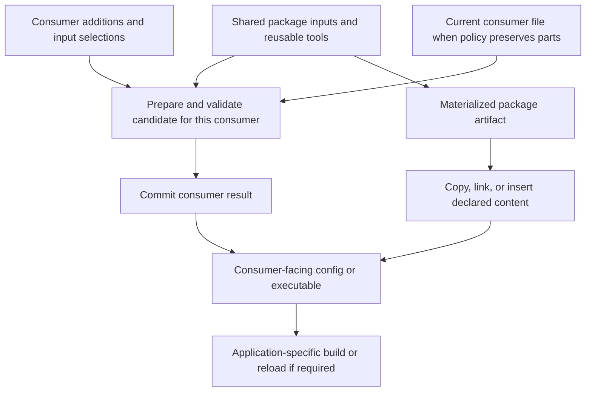

# Reusable configuration tools, explicit consumer contexts

Authoring note: the current assistant's exact underlying model identifier is
not exposed in this session; the `unknown` suffix is intentional. This is a
new assessment, not a replacement or acceptance of the previous drafts.

## Situation and verdict

The inciting incident was difficulty understanding what would change when
running Zim/Mise configuration and installation tools. Three-way inspection
grew into install-driving targets, scoped paths, user-local assembly, and
copy/link toolkits. The human now asks whether that expansion is organizing
the project around the right ideas, particularly after the historical
`install` / `install-user` split.

The question for this assessment is:

> Can Compfuzor provide reusable configuration and installation tools that
> operate for different consumers, preserve intended customization, and explain
> their effects—without creating parallel implementations for each scope?

**Draft3 contains valuable engineering and a plausible delivery toolkit. It is
not yet a sufficiently clear architectural destination for the broader
refactor. Reframe it; do not discard it or execute its entire commit list yet.**

The main tension is not copy versus link. It is whether Compfuzor primarily
delivers a package's answer to the user, or helps the user construct their own
answer from reusable package contributions. Both are useful. The latter was
explicitly called the primary direction in
[`brief`, D3](/.design/config-user-target/brief.glm53.md#L43-L60), but much of
draft3's machinery and implementation ordering centers the former.

Copy/link tools, a copy default, and generation/runtime bypasses were also
explicit human requests. Their inclusion is not evidence of agent-invented
scope. The architectural question is how to provide them without letting the
tool variants dictate the domain model.

## What deserves to survive

- **One declaration informing both apply and status.** This removes a real
  source of disagreement between handwritten installers and reporters.
- **Inspectable, directly invokable tools.** Compfuzor's generated toolkit is
  valuable independently of the original Ansible invocation. A single opaque
  deployment command would be a regression.
- **Copy and link as explicit choices, with one ordinary default.** Preserve
  the human's control without accidentally composing both operations.
- **Runtime user binding.** A globally deployed tool must not mean “the home
  of whoever rendered this playbook.”
- **Partial-file ownership.** Managed blocks can coexist with human text;
  whole-file delivery cannot make the same promise.
- **Real failure distinctions.** Committed source/output plus failed delivery
  must not be misreported as a wholly uncommitted operation. The
  `config-remote.ts` rollback concern is substantive.
- **Explicit privilege, collision checks, and deliberate cleanup.** Preserve
  separate privileged execution, refuse conflicting writers, and do not add
  automatic pruning.
- **Truthful inspection.** Keep `cmp` for comparisons and diff3 for the
  requested human presentation where three corresponding states exist.

These are good foundations, not reasons to freeze every derived field,
dispatcher family, or migration decision.

## Separate questions that system/user currently tends to bundle

| Question | Example | What it must not silently decide |
|---|---|---|
| Where is the reusable deployment? | `/opt/zim-main`, or a user-local deployment | Which consumer's config is being changed |
| Which consumer is this invocation for? | Invoking user's shell, a system daemon | Who rendered the original playbook |
| What configuration is selected for that consumer? | Shared fragments plus local additions and disabled choices | Merely where the final file is copied |
| What content may Compfuzor update? | A whole generated file, named blocks, one drop-in | Whether Unix file ownership permits a write |
| How is the result exposed and made effective? | Copy, link, direct assembly, then an application rebuild/reload if needed | Which merge/assembly policy defines the content |

These are analytical distinctions, **not a request for five new public
configuration objects**. A good interface derives ordinary answers and exposes
only meaningful variation.

The existing architecture already says “phase is when; intent is what” and
separates config assembly intent from filesystem effects
([`doc/arch.md`](/doc/arch.md#config-assembly-and-filesystem-effects)). The next
step should strengthen that distinction rather than turn user scope into a
second configuration subsystem.

### Keep the entry points; share the work

`install.sh` and `install-user.sh` are reasonable convenience and execution
entry points. Different credentials, user managers, and runtime roots remain
real differences even with perfect code reuse.

The architectural test is not whether two scripts exist. It is whether fixing
copy safety, block preservation, destination resolution, or status requires
fixing two implementations. A pair of wrappers over one operation and an
explicit execution context is healthy. A pair of independent configuration
pipelines is not.

The repo already has a concrete shared-tool precedent:
[`files/links/links.ts`](/files/links/links.ts) accepts a manifest, `--scope`,
and `--id`, and owns apply/status classification together. This is not a greenfield
need for a scope-parametric runtime.

The bounded GX code trace, checked against the relevant source here, makes the
picture more specific:

- **Systemd already demonstrates the desired shape.** Its wrappers set
  `UNIT_DIR`, `SYSTEMCTL`, and `SUDO_CMD`, then source one `install-unit.sh`
  implementation
  ([`vars_systemd_unit.tasks:388-414`](/tasks/compfuzor/vars_systemd_unit.tasks#L388-L414)).
  Separate scoped scripts do not imply duplicated algorithms.
- **Rust exposes a different problem: different operations hidden behind scope
  names.** `install-rust.sh` publishes existing build outputs; its user sibling
  runs `cargo install --path`, which has its own build/install lifecycle
  ([`common.yaml:396-459`](/vars/common.yaml#L396-L459)). Parameterizing the copy
  destination would not preserve both behaviors. Distinguish prebuilt artifact
  delivery from Cargo-managed installation before deciding what to share.
- **Composition already accepts explicit scope metadata**, while also inferring
  user scope from certain filename positions
  ([`bin_composers.py:146-164`](/library/filter_plugins/bin_composers.py#L146-L164)).
  New tools should carry explicit metadata instead of relying on a name such as
  `install-config-user-dropins.sh` to imply an execution context.

## A more useful center: reusable recipe, consumer-specific result

“Recipe” here just means the existing assembly declaration and its reusable
inputs—not a proposed new YAML keyword. “Consumer context” means enough
information to select the intended inputs, mutable choices, destinations, and
execution identity. It is more than a HOME override.

The two routes share location resolution and safe effect machinery. They do
not need to pretend to be the same operation:

- **Assembling** chooses inputs, orders/merges them, preserves whatever the
  declared content policy protects, and validates a candidate.
- **Publishing** exposes a known artifact at a destination through copy, link,
  or a managed insertion.
- **Activating** performs any application-specific action needed to use it.
  Zim's `init.zsh` build is not a byte copy of `zimrc`.

Direct assembly commits where the consumer reads; publication adds another
location when useful. A canonical `/etc/opt` aggregate need not exist merely
to make the diagram or a diagnostic have three slots.

Conversely, a canonical aggregate is not inherently wrong. It can be a useful
shared result, independent artifact, or intermediate for real consumers.

### Why destination parameterization alone is insufficient

Today the config compiler resolves the output and input paths together from
`dir` / `ETC`, then publishes one deployment-bound spec
([`config_compile.py:110-194`](/library/filter_plugins/config_compile.py#L110-L194)).
The remote tool loads that spec from its own deployment and mutates the named
input directory before rebuilding
([`config-remote.ts:70-115`](/files/config-remote.ts#L70-L115)).

Changing only the final destination to `${HOME}/...` does not answer:

- Does disabling a module affect this user or every consumer of the shared
  input set?
- Where does a user's additional fragment enter the recipe?
- Which consumer does a contribution rebuild?
- Can another user reuse the same tool without modifying the first user's
  selections or the global input registry?

For user-local assembly, these are more central than default copy/link
selection. This does not require an account database, arbitrary impersonation,
remote transport, or a generic graph scheduler. A reusable spec with a small,
explicit runtime binding may suffice; that is what the next example should
prove.

## Where draft3 needs reconsideration

### 1. A writable copy is not a customization contract

Draft2 explicitly says copy owns the whole file and replaces its bytes,
including user edits
([`draft2:492-505`](/.design/config-user-target/draft2.solx.md#L492-L505)).
Draft3 adopts that contract for the initial user-owned `zimrc`, then postpones
assembly from managed and local user drop-ins
([`draft3:491-508`](/.design/config-user-target/draft3.solx.md#L491-L508)).

This is a coherent snapshot-delivery mode. It is not yet “customize and still
have tools” in the sense of edits surviving ordinary tool use. A copy can
intentionally drift between installs, but the next install can replace it.

The missing product explanation is what kind of editing is supported:

- edits to Compfuzor-owned content are visible differences that an explicit
  apply may replace;
- unmanaged text or local input fragments are persistent customization;
- a whole-file fork is a different ownership agreement again.

Do not silently select one meaning for every consumer. For Zim, show a local
addition, a package update, and the subsequent apply before declaring Option B
to have delivered user customization.

### 2. The “two poles” describe topology, but risk becoming separate engines

Draft2 correctly notices that user scope does not imply direct assembly. Yet
its proposed direct mode is restricted to user scope and `block-in-file`
([`draft2:106-133`](/.design/config-user-target/draft2.solx.md#L106-L133)).

That can be a bounded first implementation. It should not become the enduring
claim that direct assembly is a user-only operation, or that a system config
must acquire an otherwise unnecessary intermediate to get a privileged write.

The current block processor already builds against the current output and
preserves other content regardless of where that output lives
([`config-processor.sh:34-58`](/files/config-processor.sh#L34-L58)). Its meaningful
variation is content ownership and input selection, not user versus system.

Keep differing privilege schedules, but seek shared candidate/commit semantics.
Also distinguish preservation of bytes from preservation of behavior: in shell
configuration, placement relative to unmanaged commands can matter.

### 3. The toolkit should be generated from shared capabilities, not multiplied

Draft3 introduces separate config-target, config-user-drop-in, and bin
dispatchers plus strategy variants, selectors, and bypass controls
([`draft3:200-287`](/.design/config-user-target/draft3.solx.md#L200-L287)).
The requested tools are useful. The smell is **repeated policy machinery per
surface**, not the number of executable entry points itself.

Treat those entry points as named selections of common operations where their
contracts really coincide. Keep application-specific behavior behind its own
interface. In particular, `config-user-dropins` should not require a fresh
system implementation when a system consumer later needs the same fan-out.

Availability, default selection, and the installed representation are distinct.
Draft3 usefully separates them, but its healthy-link status can coexist with
an ordinary no-override install that switches back to copy. That is permitted
policy, not an implementation error. The tool should nevertheless explain
“healthy link; ordinary apply would switch to copy” rather than leave the
operator to infer it from an environment-variable precedence table.

### 4. Reconcile with existing LINKS before creating another authority

The existing link compiler already normalizes artifact annotations, scope,
runtime roots, provenance, policies, and claims
([`artifact_links.py:220-354`](/library/filter_plugins/artifact_links.py#L220-L354)).
Its runtime classifies foreign destinations as permitted overrides under
`preserve`; other policies fail or replace
([`links.ts:391-472`](/files/links/links.ts#L391-L472)).

Draft3's proposed target plan needs an explicit relationship to this system:

- share or deliberately migrate path and destination classification;
- check conflicting writes across relevant config, artifact, and link records,
  not just inside each new plan;
- preserve meaningful differences in ownership policy rather than equating
  every operation ending in `ln -s`;
- identify which implementation owns each effect after migration.

There is also a concrete privilege mismatch to resolve before naive reuse:
the current link runtime defaults to writability-based `sudo` routing
([`links.ts:64-117`](/files/links/links.ts#L64-L117)); its mutation code does not
make `scope: user` intrinsically non-escalating. Draft3's no-escalation config
contract must not inherit that behavior by accident. This observation is not
a proposal to change the live link tool as part of this assessment.

One shared kernel of location/effect rules is attractive. One enormous
filesystem/config/package-management engine is not required.

### 5. Observation must follow the actual relationships

Keep the requested three-way diagnostic. Do not let it require an additional
copy in every architecture.

| Actual relationship | Useful observation |
|---|---|
| Inputs to generated output | Candidate versus output |
| Package artifact to installed copy/block | Artifact versus destination content |
| Direct partial-file assembly | Whether applying the declared policy would change the managed content |
| Explicit last-applied record exists | Candidate, recorded application, current managed content |
| Link exposure | Destination type, referent, and availability |
| Zim-generated startup code | Application-specific build freshness/health |

Three current streams show which relationships differ. They do not by
themselves prove who edited a file or provide a historical common ancestor for
automatic merging. A last-applied record has that historical role only if its
capture/update contract makes it trustworthy. A `.last` holding the *previous*
output is not automatically the right baseline.

Evidence sidecars are consequently a product tradeoff about explaining
history, not an unexplained storage checkbox. Two-way convergence is useful
when no independent baseline exists; three-way history can be added where
attribution matters. Neither changes the established `cmp`/diff3 decision.

Similarly, copying `jj` can make the installed executable survive build-output
cleanup, but source equality then becomes unavailable after cleanup. Distinguish
“installed file is present” from “can verify it against the current build.”
Copying one executable is not a general promise that its data/library/runtime
dependencies can also disappear.

### 6. Lifecycle composition needs an explicit consumer

The post-commit delivery contract is useful when the apply operation has
selected the intended consumer. A global reassembly should not gain a hidden
meaning of “refresh whichever user's HOME happens to be in this process,” nor
does it imply refreshing every user on the machine.

Retain composition as a convenience, but make the selected consumer and any
deferred system work visible. Separate operations need not force the human
through a manual checklist: a scoped entry point can orchestrate them.

## Three framings worth comparing

| Framing | Best at | Limitation |
|---|---|---|
| **Artifact delivery toolkit**: an artifact advertises destinations and copy/link/block tools | Removing bespoke installs; binaries; native drop-in consumers; a bounded draft3 implementation | User customization stays downstream unless consumer-local assembly is separately first-class |
| **Consumer-bound configuration**: shared recipes and contributions produce a result for an explicit consumer | The primary customization goal; shared deployments serving independent users; understandable selection/rebuild behavior | Must settle input-set and mutable-state binding, not only destination paths |
| **Compiled effect plan**: shared location/claim/writer contracts under config, LINKS, and artifacts | Eliminating duplicated filesystem policy and enabling different executors later | Easy to overbuild into a second configuration-management framework |

**Recommended combination:** use consumer-bound configuration as the product
model, a small amount of shared effect machinery as the implementation seam,
and retain the artifact delivery toolkit as a useful route through it.

These are complementary domain groupings, not a requirement to introduce three
new subsystems immediately. Exact schemas, file moves, new scope kinds, remote
execution, and a general dependency engine remain unselected.

## The six open questions are not all architectural gates

The [status handoff](/.design/config-user-target/status.glm53.md#L109-L139)
frames the work as implementation-ready modulo six choices. That understates
the unresolved ownership and consumer-binding questions above.

| Existing question | More useful treatment now |
|---|---|
| User log/system share roots | A location-profile convention, not the center of the refactor. Preserve the useful staging-versus-consumer distinction; decide when a concrete consumer exercises it. |
| Evidence default | Ask whether users need historical attribution or merely an exact preview of required changes; explain the missing-baseline case. |
| Strategy preference persistence | Show what the next ordinary install does after an explicit link choice. Decide persistence from that workflow. |
| Healthy nondefault representation | Distinguish current health from planned changes; neither has to hide the other. |
| Whole-file alternatives for aggregate blocks | Not a useful open choice if it destroys protected text. Keep the content-preservation contract. |
| Populate currently unused Zim drop-ins | Defer unless a current tool consumes them or a concrete migration requires them. Inactive copies add another apparent source of truth. |

The problem with these questions is not that the human cannot understand the
project. Several ask for low-level defaults before explaining the behavior
those defaults buy. The safety question even presents a destructive alternative
that the design already rules out.

## Recommended next checkpoint, not implementation authorization

Pause the broad 16-commit execution plan. Preserve the existing documents and
the human's prior preferences as evidence. The current request explicitly
reopens the overall framing; a handoff's “locked” label should not prevent
assessing how those preferences fit together.

Write one short operational walkthrough before another comprehensive schema:

1. A reusable deployment offers config inputs and tools.
2. Two consumer contexts use those tools without rerendering a deployment for
   each; input selections and mutable state are independent where intended.
3. One consumer adds local text/a fragment and disables one contribution.
4. A package contribution changes.
5. Preview says exactly what ordinary apply would change and what it preserves.
6. Apply updates the selected consumer; the other consumer is unchanged.
7. The same assembly/effect code can operate at a system destination through an
   explicit privileged executor, without inventing a second content algorithm.
8. A block update, a Jujutsu-style native drop-in, and a copied executable retain
   their distinct contracts while reusing appropriate machinery.

This walkthrough can start on paper. Any later prototype should use scratch
homes/system roots, not mutate live shell configuration, and should test
failure/retry as well as a clean run. No all-user enumeration or implicit sudo
is implied.

The first question worth bringing back to the human is concrete:

> After you customize your Zim configuration and a package contribution changes,
> what should running the ordinary tool preserve, refresh, and ask permission
> about?

Offer concrete behaviors that can coexist per surface: managed blocks plus
local text, local input fragments, replaceable snapshots, or deliberately
independent forks. Recommend a behavior for the actual example rather than
requiring the human to invent the architecture through a questionnaire.

**Success criterion:** the human can predict a tool's effect without knowing
which historical system/user generator emitted it or memorizing its bypass
and strategy precedence tables.

## Cross-references and evidence limits

- [`brief.glm53.md`](/.design/config-user-target/brief.glm53.md): primary
  direction toward user-owned assembly and scope-neutral destinations; this
  assessment distinguishes those goals from proposed implementation choices.
- [`draft3.solx.md`](/.design/config-user-target/draft3.solx.md) and
  [`draft2.solx.md`](/.design/config-user-target/draft2.solx.md): the toolkit,
  lifecycle, direct-assembly, and safety proposals being retained or questioned.
- [`doc/arch.md`](/doc/arch.md#config-assembly-and-filesystem-effects): the
  existing separation of assembly intent from filesystem effects that should
  guide this refactor.
- [`global-usermode` assessment and addendum](/.design/global-usermode/init0.opencode.md):
  globally deployed artifacts with runtime user activation; importantly, its
  addendum says `fsh` closed an earlier path-vocabulary gap. Do not repeat the
  older “separate is broken” finding as timeless current truth.
- [`link-script/draft2-0.gpt56.md`](/.design/link-script/draft2-0.gpt56.md):
  prior shared scoped manager and preserve-policy design. The actual
  [`link runtime`](/files/links/links.ts) must also be read because privilege
  behavior has evolved beyond that document.
- [`fs-pipeline/draft0.gpt56.md`](/.design/fs-pipeline/draft0.gpt56.md#option-f-generate-a-filesystem-bundle-and-apply-it-later):
  already explores deferred file application, multi-user reuse, and the risk
  of duplicating configuration management. Its ownership and privilege
  questions are directly relevant; its performance/backend options need not
  enter this task.
- [`config-mcp/draft2.gpt56t.md`](/.design/config-mcp/draft2.gpt56t.md#module-seam):
  earlier reasoning about contribution producers versus consumer assemblies.
  This is conceptual prior art, not the current schema: the implemented
  compiler is filename-keyed and should not be described as having that draft's
  nested instance DAG.
- [`doc/bins.md`](/doc/bins.md): the scoped command hierarchy is an invocation
  interface, not proof of duplicated implementations or automatic scheduling.

This is a source/design assessment, not a live deployment audit or a tested
replacement implementation. No production behavior has been changed. Historical
claims about installed `jj`, Zim, and Mise are treated as motivating reports,
not freshly verified current state. Existing working-copy code changes were
read as current evidence and left untouched.
