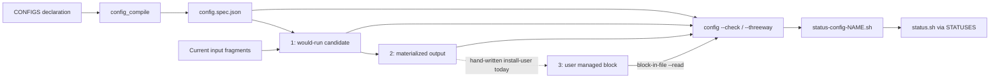

# Config user-file targets and three-way drift status

> **Authoring model:** GPT-5.6 Sol xhigh (`solx`).

## Recommendation

Add an optional, per-config **`user_targets` list** to `CONFIGS`. Each target
declares a user-owned file and a block-in-file block name. Compile the list into
that config's `config.spec.json` record. In the first release it is
**status-only**: it neither creates the user file nor installs or updates the
block.

Give the runtime two related surfaces:

1. `config.sh --threeway NAME` is the explicit diagnostic. It always identifies
   slots 1/2/3 and runs `diff3` for every declared target.
2. Existing `config.sh --check [NAME]` becomes the complete status check. It
   retains its current candidate-versus-output check and additionally checks
   every declared user target. Therefore the generated `status-config-NAME.sh`
   bins gain user drift automatically. The aggregate `status.sh` gains it too
   wherever the generic STATUSES orchestrator is not shadowed by an authored
   same-name bin; Zim currently has that collision and should migrate its custom
   body to a named reporter.

Use `block-in-file --read`; do not add a sed fallback. Keep install behavior in
the existing `install-user.sh` bins until a richer deployment declaration can
express creation, placement, transforms, privilege, and user selection.

Do **not** put Zim's `.zshenv`/`.zshrc` blocks on `CONFIGS.zimenv` or
`CONFIGS.zimrc`: those blocks contain separate `ETC_FILES` loaders, not copies
of the config outputs. The first runtime test should use a purpose-built config
fixture. The first production migration should be a config that truthfully
becomes a managed block, with `clickpad.user.pb` the best current candidate.
`ETC_FILES` targets should reuse the descriptor in a follow-up artifact-status
design, but they offer only materialized-versus-user status unless ETC_FILES
also gains a runtime preview producer.

## The problem in the user's tri-state terms

A declared config can have three simultaneously meaningful byte streams:

1. **would-run** — what current inputs produce if config runs now:
   `config.sh --stdout NAME`;
2. **materialized** — the last atomically committed config output;
3. **user** — a copy of that output embedded as a named managed block in a
   user-owned file.

The first two are already first-class. The third is currently known only to
hand-written installers and status code. The desired diagnostic is:

```bash
diff3 \
  <(config.sh --stdout NAME) \
  "$OUTPUT" \
  <(block-in-file --read -n "$BLOCK" "$USER_FILE")
```

For the common one-sided cases GNU `diff3` gives exactly the useful attribution:

| Section | Agreement | Interpretation |
|---|---|---|
| `====1` | materialized = user | source/current-input change is unique to would-run |
| `====2` | would-run = user | materialized output is uniquely stale or altered |
| `====3` | would-run = materialized | user block is uniquely stale or edited |
| `====` | no two slots agree | mixed drift requiring inspection |

`diff3`'s exit status is **not** a drift detector: GNU diff3 returns 0 for
successful reports containing one-sided differences. Status must use `cmp` (or
equivalent byte comparisons) and use `diff3` only as the explanatory surface.



The declaration closes the missing edge from the compiled spec to slot 3. It
does not make config responsible for installing slot 3.

## Surveyed mechanics

### Declaration to compiled spec

- Zim declares two filename-keyed config outputs, `zimrc` and `zimenv`, with
  block-in-file processors, validation commands, remote globs, and stale-block
  removal at [`zim.opt.pb:11-33`](/zim.opt.pb#L11-L33).
- [`sub_config.tasks:2-8`](/tasks/compfuzor/sub_config.tasks#L2-L8) resolves
  `CONFIGS`, calls `config_compile(ETC, BINS_DIR,
  CONFIG_DISABLED_SUFFIX)`, and publishes the result under
  `SUBSYSTEM.config`.
- [`config_compile.py:110-124`](/library/filter_plugins/config_compile.py#L110-L124)
  turns each output key into a unique config name and output path.
  [`config_compile.py:126-143`](/library/filter_plugins/config_compile.py#L126-L143)
  validates processor, validation command, block settings, and disabled suffix;
  [`config_compile.py:145-223`](/library/filter_plugins/config_compile.py#L145-L223)
  normalizes ordered file/glob inputs and remote/mutable glob metadata.
- The normalized config record currently contains `output`, `processor`,
  `inputs`, `validate`, and `apply` at
  [`config_compile.py:225-233`](/library/filter_plugins/config_compile.py#L225-L233).
  This is the precise insertion point for compiled `user_targets`.
- For every config the compiler emits an internal processor leaf,
  `config-NAME.sh`, and `status-config-NAME.sh`; the status bin executes the
  config bin with `--check` and is appended to `STATUSES` at
  [`config_compile.py:237-242`](/library/filter_plugins/config_compile.py#L237-L242).
- The returned spec is `{configs, remotes}`
  ([`config_compile.py:259-264`](/library/filter_plugins/config_compile.py#L259-L264)).
  `config_publish` contributes it as `config.spec.json`, along with generated
  bins, statuses, directories, and `jq`
  ([`config_compile.py:267-283`](/library/filter_plugins/config_compile.py#L267-L283)).
- [`gen_config.tasks:6-12`](/tasks/compfuzor/gen_config.tasks#L6-L12) merges
  those contributions into the shared `DIRS`, `ETC_FILES`, `BINS`, `STATUSES`,
  and `PKGS` globals.

The phase order is deliberate: config is compiled and synthesized at
[`compfuzor.includes:62-68`](/tasks/compfuzor.includes#L62-L68), compiled
filesystem artifacts follow at
[`compfuzor.includes:104-106`](/tasks/compfuzor.includes#L104-L106), status is
finalized at [`compfuzor.includes:111-117`](/tasks/compfuzor.includes#L111-L117),
and files/bins are materialized before runnable bins execute at
[`compfuzor.includes:188-210`](/tasks/compfuzor.includes#L188-L210).

The deployed `/etc/opt/zim-main/config.spec.json:2-62` confirms the runtime
shape: each channel has an absolute output, normalized input, processor,
validator, and apply bit, but no user destination.

### Candidate, check, and commit runtime

[`config-run.sh:11-45`](/files/config-run.sh#L11-L45) parses `--check`, the new
`--stdout`, `--list`, quiet mode, and an optional target. With no target it
selects configs whose `apply` bit is true; generated per-config bins always pass
an explicit name.

For every selected config the runtime:

1. reads output and validation metadata and creates a transaction
   ([`config-run.sh:47-59`](/files/config-run.sh#L47-L59));
2. turns normalized file/glob inputs into a processor manifest
   ([`config-run.sh:61-79`](/files/config-run.sh#L61-L79));
3. invokes the internal processor leaf and validates its candidate
   ([`config-run.sh:81-112`](/files/config-run.sh#L81-L112));
4. streams the candidate byte-exactly in `--stdout` mode
   ([`config-run.sh:113-118`](/files/config-run.sh#L113-L118));
5. compares candidate to materialized output in `--check`, or queues changed
   outputs for an atomic multi-output commit
   ([`config-run.sh:119-155`](/files/config-run.sh#L119-L155)).

The early `continue` when candidate equals output at
[`config-run.sh:119-121`](/files/config-run.sh#L119-L121) must move when user
targets land. Equality of slots 1 and 2 cannot skip checking slot 3.

The deployed `/opt/zim-main/bin/config.sh:84-237` is the rendered form of the
same runtime, wrapped with env, strict-shell, reporting, and bypass helpers. The
env helper matters: `$HOME` should be resolved for the user invoking status,
not frozen to the account that rendered the playbook.

### Generated status path

- Every generated `status-config-NAME.sh` delegates to
  `config-NAME.sh --check`; the deployed
  `/opt/zim-main/bin/status-config-zimrc.sh:77-82` demonstrates the wrapper and
  config/status bypass guards.
- `gen_config.tasks` has already inserted those bin names into `STATUSES` before
  [`gen_status.tasks:13-21`](/tasks/compfuzor/gen_status.tasks#L13-L21)
  synthesizes the status artifacts.
- The status subsystem activates whenever a reporter exists and emits the
  aggregate bin at [`vars/common.yaml:730-739`](/vars/common.yaml#L730-L739).
- [`files/status/status.sh:10-35`](/files/status/status.sh#L10-L35) runs the
  baked reporter list in order. Its contract is 0 clean, 1 drift, and 2
  not-applicable; unexpected reporter failures are also surfaced as aggregate
  drift.

This path means user-target status does not need a new `STATUS_USER_FILES`
provider or changes to `gen_status.tasks`. Deepen the config reporter already
owned by each config.

There is one verified composition exception. Zim authors a `BINS` entry named
`status.sh` at [`zim.opt.pb:298-351`](/zim.opt.pb#L298-L351). The deployed
`/opt/zim-main/bin/status.sh:81-131` contains that custom body, not the generic
`REPORTERS=(...)` loop, even though the generated `status-config-zimrc.sh` and
`status-config-zimenv.sh` exist. A content-bearing bin wins rendering over the
later same-name `src` record because [`bins.tasks:24-40`](/tasks/compfuzor/bins.tasks#L24-L40)
renders contentful records directly, while wrapped `src` records are only
selected when the record is not contentful
([`bins.tasks:41-72`](/tasks/compfuzor/bins.tasks#L41-L72)).

The clean fix is independent of `user_targets`: rename Zim's authored body to
`status-zim.sh`, add it to `STATUSES`, and let the generic `status.sh` orchestrate
it alongside both config reporters. Direct per-config status works without that
cleanup; aggregate status does not.

### Current block installs are separate effects

Zim's installer first promotes fragments and runs config, then installs two
loader files as managed blocks:

- `/opt/zim-main/etc/zimenv.zsh` into `.zshenv` as `zim-main-zimenv`;
- `/opt/zim-main/etc/zimrc.zsh` into `.zshrc` as `zim-main-zimrc`.

The declarations are at [`zim.opt.pb:281-297`](/zim.opt.pb#L281-L297). The
loaders themselves are separate `ETC_FILES` beginning at
[`zim.opt.pb:352-380`](/zim.opt.pb#L352-L380). Zim's hand-written status uses a
sed range and explicitly removes `# source:` metadata at
[`zim.opt.pb:330-349`](/zim.opt.pb#L330-L349).

Mise has the simpler version of the same pattern: two `ETC_FILES` at
[`mise.opt.pb:27-35`](/mise.opt.pb#L27-L35), copied into `.bashrc` and
`.bash_profile` by block-in-file with `-C true` at
[`mise.opt.pb:47-68`](/mise.opt.pb#L47-L68). The deployed files contain a
`# source: /opt/mise-main/etc/...` line immediately after each opening marker.

These examples prove the deployment relationship and the need for reusable
status, but neither currently proves `CONFIG output -> user block`.

### `block-in-file --read`

The first-party reader is the correct slot-3 producer:

- [`README.md:89,124`](https://github.com/jauntywunderkind/block-in-file/blob/main/README.md#L89)
  specifies byte-exact body output, excluding markers and provenance, and exit
  1 for a missing block;
- [`src/block-reader.ts:27-81`](https://github.com/jauntywunderkind/block-in-file/blob/main/src/block-reader.ts#L27-L81)
  matches tagged markers, captures source provenance separately, and excludes
  it from the returned body;
- [`test/read-cli.test.ts:32-67`](https://github.com/jauntywunderkind/block-in-file/blob/main/test/read-cli.test.ts#L32-L67)
  verifies exact output, trailing-newline round trips, missing blocks, and
  unreadable files.

The CLI supports a custom comment prefix as well. The first config contract can
carry that small part of block identity without becoming an installer schema.

## Proposed declaration and compiled shape

### Public YAML

Use a plural field and a list even for one target:

```yaml
CONFIGS:
  shellrc:
    processor: concat
    inputs:
      - glob: shellrc.d/*.conf
    user_targets:
      - file: "$HOME/.shellrc"
        name: compfuzor-shellrc
```

Multiple destinations are ordered and mean that the same materialized config
bytes are expected in every named block:

```yaml
CONFIGS:
  shared-env:
    processor: concat
    inputs:
      - glob: shared-env.d/*.conf
    user_targets:
      - file: "$HOME/.profile"
        name: compfuzor-shared-env
      - file: "$HOME/.bash_profile"
        name: compfuzor-shared-env
```

Canonical target fields:

| Field | Required | Meaning |
|---|---|---|
| `file` | yes | Absolute or explicitly home-rooted user file path |
| `name` | yes | Exact block-in-file block name |
| `comment` | no | Marker/provenance comment prefix; default `#` |

`name` is required rather than defaulting to the config name. Existing block
names encode deployment identity (`zim-main-zimrc`, `mise-main`) and accidental
defaults would silently inspect a different block. The compiler should reject
unknown target keys, empty values, newlines/NULs, invalid block names, and
duplicate `(normalized file, comment, name)` identities across the complete
`CONFIGS` mapping. Like output ownership, two configs claiming one managed block
is ambiguous and should fail compilation. The same name in different files is
valid.

Do not put install flags (`create`, `before`, `after`, `envsubst`, or source
attribution) here. They do not affect how an already installed body is read and
would blur status observation with deployment policy.

If custom marker-start/end strings are already a required consumer case, add
`marker_start` and `marker_end` as optional reader identity fields before the
first release. Otherwise defer them until a real non-default block appears;
all relevant in-tree installs currently use `start`/`end`.

### User path semantics

User paths must resolve at **status runtime**, for the invoking user. They must
not be joined to `ETC`, and `posixpath.normpath` must not leave a quoted `~`
that the shell will treat literally.

Recommended first grammar:

- `/absolute/path` — lexical normalization at compile time, no runtime change;
- `~` and `~/...` — compiled to `${HOME}` and `${HOME}/...`;
- `$HOME`/`${HOME}` and descendants — compiled to the same `${HOME}` form;
- reject other relative paths and other shell expressions.

At runtime substitute only the recognized leading `${HOME}` token. Do not use
`eval`. This safely handles paths with spaces and makes `~` and `$HOME`
equivalent for duplicate detection.

This deliberately does not yet model current installer overrides such as
`${ZDOTDIR:-$HOME}` or `${BASH_RC:-$HOME/.bashrc}`. If those must be status
inputs in version one, use a structured path form rather than arbitrary shell
evaluation, for example:

```yaml
file:
  env: ZDOTDIR
  default: "$HOME"
  suffix: .zshenv
```

That broader form is an open decision below. A simple string covers the common
per-invoking-user case and keeps the first compiler/runtime change focused.

### Compiled JSON

Compile public spelling into one canonical list under the normalized config:

```json
{
  "configs": {
    "shellrc": {
      "output": "/etc/opt/example/shellrc",
      "processor": "concat",
      "inputs": [
        {
          "glob": "/etc/opt/example/shellrc.d/*.conf",
          "directory": "/etc/opt/example/shellrc.d",
          "pattern": "*.conf",
          "name": "shellrc.d",
          "disabled_suffix": ".disabled",
          "remote": false
        }
      ],
      "validate": null,
      "apply": true,
      "user_targets": [
        {
          "file": "${HOME}/.shellrc",
          "name": "compfuzor-shellrc",
          "comment": "#"
        }
      ]
    }
  }
}
```

Always compile `comment` explicitly. Omit `user_targets` when undeclared rather
than emitting an empty list; presence then remains a useful capability signal
to other spec consumers. Preserve declaration order for stable status output.

`user_targets` is per config, not top-level, because slot 1 and slot 2 come from
that config record and the relationship is meaningless without their identity.

## Real playbook examples and the Zim boundary

### Zim: the tempting declaration is wrong

This must **not** be added to the current Zim declarations:

```yaml
CONFIGS:
  zimrc:
    processor: block-in-file
    # ...
    user_targets:                  # WRONG for current zim.opt.pb
      - file: "$HOME/.zshrc"
        name: zim-main-zimrc
```

Slot 1 would be a list of `zmodule` declarations assembled from `zimrc.d`; slot
2 would be `/etc/opt/zim-main/zimrc`; slot 3 would be the executable loader from
`/opt/zim-main/etc/zimrc.zsh`. They are intentionally different documents.
The same mismatch exists between `CONFIGS.zimenv` and `zimenv.zsh`.

The truthful future metadata belongs to the loader artifact:

```yaml
# Follow-up artifact-target design, not part of this CONFIGS patch.
ETC_FILES:
  - name: zimenv.zsh
    user_targets:
      - file: "$HOME/.zshenv"
        name: zim-main-zimenv
    content: |
      # existing loader body ...
  - name: zimrc.zsh
    user_targets:
      - file: "$HOME/.zshrc"
        name: zim-main-zimrc
    content: |
      # existing loader body ...
```

That would replace Zim's hand-written materialized-versus-user sed check with
block-in-file `--read`. It would **not** provide slot 1 from `config.sh`, because
an `ETC_FILES` template has no deployed runtime renderer. Calling it a config
three-way check would be misleading.

### Mise: same target descriptor, also currently ETC_FILES

The current Mise relationship can be represented truthfully only as artifact
metadata:

```yaml
# Follow-up artifact-target design.
ETC_FILES:
  - name: mise.bashrc
    user_targets:
      - file: "$HOME/.bashrc"
        name: mise-main
    content: |
      eval "$(mise activate bash)"
  - name: mise.bash_profile
    user_targets:
      - file: "$HOME/.bash_profile"
        name: mise-main
    content: |
      eval "$(mise activate bash --shims)"
```

Do not manufacture one-input `CONFIGS` merely to make these records consume the
new field. That would turn config assembly into an adapter for metadata that
belongs to compiled file artifacts. Mise is the best first consumer of a later
`ETC_FILES.user_targets` two-way status provider because its two existing
blocks are small, direct copies with provenance and no Zim-specific runtime
indirection.

### Valid production migration candidate: Clickpad

[`clickpad.user.pb:7-21`](/clickpad.user.pb#L7-L21) already assembles
`.xinitrc.d/*` directly over the whole user-owned `.xinitrc`. It can truthfully
move the config output to a durable package path and make `.xinitrc` a managed
block target:

```yaml
ETC_FILES:
  - clickpad.xinitrc
FILES:
  - name: .xinitrc.d/foo
    src: clickpad.xinitrc
DIRS:
  - .xinitrc.d

CONFIGS:
  xinitrc:
    dir: "{{ ETC }}"              # materialized slot 2, outside the input glob
    name: clickpad
    processor: concat
    disabled_suffix: false
    inputs:
      - glob: .xinitrc.d/*
        dir: "{{ HOMEDIR }}"
    user_targets:
      - file: "$HOME/.xinitrc"
        name: clickpad

BINS:
  - name: install-user.sh
    content: |
      block-in-file -C true -n clickpad -i "{{ ETC }}/xinitrc" -o "$HOME/.xinitrc"
```

This gives a real `candidate -> materialized config -> user block` chain rather
than creating fake assembly. Migration must preserve or explicitly review an
existing whole-file `.xinitrc` before inserting the managed block, so this
should follow the runtime work and its tests rather than be bundled into the
compiler change.

## Semantics

### Status-only now; installation remains explicit

`user_targets` asserts: **if this config is declared, these user blocks are
expected to contain the materialized config bytes**. Therefore:

- an absent target file or absent named block is drift (exit 1), not
  not-applicable;
- a present but different block is drift;
- declaring no targets preserves current two-way config behavior;
- config apply updates only the materialized output. It never changes a user
  file;
- `install-user.sh` remains the explicit repair/apply surface.

This scope is necessary because `{file, name}` cannot reproduce current install
semantics. Mise needs `-C true`; other callers use placement, alternate comment
syntax, env substitution, or privilege. Config bins may also run automatically
or under an account different from the intended user. Making config apply drive
the install from this incomplete record would create surprising user-file
effects and violate the documented config/filesystem seam at
[`doc/arch.md:678-690`](/doc/arch.md#L678-L690).

A future install-driving declaration should be a separate concept—possibly a
compiled user-block deployment artifact—with explicit source, create policy,
placement, transforms, ownership/user scope, and apply bin. `user_targets` can
then be derived from that richer declaration; it should not grow installer
flags one at a time.

### Runtime modes

#### `config.sh --threeway NAME`

- Requires exactly one explicit config name.
- Returns 2 when that config has no `user_targets` (not applicable).
- Generates and validates the candidate once, then compares each declared
  target in order.
- Prints a legend before each diff because default `diff3` uses numeric section
  identities:

  ```text
  config: clickpad
  1 would-run: candidate from current inputs
  2 materialized: /home/me/.config/clickpad/xinitrc
  3 user: /home/me/.xinitrc [block clickpad]
  ```

- Returns 0 only when all three slots are byte-identical for all targets; 1 for
  any drift, missing declared slot, unreadable target, or required-tool failure.
- Honors `--quiet` by suppressing diff bodies while retaining the result.
- Is mutually exclusive with apply, `--stdout`, and `--list` modes.

The diagnostic should store all three streams in files and invoke `diff3` with
file paths. Do not put slot 3 into a shell variable: command substitution strips
trailing newlines and would break the byte-exact contract.

#### Existing `config.sh --check [NAME]`

Keep `--check` as the generated status API. For each config:

1. generate and validate slot 1;
2. compare slot 1 to slot 2 exactly as today;
3. if targets exist, read and compare every slot 3;
4. on drift, print the same three-way legend and `diff3` report per target;
5. if no targets exist, preserve the current unified two-way diff.

This makes direct `config.sh --check`, per-config status bins, and aggregate
`status.sh` agree on what "config status" means. A separate
`status-config-user-NAME.sh` would run the expensive candidate producer twice,
split one config's state across reporters, and complicate ordering without
adding a useful boundary.

The generated `status-config-NAME.sh` bodies can remain unchanged because they
already pass `--check`. `gen_status.tasks` and the status subsystem also remain
unchanged. Playbooks that author their own `status.sh` body must first move that
body into a uniquely named STATUSES reporter; otherwise their custom bin masks
the aggregate orchestrator, as Zim currently demonstrates.

### Exit behavior

| Condition | `--check` / reporter | explicit `--threeway NAME` |
|---|---:|---:|
| candidate, output, and every target agree | 0 | 0 |
| candidate differs from output | 1 | 1 |
| target file/block missing or differs | 1 | 1 |
| no target declared | normal two-way 0/1 | 2 (not applicable) |
| block reader or diff3 unavailable/fails | 1 with diagnostic | 1 with diagnostic |
| invalid CLI usage / unknown config | 2 | 2 |

There is an existing CLI-level overlap between exit 2 for bad usage and the
reporter convention's exit 2 for not-applicable. Generated reporter invocations
are valid, so this does not change aggregate behavior, but a later CLI cleanup
could separate usage from reporter semantics.

### Slot 3: depend on block-in-file, no inline sed

Use the same override as the config block processor:

```bash
block_reader=${CONFIG_BLOCK_IN_FILE:-block-in-file}
"$block_reader" --read \
  --comment "$comment" \
  -n "$name" \
  "$resolved_file" >"$user_candidate"
```

Pass custom marker flags too if they enter the declaration contract.

Do not fall back to the Zim sed pipeline. The first-party reader already owns:

- tagged marker matching;
- marker and provenance exclusion;
- trailing-newline round trips;
- custom comment prefixes;
- missing/unreadable diagnostics.

A fallback would be a second, less-correct parser and would make status results
depend on which binary happened to be installed. Let the declared integration
fail clearly. When at least one target is compiled, add `diffutils` to config's
package contribution for GNU `diff3`; block-in-file remains an explicit
first-party runtime prerequisite rather than an apt package.

### Explicit declaration versus `# source:` discovery

Provenance makes declaration-free discovery attractive: scan candidate user
files for `# source: OUTPUT` and infer `(file, block name)`. That is useful as a
migration or audit tool, but it is not a sound status contract:

- status would first need an undeclared search set of user files;
- a missing target—the most important install drift—cannot be discovered;
- source paths may use `/opt/NAME/etc/...` versus `/etc/opt/NAME/...` symlink
  spellings;
- provenance can be disabled, stale, or `<STDIN>`;
- marker comments and names are part of identity;
- recursively scanning a user's home is expensive and intrusive.

An explicit target states intent before the block exists and bounds all reads.
`# source:` remains valuable evidence: it lets an inventory command suggest
declarations and lets a future structured `block-in-file inspect --json`
cross-check source metadata. The first three-way status should compare the body
only, as `--read` does; it should not parse or reject provenance spelling.

## First-consumer plan

1. **Integration fixture first.** Extend the config integration fixture with a
   concat config whose materialized output is installed into one or two managed
   blocks. Cover all `====1`/`====2`/`====3`/mixed cases and exit codes without
   depending on a production playbook migration.
2. **Clickpad as the first CONFIGS production consumer.** Move the existing
   whole-file `.xinitrc` output to a durable materialized path, retain its
   `.xinitrc.d` producer, and install that output as a named block. This is a
   genuine three-stage config rather than an ETC file disguised as one.
3. **Do not attach current Zim loaders.** Retain Zim's hand-written status until
   artifact targets exist, or replace its sed body extraction directly with
   `block-in-file --read` as an independent cleanup.
4. **Repair Zim's status composition separately.** Rename the authored
   `status.sh` body to `status-zim.sh`, register it in `STATUSES`, and restore the
   generic aggregate `status.sh` so existing config reporters are reachable.
5. **Follow with compiled artifact targets.** Reuse the exact target descriptor
   on normalized `ETC_FILES` copy artifacts. Mise should adopt that two-way
   materialized/user status first; Zim follows after deciding how ZDOTDIR paths
   are represented. Keep the provider distinct from config so it does not
   promise a nonexistent ETC_FILES would-run slot.

This ordering proves the requested config feature without forcing unrelated
artifacts through config assembly, then generalizes only after the compiled
filesystem seam has a concrete status consumer.

## OPEN QUESTIONS for the human

1. **Public spelling:** accept the recommended canonical
   `user_targets: [{file, name}]`, or prefer singular `user_target` now and defer
   multiple targets? I recommend the plural list only; aliases create permanent
   surface for little benefit.
2. **Default status depth:** should generated `status-config-*` bins include
   slot 3 through enhanced `--check` (recommended), or should user drift appear
   only when an operator explicitly asks for `--threeway`?
3. **Path variability:** is runtime `$HOME` enough for the first release, or
   must declarations follow `ZDOTDIR`, `BASH_RC`, and similar overrides? If
   overrides are required, should the file field gain the proposed structured
   `env/default/suffix` form?
4. **Missing installation:** does a declared but missing user block mean drift
   (recommended), or not-applicable until an independent activation signal says
   `install-user.sh` has run? The latter requires another field or state source.
5. **Provenance:** should status compare only body bytes (recommended), or also
   require the stamped `# source:` to identify the declared materialized output?
   Requiring it needs a structured block-in-file inspection API and symlink-path
   equivalence rules.
6. **First production consumer:** approve Clickpad's whole-file-to-managed-block
   migration, choose Screen's analogous `.screenrc` path, or leave production
   adoption until a new natural config-copy consumer appears?
7. **ETC_FILES follow-up:** should artifact-level `user_targets` be designed
   immediately after this work so Mise and Zim can remove hand wiring, or remain
   out of scope until the filesystem apply pipeline is deepened further?
8. **Zim status composition:** should the existing authored `status.sh` be moved
   to a registered `status-zim.sh` as part of this effort (recommended), or be
   left as a separately tracked cleanup even though it currently masks all
   aggregate STATUSES reporters?

## Ordered implementation steps

1. Record the human decisions above and freeze the public/compiled target
   contract, especially path expansion and missing-install semantics.
2. Add compiler normalization and validation for `user_targets`; compile home
   spellings canonically and preserve target order. Add filter tests for absent,
   single, multiple, duplicate, malformed, and unsupported-path declarations.
3. Add target records to the normalized per-config spec without changing apply
   selection, output ownership, remote inputs, or generated status registration.
   Contribute `diffutils` only when a target exists.
4. Refactor `config-run.sh` mode parsing so apply, stdout, check, list, and
   threeway are explicit mutually exclusive modes. Preserve the byte-exact
   `--stdout` path.
5. Refactor candidate generation so check/threeway can retain the validated
   candidate long enough to inspect targets. Remove the slot-1/slot-2 equality
   early-continue before target checks.
6. Implement the narrow, non-`eval` user-path resolver. Read each block to a
   transaction file through `${CONFIG_BLOCK_IN_FILE:-block-in-file} --read`;
   never use command substitution for content.
7. Compute status with bytewise pair comparisons. Print numbered legends and
   default-format `diff3` diagnostics, but never derive drift from diff3's exit
   code. Handle absent output, file, block, reader, and diff3 explicitly.
8. Integrate the target check into `--check`; add direct `--threeway NAME` as
   the diagnostic surface. Keep generated status bins and `gen_status.tasks`
   unchanged.
9. Move any authored same-name `status.sh` body—currently Zim's—to a uniquely
   named registered reporter so the generic aggregate surface actually invokes
   `status-config-*`. Commit this composition cleanup separately from target
   semantics.
10. Extend integration coverage for exact trailing newlines, spaces in paths,
   custom comment prefixes, multiple targets, all one-sided drift slots, mixed
   drift, missing target/block, tool failure, quiet mode, and configs without
   targets. Verify existing `--stdout`, atomic apply, and two-way status tests.
11. Update [`doc/arch.md`](/doc/arch.md) after behavior lands, documenting the
    status-only boundary and exit contract.
12. Migrate the selected real config consumer in a separate commit, with a
    deliberate transition for any existing whole-file user output.
13. Open the artifact-target follow-up using the same target descriptor for
    `ETC_FILES`, explicitly labeling its initial status as two-way rather than
    config three-way.

## Cross-references

- [`doc/arch.md:678-763`](/doc/arch.md#L678-L763) defines config assembly,
  filesystem effects, compiled runtime state, processor leaves, and current
  status behavior. This proposal deepens that existing config status seam.
- [`/.design/config-mcp/draft2.gpt56t.md`](/.design/config-mcp/draft2.gpt56t.md)
  argues that config owns assembly while filesystem declarations own concrete
  file effects. That boundary is why this proposal does not make status-only
  targets drive installation.
- [`/.design/fs-pipeline/draft0.gpt56.md`](/.design/fs-pipeline/draft0.gpt56.md)
  describes the partially compiled filesystem artifact seam. It is the natural
  home for a later ETC_FILES target provider.
- [`/.design/zim-generator/channels1.gpt56s.md`](/.design/zim-generator/channels1.gpt56s.md)
  documents the distinct Zim config and startup-loader channels; that
  distinction prevents the tempting but invalid Zim `user_targets` mapping.
- [`/mise.opt.pb`](/mise.opt.pb) is the cleanest current block-install pattern
  and the recommended first consumer of future artifact-level target status.
