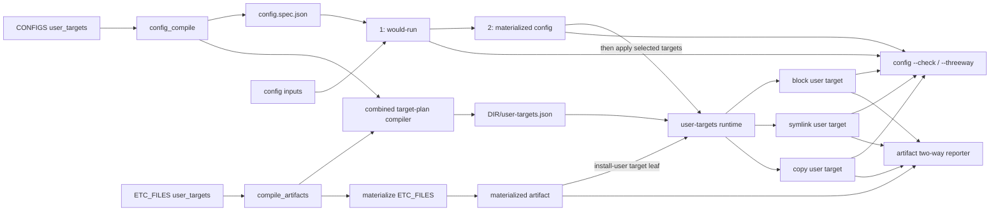

# Install-driving user targets for configs and filesystem artifacts

> **Authoring model:** GPT-5.6 Sol xhigh (`solx`).

## Revision and recommendation

This revision supersedes draft0's status-only boundary. The human accepted the
three-state model and required the missing deployment operation to be part of
the same declaration.

`user_targets` is an optional plural list on both `CONFIGS` entries and concrete
filesystem copy artifacts such as `ETC_FILES` entries. Every target has an
explicit `strategy: block | symlink | copy`. The descriptor is authoritative
for **both install and status**:

- config targets install after the complete atomic config-output commit;
- filesystem-artifact targets install through a generated user-scope install
  leaf, composed into `install-user.sh`;
- config status is three-state: would-run, materialized, and user;
- ETC_FILES status is strictly two-state: materialized and user. It has no
  deployed runtime producer for a would-run slot.

The key recommendations are:

1. Compile both declaration sites into one versioned
   `DIR/user-targets.json` plan with a shared strategy runtime. Keep normalized
   config targets embedded in `config.spec.json` as well, because
   `config.sh --check` and `--threeway` own candidate-aware reporting.
2. Treat installation as convergent and user-scoped. A normal config apply
   installs targets even when its materialized output was already current, so
   rerunning `config.sh NAME` repairs slot 3.
3. Preflight all selected targets, then attempt every target in declaration
   order. Installation failures are aggregate-fatal but do not roll back
   already committed config outputs or already successful user targets.
4. Reserve a distinct config-apply result for “outputs committed, target
   install failed,” and teach `config-remote.ts` not to roll back an input
   mutation in that case. The source of truth has advanced; retrying target
   convergence is safer than pretending the config commit did not happen.
5. For whole-file safety, `copy` may replace an existing regular file but
   refuses symlinks/directories/special files. `symlink` may replace an existing
   symlink but refuses a regular file/directory/special file. This makes the
   chosen strategy meaningful without silently changing an inode's ownership
   model.
6. Migrate Mise's two Bash loader `ETC_FILES` first. For the first CONFIGS
   consumer, prefer Zim's existing `zimfw.conf` symlink before Clickpad: it
   exercises the real declaration/runtime path with no content-layout migration.
   Clickpad remains the first good managed-block CONFIGS example.

## The two state models must remain distinct

### CONFIGS: three states

For a config named `NAME`:

1. **would-run** — validated candidate generated from current inputs;
2. **materialized** — the committed `CONFIGS.NAME.output`;
3. **user** — the state at a declared user target.

For byte-bearing `block` and `copy` strategies, all three can be represented as
files. `diff3` explains their relationship:

| Section | Agreement | Interpretation |
|---|---|---|
| `====1` | materialized = user | current inputs changed; config must run |
| `====2` | would-run = user | materialized output alone is stale or altered |
| `====3` | would-run = materialized | user copy/block is stale or edited |
| `====` | no two agree | source and installation drift are mixed |

For `symlink`, slot 3 is primarily topology rather than another owned byte copy.
Status requires a symlink whose resolved referent equals the materialized
output. If the target path is readable, its bytes may still be captured for an
explanatory `diff3`, but content equality never excuses a wrong inode type or
wrong link target.

### ETC_FILES: two states only

For an `ETC_FILES` copy artifact:

1. **materialized** — the file already rendered by Ansible at the compiled
   artifact's `resolved_dest`;
2. **user** — the block, symlink, or copy installed from that file.

There is no deployed equivalent of `config.sh --stdout` for an ETC_FILES
template. The artifact reporter therefore emits a normal two-way diff or link
topology diagnosis. It must not call this a three-way check, synthesize a fake
would-run slot, or invoke the playbook as a renderer.



The install arrows now originate in the compiled descriptor. Hand-written
install commands disappear as consumers migrate.

## Surveyed seams retained from draft0

### Config compiler and runtime

- [`sub_config.tasks:2-8`](/tasks/compfuzor/sub_config.tasks#L2-L8) resolves
  `CONFIGS` and publishes the `config_compile` result under
  `SUBSYSTEM.config`.
- [`config_compile.py:225-233`](/library/filter_plugins/config_compile.py#L225-L233)
  constructs each normalized config record. This remains the insertion point
  for normalized `user_targets`.
- [`config_compile.py:237-242`](/library/filter_plugins/config_compile.py#L237-L242)
  generates `config-NAME.sh` and `status-config-NAME.sh`; the latter already
  delegates to `--check` and enters `STATUSES`.
- [`gen_config.tasks:6-12`](/tasks/compfuzor/gen_config.tasks#L6-L12) merges the
  compiled config's spec file, bins, status reporters, directories, and package
  dependencies into shared host state.
- [`config-run.sh:47-79`](/files/config-run.sh#L47-L79) creates one transaction
  and manifests current inputs. [`config-run.sh:81-118`](/files/config-run.sh#L81-L118)
  produces and validates each candidate and implements byte-exact `--stdout`.
- The candidate/materialized equality shortcut at
  [`config-run.sh:119-121`](/files/config-run.sh#L119-L121) must be removed or
  delayed: slot 3 still needs repair/status when slots 1 and 2 agree.
- The existing output transaction validates all candidates before committing
  queued outputs at [`config-run.sh:123-155`](/files/config-run.sh#L123-L155).
  User-target application belongs after this complete commit, not within its
  per-output move loop.

All streams used for comparison remain transaction files. Never hold a block or
copy body in command substitution: shell substitution strips trailing newlines.
All byte drift is decided with `cmp`; `diff`/`diff3` are explanatory only.

### Filesystem artifact compiler

[`compile_artifacts.tasks:2-43`](/tasks/compfuzor/compile_artifacts.tasks#L2-L43)
passes every active file family, including `ETC_FILES`, into the filesystem
artifact compiler. [`artifact_links.py:73-108`](/library/filter_plugins/artifact_links.py#L73-L108)
already gives each entry:

- family, kind, writer, and stable origin;
- materialized root and family-relative destination;
- authoritative `resolved_dest`;
- the original declaration under `item`.

[`artifact_links.py:144-165`](/library/filter_plugins/artifact_links.py#L144-L165)
publishes family entries plus flattened copy/line lists. The user-target
extension should normalize targets onto each eligible entry and add a flattened
target contribution; it should not make `fs_hierarchy.tasks` understand install
strategies.

The existing link annotations establish the precedent: compiled artifact
metadata uses `resolved_dest` as the source
([`artifact_links.py:299-327`](/library/filter_plugins/artifact_links.py#L299-L327)),
then a later generator creates a durable runtime plan. The links subsystem
writes that late-compiled plan directly to `DIR/links.json`
([`link_plan.tasks:13-23`](/tasks/compfuzor/link_plan.tasks#L13-L23)) rather than
adding another ETC_FILES record after `_ARTIFACTS` has frozen. User targets
should follow the same pattern with `DIR/user-targets.json`.

Concretely, import `gen_user_targets.tasks` immediately after
`compile_artifacts.tasks` and before `gen_links.tasks` in
[`compfuzor.includes:104-111`](/tasks/compfuzor.includes#L104-L111). Materialize
the plan with a direct task in the filesystem phase beside `link_plan.tasks`;
do not append a late ETC_FILES entry that `_ARTIFACTS` will never see.

Only concrete `writer: copy` file artifacts are eligible in version one.
Reject `line`, `copyDir`, or declarations whose materialized source is not a
regular file; they do not define one byte source suitable for these strategies.

### Status composition

Enhanced `--check` flows through the already generated config reporter. A new
`status-user-targets.sh` reporter handles **artifact-owned targets only**, so
config targets are not checked twice. It is registered after `_ARTIFACTS` and
the combined plan are compiled but before
[`gen_status.tasks:13-21`](/tasks/compfuzor/gen_status.tasks#L13-L21) freezes the
reporter set. The generic orchestrator retains its 0 clean / 1 drift / 2
not-applicable contract at
[`files/status/status.sh:10-35`](/files/status/status.sh#L10-L35).

Zim still has the draft0 composition bug: its authored `status.sh` at
[`zim.opt.pb:298-351`](/zim.opt.pb#L298-L351) masks the generic STATUSES
orchestrator. That cleanup remains required and is specified below.

## Canonical descriptor

### Public shape

`strategy` is required. There is no behavioral default for an install-driving
record.

```yaml
user_targets:
  - strategy: block
    file:
      env: BASH_RC
      default: "$HOME/.bashrc"
    name: mise-main

  - strategy: symlink
    file: "$HOME/.config/example/config-link"

  - strategy: copy
    file: "$HOME/.config/example/config-copy"
```

| Field | Strategies | Required | Meaning |
|---|---|---:|---|
| `strategy` | all | yes | `block`, `symlink`, or `copy` |
| `file` | all | yes | String path or structured runtime path selector |
| `name` | block | yes | Exact block-in-file name; rejected for symlink/copy |

Version one deliberately fixes block-in-file's other behavior to the command
selected by the human: default `# NAME start/end` markers, source attribution
enabled, and `-C true`. There are no per-target create, placement, comment,
envsubst, force, ownership, or privilege flags.

### Structured runtime path

The file field accepts either a string or:

```yaml
file:
  env: ZDOTDIR
  default: "$HOME"
  suffix: "/.zshenv"
```

The mapping has exactly three fields:

| Field | Required | Semantics |
|---|---:|---|
| `env` | no | Valid shell variable name whose non-empty runtime value overrides `default` |
| `default` | yes | Absolute or HOME-rooted fallback base/file |
| `suffix` | no | Literal path suffix appended to the selected value; empty by default |

Resolution is safe and non-evaluating:

1. At compile time canonicalize leading `~`, `$HOME`, and `${HOME}` in
   `default` to `${HOME}`. Reject other `$` expressions, NUL/newline, and plain
   relative defaults.
2. At runtime, if `env` is named and non-empty, select its value verbatim;
   otherwise substitute the invoking process's `HOME` into `default`.
3. Append `suffix` literally. Require it to be empty or begin with `/`; reject
   NUL/newline and lexical `..` traversal.
4. Require the final path to be absolute. Environment values are not recursively
   shell-expanded. An env file line such as `export BASH_RC="$HOME/.bashrc"`
   already expands when sourced; a literal `$HOME` received inside the variable
   is invalid.

String shorthand compiles to `file: {default: ...}`. The runtime always consumes
the canonical mapping, so CONFIGS and ETC_FILES cannot develop different path
rules.

This directly models both live override styles:

```yaml
# Full-file override: ${BASH_RC:-$HOME/.bashrc}
file:
  env: BASH_RC
  default: "$HOME/.bashrc"

# Directory override plus suffix: ${ZDOTDIR:-$HOME}/.zshrc
file:
  env: ZDOTDIR
  default: "$HOME"
  suffix: "/.zshrc"
```

### Normalized records and ownership

A config keeps the canonical descriptor in `config.spec.json`:

```json
{
  "output": "/etc/opt/zim-main/zimrc",
  "processor": "block-in-file",
  "apply": true,
  "user_targets": [
    {
      "strategy": "symlink",
      "file": {
        "env": "ZIM_CONFIG_LINK",
        "default": "${HOME}/.config/zsh/zimfw.conf",
        "suffix": ""
      }
    }
  ]
}
```

The combined plan adds source and origin:

```json
{
  "version": 1,
  "deployment": {"id": "zim-main", "dir": "/opt/zim-main"},
  "targets": [
    {
      "id": "config:zimrc:0",
      "origin": {"kind": "config", "name": "zimrc", "index": 0},
      "source": "/etc/opt/zim-main/zimrc",
      "strategy": "symlink",
      "file": {
        "env": "ZIM_CONFIG_LINK",
        "default": "${HOME}/.config/zsh/zimfw.conf",
        "suffix": ""
      }
    }
  ]
}
```

An ETC_FILES record follows the same plan shape with origin like
`{kind: "artifact", family: "ETC_FILES", index, identity}` and `source` equal
to that artifact's `resolved_dest`.

Validate target claims twice:

- compile time rejects duplicate canonical symbolic claims across CONFIGS and
  all filesystem artifacts;
- runtime resolves env selectors and rejects collisions before mutation.

Claim rules are strategy-aware:

- `copy` or `symlink` exclusively claims the whole destination path;
- `block` claims `(destination path, block name)`;
- distinct block names may share one file;
- a whole-file strategy conflicts with every block claim on that file.

The second pass is necessary because two different env selectors can resolve to
one file only for a particular invocation.

## Strategy contract

The source is implicit and cannot be overridden: a CONFIGS target uses its
config output; an artifact target uses `resolved_dest`. Every strategy verifies
that source is a readable regular file before touching the destination. Every
strategy also creates the destination's parent directory before its strategy
command; this is fixed convergence behavior, not a per-target installer flag.

### `strategy: block`

Install exactly through block-in-file:

```bash
block-in-file -C true -n "$name" -i "$source" -o "$file"
```

The runtime creates the parent directory first; `-C true` then owns file/block
creation. Existing unrelated file content and other managed blocks remain
untouched.

Status reads slot 3 to a transaction file:

```bash
${CONFIG_BLOCK_IN_FILE:-block-in-file} --read -n "$name" "$file" >"$snapshot"
```

There is no sed fallback. A missing/unreadable file, missing named block, or
`cmp` difference between source and snapshot is install drift. Markers and
`# source:` provenance are excluded by the reader; provenance spelling is not
validated in version one.

### `strategy: symlink`

Install creates the parent directory, then converges the destination using both
`-n` and `-f`:

```bash
mkdir -p -- "$(dirname "$file")"
ln -sfn -- "$source" "$file"
```

`-n` prevents an existing symlink-to-directory from being dereferenced as a
directory operand. `-f` permits replacement of an existing wrong or dangling
symlink. Neither flag is a safety policy, so preflight is mandatory:

- absent destination: create the symlink;
- existing symlink: leave it if correct, otherwise replace it;
- existing regular file, directory, or special file: refuse and report drift;
  never unlink it implicitly.

Status requires all of:

1. source exists and resolves;
2. destination exists as a symlink (`test -L`, including dangling links);
3. destination is not dangling;
4. resolved destination referent equals resolved source.

A non-link with identical bytes is still drift. A link through a different
lexical spelling is clean when both resolve to the same source. Diagnostics
print declared source, raw `readlink`, and resolved paths. If the destination is
readable, config three-way mode may snapshot its content for `diff3`; topology
predicates, not that content, decide the user-drift bit.

### `strategy: copy`

Install creates the parent directory and copies the source over the destination:

```bash
mkdir -p -- "$(dirname "$file")"
cp --remove-destination -- "$source" "$file"
```

The strategy declares whole-file content ownership, so an existing regular file
is intentionally replaced—including user edits—when apply runs. This is what
makes rerun a repair operation. Safety guards refuse an existing symlink,
directory, or special file instead of following/replacing it. The implementation
must repeat the type check immediately before `cp`; the destination directory is
user-owned, so version one does not attempt a cross-process lock.

Status requires a regular non-symlink destination and byte equality via `cmp`.
Missing, wrong-type, unreadable, or byte-different destinations are install
drift. Unified diff is explanatory for two-way artifact status; config status
uses diff3.

## Install lifecycle and failure semantics

### Config apply

Normal `config.sh [NAME]` becomes:

1. select configs using today's explicit-name / `apply: true` rules;
2. generate and validate every candidate;
3. resolve target paths and preflight tools, duplicate runtime claims,
   destination types, and parent feasibility without mutation (the validated
   candidate is the future source when an output does not exist yet);
4. atomically commit all changed config outputs using the existing rollback
   behavior;
5. verify each committed source is now a readable regular file, then install
   every target for every selected config in config order and target declaration
   order, including targets whose output was already current;
6. continue after individual target failures, then return a failing aggregate
   result if any failed.

Step 5 after an empty commit is intentional: apply means converge, and is the
repair command for user-only drift. `--check`, `--threeway`, `--stdout`, and
`--list` never install.

User files cannot join the output rename transaction: block operations and
multiple external destinations do not share one atomic commit boundary. If a
target fails, do **not** roll back materialized outputs. Some earlier targets may
already be correct, and rolling their source backward would create new drift.
Keep the durable output, report each failed target, and let the next apply retry
idempotently.

Use a dedicated apply exit code—recommended `4`—for “config outputs committed,
one or more user-target installs failed.” Assembly/validation/commit failures
retain their existing failure result and guarantee that target installation did
not begin.

This distinction is required by [`config-remote.ts:50-55`](/files/config-remote.ts#L50-L55)
and its rollback sites at
[`config-remote.ts:96-115`](/files/config-remote.ts#L96-L115) and
[`config-remote.ts:123-148`](/files/config-remote.ts#L123-L148). Today every
nonzero rebuild result rolls back the remote input. After install-driving
targets:

- assembly/commit failure: roll back the input as today;
- exit 4 after committed output: retain the input mutation, surface
  “config committed; user-target install failed,” and return failure to the
  operator without attempting an impossible partial rollback.

### Filesystem-artifact install

The combined target generator emits:

- a non-composed strategy runtime reading `DIR/user-targets.json`;
- `install-user-targets.sh`, user-scoped and composed into the normal
  `install-user.sh` entry point;
- `status-user-targets.sh`, registered in `STATUSES` and restricted to
  artifact-owned targets.

The install leaf is not `run: true`. ETC_FILES target installation remains an
explicit user install action, matching Mise today. If a playbook has no authored
`install-user.sh`, bin composition creates the user entry point from the
generated leaf. If it has one, as Mise does, its authored body runs and the
target leaf follows through `run_all`; this is the same shape currently visible
in deployed `/opt/mise-main/bin/install-user.sh:78-104` for
`install-bash-user.sh`.

The artifact leaf applies all artifact targets after filesystem materialization.
It preflights all, attempts all, and exits nonzero after any failure. There is no
source rollback: Ansible has already materialized ETC_FILES, and target apply is
a later user-scoped convergence step.

Removing a declaration does not remove its old block, symlink, or copy. As with
other Compfuzor declarations, this feature creates and updates declared state;
cleanup remains an explicit operator/migration action rather than automatic
pruning.

### User scope is now a formal contract

User targets run as the invoking process's effective user, with that process's
`HOME` and exported override variables. They never invoke sudo, select another
account, or infer a user from file ownership. This matches today's hand-written
`install-user.sh` behavior and the generated bin composer's user scope
([`bin_composers.py:92-117`](/library/filter_plugins/bin_composers.py#L92-L117)).

It is acceptable to formalize this now because every declared destination is
explicitly user-rooted and installation is an ordinary user action. It also
keeps privilege out of a descriptor with no ownership fields. The operational
consequence must be documented: running config as root or through a sudo setup
that changes `HOME` targets that runtime account. Compfuzor will not silently
switch back to the playbook author. Named-user/system deployment is a different
future strategy or scope, not an implicit fallback.

## Status and diagnostic surfaces

### Canonical `--check` and reporters

`config.sh --check [NAME]` checks slot 1 against slot 2 and every declared slot
3. It returns only the reporter contract:

- 0: clean;
- 1: any source/materialized drift, install drift, or evaluation failure;
- 2: not applicable (only where the reporter genuinely has no selected work).

Generated `status-config-NAME.sh` remains unchanged and therefore gains slot-3
parity automatically. `status-user-targets.sh` uses the same 0/1/2 contract for
artifact two-way status. Missing declared targets are drift, not
not-applicable.

For block/copy config targets, a drift report prints the numeric slot legend and
default-format `diff3`. For symlinks it prints topology first and emits diff3
only when a readable destination snapshot adds information. For ETC_FILES,
block/copy use a unified two-way diff; symlink uses topology only.

No status decision uses `diff` or `diff3` exit status. Block/copy equality is
computed with `cmp`; symlink identity uses explicit inode/link/resolution tests.
Add `diffutils` to package contributions whenever the combined target plan is
non-empty: config diagnostics need `diff3`, while artifact byte diagnostics use
`diff`.
Continue to depend directly on `block-in-file --read`, with
`${CONFIG_BLOCK_IN_FILE:-block-in-file}` retained for testability and no sed
fallback.

### Explicit `--threeway NAME` bit result

`--threeway` remains CONFIGS-only and requires one config with at least one
user target. Its semantic result is a bitset:

| Exit | Meaning | Operator action |
|---:|---|---|
| 0 | would-run = materialized and every target is installed correctly | none |
| 1 | would-run differs from materialized | rerun config |
| 2 | materialized differs from/is not correctly represented at one or more user targets | install/repair target or inspect user edit |
| 3 | both conditions hold | rerun config, then install/repair target |

With multiple targets, OR the install-drift bit across all targets. If the
materialized output is absent, set bit 1 and defer content comparison against
slot 3; still set bit 2 for independently observable target topology failures.

Codes 0–3 are reserved for evaluated state. Unknown config, no declared target,
missing required tools, unreadable source, or another inability to evaluate
should use a separate operational result—recommended exit 4—with a precise
diagnostic. This avoids misreporting a tool failure as “needs install.”

## Mise migration: first ETC_FILES consumer

Mise currently declares two loader files at
[`mise.opt.pb:27-35`](/mise.opt.pb#L27-L35), exports `BASH_RC` and
`BASH_PROFILE` through `ENV_LIST` at
[`mise.opt.pb:34-45`](/mise.opt.pb#L34-L45), and copies the loaders into managed
blocks through hand-written `install-bash-user.sh` at
[`mise.opt.pb:57-68`](/mise.opt.pb#L57-L68).

Replace that bin with artifact annotations:

```yaml
ETC_FILES:
  - name: mise.bashrc
    user_targets:
      - strategy: block
        file:
          env: BASH_RC
          default: "$HOME/.bashrc"
        name: "{{ NAME }}"
    content: |
      eval "$(mise activate bash)"

  - name: mise.bash_profile
    user_targets:
      - strategy: block
        file:
          env: BASH_PROFILE
          default: "$HOME/.bash_profile"
        name: "{{ NAME }}"
    content: |
      eval "$(mise activate bash --shims)"
```

Then delete only the `install-bash-user.sh` BINS entry. Keep Mise's authored
`install-user.sh` body for legacy Zsh-block cleanup and `mise settings`; the bin
composer appends generated `install-user-targets.sh` after that body. The
generic artifact reporter compares:

- `/etc/opt/mise-main/mise.bashrc` to block `mise-main` in the resolved
  `${BASH_RC:-$HOME/.bashrc}`;
- `/etc/opt/mise-main/mise.bash_profile` to block `mise-main` in the resolved
  `${BASH_PROFILE:-$HOME/.bash_profile}`.

The existing `env.export` already resolves the defaults when sourced and allows
an ambient non-empty override to win. The structured `env/default` selector
preserves that behavior without `eval`. Installation refreshes block-in-file
provenance, but status remains body-only as decided.

## Zim adoption decision still open

Zim has two different candidate migrations. Neither should attach its startup
loader blocks to `CONFIGS.zimrc`; those loaders remain separate ETC_FILES.

### Option A — current `zimfw.conf` symlink

```yaml
CONFIGS:
  zimrc:
    processor: block-in-file
    # existing inputs/validation/block settings ...
    user_targets:
      - strategy: symlink
        file:
          env: ZIM_CONFIG_LINK
          default: "$HOME/.config/zsh/zimfw.conf"
```

The implicit source is `/etc/opt/zim-main/zimrc`. This models the symlink
currently created at [`zim.opt.pb:295-297`](/zim.opt.pb#L295-L297); the live
target resolves to that output. Migration removes those three hand-written
lines because normal config apply now converges the link.

**Recommendation: choose Option A first.** It is the lowest-risk first CONFIGS
consumer, exercises the symlink strategy and runtime path override, and changes
no content ownership. It does not create a third byte copy, but its slot-3
topology is truthful and immediately useful.

### Option B — user-owned copy of zimrc

Set `ZIM_CONFIG_FILE` to a user path such as
`${XDG_CONFIG_HOME:-$HOME/.config}/zsh/zimrc` (represented through a full-file
env selector/default), then declare:

```yaml
CONFIGS:
  zimrc:
    processor: block-in-file
    # existing inputs/validation/block settings ...
    user_targets:
      - strategy: copy
        file:
          env: ZIM_CONFIG_FILE
          default: "$HOME/.config/zsh/zimrc"
      - strategy: symlink
        file:
          env: ZIM_CONFIG_LINK
          default: "$HOME/.config/zsh/zimfw.conf"
```

The copy becomes Zim's runtime config; the symlink remains a host-discovery
registry and can continue pointing directly to the materialized output. This is
a true three-byte-stream deployment and makes a user edit independently
observable. It also changes behavior: every config apply copies immediately,
whereas today's loader references the ETC-backed config and shells lazily see
the reassembled output without another user-file install. It introduces another
durable copy and requires careful treatment of contributor host discovery at
[`gen_zim.tasks:141-159`](/tasks/compfuzor/gen_zim.tasks#L141-L159).

Option B should therefore be a deliberate later migration, not the feature's
first proof. If selected, verify the desired relationship among
`ZIM_CONFIG_FILE`, `ZIM_CONFIG_LINK`, and contributor discovery before coding.

### Independent Zim status cleanup

Regardless of A/B:

1. rename authored `status.sh` to `status-zim.sh`;
2. register `status-zim.sh` in `STATUSES`, restoring the generic aggregate
   `status.sh` so `status-config-zimrc.sh`, `status-config-zimenv.sh`, target
   reporters, and Zim checks all run;
3. replace direct `$ZIM_CONFIG_FILE` use at
   [`zim.opt.pb:308-312`](/zim.opt.pb#L308-L312) with one initialized local, for
   example `zimrc_config="${ZIM_CONFIG_FILE:-{{ETC}}/zimrc}"`, and use it for
   existence, freshness, and link comparisons.

The fallback is not cosmetic: the deployed authored body at
`/opt/zim-main/bin/status.sh:88-92` dies under `set -u` when ambient setup does
not provide `ZIM_CONFIG_FILE`, while neighboring Zim variables already have
fallbacks. After target adoption, remove only checks made redundant by the
generic target reporters; retain Zim-specific init freshness checks.

## Production-consumer ordering

Strategies change the draft0 recommendation:

1. **Mise ETC_FILES block targets** prove artifact compilation, structured
   full-file env overrides, generated user-install composition, and two-way
   status while deleting hand-written duplicate commands.
2. **Zim Option A symlink** should be the first CONFIGS production target if the
   human accepts it. It is already the deployed topology and has no content
   migration.
3. **Clickpad block migration** follows as the first CONFIGS consumer with three
   byte streams. It still requires a deliberate transition from whole-file
   `.xinitrc` ownership to a managed block, so it is a worse smoke test but a
   better demonstration of `diff3` attribution.
4. **Zim Option B copy**, if desired, comes after copy behavior and host
   discovery are independently proven.

This ordering separates infrastructure proof from user-file ownership changes.

## Ordered implementation commits

Each item is intended to land as a coherent commit; tests and documentation for
that slice travel with it.

1. **Common descriptor compiler.** Add shared normalization for strategy,
   string/structured file selectors, block names, HOME canonicalization, and
   symbolic claim identity. Unit-test malformed fields, strategy-specific
   fields, duplicate claims, and path forms.
2. **CONFIGS compiler surface.** Extend
   [`config_compile.py:225-242`](/library/filter_plugins/config_compile.py#L225-L242)
   to retain canonical `user_targets` in each config spec, expose flattened
   config target contributions. Preserve all current processor, remote, toggle,
   and status-bin behavior.
3. **Combined target plan.** Extend `compile_artifacts` to normalize eligible
   ETC_FILES targets using `resolved_dest`; add a late compiler that combines
   config and artifact records, validates cross-domain claims, and writes
   versioned `DIR/user-targets.json` through a direct plan-materialization task
   analogous to `link_plan.tasks`. Contribute `diffutils` whenever the plan is
   non-empty.
4. **Shared strategy runtime.** Implement path resolution, runtime collision
   preflight, block/symlink/copy apply, snapshot/status, safe destination-type
   handling, and aggregate-failure reporting. Generate
   `install-user-targets.sh` and artifact-only `status-user-targets.sh`.
5. **Config runtime candidate/status modes.** Refactor mode parsing and candidate
   lifetime in `config-run.sh`; remove the slot-1/slot-2 early continue, retain
   transaction files, integrate slot 3 into canonical `--check`, and implement
   `--threeway NAME` result bits 0/1/2/3 plus operational exit 4. Keep
   `--stdout` byte-exact and apply-free.
6. **Config install lifecycle.** After the complete output commit, apply selected
   config targets even for unchanged outputs. Preflight before the commit,
   attempt all targets afterward, preserve committed outputs on target failure,
   and emit dedicated apply exit 4.
7. **Remote rebuild compatibility.** Teach `config-remote.ts` to distinguish
   pre-commit config failure from post-commit target failure: rollback remote
   input only for the former, retain it and report retryable target drift for
   the latter.
8. **Integration matrix.** Cover every strategy; string and env/default/suffix
   paths; spaces and trailing newlines; multiple targets; compile-time and
   runtime collisions; wrong inode types; wrong/dangling links; copy overwrite;
   block provenance exclusion; target partial failure; unchanged-output repair;
   all threeway bit combinations; artifact 0/1/2 status; and config-remote's
   post-commit failure handling.
9. **Mise migration.** Add the two ETC_FILES block targets, remove
   `install-bash-user.sh`, and verify generated install-user composition and
   deployed `.bashrc`/`.bash_profile` status with and without env overrides.
10. **Zim status cleanup.** Rename/register `status-zim.sh`, fix the unbound
    `ZIM_CONFIG_FILE` reference, and verify the generic aggregate invokes both
    config reporters plus Zim's purpose-built checks.
11. **First CONFIGS migration.** Apply the human's Zim A/B decision. Recommended
    first commit is Option A's symlink descriptor plus deletion of its
    hand-written symlink action.
12. **Managed-block CONFIGS migration.** Move Clickpad's materialized output out
    of `.xinitrc`, add its block target, and preserve/review pre-existing
    whole-file user content during the one-time transition.
13. **Architecture documentation.** Update
    [`doc/arch.md`](/doc/arch.md) with the shared descriptor, distinct config and
    artifact status depths, user-scope contract, install ordering, partial
    failure semantics, and diagnostic exit codes.

## Remaining OPEN QUESTION

The human resolved draft0's naming, status-depth, missing-target, provenance,
reader, and ETC_FILES-scope questions. Draft1 makes concrete recommendations for
whole-file safety, post-commit failure, and unchanged-output repair rather than
deferring them. One product choice remains:

1. **Zim A or B:** adopt the existing `zimfw.conf` symlink first
   (**recommended**), or move immediately to a user-owned copy of zimrc for a
   third byte stream?

## Cross-references

- [`draft0.solx.md`](/.design/config-user-target/draft0.solx.md) established the
  compiler/runtime/status survey, byte-exact transaction requirement, and Zim
  status-composition finding retained here. Draft1 replaces its status-only and
  deferred-ETC_FILES recommendations.
- [`/.design/fs-pipeline/draft0.gpt56.md`](/.design/fs-pipeline/draft0.gpt56.md)
  describes `_ARTIFACTS` as the partial filesystem spec seam. ETC_FILES targets
  attach there and are consumed by a later plan, not by filesystem apply tasks.
- [`/.design/config-mcp/draft2.gpt56t.md`](/.design/config-mcp/draft2.gpt56t.md)
  separates config assembly intent from filesystem materialization. Shared user
  targets relate their outputs without making either executor interpret the
  other's declaration language.
- [`/.design/zim-generator/channels1.gpt56s.md`](/.design/zim-generator/channels1.gpt56s.md)
  explains why Zim config outputs and startup loader ETC_FILES are separate
  channels. The proposed symlink/copy targets preserve that distinction.
- [`artifact_links.py:220-279`](/library/filter_plugins/artifact_links.py#L220-L279)
  is useful precedent for typed strategy/policy validation, symbolic runtime
  roots, stable IDs, and compiled source/destination records.
