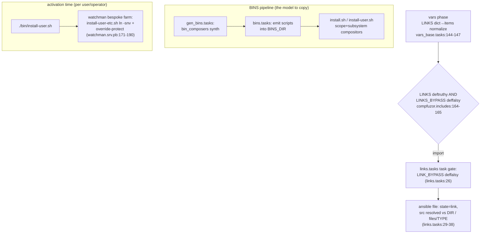
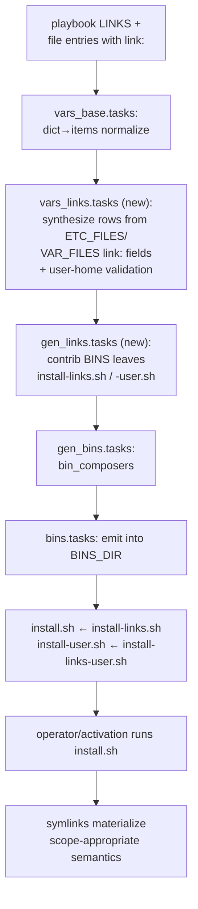

# draft0: links as recorded data, materialized at install time

## stage setting

compfuzor creates symlinks **inline during the ansible run**
(`tasks/compfuzor/links.tasks:18-39`, gated at
`tasks/compfuzor.includes:164-165`). The header comment in `links.tasks`
already confesses this is the wrong pattern: the idiomatic approach is a
generated `install.sh` the operator runs. Meanwhile BINS grew a real
composition system (`bin_composers.py`: scope compositors `install.sh` /
`install-user.sh` invoking subsystem compositors and leaves), and the fsh
lookup (`library/lookup_plugins/fsh.py`) learned to keep user paths
*un-resolved* (`home='%h'`, `home='${HOME}'`) so one artifact serves any
user. Watchman hand-rolled the exact machinery we want generically: an
overridable per-user symlink farm (`watchman.srv.pb:171-190`).

So the design writes itself in one sentence: **LINKS stops being an
execution and becomes a subsystem contrib that generates
`install-links.sh` / `install-links-user.sh` leaves, composed by the
existing BINS compositors; file entries grow `link:` fields that
synthesize LINKS rows; user-scope paths are authored un-resolved via fsh
`home='${HOME}'` and expanded by the shell at activation time.**

User vectors honored: deferred execution is the core requirement;
per-entry ergonomics beat top-level blocks; general health findings are
captured, not silently fixed; watchman's farm becomes the first consumer.

## the pipeline today (verified)



Facts that shape the design:

- **Two different bypass flags exist.** `compfuzor.includes:165` gates on
  `LINKS_BYPASS`; `links.tasks:26` gates on `LINK_BYPASS`; PERSIST_VARS
  carries `LINK_BYPASS` (`vars/common.yaml:127`) while AGENTS.md documents
  `LINKS_BYPASS`. Health finding H1.
- **LINKS rows are rich**: `src`/`dest`/`srcTemplate`/`destTemplate`/
  `force` (`links.tasks:23,36-38`), dict-or-list normalization
  (`vars_base.tasks:144-147`), and subsystem contrib can already append
  LINKS (`merge_subsys.py` `ARTIFACT_DEFAULTS`, preset `append`).
- **BINS composition is mature**: leaves named `install*.sh` /
  `install*-user.sh` are claimed into scope compositors; `subsystem:`-tagged
  leaves route through subsystem compositors whose *reserved names* collide
  with authored ones (`bin_composers.py:152-160` raises). Naming matters.
- **fsh already speaks "portable user path"**: `lookup('fsh', 'etc',
  user=True, name=True, home='${HOME}')` yields an un-expanded
  `~/.config`-based path the shell resolves per-user at runtime
  (`fsh.py:63-83`).
- **Precedent for generated install leaves**: every language/kernel
  subsystem contribs `install-<what>.sh` bins with `generated:` content
  (`vars/common.yaml` SUBSYSTEM blocks); readme shows the minimal gen_*
  shape (`gen_readme.tasks`).

## design

### D1 — LINKS becomes the `links` subsystem

New `tasks/compfuzor/gen_links.tasks` (mirroring `gen_readme.tasks`),
active when `LINKS is deftruthy and LINKS_BYPASS is deffalsy`. It contribs
BINS leaves via `merge_subsys`:

- `install-links.sh` — system-scope rows. Rendered content: `mkdir -p` the
  dest parent (sudo only if parent unwritable — see D2), then one `ln`
  per row.
- `install-links-user.sh` — user-scope rows; **never sudo**, `${HOME}`
  expanded by the shell at activation.

**Rendered vs data-record variant.** The kernel subsystems record
`kernel.*.json` into ETC_FILES and their scripts read it with jq
(`vars/common.yaml:617-649`). For links the row set is fully known at
deploy time and tiny, so I recommend **rendering the rows directly into
the script** (like `install-cli-symlink.sh` does): no jq dependency, the
script reads as documentation, and there's no deploy/runtime data skew.
The JSON-record + generic-reader variant wins only if we want a generic
`status.sh` drift reporter reading one canonical file — park that as an
open question (Q4), not a requirement.

`srcTemplate`/`destTemplate` on rows are rendered at deploy time into the
script text — templates are an authoring convenience, not runtime data.

### D2 — scope and replacement semantics

`scope` follows BINS: string or list, `user` selects the user hierarchy;
absent means system. Per-row `scope` overrides block-level.

Replacement semantics per row (the `force` field already exists,
`links.tasks:23`):

| dest state | system scope, default | system scope, `force: true` | user scope, default |
|---|---|---|---|
| absent | create | create | create |
| symlink → same src | no-op (report) | no-op (report) | no-op (report) |
| symlink → other src | **error loudly** | replace | **keep, report "override"** |
| regular file/dir | **error loudly** | replace (file) / error (dir) | **keep, report "override"** |

User scope defaults to watchman's override-protect farm semantics
(`watchman.srv.pb:174-190`): the user's own file always wins. System scope
defaults to strict-and-loud: a clobbered `/etc` path should stop the
install, not silently win. `force: true` (maping to `ln -sfn` plus a
guarded `rm` for regular files) is the explicit opt-in to replace.

Sudo: system-scope script does `mkdir -p`/`ln` directly and is expected to
run through `install.sh` which the operator runs with appropriate rights
(the kernel `install-kernel-*.sh` leaves already assume this posture);
no per-command sudo plumbing inside the leaf. User scope never elevates.

### D3 — per-entry `link:` fields

New `tasks/compfuzor/vars_links.tasks`, imported in the vars phase
*after* subsystem contrib has finalized `ETC_FILES`/`VAR_FILES`/`BINS`
(and after `vars_base.tasks` dict→items LINKS normalize, so synthesized
rows append to a list). For every entry carrying `link:`:

- the entry's resolved dest (the same computation `fs_hierarchy.tasks:134`
  performs) becomes the synthesized row's `src`;
- the `link:` value becomes the row's `dest`, carrying scope:
  - `link: true` → link beside the original? **No** — truthy-string or
    mapping only. `link: /usr/local/bin/foo` (absolute path, system
    scope); `link: user` alone links into the fsh user mirror of the
    entry's dir kind (see D4); mapping form `link: {dest: ..., scope:
    user, force: true}` for the general case.

Then gen_links (D1) handles hand-written and synthesized rows identically
— one materialization path.

**Field-name collision (health finding H6):** BINS entries already use
`link` to mean "this bin's source is a symlink target"
(`bins.tasks:55`, `bins_link.tasks:5-13`). Reusing `link` on BINS rows
would be genuinely ambiguous. Options:

- **A (recommended):** `link:` on ETC_FILES/VAR_FILES only; BINS keeps its
  existing `link` meaning; a BINS row that wants a generated link uses
  `linkTo:`. Ugly asymmetry, zero breakage.
- **B:** rename the BINS field to `symlinksTo`/`srcLink` and free `link`
  everywhere. Cleaner vocabulary, one mechanical migration over ~a few
  playbooks.
- **C:** only `linkTo:` everywhere for the new meaning.

Breaking changes are fine (<1.0); B is the honest fix, A the pragmatic
one. Flag for synthesis (Q1).

### D4 — fsh shared vocabulary: user paths stay un-resolved

Canonical rule: **user-scope link dests must be authored un-resolved** —
through `lookup('fsh', <kind>, user=True, name=True, home='${HOME}')` (or
literal `${HOME}/...`), never a resolved `HOMEDIR` path. The generated
`install-links-user.sh` then works for whichever user activates.
`vars_links.tasks` emits a loud validation error when a `scope: user`
row's dest contains the deploying user's resolved home (the mistake
mopidy.pb:15 and vim.user.pb:19 currently bake in — `~`/`{{ETC}}` under
USERMODE resolve to the deploying user at play time, which is exactly the
coupling this design removes).

`link: user` shorthand resolves through the same fsh table: an ETC_FILES
entry named `watchman.json` with `link: user` produces dest
`${HOME}/.config/<NAME>/watchman.json` — the fsh `etc` user spec
(`fsh.py:107`) with `home='${HOME}'`, `name=True`. No per-user templating
anywhere; the shell expands `${HOME}` at activation.

### D5 — the watchman farm, migrated

`install-user-etc.sh` (bespoke, 20 lines) is replaced by ETC_FILES
annotations:

```yaml
ETC_FILES:
  - name: watchman.json
    src: ...
    link:
      dest: "{{lookup('fsh','etc',user=True,name=True,home='${HOME}')}}"
      scope: user
```

which generates `install-links-user.sh` with override-protect defaults —
behaviorally identical to the farm loop, including the "user override
left untouched, reported" branch. `install-cli-symlink.sh` stays bespoke:
it does `rm -rf`, `chmod 0700`, and a computed `<user>-state` path —
beyond a declarative link; that's fine, the generic mechanism doesn't
need to absorb every shell verb.

### D6 — bypass, lifecycle, transition

- `LINKS_BYPASS=True` becomes the single flag: no gen_links contrib, no
  scripts, no inline execution. Retire `LINK_BYPASS` (H1), migrate
  PERSIST_VARS to `LINKS_BYPASS`.
- Inline execution is deleted, with a one-release escape hatch
  `LINKS_INLINE=True` that imports the old `links.tasks` body. After the
  ~19 playbooks using LINKS today are audited (most are plain
  system-scope rows that will render identically; `mopidy`, `vim.user`,
  `xdg-dirs` are the user-scope conversions), drop the hatch.
- `bins_run`/`install.sh` composition means "act at runtime" for free:
  `install-links.sh` is just another leaf in the `install` scope
  compositor. No new runner concept needed.

### resulting pipeline



## general system health findings (capture, don't fix silently)

- **H1 — dual bypass flags.** `LINKS_BYPASS` (includes:165, AGENTS.md)
  vs `LINK_BYPASS` (links.tasks:26, PERSIST_VARS common.yaml:127).
  Unify on `LINKS_BYPASS`.
- **H2 — dest resolution duplicated 4×.** `links.tasks:38`,
  `fs_hierarchy.tasks:134`, `bins.tasks:38`, and `__DEST`
  (`common.yaml:142`). vars_links needs the same logic a 5th time unless
  it's extracted into a filter (`entry_dest(entry, dir)`) first — do the
  extraction as part of this work.
- **H3 — dead code in links.tasks.** The commented parent-stat block
  (links.tasks:9-17) references the superseded `should_become`; dies with
  the inline path.
- **H4 — `USERMODE_CACHE_DIR: "{{XDG_CACHE_HOME}}/.cache"`
  (common.yaml:30)** double-suffixes (XDG_CACHE_HOME *is* `~/.cache`) and
  uses singular `CACHE` where the family is `CACHES` (cf. line 39).
  Suspicious bug + naming inconsistency; needs its own fix/ticket.
- **H5 — bin_composers reserved-name trap.** An authored leaf named
  `install-links.sh` tagged `subsystem: links` raises
  ("reserved subsystem compositor name", bin_composers.py:156-160). Our
  leaves must either leave `subsystem` unset or use distinct leaf names
  (`install-symlinks-*.sh` + `subsystem: links`). Document the trap.
- **H6 — `link` vocabulary collision on BINS.** See D3 options.
- **H7 — non-hermetic src resolution.** links.tasks `_src` picks `DIR` vs
  `files/TYPE` via `is exists` at play time (links.tasks:32-34); with
  rendered scripts the choice freezes at deploy time — an improvement,
  but the generated script should `test -e` the src before linking and
  say something useful.
- **H8 — FS_CONTAINERED ignored by links.** fs_hierarchy swaps dir/link
  roles under containers (fs_hierarchy.tasks:5-6); LINKS never consulted
  it. Whatever containered means for generated scripts deserves a line in
  the next draft (Q5).

## rollout sketch

1. Extract `entry_dest` filter (H2) — standalone, testable.
2. `gen_links.tasks` + rendered leaf templates under `files/` (following
   `../kernel/install-*.sh` placement); system scope only.
3. `vars_links.tasks` synthesis for ETC_FILES/VAR_FILES (option-A naming);
   user scope + fsh validation; migrate watchman farm to annotations.
4. Unify bypass flags (H1), delete inline path behind `LINKS_INLINE`
   hatch; audit + migrate the ~19 LINKS playbooks.
5. Decide Q1–Q5 in synthesis; fold BINS naming cleanup (H6/H5 docs) as
   its own small change.

## open questions for the syn wave

- **Q1** — `link` vs `linkTo` naming given the BINS collision (D3 A/B/C).
- **Q2** — should system scope default to replace-not-error when dest is
  a *symlink to another compfuzor deploy* (multi-instance case)?
- **Q3** — do we want the links recorded as `links.json` too, for a
  `status` drift reporter, or is script-as-record enough?
- **Q4** — does `link: user` shorthand need a `kind:` override (link an
  ETC file into the user *share* tree, say)?
- **Q5** — semantics of generated links under `FS_CONTAINERED`?

## research prompt (next wave)

> Read `.design/link-script/draft0.glm53.md` and pressure-test D1–D6
> against the tree: does `bin_composers` actually claim
> `install-links-user.sh` into `install-user.sh` without a subsystem tag;
> does the fsh `home='${HOME}'` output survive `merge_subsys` templating
> un-expanded; where exactly must `vars_links.tasks` sit relative to
> `vars_systemd_unit.tasks` (which freezes ETC_FILES) so synthesized rows
> see final file entries. Answer Q1–Q5 with evidence.
