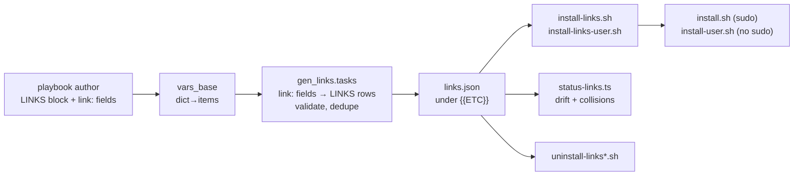

# draft1: record the links, act at activation

## what's up

This is the first design draft (draft1) responding to
[prompt0.md](/.design/link-script/prompt0.md) — the quest to give links the
same deferred, per-scope, composable form that paths (fsh) and env
(env.export / ZIM_ENV) already have, plus per-entry link annotations so "one
extra link" stops meaning "one whole LINKS block". The prompt was expanded
since the quest was first captured: it now names the kernel sysctl
record-then-apply pattern as the house precedent, asks for don't-stomp
semantics shared with the ZIM_ENV policy, and wants a generic drift/collision
reporter and clean teardown as first-class outcomes.

Everything below was verified against the tree on 2026-08-19; file:line
references are live.

## verified current state

| Concern | Where | Behavior |
|---|---|---|
| LINKS normalization | [/tasks/compfuzor/vars_base.tasks:144](/tasks/compfuzor/vars_base.tasks) | dict → items with `dest`/`src` keys |
| Inline link execution | [/tasks/compfuzor/links.tasks:18](/tasks/compfuzor/links.tasks) | ansible `file: state=link` per entry, deploy-time, `become_calc` on dest |
| Links import gate | [/tasks/compfuzor.includes:164](/tasks/compfuzor.includes) | `LINKS is deftruthy and LINKS_BYPASS is deffalsy` |
| Inner bypass name | [/tasks/compfuzor/links.tasks:26](/tasks/compfuzor/links.tasks) | `LINK_BYPASS` (singular!) — a second, differently-named gate |
| Existing per-entry link fields | [/tasks/compfuzor/bins_link.tasks](/tasks/compfuzor/bins_link.tasks), [/tasks/compfuzor/bins_link_global.tasks](/tasks/compfuzor/bins_link_global.tasks) | BINS `link:` / `global:` → deploy-time symlinks, `delay` phases exist |
| File-entry extension precedent | [/tasks/compfuzor/fs_hierarchy.tasks:134](/tasks/compfuzor/fs_hierarchy.tasks) | `destTemplate` overrides dest; readme subsystem uses it ([/vars/common.yaml:696](/vars/common.yaml)) |
| Record-then-apply precedent | [/vars/common.yaml:639](/vars/common.yaml) | kernel_sysctl: `kernel.sysctl.json` in ETC_FILES + `KERNEL_SYSCTL_JSON` env + jq |
| Apply-side precedent | [/files/kernel/install-kernel-sysctl.sh](/files/kernel/install-kernel-sysctl.sh) | thin script: build, `sudo mkdir -p`, `sudo ln -sf` into `/etc/sysctl.d` |
| Drift-report precedent | [/files/kernel/status-sysctl.ts](/files/kernel/status-sysctl.ts) | desired (JSON) vs deployed vs live, `-q` synopsis, JSON modes |
| Don't-stomp + overwrite hatch | [/library/filter_plugins/zim_fragment.py:268](/library/filter_plugins/zim_fragment.py) | `_compfuzor_env_overwrite`: `COMPFUZOR_ENV_OVERWRITE` = 1/true/y/yes/* = all, else comma-separated name globs |
| Scope composition | [/library/filter_plugins/bin_composers.py:115](/library/filter_plugins/bin_composers.py) | `install-*-user.sh` infers `user` scope; scope compositor `install-user.sh` |
| fsh parameterized user paths | [/library/lookup_plugins/fsh.py:104](/library/lookup_plugins/fsh.py) | `home='%h'` (systemd), `home='${HOME}'` (shell), `runtime=`; `global-bins` user form is `~/.local/bin` |
| LINKS subsystem merge | [/library/lookup_plugins/merge_subsys.py:115](/library/lookup_plugins/merge_subsys.py) | `LINKS` already an ARTIFACT_DEFAULTS artifact (`append`) — ready for subsystem contrib |
| Bespoke farm (the prototype) | [/watchman.srv.pb:171](/watchman.srv.pb) | `install-user-etc.sh`: don't-stomp symlink farm, `install-cli-symlink.sh`: force-style routing link |
| LINKS usage in playbooks | 39 `.pb` files | blast radius for the default flip |
| linkdir.includes users | dovecot.pb, spark.srv.pb, postfix.pb | raw `find | ln -s` farm with no records |

The header comment in [/tasks/compfuzor/links.tasks](/tasks/compfuzor/links.tasks)
already declares this design's direction: "Prefer install.sh over LINKS for
new playbooks." draft1 is that note turned into a mechanism.

## design overview



Three moving parts, matching the quest's shared backbone:

1. **the record** — `links.json`, one per deploy, both scopes in one file.
2. **the scripts** — scope-aware `install-links*.sh` composed into the action
   compositors, carrying one named don't-stomp policy.
3. **the annotations** — `link:` fields on file entries that synthesize rows
   into the record.

## 1. the record

One ETC_FILES entry, exactly the kernel_sysctl shape:

```yaml
SUBSYSTEM:
  links:
    requested: "{{ LINKS is deflengthy or _links_entry_fields|length > 0 }}"
    contrib:
      ETC_FILES:
        - name: links.json
          content: "{{ _links_rows | to_nice_json }}"
      BINS: "{{ _links_bins }}"
      ENV:
        LINKS_JSON: "{{ DIR }}/etc/links.json"
      ENV_LIST: [LINKS_JSON]
      PKGS: [jq]
```

Row schema (a strict superset of today's LINKS entry):

```json
{
  "src": "/etc/opt/watchman-main/etc/watchman.json",
  "dest": "${HOME}/.config/watchman-main/watchman.json",
  "scope": "user",
  "name": "watchman.json",
  "force": false,
  "privileged": false,
  "origin": "ETC_FILES:watchman.json"
}
```

- `scope` — `system` (default) or `user`. User rows are deferred to
  `install-user.sh` composition; system rows to `install.sh`.
- `src` — always resolved absolute at render time (DIR-relative defaults
  resolved by the same rules as today's links.tasks).
- `dest` — resolved at render time for system rows; **unresolved template
  literals** for user rows (`${HOME}`, `${XDG_RUNTIME_DIR}`), expanded by the
  shell at activation. This is the fsh `home='${HOME}'` vocabulary; no
  per-user templating exists anywhere.
- `name` — stable row identity for reporting and overwrite-glob matching
  (defaults to basename of dest).
- `force` — opts the row into replace semantics (`ln -sfn`) for paths the
  deploy owns outright (kernel sysctl's `/etc/sysctl.d` link is the model).
  Default false = don't-stomp.
- `privileged` — whether the system-scope applier needs sudo; computed at
  render from `become_calc` on the resolved dest (so a full `USERMODE`
  deploy records `false` and its "system" rows apply without sudo).
- `origin` — provenance for the collision reporter: which block/entry
  synthesized the row.

Both scopes in one file (not `links.json` + `links-user.json`) because the
record is one diffable statement of "what this deploy wants linked", and the
drift reporter wants to check both in one pass.

## 2. vocabulary

### LINKS entries

Existing fields all survive (`dest`, `src`, `force`, `srcTemplate`,
`destTemplate`, dict shorthand). New fields: `scope`, `name`, and `origin`
(as above). `LINKS` continues to merge via ARTIFACT_DEFAULTS (`append`), so
subsystems can contribute rows unchanged.

### per-entry `link:` fields

On every `<KIND>_FILES` list (ETC_FILES, VAR_FILES, SHARE_FILES, …) and on
FILES, mirroring how `destTemplate` extends entries today:

```yaml
ETC_FILES:
  - name: watchman.json
    json: { ... }
    link: user            # → ${HOME}/.config/<NAME>/watchman.json, scope user

  - name: terminfo.db
    link: /usr/share/terminfo   # explicit system dest dir, basename kept

  - name: bundled.conf
    link:
      dest: /etc/bundle.d/{{NAME}}.conf   # full control
      scope: system
      force: true
```

Resolution rules, in `gen_links.tasks`:

| Form | Synthesized row |
|---|---|
| `link: user` | `scope: user`, `dest: lookup('fsh', kind, user=True, name=True, home='${HOME}') + '/' + basename` |
| `link: <string>` | `scope: system`, dest dir = the string (templated), basename kept |
| `link: true` | `scope: system`, dest dir = `fsh` deploy-mode base of the kind (rarely what you want; mostly for FILES) |
| `link: {…}` | explicit `dest`/`scope`/`force`; only `dest` required |

The `link: user` + fsh rule is the payoff case: for watchman-main it renders
`~/.config/watchman-main/watchman.json` with zero per-user templating, which
is precisely the path `UNIT_ETC_FILE`/`SHELL_ETC_FILE` already express for
the unit and the shell.

### BINS

BINS already spends `link:` on deploy-time linking
([/tasks/compfuzor/bins_link.tasks](/tasks/compfuzor/bins_link.tasks)), so
BINS does **not** grow a `link:` field. Instead `global:` learns a scope:

```yaml
BINS:
  - name: my-tool
    global: user        # defer: link into ${HOME}/.local/bin at activation
```

`global: user` renders dest through fsh kind `global-bins` with
`home='${HOME}'` (`{{fsh_home}}/.local/bin` in
[/library/lookup_plugins/fsh.py:119](/library/lookup_plugins/fsh.py)), emits a
`scope: user` row, and suppresses the deploy-time `bins_link_global` task for
that entry. Plain `global: true` keeps today's deploy-time behavior (its
dest `/usr/local/bin` is deploy-owned, force is idiomatic there, and
`PYTHON_CONSOLE_SCRIPTS` depends on it). The CLI-shim consumer
(`~/.local/bin`) is the deferred one.

## 3. the scripts

Two thin action scripts plus one shared core, following kernel naming:

```
files/links/install-links.sh         # scope compositor child: system rows
files/links/install-links-user.sh    # user rows (name infers user scope)
files/links/lib-links.sh             # compose: false — _cf_link_apply core
```

`bin_composers` picks both up for free: `install-links.sh` joins `install.sh`'s
`run_all`, `install-links-user.sh` joins `install-user.sh`'s
([/library/filter_plugins/bin_composers.py:115](/library/filter_plugins/bin_composers.py)).

The core applies one named policy — **don't-stomp**, the same policy ZIM_ENV
implements for env vars, now for path entries:

```sh
_cf_link_apply() {          # <src> <dest> <force> <name>
  mkdir -p "$(dirname "$2")"
  if [ -L "$2" ] && [ "$(readlink "$2")" = "$1" ]; then
    _cf_link_status ok "$2 -> $1 (up to date)"
    return 0
  fi
  if [ -e "$2" ] || [ -L "$2" ]; then
    if [ "$3" = true ] || _cf_link_overwrite "$2"; then
      ln -sfnv "$1" "$2" && _cf_link_status replaced "$2 (forced)"
    else
      _cf_link_status override "$2 (kept existing; user override)"
    fi
    return 0
  fi
  ln -snv "$1" "$2"
}
```

This is watchman's `install-user-etc.sh` farm logic
([/watchman.srv.pb:171](/watchman.srv.pb)) factored out of the playbook — the
farm was the prototype of this policy.

**Overwrite escape hatch** — `COMPFUZOR_LINK_OVERWRITE`, same spec grammar as
`COMPFUZOR_ENV_OVERWRITE` ([/library/filter_plugins/zim_fragment.py:268](/library/filter_plugins/zim_fragment.py)):

- unset → never displace an existing dest;
- `1|true|y|yes|*` (case-insensitive) → overwrite all rows;
- otherwise comma-separated globs matched against the dest path
  (case-sensitive, `*` spans `/` in case-pattern matching), e.g.
  `COMPFUZOR_LINK_OVERWRITE='*.config/watchman*,~/.local/bin/foo'`.

`force: true` rows bypass don't-stomp unconditionally — they are for paths
the deploy owns (the kernel-sysctl `/etc/sysctl.d` link uses `ln -sf`
today, [/files/kernel/install-kernel-sysctl.sh:6](/files/kernel/install-kernel-sysctl.sh)).

**Guards and reporting** — standard action-runner shape
([/doc/subsys.md](/doc/subsys.md) § Action runner): `_cf_action_init` /
`_cf_action_end`, `_cf_guard_bypass LINK` → `COMPFUZOR_LINK_BYPASS`,
per-scope nested action `COMPFUZOR_LINK_INSTALL_BYPASS` /
`COMPFUZOR_LINK_INSTALL_USER_BYPASS` via the derived-name convention. The
per-row statuses (`ok` / `override` / `replaced` / `linked`) print under the
loud gate so `install-user.sh` output reads like the farm's did.

**Privilege** — system rows run `sudo`-wrapped only when the row recorded
`privileged: true` and euid ≠ 0. User rows never escalate; their dests are
`${HOME}`-relative by construction.

**jq reads the record, not the template** — like kernel's build scripts, the
applier loops `jq -r '.rows[] | select(.scope==...) | [...]'` over
`$LINKS_JSON`, so a hand-edited record (or a stale one during a partial
deploy) is applied as-written, and the script needs no generated per-row
body.

## 4. fsh integration

One vocabulary across both scopes, selected per consumer:

| Consumer | Composition | Example for the watchman etc file |
|---|---|---|
| systemd unit directive | `home='%h'` | `%h/.config/watchman-main/watchman.json` |
| shell script / record row | `home='${HOME}'` | `${HOME}/.config/watchman-main/watchman.json` |
| render-time facts (deploy user) | no `home=` | `/home/<deployer>/.config/...` (diagnostics only) |

The record only ever stores the shell row. Validation in `gen_links.tasks`:
every `scope: user` dest must contain `${HOME}` (or `${XDG_RUNTIME_DIR}`);
every system dest must be absolute. That keeps the "no per-user templating"
invariant machine-checked instead of conventional.

## 5. pipeline placement

`gen_links.tasks` imports into [/tasks/compfuzor.includes](/tasks/compfuzor.includes)
between `gen_kernel.tasks` (line 91) and `gen_bins.tasks` (line 96) — after
every ETC_FILES-contributing gen_* that can carry `link:` fields, before
compositor synthesis so `install-links*.sh` get composed.

It does four things:

1. scan all `<KIND>_FILES` + FILES for `link:` fields, synthesize rows;
2. validate (user-dest literals, absolute system dests, duplicate
   `(scope, dest)` within the deploy);
3. merge rows into LINKS (hand LINKS first, synthesized after — hand entries
   win on dest collisions, with a loud warning);
4. contribute `links.json`, the bins, ENV/ENV_LIST, and jq via
   `SUBSYSTEM.links` + `merge_subsys`.

**Shared dest resolution.** Synthesizing a row needs the file entry's final
dest — logic currently duplicated across the lineinfile task, the copy task
([/tasks/compfuzor/fs_hierarchy.tasks:103](/tasks/compfuzor/fs_hierarchy.tasks),
line 134), and links.tasks' src side (lines 30–38). Extract a
`file_dest(entry, kind_dir)` filter, use it from all four sites. This is a
prerequisite refactor, not gold-plating: without it gen_links re-implements
the dest rules a third time and they will drift.

## 6. retiring inline execution

- [/tasks/compfuzor/links.tasks](/tasks/compfuzor/links.tasks) loses its
  `file: state=link` loop; the file becomes (at most) the transitional
  inline executor.
- `LINKS_BYPASS` becomes the single Ansible-layer gate (record generation
  skips too). `LINK_BYPASS` (singular, links.tasks:26) is folded into it —
  see health notes.
- **Transitional mode:** `LINKS_INLINE=true` keeps deploy-time execution for
  system rows during migration. Default is record-only. The 39 LINKS-using
  playbooks keep their schema unchanged; the behavior change is *when*
  system links appear (deploy → first `install.sh` run). Audit list from
  `rg -l '^\s*LINKS:' --glob '*.pb'`; most are `/etc`-ish system links that
  `install.sh` already exists to make.
- `linkdir.includes` (dovecot, spark.srv, postfix) migrates to LINKS rows
  wholesale — its `find | ln -s` is exactly don't-stomp-less linking we are
  replacing, and its users get records + drift reporting for free.

## 7. watchman as first consumer

- delete `install-user-etc.sh`; `ETC_FILES: watchman.json` gains `link: user`.
  The generated `install-links-user.sh` reproduces the farm byte-for-byte in
  behavior (the farm's logic is §3's policy), minus the bespoke shell.
- `install-cli-symlink.sh` **stays bespoke.** Its dest embeds `$(id -un)` at
  runtime, it links a *directory* with `rm -rf` + `chmod 0700` — replace
  semantics with runtime-computed paths, not don't-stomp semantics with
  render-time paths. Forcing it into static rows would need shell-templated
  dests, which reintroduces per-user templating through the back door. The
  status reporter can still check it (watchman's status script already does).
- `ZIM_ENV` / env.export / unit `Environment=` lines are untouched — the
  hybrid deploy's other two faces already work.

## 8. reporting

`status-links.ts`, contributed to STATUSES whenever rows exist, mirroring
[/files/kernel/status-sysctl.ts](/files/kernel/status-sysctl.ts):

- **desired** — `links.json` (defines the row set);
- **live** — `readlink` per dest, `${HOME}`-expanded by running under the
  user's shell (it ships in BINS, so it runs as the activating user);
- row states: `OK` (ours), `MISSING` (install advised), `OVERRIDE` (foreign
  file/symlink — intentional, but visible), `STALE` (symlink to a src we no
  longer record);
- `-q` one-word synopsis, `--json` lines, exit 0/1/2 — the status-sysctl
  contract.

**Collision audit** — `--all` sweeps `{{ETCS_DIR}}/*/etc/links.json` (and
USERMODE equivalents) and reports dests claimed by two or more deploys: the
generic answer to "who links into `~/.local/bin`?", replacing watchman's
hand-rolled `cli-route`/`config-link` status checks and the cross-playbook
`install-cli-symlink.sh` collision spelunking the prompt cites.

## 9. teardown

`uninstall-links.sh` / `uninstall-links-user.sh` (`compose: false` or a new
`uninstall` action token — open question): remove a dest only when it is a
symlink whose target equals the recorded src; never touch overrides; `rmdir`
recorded parent dirs only if empty. Unrecorded links were never cleanly
removable; recorded ones are. A full `uninstall.sh` story (bins, units, env)
is out of scope here, but links stop being the blocker.

## open questions

1. **BINS user-global spelling** — `global: user` (proposed) vs `link: user`
   (collides with BINS' existing deploy-time `link:`) vs a fresh field like
   `shim: true`?
2. **Default flip timing** — record-only immediately, or one release of
   `LINKS_INLINE=true` default while the 39 playbooks are audited?
3. **kernel-sysctl migration** — should its `/etc/sysctl.d` link become a
   `force: true` links.json row now (one system-scope consumer to prove the
   system path), or stay on its own thin script until the user path proves
   out?
4. **uninstall as action token** — extend `BIN_ACTIONS` with `uninstall`
   (compositors for free) or keep `compose: false` scripts?
5. **collision sweep privileges** — `--all` reads other deploys' links.json
   from `{{ETCS_DIR}}`; fine for the common single-user-admin case, but note
   for multi-admin hosts.

## general system health findings (captured, not fixed)

1. **`LINK_BYPASS` vs `LINKS_BYPASS`** — two names gate the same subsystem
   ([/tasks/compfuzor.includes:165](/tasks/compfuzor.includes) vs
   [/tasks/compfuzor/links.tasks:26](/tasks/compfuzor/links.tasks)). Unify on
   `LINKS_BYPASS` during this work; keep `LINK_BYPASS` as a deprecation alias
   briefly.
2. **dest/src resolution triple-duplicated** — fs_hierarchy lineinfile
   (:103), copy (:134), links.tasks (:30–38). Extract the `file_dest` filter
   (§5) and call it done.
3. **gen_bins ordering** — compositor synthesis
   ([/tasks/compfuzor.includes:96](/tasks/compfuzor.includes)) runs *before*
   gen_desktop (line 98) and gen_patches (line 101), whose `merge_subsys`
   BINS contributions therefore never land in any `install.sh`/`build.sh`
   `run_all`. Desktop/patches install scripts are compositor-orphans today.
4. **fs_env.tasks duplication** — ~70 lines of env-resolution vars are
   copy-pasted between the two tasks
   ([/tasks/compfuzor/fs_env.tasks:23](/tasks/compfuzor/fs_env.tasks) vs
   :121). Extract to a shared vars include or filter.
5. **linkdir.includes** — raw shell `find | mkdir | ln -s`, no don't-stomp,
   no records, per-dir subshells. Three users; migrate to LINKS (§6).
6. **overwrite-spec as a named convention** — the `COMPFUZOR_*_OVERWRITE`
   grammar now has (or will have) three implementations: zim env (zsh),
   links (sh), and the doc comment in
   [/tasks/compfuzor/gen_bins.tasks:5](/tasks/compfuzor/gen_bins.tasks).
   Worth one doc section naming the policy and the grammar, so the third
   implementation doesn't freelance.
7. **inline LINKS failure modes die with retirement** — ansible
   `file: state=link, force=false` errors rather than reports when dest
   exists as a foreign file; deploy-time linking as the deploying user also
   mis-attributes user-scope dests. Both go away when rows materialize at
   activation as the activating user.

## cross-references

- [prompt0.md](/.design/link-script/prompt0.md) — the quest this answers;
  vectors preserved: deferred execution is core, ergonomics matter, health
  issues get captured.
- [/doc/subsys.md](/doc/subsys.md) — subsystem contrib/merge model this
  design rides; § Action runner defines the guard/report shape of §3.
- [/doc/arch.md](/doc/arch.md) — §6 sketches contrib artifacts (`ETC_FILES`,
  `LINKS`) merging centrally; `SUBSYSTEM.links` is that pattern realized for
  the links concern.
- [/watchman.srv.pb](/watchman.srv.pb) — hybrid-deploy reference and the
  bespoke farm this replaces; its header comment is the deploy/activate
  split's best in-tree documentation.
- [`.design/zim-generator/init0.gpt56.md`](/.design/zim-generator/init0.gpt56.md)
  — ZIM_ENV don't-stomp policy and the lazy-template trap
  (`resolve` at the consuming task's scope) that gen_links' render-time fsh
  composition must respect.
- [`.design/global-usermode/init0.opencode.md`](/.design/global-usermode/init0.opencode.md)
  — USERMODE scope collapse context for `privileged` recording (§1).
