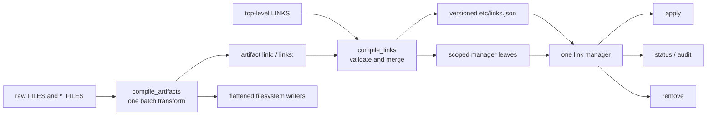

# Compiled artifacts and deferred link plans

## Status

This draft proposes the direction for a substantial filesystem and LINKS
overhaul. It incorporates the useful convergence from the earlier drafts and
the subsequent workshop decisions:

- compatibility with old `LINKS` behavior is not a goal;
- `LINKS` means deferred activation, never an inline Ansible effect;
- `DEPLOY_LINKS` is omitted from v1 rather than designing an escape hatch
  without a current use;
- `link:` and `links:` on filesystem artifacts compile into the same link plan
  as top-level `LINKS`;
- `link: user` symmetrically maps an artifact into the user form of its own fsh
  family;
- explicit destinations may deliberately cross fsh families;
- `links.json` is the durable source of truth for materialization, status,
  audit, and removal;
- one runtime manager owns all link classification and mutation semantics;
- artifact destination resolution is consolidated, while retaining the useful
  `defaultDir` behavior: relative paths receive a base, `/` and `~` paths pass
  through, and `..` is permitted;
- the consolidation should reduce or hold steady the number of Ansible task
  actions and repeated lookups, not add per-entry processing tasks;
- a global registry and cross-process locking protocol are deferred until
  ordinary multi-plan audit demonstrates a need.

The main architectural addition beyond the original quest is a compiled
artifact representation. Link annotations need the exact destination of their
source artifacts. Today that destination is recalculated in several task-local
expressions with different rules. Compiling artifacts once gives filesystem
materialization and link synthesis one answer while creating an opportunity to
flatten and simplify the slow Ansible execution path.

## Decision in brief



There are two related compilers:

1. The **artifact compiler** normalizes filesystem declarations, chooses their
   materialized roots, and resolves each output destination.
2. The **link compiler** combines explicit `LINKS` with `link:` and `links:`
   annotations from compiled artifacts into one canonical link plan.

The compilers have no host filesystem effects. Existing Ansible filesystem
tasks materialize compiled artifacts under the deployment hierarchy. Generated
BINS materialize link records later, under the intended system or user
identity.

## Where we are coming from

Compfuzor's filesystem vocabulary grew incrementally. It has useful ideas, but
not one destination model:

- `FILES` writes directly beneath `DIR` and has separate list, mapping, and
  line-entry implementations.
- Every `*_FILES` family is interpreted in `fs_hierarchy.tasks`, which chooses
  between an fsh root and `DIR/<kind>` according to `FS_CONTAINERED`.
- Copied hierarchy files have the richest destination expression:
  `destTemplate`, then `dest`, `name`, `src`, or the scalar entry.
- Hierarchy line entries use a different expression and do not support
  `destTemplate` or the `src` fallback.
- Generic `FILES` line entries ignore `dest` entirely.
- Mapping-form `FILES` manually reproduces part of `defaultDir`.
- Top-level `LINKS` duplicates another near-copy of destination resolution and
  gives relative sources different meanings depending on which candidate path
  happens to exist on the host.
- A dormant `__DEST` expression in `vars/common.yaml` describes yet another
  variant and is not an authority for active tasks.

Despite these differences, the established and useful path convention is
simple: a relative path belongs under a supplied base, while a path beginning
with `/` or `~` stands on its own. This is the `defaultDir` pattern. The new
design keeps that convention rather than replacing it with a restrictive path
language.

The current hierarchy also has an important mode switch:

```text
FS_CONTAINERED=false:
  materialized root = fsh root
  deployment link  = DIR/<kind>

FS_CONTAINERED=true:
  materialized root = DIR/<kind>
  deployment link  = fsh root
```

The swap is currently local to `fs_hierarchy.tasks`. Any separate attempt to
infer an artifact path, including a link annotation compiler, can accidentally
choose the exposure side instead of the path that was actually written.

Finally, current `LINKS` is an inline filesystem effect. Ansible normalizes some
input early, then `links.tasks` calls `file: state=link` during deployment. This
binds user links to the deployment actor, prevents composition into
`install-user.sh`, and leaves no durable ownership record for status or safe
removal. The header of `links.tasks` already says generated installers are the
preferred pattern. This design completes that transition.

## Design principles

### One resolution rule, not a stricter rule

Consolidation exists to remove disagreement, not to forbid convenient paths.

- Keep `defaultDir` semantics.
- Accept `/absolute`, `~/home-relative`, and relative destinations.
- Permit `.` and `..`; do not turn trusted local playbook input into a sandbox.
- Resolve and normalize paths only where comparison requires it.
- Give `dest`, `name`, and `src` stable, documented roles.
- Remove `destTemplate`; `dest` is rendered at one explicit compilation
  boundary.

### Compile in batches

Ansible task actions and repeated templating/lookups are expensive. The design
must not introduce a `set_fact`, include, lookup, or validation task per file.

`compile_artifacts` should be one pure filter invocation over the complete
artifact-family map. It receives precomputed family roots and returns grouped
and flattened records. `compile_links` likewise processes complete collections
in one invocation. Python iteration inside a filter is substantially cheaper
than adding Ansible task actions for every record.

The executor can then use a small number of loops over already-compiled writer
groups rather than re-running destination expressions inside each task family.

### Authored data and compiled data are distinct

Public variables remain authoring interfaces:

- `FILES`, `ETC_FILES`, `VAR_FILES`, and the other `*_FILES` families;
- top-level `LINKS`;
- per-entry `link:` and `links:` annotations.

Internal compiled structures are downstream interfaces:

- `_artifacts`: canonical filesystem output records;
- `_links`: canonical link records;
- `links.json`: the durable deployed representation of `_links`.

Artifact annotations do not literally mutate public `LINKS`. They compile into
the same `_links` plan. This preserves provenance and keeps authored declarations
distinguishable from synthesized records.

### Scope means activation identity

`system` and `user` are not just directory choices. Scope selects:

- the BINS compositor;
- the activation identity and privilege domain;
- available runtime roots;
- the status context;
- the appropriate audit population.

System records join `install.sh`; user records join `install-user.sh`.

## Artifact compilation

### Canonical artifact record

The artifact compiler emits records resembling:

```yaml
family: ETC_FILES
kind: etc
writer: copy

identity: watchman.json
materialized_root: /etc/opt/watchman-main
relative_dest: watchman.json
resolved_dest: /etc/opt/watchman-main/watchman.json

source:
  type: json
  value: { enforce_root_files: true }

origin:
  family: ETC_FILES
  index: 0
  producer: watchman

annotations:
  links:
    - scope: user
```

The precise serialized Python shape is an implementation detail, but the
following concepts are required:

| Field | Meaning |
|---|---|
| `family` | Public source variable, such as `ETC_FILES` or `FILES`. |
| `kind` | fsh kind, or null for generic `FILES`. |
| `writer` | `copy`, `line`, or another explicit materializer. |
| `identity` | Stable diagnostic identity, usually `name` or destination. |
| `materialized_root` | Root under which relative destinations are written. |
| `relative_dest` | Family-relative path when the declaration provides one. |
| `resolved_dest` | Exact destination supplied to the filesystem writer. |
| `origin` | Family, index/key, and subsystem producer where known. |
| `annotations` | Normalized `link:` / `links:` declarations. |

### Unified destination rule

The compiler replaces all task-local destination expressions with one rule:

```text
destination value = first truthy value of dest, name, src, scalar declaration
resolved_dest      = destination value | defaultDir(materialized_root)
```

This intentionally follows the richest existing hierarchy-copy behavior
without retaining `destTemplate`.

The fields have stable roles:

- `dest` explicitly chooses the output destination.
- `name` names the artifact and is its ordinary output default.
- `src` describes the input but remains a convenient output fallback when no
  destination or name is given.
- a scalar entry acts as its own name/source/destination shorthand.

Line and copy writers consume the same `resolved_dest`. Generic `FILES` uses
`DIR` as its materialized root and otherwise follows the same contract as
hierarchy families. Its old special cases are deliberately not preserved.

The compiler accepts paths according to `defaultDir`:

- `/etc/example.conf` passes through;
- `~/.config/example.conf` passes through;
- `nested/example.conf` becomes `<materialized_root>/nested/example.conf`;
- `../shared/example.conf` becomes
  `<materialized_root>/../shared/example.conf` and remains valid.

`~` is a convenient actor-relative spelling. For deploy-time artifact writes,
it retains the execution context expected by Ansible. For deferred link plans,
the manager expands `~` or `~/` against the activation actor without invoking
a shell or supporting arbitrary `~user` expansion.

### Rendering boundary

`destTemplate` is retired. All authored `dest` values are rendered once when
the artifact collection is compiled, after the ordinary subsystem and domain
generators have contributed their records.

The implementation must verify how trusted nested Jinja values currently reach
`destTemplate|unsafety`; the replacement is an explicit compiler rendering
boundary, not simply deleting the field and hoping Ansible's lazy evaluation
has identical behavior. Existing generated uses should migrate to ordinary
`dest` declarations and receive focused tests.

### Family roots and fsh

The fsh lookup is the authority for hierarchy roots. Roots are computed once per
active family and supplied to the batch compiler:

```text
fsh_root = lookup('fsh', kind, name=True)
dir_root = DIR/<kind>

materialized_root = FS_CONTAINERED ? dir_root : fsh_root
exposure_root     = FS_CONTAINERED ? fsh_root : dir_root
```

There is no fsh lookup per artifact. The compiler receives a small context map
covering the active families.

`materialized_root` determines file destinations and annotation sources.
`exposure_root` determines the structural hierarchy link created by the
filesystem setup. Those hierarchy links remain immediate structural effects:
they make the deployment layout usable and are not deferred activation LINKS.

This uses fsh as the hierarchy backbone without forcing fsh itself to understand
artifact records or link policy.

### Flattened execution

The current `_multi.tasks` import invokes `fs_hierarchy.tasks` for each active
family, and each include reinterprets raw declarations. The compiled form makes
a flatter executor possible:

```yaml
_artifacts:
  families: [...]
  copies: [...]
  lines: [...]
  directories: [...]
```

Execution then needs:

1. one loop to ensure active family roots and structural hierarchy links;
2. one loop for declared subdirectories;
3. one copy loop over `_artifacts.copies`;
4. one lineinfile loop over `_artifacts.lines`.

Every record carries its resolved mode, owner, group, backup policy, and
destination, so writer tasks do not need to recalculate family-local variables.
This is a potential reduction in task includes and templating work, despite the
new compilation phase.

The first implementation may retain family-oriented executor tasks while
switching them to compiled records if flattening obscures behavior. The firm
boundary is that they consume `resolved_dest`; they do not resolve it again.

## Link authoring API

### Top-level LINKS

`LINKS` is redesigned as an explicit list. Old mapping and accidental legacy
forms need not survive.

```yaml
LINKS:
  - id: modprobe-blacklist
    src: "{{ ETC }}/blacklist-efi-pstore.conf"
    dest: /etc/modprobe.d/blacklist-efi-pstore.conf
    scope: system
    policy: replace

  - id: watchman-config
    src: "{{ ETC }}/watchman.json"
    scope: user
    dest:
      fsh: etc
      name: watchman.json
```

Defaults:

- `scope: system`;
- `policy: preserve`;
- `state: present`;
- a deterministic ID when omitted.

Top-level records are for sources that are not naturally owned by a filesystem
artifact declaration. When a generated artifact owns the source, an annotation
is preferred because it cannot drift from the artifact's actual destination.

### Per-entry `link:` and `links:`

Both fields compile into the LINKS domain:

```yaml
ETC_FILES:
  - name: watchman.json
    json: { enforce_root_files: true }
    link: user

  - name: local.conf
    content: "..."
    link: /etc/example/local.conf

  - name: generated.desktop
    content: "..."
    links:
      - scope: user
        dest:
          fsh: share
          name: applications/generated.desktop
      - scope: system
        dest: /usr/local/share/applications/generated.desktop
        policy: replace
```

Rules:

- `link:` declares exactly one link.
- `links:` declares a list of zero or more links.
- A scalar path is an exact destination, not a destination directory to which
  a basename is silently appended.
- A relative scalar or mapping destination is based under `DIR`, following
  top-level LINKS and `defaultDir`; use `link: user` or structured fsh for a
  hierarchy-derived destination.
- `link: user` is the symmetric shorthand described below.
- A mapping can set `dest`, `scope`, `policy`, `state`, and `id`.
- An annotation cannot set `src`; its source is always the owning artifact's
  `resolved_dest`.
- Top-level `LINKS` and annotations undergo the same validation and policy
  normalization.

`BINS.link` currently has another meaning. V1 applies this annotation grammar
to `FILES` and `*_FILES`, not BINS. BINS exposure can migrate after its existing
`link` and `global` vocabulary is deliberately redesigned.

### Symmetric user shorthand

For a family artifact with a relative destination:

```yaml
ETC_FILES:
  - name: profiles/default.json
    link: user
```

means:

```text
source:
  <materialized etc root>/profiles/default.json

destination:
  lookup('fsh', 'etc', user=True, name=True, home='${HOME}')
    + /profiles/default.json
```

The source and destination share:

- fsh kind (`etc`);
- deployment name;
- artifact-relative path.

Only activation scope changes. The same rule applies to `VAR_FILES`,
`SHARE_FILES`, and other hierarchy families.

Generic `FILES` has no fsh kind, so it cannot use `link: user`; it can use an
explicit `link:` or `links:` destination.

An artifact with no meaningful `relative_dest`, usually because it selected an
independent absolute or `~` destination, cannot use symmetric inference. It
must provide an explicit destination.

### Explicit cross-hierarchy destinations

Structured fsh destinations describe the destination family. They intentionally
permit a source artifact to surface somewhere else:

```yaml
ETC_FILES:
  - name: generated.desktop
    links:
      - scope: user
        dest:
          fsh: share
          name: applications/generated.desktop
```

Here the source is an `etc` artifact and the destination is in user `share`.
This is additional power, not the behavior implied by `link: user`.

The fsh destination compiler selects the requested scope and runtime spelling:

```text
system: lookup('fsh', kind, name=True)
user:   lookup('fsh', kind, user=True, name=True,
               home='${HOME}', runtime='${XDG_RUNTIME_DIR}')
```

## Canonical link plan

### Manifest

Generate `{{ DIR }}/etc/links.json` as a versioned plan:

```json
{
  "version": 1,
  "deployment": {
    "id": "watchman:main",
    "name": "watchman-main",
    "dir": "/srv/watchman-main"
  },
  "links": [
    {
      "id": "artifact:ETC_FILES:watchman.json:user",
      "origin": {
        "type": "artifact",
        "family": "ETC_FILES",
        "identity": "watchman.json",
        "field": "link"
      },
      "scope": "user",
      "src": "/etc/opt/watchman-main/watchman.json",
      "dest": "${HOME}/.config/watchman-main/watchman.json",
      "runtimeRoots": ["HOME"],
      "policy": "preserve",
      "state": "present"
    }
  ]
}
```

Requirements:

- reject unsupported manifest versions;
- produce deterministic record ordering;
- generate stable IDs and reject duplicate IDs;
- retain diagnostic origin separately from identity;
- preserve approved deferred roots as data, not executable shell;
- retain policy and desired state rather than baking them into generated shell;
- include both scopes in one deployment plan.

### Path forms in link records

Link paths may use:

- absolute paths;
- relative paths interpreted through their declared authoring base;
- `~` and `~/`, expanded for the activation actor;
- a leading `${HOME}`;
- a leading `${XDG_RUNTIME_DIR}`.

Relative `src` and `dest` paths in top-level `LINKS` are based under `DIR`.
Relative explicit destinations in artifact annotations use the same base. This
keeps `defaultDir` behavior uniform; inferred and structured fsh destinations
choose their hierarchy base explicitly instead.

The manager performs recognized prefix substitution directly. It never invokes
`eval`, reparses arbitrary shell expressions, or expands arbitrary environment
variables. `%h` and `%t` remain systemd spellings and do not belong in link
plans.

Allowing `~` is an ergonomic feature, not a claim that all home spellings have
the same portability. Generated shared deployments should prefer structured
fsh destinations or `${HOME}` because those clearly defer identity. A literal
`~` still has well-defined activation-actor semantics.

`..` is accepted. The manager may normalize absolute paths and symlink targets
for equality checks, but normalization does not reject paths for escaping an
authoring base.

### Validation and ownership

Compilation fails when:

- a record lacks an unambiguous source or destination;
- scope or policy is unknown;
- an annotation attempts to override its source;
- symmetric shorthand is used without a family-relative destination;
- source and destination normalize to the same path;
- two records claim the same normalized `(scope, destination)` with different
  sources or policies;
- IDs conflict;
- a runtime-root expression is unsupported.

Exact duplicate records may merge while preserving all origins. Conflicting
destinations never use first- or last-write-wins.

## Materialization and policy

### One manager

Thin generated BINS leaves delegate to one generic link manager. The manager,
not separate shell fragments, owns:

- runtime-root expansion;
- destination classification;
- normalized symlink comparison;
- collision policy;
- status classification;
- audit output;
- conservative removal.

This prevents apply and status implementations from developing subtly
different definitions of a managed link.

The manager's implementation language remains an implementation gate. A
TypeScript executable aligns with the existing `status-*.ts` tools and makes
safe filesystem/path handling straightforward, but it requires a suitable Node
runtime. Shell plus jq aligns with existing install leaves but makes robust path
transport and shared lifecycle logic harder. The architecture requires one
manager interface regardless of the selected runtime.

### BINS composition

Generated leaves use names distinct from reserved subsystem compositor names:

| Leaf | Scope | Subsystem | Route |
|---|---|---|---|
| `install-link-records.sh` | system | `links` | `install-links.sh` -> `install.sh` |
| `install-link-records-user.sh` | user | `links` | `install-links-user.sh` -> `install-user.sh` |

Emit a leaf only when its scope has records. Do not set `run: true`; rendering a
deployment must not materialize activation links as the deploying actor.

Removal starts as a standalone manager command or `compose: false` wrapper.
Adding `remove` or `uninstall` to the general BINS action vocabulary is a
separate system-wide decision.

All BINS producers, including links, status, desktop, and patches, must run
before one final `gen_bins` pass. The current placement of `gen_bins` before
desktop and patch generation is already incorrect for late-contributed BINS.

### Policies

Version 1 supports:

| Policy | Existing foreign destination |
|---|---|
| `preserve` | Keep it and report an override. This is the default. |
| `fail` | Keep it and fail materialization. |
| `replace` | Replace a foreign symlink or regular file; never remove a directory. |

The default does not vary by scope. User and system records share one named
don't-stomp policy. Scope controls identity and composition, not an implicit
collision policy.

For each present record, the manager:

1. expands approved runtime roots;
2. checks and normalizes the source and destination for comparison;
3. creates a missing destination parent without changing existing ancestor
   ownership or modes;
4. creates an absent link;
5. reports a link resolving to the intended source as managed and unchanged;
6. handles any other destination according to policy;
7. refuses recursive directory replacement under every policy.

The system leaf follows the existing installation privilege contract. The user
leaf never elevates. Scope itself does not magically grant privilege; permission
failures should remain direct and understandable.

### Selective overwrite

`COMPFUZOR_LINK_OVERWRITE` is the link analogue of
`COMPFUZOR_ENV_OVERWRITE`:

- `1`, `true`, `y`, `yes`, or `*`, case-insensitive, selects every record;
- otherwise, comma-separated glob patterns select stable record IDs.

Matching IDs rather than destination paths avoids treating path punctuation as
control syntax. Runtime overwrite can select a preserved record for replacement,
but it never permits directory removal.

## Status, audit, and removal

The same manager reads the same manifest for every lifecycle operation.

### Status

Classify each record as:

- `MANAGED`: destination is a symlink resolving to the intended source;
- `MISSING`: destination is absent;
- `OVERRIDE`: destination exists but is not the managed link and policy is
  `preserve`;
- `CONFLICT`: destination violates `fail` or required ownership;
- `SOURCE_MISSING`: desired source is absent;
- `INVALID`: manifest or runtime-root failure.

`OVERRIDE` is healthy but visible under `preserve`; it is not silently erased
from reports. Status should support human output, JSON output, a quiet synopsis,
and the established `0` in-sync / `1` drift / `2` source-or-usage error shape.

### Audit

Compilation guarantees uniqueness within one plan. Cross-deployment audit
accepts repeated manifest paths or a documented directory sweep and reports
claims grouped by normalized scope and destination.

V1 does not require installers to publish plans into a global registry, acquire
registry locks, or claim complete machine-wide discovery. Those mechanisms can
be added if explicit audit cannot answer real operational questions.

### Removal and retirement

Removal is conservative:

- remove only a destination that is still a symlink resolving to the recorded
  source;
- preserve regular files, directories, foreign links, and links changed after
  installation;
- do not remove parent directories in v1;
- report missing links and preserved overrides without destructive recovery.

Deleting a declaration from a newly generated manifest cannot identify the old
link by itself. Version 1 therefore supports `state: absent` tombstones carrying
the former source and destination. Automatic stale cleanup after declarations
simply disappear would require a previous-plan ledger and is deferred.

## Bypass semantics

Use one control at each layer:

| Control | Meaning |
|---|---|
| `LINKS_BYPASS` | Generation-time domain bypass: do not compile or emit the plan or consumers. |
| `COMPFUZOR_LINK_BYPASS` | Runtime guard: skip the links subsystem while allowing sibling installers. |
| `BINS_BYPASS` | Existing global suppression of BINS rendering/execution. |

Retire the singular Ansible variable `LINK_BYPASS`. It currently disagrees with
the outer `LINKS_BYPASS` include gate. Runtime `COMPFUZOR_LINK_BYPASS` remains
singular because it names the `LINK` subsystem guard under the established
runtime convention.

## No deploy-time LINKS in v1

This design does not introduce `DEPLOY_LINKS`.

Links needed as inputs to later generation steps are outside the activation
LINKS lifecycle. For now they should be eliminated in favor of the actual
source path or implemented by the domain-specific task that owns the generation
topology.

If a generic deploy-time escape hatch is later proven necessary, its
documentation should say clearly that it is **NOT RECOMMENDED**. It would not
participate in activation ownership, generic status, or teardown. There is no
reason to make that exception part of the v1 design while legacy compatibility
is explicitly out of scope.

## Watchman tracer bullet

Watchman's config farm remains the first complete consumer:

```yaml
ETC_FILES:
  - name: watchman.json
    json:
      root_files: [.git, .hg, .jj]
      enforce_root_files: true
    link: user
```

This exercises:

- a globally materialized source artifact;
- canonical artifact destination resolution;
- symmetric `etc` -> user `etc` inference;
- a literal `${HOME}` surviving plan generation;
- user-scope BINS composition;
- preserve-by-default override behavior;
- status and conservative removal from the same record.

After parity is demonstrated, remove the bespoke `install-user-etc.sh` and its
duplicate config-link status branch. Watchman's state routing link remains
separate unless it can adopt the same non-destructive policy; its current
runtime username computation and recursive replacement are not ordinary link
materialization.

## Implementation sequence

### 1. Canonical destination resolver

- Add pure tests specifying the single `defaultDir`-based destination rule.
- Cover relative, absolute, `~`, `.`, `..`, scalar, `dest`, `name`, and `src`
  forms.
- Cover line and copy records with identical declarations.
- Remove the dead `__DEST` pseudo-authority.

### 2. Batch artifact compiler

- Build active family contexts with one fsh lookup per family.
- Compile raw declarations into `_artifacts` in one filter invocation.
- Preserve family/index/subsystem provenance.
- Make existing filesystem writers consume `resolved_dest`.
- Flatten writer loops where that measurably reduces task/include overhead.
- Test both sides of `FS_CONTAINERED` and prove annotations use the
  materialized side.

### 3. Link compiler and manifest

- Define strict top-level `LINKS` list records.
- Normalize artifact `link:` and `links:` annotations.
- Implement symmetric shorthand and explicit cross-fsh destinations.
- Validate IDs and destination ownership.
- Append `links.json` directly as a canonical artifact.

### 4. Manager and composition

- Select the manager runtime after a focused dependency/prototype check.
- Implement apply and status first using one destination classifier.
- Add scoped leaves tagged `subsystem: links`.
- Move `gen_bins` after all producers.
- Verify rendering alone causes no link destination effects.

### 5. Watchman migration

- Replace `install-user-etc.sh` with `link: user`.
- Exercise two temporary HOME values against one deployment.
- Verify files, directories, foreign symlinks, and dangling symlinks are
  preserved and reported.
- Remove duplicate watchman-specific link status after generic status lands.

### 6. Audit and removal

- Add multi-manifest audit without a registry.
- Add conservative removal and `state: absent` tombstones.
- Revisit registry/discovery only with evidence from real collisions.

No compatibility stage executes old inline and new deferred LINKS in parallel.
The old playbooks are not a migration constraint; tests and the tracer bullet
define the new behavior.

## Verification

### Artifact compiler

- `FILES` and every active `*_FILES` family use one destination rule.
- Mapping and list authoring forms normalize deterministically where retained.
- Line and copy writers receive the same destination for the same declaration.
- `destTemplate` uses are rejected with migration guidance.
- fsh roots are looked up once per active family, not once per record.
- `FS_CONTAINERED` selects the correct materialized and exposure roots.
- `~` and `..` remain valid.
- provenance survives subsystem contribution and flattening.

### Link compiler

- Top-level and annotated links produce the same canonical schema.
- `link:` and one-element `links:` produce equivalent records.
- `link: user` preserves kind, deployment name, and relative destination.
- Explicit fsh destinations can change the destination kind.
- annotations always use the artifact's compiled `resolved_dest` as source.
- duplicate records merge origins; conflicting ownership fails.
- output IDs and ordering are deterministic.

### Runtime manager

- absolute, `~`, `${HOME}`, and `${XDG_RUNTIME_DIR}` destinations resolve
  without shell evaluation;
- absent, managed, relative-target, foreign, and dangling links classify
  consistently across apply, status, and remove;
- preserve, fail, replace, and selective overwrite behave as specified;
- directories are never recursively replaced;
- removal deletes only still-managed links;
- runtime bypass skips links without skipping sibling subsystems.

### Integration

- rendering a playbook writes `links.json` and BINS but does not touch link
  destinations;
- system and user leaves join the correct compositor hierarchy;
- no late BINS producer is orphaned after the final `gen_bins` pass;
- watchman activation works against two temporary homes;
- the count of Ansible task actions and repeated lookups does not regress for a
  representative multi-family deployment.

## General health findings exposed by the overhaul

These are recorded because the new compiler crosses their seams. They need not
all be fixed in the same change:

- `LINKS_BYPASS` and `LINK_BYPASS` currently disagree.
- `gen_bins` currently precedes generators that can add BINS.
- `_vals.props.mode` in `fs_hierarchy.tasks` appears to use a plural field while
  the surrounding fact is `_vals.prop`.
- `<KIND>_DIR` is loaded but does not currently affect `_dir`, despite looking
  like a path override.
- hierarchy bypass expressions include checks against variable-name strings,
  making part of the intended emptiness test ineffective.
- user hierarchy roots contain a few trailing-slash and conventional-path
  inconsistencies, notably the current user `share` spelling. The link design
  should reuse fsh's answer rather than silently repair it in a second place.
- current relative LINKS source resolution depends on host existence checks.
  The new explicit LINKS schema removes that ambiguity.
- hierarchy structural links, BINS source links, BINS global exposure, and
  activation LINKS are distinct lifecycle concepts. This design absorbs only
  activation LINKS and filesystem-entry annotations.

## Settled decisions and remaining gate

Settled for draft2:

- `LINKS` is deferred and may break all old declarations.
- no `DEPLOY_LINKS` in v1;
- one durable plan drives the complete link lifecycle;
- one manager owns lifecycle semantics;
- `link:` and `links:` are artifact annotations into that plan;
- `link: user` is symmetric by fsh family;
- explicit destinations may cross families;
- `defaultDir`, `~`, and `..` remain supported;
- `destTemplate` is retired through an explicit rendering-boundary migration;
- artifact destinations are batch-compiled and consumed rather than
  recalculated;
- `FS_CONTAINERED` is represented through materialized and exposure roots;
- preserve is the default policy for both scopes;
- no registry or locking protocol in v1;
- no dual inline/deferred compatibility execution.

One implementation gate remains: choose the runtime for the single manager.
That choice should be made from a small prototype measuring runtime availability,
safe path handling, manifest transport, and reuse across apply/status/remove.
It does not change the authoring API, manifest, compositor graph, or policy
model defined here.

## Cross-references

- [`prompt0.md`](/.design/link-script/prompt0.md) establishes deferred
  execution, per-entry ergonomics, shared don't-stomp policy, and watchman as
  the motivating consumer.
- [`draft0.gpt56s.md`](/.design/link-script/draft0.gpt56s.md) developed the
  manifest-backed generic manager and final-producer ordering adopted here.
- [`draft0.glm53.md`](/.design/link-script/draft0.glm53.md) identified the BINS
  compositor collision, fsh shell spelling, and duplicated destination logic.
- [`draft1.glm53.md`](/.design/link-script/draft1.glm53.md) documented the
  existing record/apply/status precedents and the broad current LINKS surface.
- [`draft1-0.gpt56.md`](/.design/link-script/draft1-0.gpt56.md) supplied the
  link-plan vocabulary, structured fsh destinations, and explicit ownership
  model. This draft defers its registry and deploy-link escape hatch.
- [`/doc/bins.md`](/doc/bins.md) defines the leaf -> subsystem compositor ->
  scope compositor graph used for activation.
- [`/doc/subsys.md`](/doc/subsys.md) defines generated subsystem contributions,
  runtime guards, and action-runner conventions.
- [`/doc/pipeline-and-intent-prefix-memo.md`](/doc/pipeline-and-intent-prefix-memo.md)
  supplies the `raw -> norm -> spec -> syn -> apply` vocabulary. `_artifacts`
  and `_links` are explicit specs consumed by filesystem and runtime apply
  boundaries rather than task-local reinterpretations of raw input.
- [`/doc/prefix-review.md`](/doc/prefix-review.md) identifies hierarchy and
  `_multi.tasks` fanout as a gap in the broader pipeline model. Batch artifact
  compilation is a concrete design for that missing compile-to-fs handoff.
- [`/library/lookup_plugins/fsh.py`](/library/lookup_plugins/fsh.py) is the
  hierarchy and runtime-root authority reused by artifact and link compilation.
- [`/tasks/compfuzor/fs_hierarchy.tasks`](/tasks/compfuzor/fs_hierarchy.tasks)
  contains the current containered root swap and destination expressions being
  consolidated.
- [`/tasks/compfuzor/fs_base.tasks`](/tasks/compfuzor/fs_base.tasks) contains
  the current generic FILES special cases being replaced.
- [`/tasks/compfuzor/links.tasks`](/tasks/compfuzor/links.tasks) is the inline
  execution path retired by this design.
- [`/.design/global-usermode/init0.opencode.md`](/.design/global-usermode/init0.opencode.md)
  establishes the deploy/activate identity split and `%h` versus `${HOME}`
  consumer distinction.
