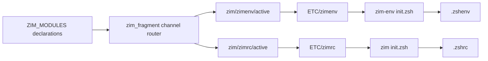

# Dual Zim startup channels

## What's up

Mise must be available from `.zshenv`, including non-interactive `zsh -c`
processes used by Compfuzor bins. The selected direction is not a raw mise
block plus an interactive Zim module. It is two configs managed by one Zim host
and one controller:

| Channel | Startup file | Config | Home | Modules |
|---|---|---|---|---|
| `zimenv` | `.zshenv` | `ETC/zimenv` | `~/.cache/zim-env` | `rektide/zim-mise` only |
| `zimrc` | `.zshrc` | `ETC/zimrc` | `~/.cache/zim` | the interactive module roster |

`ZIM_MODULES` entries default to `channel: zimrc`. An explicit `channel:
zimenv` routes a declaration into the early config. Producer fragments are
grouped as `etc/zim/<channel>/{active,disabled}/` and promoted to a remote input
with the same channel name.

## Mise semantics

`rektide/zim-mise` is loaded only by `zimenv`. It inspects Zsh's interactive
option when sourced:

- interactive shell: cache and source `mise activate zsh`, hook environment,
  and publish completions before the main Zim instance loads;
- non-interactive shell: cache and source `mise activate zsh --shims` only.

The two generated activation scripts have distinct cache names. This prevents
a non-interactive shell from populating a cache that later suppresses full
interactive activation. `mise.opt.pb` no longer owns Zsh activation blocks;
its Bash activation remains independent.

## Runtime isolation

Two configs cannot share `ZIM_HOME`, because Zim always builds
`${ZIM_HOME}/init.zsh`. The `.zshenv` loader therefore scopes both Zim variables
inside an anonymous function and removes the generated `zimfw` function after
loading. The `.zshrc` instance then establishes the ordinary global Zim control
context.

`zimfw-channel.sh <zimrc|zimenv> [action]` runs the shared controller with user
startup files disabled. Contributor promotion rebuilds every touched channel,
so `.zshenv` normally sources a prebuilt static init rather than performing
installation work.

## Config behavior

The generic config module already supports multiple independent outputs; it did
not need an instance or DAG extension. The work required was Zim-specific
routing and two static `CONFIGS` declarations. Both candidates are checked with
`zsh -n` before replacement.

Remote config inputs are symlinks. Assembly and generic toggles must follow
valid symlink targets while mutating the link path itself. Config compilation
also contributes glob directories to filesystem materialization.

## Cleanup boundary

Compfuzor does not automatically prune stale or undeclared fragments. Promotion
creates or updates declared links; removal is a deliberate operator action via
the remote config tooling. This is an explicit scope boundary, not missing
reconciliation behavior.

The channel migration changes both consumer directories, so legacy
`zimfw.conf.d` links are no longer read by either new config. Old generated
producer files may remain on disk without affecting the new channel outputs.

## Verification

- Zim fragment filter tests cover default, explicit, disabled, and invalid
  channel routing.
- Zim remote integration covers active and disabled fragments routed to two
  independent remote targets and one channel rebuild per touched channel.
- Config remote integration runs the real assembler against symlink inputs and
  exercises disable/enable.
- A redirected playbook render produced one mise-only `zimenv` tree and the
  remaining roster under `zimrc`.
- A real isolated Zim build confirmed that the `.zshenv` loader does not leak
  `ZIM_HOME`, `ZIM_CONFIG_FILE`, or the secondary `zimfw` function.

## Cross-references

- [`init0.gpt56.md`](/.design/zim-generator/init0.gpt56.md) established the
  earlier two-tier mise requirement and deferred explicit channel fanout. This
  revision implements fanout as two Zim configs rather than raw shell channels.
- [`doc/arch.md`](/doc/arch.md#config-assembly-and-filesystem-effects) documents
  the filename-keyed config interface and remote symlink lifecycle used by both
  channels.
- [`mise.opt.pb`](/mise.opt.pb) retains Bash and systemd integration while
  ceding all Zsh activation to `zimenv`.
- [`zim.opt.pb`](/zim.opt.pb) is the concrete host declaration, loader, status,
  and per-channel controller.
