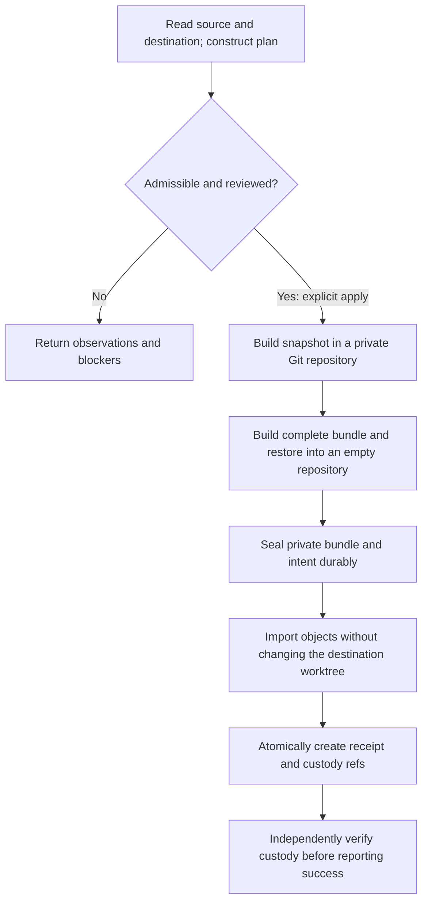

# Archive toolkit

**Keep source checkouts useful without treating local work as disposable.**

An archive here is a long-lived Git repository with a colocated jj checkout.
It can hold upstream history, local branches, unfinished work, and recovery
tips. It is a place to keep working with source—not a compressed backup file.

Our convention is `~/archive/<org>/<repo>`. The toolkit accepts explicit paths;
you do not need that directory layout to use its repository operations.

The tool grew out of Compfuzor's need to update these checkouts without losing
their local work. It is now both an operator-facing CLI and a reusable library.
Compfuzor consumes the same operations rather than owning a separate implementation.

## What it is for

There are two related, but deliberately different, jobs:

| Job | Starting point | Intended result |
|---|---|---|
| **Maintain an archive or deployment workspace** | A checkout you want to keep working in or using | Fetch upstream changes, preserve displaced local tips, and advance the selected checkout. |
| **Take custody of another checkout's work** | An older checkout whose history or uncommitted files must not be overlooked | Account for the selected Git work, preserve it in an existing archive, and leave evidence that can be verified without the old checkout. |

Use `deploy` for a Compfuzor deployment workspace, `refresh` for an explicitly
selected checkout, and `adopt` followed by `verify-adoption` for custody. The
last two jobs are not interchangeable:
the second. They are not interchangeable:

- **Refresh changes the active checkout.** It snapshots local files, imports
  refs, fetches, and advances the selected working copy. It can also move
  tracked bookmarks in the shared repo, saving divergent local tips first.
- **Adoption adds custody without switching either checkout.** It preserves
  selected objects under new refs and records what was preserved. It does not
  choose which recovered history an application should run.

This separation is the project's central boundary: **keeping work, using work,
publishing work, and retiring its old location are different decisions.**

## Start using it

You need system **Node 26**, **Git**, and **jj**. Custody has additional Linux
requirements explained under [Limitations](#limitations).

### Run the distributed file

[`archive/repo-jj-archive.ts`](/archive/repo-jj-archive.ts) is the distributable:
one executable TypeScript file containing the JavaScript dependencies. Copy
that file where you need it; no source tree or adjacent `node_modules` is needed.

```sh
# In the directory containing your copied distribution:
./repo-jj-archive.ts --help
./repo-jj-archive.ts health --dest ~/archive/ORG/REPO

# Explicit Node invocation works too:
node repo-jj-archive.ts refresh --help
```

The file bundles the application and its dependencies, **not Node, Git, or jj**.
Compfuzor provisions Node 26 through [`nodesource.repo.pb`](/nodesource.repo.pb).

### Work from source

In a Compfuzor checkout, install dependencies once and run the original modules
directly. There is no build step in the development loop:

```sh
pnpm install
node archive/src/repo-jj-archive.ts --help
node archive/src/repo-jj-archive.ts adopt --help
```

The remaining examples use this source entry. With a copied distribution,
substitute `./repo-jj-archive.ts` for `node archive/src/repo-jj-archive.ts`.

## Choose a workflow

### Maintain a checkout

Start by checking jj's view, then refresh only the checkout you intend to change:

```sh
node archive/src/repo-jj-archive.ts health --dest ~/archive/ORG/REPO

node archive/src/repo-jj-archive.ts refresh \
  --dest ~/archive/ORG/REPO \
  --repo https://github.com/ORG/REPO \
  --label REPO --branch main
```

`health` is a pinned, read-only jj query. It does not snapshot files or import
new Git refs. A healthy result is not a claim that the checkout is clean or
that all of its work has been backed up.

`refresh` composes the maintenance sequence: initialize or clone when needed,
snapshot, check remotes, fetch, save divergent local tips, and reconcile the
selected checkout. It fetches all branches from declared remotes by default,
without untracking any bookmark. Normal upstream movement fast-forwards a
tracked local bookmark. If a locally moved bookmark diverges from upstream,
the old local tip is saved as `compfuzor/save/<branch>-<datestamp>-<suffix>`
before the local bookmark is set to upstream. A branch already conflicted
before this fetch, or one tracking multiple remotes, requires manual resolution.

`--fetch-scope selected` fetches only the selected branch from the selected
remote. `--untrack selected` and `--untrack all` are explicit tracking
overrides; the default is `none`. `--no-save-displaced` leaves new divergent
bookmarks conflicted instead of saving and resolving them; if the selected
branch conflicts, the command fails rather than advancing its worktree.
Neither fetch nor save publishes commits to a remote.

For finer control, use `snapshot`, `harvest`, `remotes`, and `fetch` separately.
`fetch` now retains bookmark tracking by default. Its explicit `--untrack`
option changes tracking; unlike `refresh`, it does not reconcile a newly
conflicted bookmark or advance the checkout.

**`refresh --update false` is not a dry run.** It can still initialize jj,
snapshot/import, and manage declared remotes. There is no universal plan mode
for maintenance commands; the plan model below belongs specifically to adoption.

An existing remote URL mismatch fails rather than silently changing its meaning.
Inspect the reported URLs before using `remotes --reconcile` or
`refresh --reconcile-remotes` to authorize a change.

### Preserve an older checkout

An old checkout may contain more than its current branch: a detached HEAD,
annotated tags, older stash entries, reflog-only commits, and uncommitted files.
Cloning its upstream URL again is not an inventory of that work.

Stop other writers to both repositories, choose an **existing jj-colocated
destination**, and ask for a plan:

```sh
node archive/src/repo-jj-archive.ts adopt \
  --legacy /path/to/old-checkout \
  --dest ~/archive/ORG/REPO \
  --repo https://github.com/ORG/REPO \
  --label old-checkout --generation g0 --branch main --json
```

Here, `--legacy` is the source of work; `--dest` is where custody will live;
`--repo` declares the destination's expected origin URL. `--label` names this
custody lineage and `--generation` names one immutable capture within it.

For adoption, `--branch` identifies the branch used for recorded baseline
comparisons. It is not a request to keep only that branch or to deploy it;
the plan inventories the other refs and candidate work too.

No transfer happens without `--apply`. Planning may use private scratch to
compute a proposed snapshot, but does not change either repository. Inspect
the plan before deciding whether its proposal is the preservation you want.

## Understand the plan

A plan answers three questions together:

1. **What did we observe?** Source history, index and worktree state, candidate
   revisions, and the destination's current state.
2. **What would we preserve?** Selected tips, an exact proposed worktree tree
   when needed, and the refs that would protect the admitted transfer.
3. **May that transfer proceed?** Unsupported conditions, missing decisions,
   privacy review, and other admission checks.

It is not merely a list of commands or a prediction of `changed: true`.
The plan makes the boundary between **observed**, **selected**, **left behind**,
and **not yet known** available to both a person and an automation caller.

### Reading the result

| Part of the plan | What to look for |
|---|---|
| `state` and `blockers` | Whether this capture is admissible now. A blocked plan identifies work to do before applying. |
| `source` | HEAD, refs, candidates, index/worktree observations, ignored and excluded paths, and the source fingerprints. |
| `source.head.treePaths` | The exact committed HEAD manifest, including when the source needs no new working-copy snapshot. |
| `proposedSnapshot` | The proposed dirty tree's paths, modes and blob IDs. A blocked preview also exposes its manifest digest and review requirements. |
| `baselines` | The concrete locally observed refs and OIDs behind comparisons—not a claim about what every remote server contains. |
| `pins` | The concrete custody ref mapping for a ready plan. Blocked plans do not present an admitted pin set. |
| `warnings` | Relevant caveats that are distinct from blockers. |
| `retirementUnresolved` | Matters Git custody cannot settle, even if the transfer itself succeeds. |

**Unknown is not empty.** An uninspected category is `null`; an inspected
category with no entries can be `[]`. An inability to inspect something must
not become a reassuring claim that there is nothing to preserve.

`proposedSnapshot: null` needs its own interpretation: a clean source needs
no synthetic commit. Its committed files are still described by the HEAD
manifest. On a blocked plan, read the observations and blockers to distinguish
that case from an unavailable preview.

**Blocked is a useful planning result.** With `--json`, a valid blocked plan
exits successfully and prints its report. Automation must inspect `state` and
`blockers`, not treat exit code zero as permission to apply.

**Ready is not preserved.** It means the observed inputs meet admission rules.
No custody has been established until apply has installed the artifacts and
independent verification has checked them.

### Decisions belong to the observed content

Some candidate revisions require a `--dispositions` file: select a candidate
by its kind and full object ID, or explicitly mark it not required with a reason.
The tool does not decide that unfamiliar dangling history is disposable.

Sensitive included paths and a lost staged/unstaged distinction can require a
`--path-review` file. That approval names exact paths, modes and blob IDs and
binds to a manifest digest. It is not a blanket “force” flag.

`--exclude-from` applies only to **untracked** input. It cannot erase a tracked
credential or runtime file from history. A local-custody review likewise does
not make that history safe to publish.

The [review-file guide](/doc/archive-toolkit/custody.md#review-inputs) gives the
actual JSON formats. Keep saved plans and review files private and **outside
both checkouts**, so preparing the review does not itself change the capture.

### A plan is not a reservation

There is no saved-plan replay command. `adopt --apply` reads the current inputs
and plans again. It checks the source and destination repeatedly around staging
and transfer rather than trusting an earlier printout.

This is why review is content-bound: a changed blob cannot inherit approval
merely because it has the same filename. If the reviewed content changes,
inspect a fresh plan and update the decision where necessary.

Keep writers stopped throughout. Fingerprints detect drift; they do not turn
two live repositories into an atomic filesystem snapshot.

## From plan to custody to verification

After reviewing an admissible plan, repeat the invocation with `--apply`.
Include the same exclusion and decision files if the plan required them:

```sh
node archive/src/repo-jj-archive.ts adopt \
  --legacy /path/to/old-checkout \
  --dest ~/archive/ORG/REPO \
  --repo https://github.com/ORG/REPO \
  --label old-checkout --generation g0 --branch main --apply --json
```

For example, add `--dispositions /private/review/decisions.json` and
`--path-review /private/review/paths.json` when those decisions are needed.
Do not omit required reviews to bypass a blocked plan; apply enforces them.

The implementation keeps the stages separate:



### Why private staging matters

Git still does the Git work: writing trees and commits, making bundles, and
updating refs. The toolkit does not implement its own object database.

The staging repository keeps new objects out of the source. A separate index
alone is insufficient: Git can still write newly staged blobs into the source
object database. Private staging isolates **both** the index and object writes.

The resulting worktree snapshot is deterministic for the same parent, tree
and snapshot format. Its bundle is tested in an empty repository, not just in
the already-populated destination where missing objects could go unnoticed.

### Three artifacts with different jobs

| Artifact | Role | Where it lives |
|---|---|---|
| **Custody refs** | Protect exact selected tips with names that do not overwrite earlier captures. Branches, tags and other selected tips use separate lanes. | Destination Git refs: `refs/heads/harvest/…`, `refs/tags/harvest/…`, and `refs/adopt/custody/…`. |
| **Receipt** | Records the expected transfer: source identities, manifests, decisions, pin mapping and bundle checksum. | `adoption.json` in a metadata commit at `refs/adopt/receipts/<label>/<generation>`. It is not checked out into the worktree. |
| **Private bundle and intent** | Retain the self-contained Git transfer and its intended capture for restoration and diagnosis. | An owner-only `.compfuzor-adoptions/` vault beside the destination. |

A receipt records what should exist; it is not a certificate that those
objects are still present. Verification reads the evidence again.

### Verify without the old checkout

Use the full receipt ref returned by apply:

```sh
node archive/src/repo-jj-archive.ts verify-adoption \
  --dest ~/archive/ORG/REPO \
  --receipt refs/adopt/receipts/old-checkout/g0 --json
```

The verifier checks exact destination refs and object types, reachable object
closure, path manifests, and bundle bytes. It restores the bundle into a fresh
repository. None of that requires the old source directory to remain available.

Optional `--legacy /path/to/old-checkout` adds source-drift diagnosis. Historical
custody, subsequent source/destination drift, and unresolved retirement work
are separate results; a later edit does not itself erase a preserved revision.

Move the archive and its sibling vault together if relocating them. Copying
Git history alone is not enough for this verification contract: the receipt's
private bundle must also be present and readable with the required permissions.

### Retries preserve the original capture

An unchanged retry uses the original receipt and bundle; it does not mint a
new timestamped receipt or overwrite existing pins. A matching incomplete
installation can complete missing refs under the same immutable contract.

Changed capture inputs under an occupied generation are refused. Choose a
new generation, such as `--generation g1`, after reviewing the new plan. The
previous generation remains intact.

If apply fails after writing artifacts, it does not automatically roll them
back or delete them. Preserve the error and evidence, verify what exists, and
investigate before retrying. Failure is not proof that nothing happened.

## Limitations

### Why custody currently requires Linux

The Linux requirement comes from **our secure file-access implementation**, not
from Git, jj, Effect, or the idea of an adoption plan.

Custody verification opens a directory, then opens children relative to that
held directory through `/proc/self/fd/<fd>/…`. It uses no-follow flags and
checks the opened objects, rather than trusting a pathname checked earlier.

That matters because “check this is a safe file, then open its path” can read
a different file if a directory or symlink changes between those operations.
Vault contents may include private history, so the proof must use the checked
bytes—not reopen a path and assume it still identifies the same bundle.

This mechanism requires Linux with usable procfs. The vault also requires
effective-user ownership and no group/other access. Existing insecure
components are refused, not silently chmodded.

Porting custody means replacing this narrow file-access mechanism with an
equivalent guarantee. It does **not** require redesigning the plan or Git
transfer. Routine checkout commands are not inherently Linux-only, but this
project has not established cross-platform support for them.

### What is deliberately not promised

- **Destination creation during adoption:** `adopt` requires an existing,
  healthy jj-colocated destination. Initialize one separately if needed;
  `refresh` can do that, but also manages the selected checkout.
- **Live-repository consistency:** stop writers and keep paths stable. Drift
  checks are safeguards, not a lock or an atomic cross-repository snapshot.
- **Every Git repository variant:** linked worktrees, shallow/partial clones,
  alternates, submodules, unsupported filters/LFS and executable-helper
  configurations can block admission. Tree/blob-tipped custody is not supported.
- **Two independent dirty states:** one synthetic worktree tree does not
  preserve both the staged and unstaged versions. Review must acknowledge that
  loss where permitted; index-only staged work without a preserving snapshot
  is blocked for separate preparation.
- **Whole-directory backup:** ignored runtime files, excluded untracked files,
  jj operation history and repository metadata are not captured as a filesystem
  backup. Git custody does not establish a consistent database/WAL backup.
- **Remote publication or independent backup:** the vault is local. A recorded
  remote-tracking tip is a local baseline, not proof of what a server currently
  holds. Secret-path classification is not a complete secret audit.
- **Deployment or retirement:** the tool does not select a deployment workspace,
  publish recovered refs, prune old artifacts, or delete a source. Verified Git
  custody alone cannot establish that consumers and runtime state have moved.

See the [detailed admission boundary](/doc/archive-toolkit/custody.md#admission-boundary)
for the supported cases and the evidence each command does—and does not—provide.

## Command reference

Every command has `--help`. Select destinations explicitly; a useful command
name is not a substitute for understanding its mutation boundary.

| Command | Use it to |
|---|---|
| `health --dest DIR` | Inspect visible jj heads and conflicted bookmarks without snapshotting or importing. |
| `snapshot --dest DIR` | Explicitly run jj status, snapshot files and import colocated Git refs. |
| `harvest --dest DIR --label NAME [--kind TYPE] [--target REV] [--copy]` | Pin a revision under a unique recovery bookmark; `--copy` duplicates mutable work before pinning. |
| `remotes --dest DIR --repo URL [--remotes JSON] [--reconcile]` | Compare declared URLs; only `--reconcile` authorizes adding or changing them. |
| `fetch --dest DIR --label NAME [--remote NAME]` | Snapshot and fetch one remote without reconciliation. `--branch` limits fetched refs; `--untrack none\|selected\|all` is explicit. |
| `refresh --dest DIR --repo URL --label NAME` | Compose maintenance. Options include `--branch HEAD\|branch\|branch@remote`, `--remote`, `--remotes`, `--fetch-scope all\|selected`, `--untrack none\|selected\|all`, `--no-save-displaced`, `--update true\|false`, `--depth`, `--json`, and `--reconcile-remotes`. |
| `deploy --archive DIR --workspace DIR --repo URL --label NAME` | Create or refresh a deployment jj workspace with a colocated Git worktree; accepts the same fetch, tracking and save controls as `refresh`. |
| `adopt --legacy DIR --dest DIR --repo URL --label NAME` | Produce a custody plan; add `--apply` to transfer. Also accepts `--branch`, `--generation`, `--exclude-from`, `--dispositions`, `--path-review`, and `--json`. |
| `verify-adoption --dest DIR --receipt REF [--legacy DIR] [--json]` | Check installed custody, optionally comparing the old source too. |
| `heal --dest DIR --yes` | Back up `.jj` and re-adopt from existing Git refs. Explicit last resort, not recovery of missing Git objects or jj-only history. |
| `self [--archive-dir PATH] [--freshen]` | Find the conventional Compfuzor archive; optionally fetch its origin without resetting the worktree. |
| `complete SHELL` | Generate completion. Bash/zsh/fish use Effect's command tree; PowerShell currently covers command names and global flags only. |

For ghost-head failures, read the [incident and repair context](/design/repo-jj-archive/incident-ghost-heads.glm53.md)
before using `heal`. Its retained `.jj` backup is evidence, not a guarantee
that rebuilding jj metadata can recover objects Git no longer has.

## Compfuzor integration

[`repo_jj_archive.tasks`](/tasks/compfuzor/repo_jj_archive.tasks) calls
`deploy --json`. `ARCHIVE_SRC` is the shared repository at
`~/archive/<org>/<repo>`; `GIT_DIR` (normally `DIR/repo`) is a **real jj
workspace and colocated Git worktree** backed by that repository. A missing or
empty workspace path is created. An existing jj workspace of this archive
without `.git` gains a Git worktree via `jj git colocation enable`, retaining
its worktree files; subsequent runs are no-ops when already colocated. An old
symlink, standalone checkout, unrelated jj repository, or occupied `.git` entry
is refused without converting or deleting its contents. Fetching from
the deployment workspace does not use the archive main worktree as its
deployment checkout. **Creating** a workspace from an existing archive runs
`jj workspace add` in the archive; jj may snapshot previously unsnapshotted
files in the archive main `@` once. This preserves their contents and parent
but changes that `@` commit ID. Subsequent deployment refreshes run from the
dedicated workspace. With a custom `GIT_DIR`, `DIR/repo` links to that custom
workspace only if the exposure path is vacant or already points there.

`GIT_REMOTE_FIX=true` permits remote URL reconciliation. `JJ_FETCH_SCOPE`,
`JJ_UNTRACK`, and `JJ_SAVE_DISPLACED` expose the corresponding CLI controls;
the defaults fetch all, untrack none, and save displaced local tips. A
deployment with an old checkout or symlink needs a deliberate operator
cutover; the repository task does not silently migrate it.

The host's canonical Compfuzor checkout is preferred when its launcher is
executable **and supports `deploy`**. The executing playbook's launcher is the fallback.
`COMPFUZOR_REPO_JJ_RUNNER` overrides the selection.

`COMPFUZOR_SELF_FRESHEN=true` separately opts into fetching the host checkout's
origin. Choosing a runner is not itself an update of that runner's worktree.

The launcher at [`script/repo-jj-archive.ts`](/script/repo-jj-archive.ts) uses
source when source and Effect dependencies are available; otherwise it uses
the single-file distribution. Neither path requires a separate tool implementation.

A successful deployment's machine result is one JSON line:

```json
{"changed":false,"notices":[]}
```

Notices report created bookmarks and other repository changes. Failures use
stderr and a nonzero exit status, without partial JSON on stdout. The Ansible
task checks the return code before parsing the result.

The old flag-only refresh invocation remains compatible, including its
`--version BRANCH` spelling. Prefer explicit `refresh --branch …`; root
`--version` means the toolkit's version.

## Architecture and development

The CLI is one consumer of the library, not the place where repository policy
lives. [`archive/src/index.ts`](/archive/src/index.ts) exposes the operations
and data types; the domains below give the implementation its structure.

| Domain | Responsibility |
|---|---|
| [`cli/`](/archive/src/cli/) | Effect command definitions, compatibility arguments, human/JSON presentation, executable lifecycle. |
| [`repository/`](/archive/src/repository/) | Checkout operations, remote policy, and Git/jj invocation through Effect's process support. |
| [`recovery/`](/archive/src/recovery/) | Recovery bookmarks, explicit jj repair, immutable custody-ref transactions and retry policy. |
| [`custody/`](/archive/src/custody/) | Inventory and admission, plan/receipt contracts, private staging, vault storage, apply and independent verification. |

The plan is the shared boundary between inventory and apply. Its
[ready/blocked types](/archive/src/custody/model.ts) distinguish complete
admitted evidence from partial observations. Private preview can explain a
blocked proposal without returning a transferable stage or bypassing approval.

The [receipt codec](/archive/src/custody/codec.ts) checks durable claims and ref
mapping. The [verifier](/archive/src/custody/verify.ts) checks the actual objects
and bundle rather than trusting the receipt's own check flags.

Effect supplies CLI parsing, process execution and interruption. Git and jj
remain the repository engines. Existing maintenance APIs return Promises;
planning/apply return Effects. Promise adapters carry abort signals through to
child execution, so interrupting a command also terminates its active child.

See the [library guide](/doc/archive-toolkit/custody.md#public-library-entry-points)
for the concrete signatures. Run source during development; build only for
distribution, and commit the regenerated file with changes to reachable code.

```sh
pnpm check
node --test 'archive/test/**/*.test.ts'
python3 -m pytest --import-mode=importlib -q \
  tests/integration/repo_jj_archive.test.py \
  tests/integration/archive_library.test.py \
  tests/integration/archive_cli_contract.test.py \
  tests/integration/archive_custody_cli.test.py
pnpm build
```

The [verification checkpoint](/design/archive-toolkit/verification0.gpt6luna.md)
records 127 Node tests, 34 integration tests, reproducible bundle bytes, and
copied-bundle custody checks after source removal. Those are fixture results,
not a report of a production migration.

For deeper context, start with the [custody operator guide](/doc/archive-toolkit/custody.md),
the [implementation brief](/design/archive-migration/brief0.gpt6sol.md), and the
[focused safety review](/design/archive-toolkit/safety-review0.gpt6sol.md).
The review's cleared scope is Linux, quiesced paths and existing destinations;
it is not permission to retire a source or a claim that every brief feature exists.
