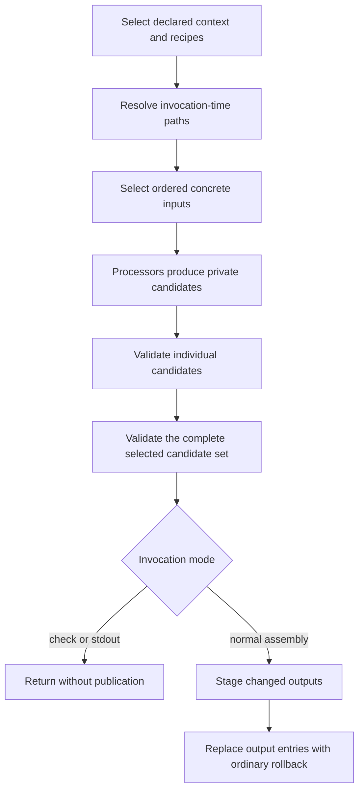

# Situation and evidence

The operator recalls splitting configuration into pieces during the Zim2/Mise2
work and asks whether assembly is a step within CONFIG. **Yes: assembly is an
existing CONFIG operation, not a new subsystem we need to invent.**

This report synthesizes the delegated source/history investigation. The parent
also read `assembly.ts`, `install.ts`, `publication.ts` and the maintained CONFIG
overview. No tests or live operations were performed for this report. Delegated
line references describe current repository sources, not upstream guarantees.

# The operator operations already exist

The fixed entry points are symlinks into the shared runtime, documented in the
[CONFIG overview](/doc/config/README.md):

| Operation | Meaning today |
|---|---|
| `config-sync-inputs.sh` | Copy/link selected canonical inputs into a consumer context. |
| `config-assemble.sh` | Bind recipes to a context, produce candidates, validate, and commit selected outputs. `--check` and `--stdout` do not publish. |
| `config-install.sh` | Either seed inputs and assemble into the consumer context, or deliver existing outputs using copy/link. |
| `config-publish.sh` | Copy/link existing canonical outputs to consumer destinations. It does not itself assemble or run the candidate transaction. |
| `config-inputs.sh` | Observe or mutate input slots, with rebuild behavior. |
| `config-status.sh` | Observe declared input/output state and drift. |

These are **operations**, not a mandatory six-step pipeline. In particular,
assembly is already a complete publication; calling it and then publishing
the same outputs again would misrepresent its contract. See
[`runAssemblyResult`](/files/config/assembly.ts#L108-L142),
[`installContext`](/files/config/install.ts#L34-L56), and
[`publishOutputs`](/files/config/publication.ts#L15-L30).

# The internal candidate transaction

[`config-run.sh`](/files/config-run.sh#L86-L269) owns input selection,
candidate production, recipe validation, the transaction-validation hook, and
commit/rollback. [`assembly.ts`](/files/config/assembly.ts#L56-L142) binds one
private resolved spec and invokes that runner once.

This is not crash-atomic visibility of all outputs. Registration/input mutation
and post-publication activation are also not automatically part of that output
transaction. [`withInputBatch`](/files/config/registration.ts) coordinates a
registration batch and one callback, restoring source slots after ordinary
failure; it is not a second artifact publisher.

# Where the remembered rework landed

The delegated history inspection identified the fixed-operation/module split
at `de4f370658d2` (September 13), multicall consolidation at `b68093ebd285`,
and direct runtime-model compilation at `dc44e0ba4fcd` (September 14).
The [command design](/design/config-context/command0.solx.md),
[completed simplification](/doc/config/simplification.md), and
[deployment log](/doc/config/log.md) record the progression.

The two domain workflows remain meaningfully different:

- **Zim:** CONFIG assembles the declarations; the Zim installation operation
  additionally projects loaders, builds channel caches, wires dotfiles and
  updates its registry. Those effects are not all within CONFIG's output
  transaction. See [`files/zim/runtime.ts`](/files/zim/runtime.ts) and
  [`activation.ts`](/files/zim/activation.ts).
- **Mise:** its independent Bash block installers did not acquire a fabricated
  CONFIG recipe graph. See [`mise2.opt.pb`](/mise2.opt.pb) and the
  [maintained overview](/doc/config/README.md#L124-L128).

Also, **`config.sh` is not `config-assemble.sh`**: it aggregates authored
configuration generators. Fixed CONFIG commands are deliberately excluded from
that compositor lane, except that `config-install.sh` participates explicitly
in install. See the [config compositor lane](/doc/config/README.md#L78-L112).

# Keybindings reuse the commit implementation, but have their own preparation

The current consumer operation resolves membership, captures and composes
declarations, prepares definitions/placements/root bytes, builds a dynamic
ordinary CONFIG spec, and invokes CONFIG once. Native closure validation runs
against the complete candidate set before CONFIG commits the artifacts.
See [`assembleConsumer`](/files/config/keybindings/consumer.ts#L416-L495) and
[`validateClosure`](/files/config/keybindings/closure.ts#L165-L235).

That higher-level preparation is **not automatically reached by the generic
`config-assemble.sh` dispatcher**. This is the integration gap an audience-aware
general action interface should address, rather than merely renaming
`keybindings.mjs`.

There is also a terminology trap: keybinding `--mode assemble` means **preserve
and require existing receiver placements**, rather than seed or refresh them.
It is not CONFIG's check/apply transaction mode. The generated host installer
does not hardcode it; the host CLI defaults to seed. See
[`consumer.ts`](/files/config/keybindings/consumer.ts#L327-L345),
[`runtime.ts`](/files/config/keybindings/runtime.ts#L99-L109), and
[`keybindings_compile.py`](/library/filter_plugins/keybindings_compile.py#L182-L191).

# Design implications, not yet implementation decisions

1. Reuse existing context selection and the candidate transaction for general
   action aliases. Do not introduce another assembly engine.
2. Keep preparation, input registration, candidate assembly/validation,
   copy/link delivery and activation distinct behind the small public interface.
3. If a general assembly operation should combine keybindings and other CONFIG
   recipes in **one** transaction, extract a preparation result with recipes,
   captured inputs and validation requirements. Calling the current complete
   committing consumer operation from inside a candidate leaf would nest
   publication instead of sharing the transaction.
4. Audience selection alone neither relocates deployment material nor chooses
   copy versus link versus assembly. Those policies need explicit treatment.

# Cross-references

- [Operator intent](/design/action-audiences/intent0.gpt61sol.md): the broader
  user-first audience and alias requirement driving this inquiry.
- [Consumer toolkit](/doc/config/consumer-toolkit.md): existing context,
  installation and delivery contracts to preserve.
- [Keybinding commit seam](/design/keybindings/commit-seam0.gpt61sol.md): why
  domain preparation wraps the existing transaction instead of replacing it.
- [CFR draft](/design/compfuzor-runtime/effect-draft1.gpt61sol.md): proposed
  narrower domain stages are future direction, not a shipped universal
  `assemble → publish` workflow.
