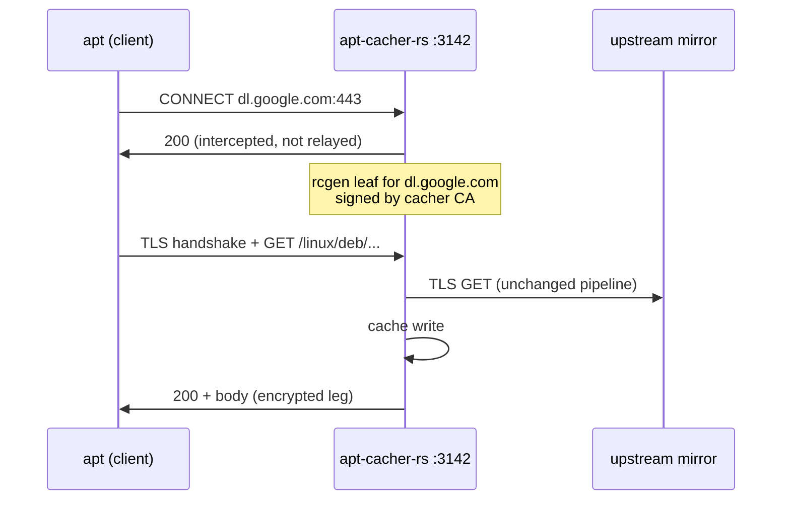

# apt-cacher-rs HTTPS serving — init0

Stage-setting: the host runs apt-cacher-rs v0.8.0 (service `apt-cacher-rs-git`, `:3142`,
`/etc/opt/apt-cacher-rs-git/apt-cacher-rs.conf`). Plain-http client URLs are fetched
over TLS upstream and cached (`https_upgrade_mode = Auto`); `https://` sources ride
CONNECT tunnels (`https_tunnel_enabled = true`, 14-host managed allowlist in
[`apt-cacher-rs.src.pb`](/apt-cacher-rs.src.pb)) which are uncacheable passthrough by
design — so chrome/vscode/tailscale/microsoft/jellyfin-class vendor repos are invisible
to the cache. Question: can the daemon *also* serve HTTPS — terminate TLS with its own
CA, decrypt, cache, re-fetch upstream over TLS (squid ssl-bump / apt-cacher-ng
CertAgent-style)? Researched against upstream HEAD 70dce92 (2026-09-08, 320 commits
past v0.8.0) at `/usr/local/src/apt-cacher-rs-git/repo`, plus GitHub issues/PRs.

## 1. Upstream verdict: nothing exists, nothing requested

- **No TLS-listener/MITM/CA code at HEAD.** The only rustls usage is *client*-side
  (upstream fetch): `build_rustls_client_config()` in `src/main.rs:405`, connector
  wiring in `src/hyper_conn.rs:99-102`. The accept loop is plain TCP
  (`TcpListener::bind`, `src/main_loop.rs:498`); no `TlsAcceptor` anywhere.
- **`rcgen` is a dev-dependency only** (`Cargo.toml:98`, under `[dev-dependencies]`),
  a leftover from the now-removed kTLS integration suite; zero uses in `src/`.
  Amusingly, the cert-generation crate a MITM feature would need is already in the
  dependency graph — just not wired to production code.
- **No issue or PR asks for it.** GitHub has 2 open issues — [#162 "packages from repo
  pkg.henderkes.com do not get cached"](https://github.com/cgzones/apt-cacher-rs/issues/162)
  (https-only vendor repo; reporter self-worked-around by flipping the source to
  `http://`, exactly the README's answer) — and nothing matching
  mitm/tls-listener/certificate-serving in open *or* closed items. Closed [#54 "HTTPS
  auto-upgrade causes problems"](https://github.com/cgzones/apt-cacher-rs/issues/54)
  was about upgrade mode, not serving.
- **The README documents the maintainer's answer** ("How to use"): *"If your sources
  contain HTTPS repositories you would like to cache as well, change their URL scheme
  to http:// to cache their packages"* — with the explicit note that apt's GPG
  verification covers integrity on the unencrypted client leg. `TODO` lists no MITM
  item.
- **Scope signals**: the maintainer measures ruthlessly and deletes what doesn't pay —
  d996155 "Drop the kTLS feature" (2026-09-05) removed kernel-TLS RX because the
  userspace loop beat it by 18% CPU per MiB. A client-facing TLS path that forfeits
  the zero-copy backend would face the same perf-first skepticism, though note kTLS's
  removal actually *simplifies* a bump patch (one fewer moving part).

## 2. Implementation surface (fork-level)

The workable shape is **CONNECT ssl-bump**, not a separate listener: keep one port,
and for allowlisted hosts intercept the CONNECT instead of relaying it.

What already fits:

- The hyper fallback backend is **generic over IO**:
  `handle_hyper_connection<T: AsyncRead + AsyncWrite + Unpin + Send>`
  (`src/hyper_conn.rs:2816`). A `tokio_rustls::server::TlsStream` hands straight into
  it — cache lookup, upstream TLS fetch, conditional requests, integrity checking all
  run unchanged, merely over an encrypted client leg. `tokio-rustls 0.26` is already a
  dependency.
- The interception point is clean: `request_dispatch::preflight_method` returns the
  `Tunnel` variant; `sendfile_conn.rs` currently hands the connection to
  `run_connect_tunnel` (relay via `copy_bidirectional_idle`,
  `src/connect_tunnel.rs`). A bump fork adds: after `validate_connect_target`,
  reply `200`, `TlsAcceptor::accept()` with a per-authority `ServerConfig`, then
  loop the decrypted stream through `handle_hyper_connection`.
- Host policy is ready: `https_tunnel_allowed_mirrors` (`src/config.rs:868`,
  fail-closed) is exactly the bump allowlist; our
  `script/apt-tunnel-mirrors.ts`-managed list transfers verbatim.
- `rcgen` promotion from dev-dep + a small CA/cert-cache module (~150 lines) gives
  per-host leaf certs; aws-lc-rs provider is already process-global
  (`src/main.rs:407`).

What resists:

- **The zero-copy backend cannot serve TLS.** `handle_sendfile_connection` is
  concrete over `TcpStream` (`src/sendfile_conn.rs:196`) and serves cache hits via
  `sendfile(2)`; the splice backend pipes through `splice(2)`. Every bumped
  connection degrades permanently to the userspace hyper backend (read/mmap →
  encrypt → writev). Correct, just not the project's pride and joy — at homelab
  throughput (184 MB saved on day one) irrelevant.
- **No mirror mapping exists** for origin-form requests: proxy GETs are always
  absolute-URI (`src/request_dispatch.rs:250`: "Proxy GET requests always use
  http://, HTTPS goes through CONNECT"), and origin-form paths hit "Unrecognized
  resource path" (issue #162's warning). So a "real" TLS origin listener where
  sources become `https://cacher:3143/...` would additionally need apt-cacher-ng-style
  path/vhost remapping — a much bigger feature. Skip that variant.

Size: core fork patch ≈ 300–500 lines (acceptor + CA/cert cache + CONNECT arm fork +
~5 config keys). To *upstream* standard — metrics, dashboard rows, integration tests
(they keep a backend-agnostic TLS suite), config validation/warnings, README security
notes — realistically 1–2k lines. There's no open issue to anchor a PR against, and
the README already blesses the http-flip workaround, so upstream appetite is
unknowable-but-lukewarm. This is fork-maintenance territory against an upstream that
lands ~320 commits per release cycle and reworks internals constantly (PR
[#189 "Bye hyper"](https://github.com/cgzones/apt-cacher-rs/pull/189) etc.).

## 3. What clients need, per design

**(a) CONNECT-bump (the design that fits).** Each apt client needs:
`Acquire::https::Proxy "http://cacher:3142/"` (CONNECT) plus trust in the cacher CA.
The key trick from `apt-transport-https(1)`: **`Acquire::https::CAInfo
"/etc/apt/apt-cacher-rs-ca.pem"`** scopes the CA to *apt only* — no
`update-ca-certificates` system-wide trust, so curl/gitolite/whatever never trust the
cacher key. Distribution across the tailnet fleet rides the same compfuzor channel
that already ships `Acquire::http::Proxy` in `apt-cacher-rs.src.pb` (drop the PEM +
one apt-conf line). Per-host `CAInfo::host` variants exist if scoping tighter matters.
Compromise note: a stolen cacher CA key lets an attacker serve *stale-but-signed*
packages (apt still verifies GPG; only rollback/replay opens up, partially mitigated
by Release `Valid-Until` windows) — not arbitrary code.

**(b) Non-apt clients** keep true passthrough automatically: bump only fires for
CONNECT targets on the allowlist; everything else relays as today
(`copy_bidirectional_idle`). `NO_PROXY`/`Acquire::*::Proxy::host "DIRECT"` for
opt-outs.

**(c) A dedicated TLS listener with a proxy-hostname cert** (tailscale certs,
step-ca) only belongs to the origin-server variant — which needs the mirror-mapping
feature apt-cacher-rs lacks (§2). Not worth building. If ever revisited: tailscale
`tailscale cert` on the MagicDNS name would issue the listener cert for free, and
step-ca would be overkill.

## 4. Alternatives, honestly

| Option | Caches https? | Cost here | Verdict |
|---|---|---|---|
| **apt-cacher-rs + http-flip** (status quo, `apt-src-scheme.ts n http`) | yes, for mirrors serving plain http | zero — already deployed, managed list | **the posture** |
| apt-cacher-rs CONNECT tunnels | no (passthrough) | zero — already deployed | keeps https-only vendors working |
| fork-patch ssl-bump (§2) | yes, all allowlisted | ~500-line fork, CA fleet distribution, permanent rebase drag | justified only if vendor-repo bytes dominate |
| [apt-cacher-ng `CertAgent`](https://salsa.debian.org/apt-cacher-ng/apt-cacher-ng) | yes, built-in MITM | second daemon, splits cache with apt-cacher-rs, project largely dormant | no |
| squid ssl-bump + apt-cacher-rs chained | yes | two proxies, CA + bump config, big surface for small fleet | no |
| mitmproxy regular mode | no cache at all | permanent service + chaining | no (wrong tool: it's a debugger) |

**The security tradeoff spelled out.** apt never trusted the transport for integrity:
`InRelease`/`Release` are GPG-signed against `signed-by` keyrings, and every `.deb`
hash lives inside those signed indexes — transport TLS is redundancy for integrity,
its real contributions are *confidentiality* and metadata hiding. With http-flip:
client→cacher leg is plaintext *but lives inside the tailnet's WireGuard tunnel*
(Tailscale encrypts L3 between nodes — the confidentiality TLS would add on that leg
is already present); cacher→upstream leg is TLS (`https_upgrade_mode = Auto`). So the
honest residual loss of flip-vs-MITM is: (1) confidentiality on the loopback/LAN hop
for same-box builds — mkosi on the cacher host is pure loopback, moot; (2) the cacher
sees and logs fetch metadata — which is the point of having a cacher. MITM-bump buys
encrypted-leg-to-the-cacher that WireGuard already provides, at the cost of a new
trusted CA on every client.

## 5. Recommendation, sized to reality

Fleet = 1 main box + a couple tailnet clients + mkosi builds; cache hit ratio just
became nonzero (184 MB saved today), and the *big* win — the Debian mirror — is
already cached via flip. The uncached remainder is third-party vendor repos, a modest
byte share. **Posture: flip what can flip (`apt-src-scheme.ts n http`), tunnel the
rest (`apt-tunnel-mirrors.ts`), revisit only on a trigger.** Concretely:

1. Keep the managed allowlists authoritative; re-run `apt-tunnel-mirrors.ts --journal`
   periodically to catch newly-added vendor repos and flip whichever of them serve
   plain http.
2. Don't fork yet. If a trigger fires — e.g. vendor-repo bytes visibly dominate
   misses on the dashboard, or the fleet grows past ~5 mkosi-heavy builders — the
   §2 sketch (~500 lines: `TlsAcceptor` + rcgen CA reusing the existing
   `https_tunnel_allowed_mirrors` list, routing decrypted conns to
   `handle_hyper_connection`) is a weekend-scale fork patch, and could be floated
   upstream as an issue+PR first (there's no competing request; the maintainer's
   README workaround suggests they'd want strong justification).
3. Meanwhile, one cheap probe: watch the dashboard's tunnel/passthrough counters for
   a week; if tunneled bytes are noise-level, close the question.

## References

- Upstream HEAD: `/usr/local/src/apt-cacher-rs-git/repo` @ 70dce92 (2026-09-08); v0.8.0 is 320 commits back.
- `src/main_loop.rs:498` (TCP-only accept), `src/hyper_conn.rs:2816` (IO-generic backend), `src/sendfile_conn.rs:196` (TcpStream-concrete zero-copy backend), `src/connect_tunnel.rs` (CONNECT validation + relay), `src/config.rs:794-868` (`https_upgrade_mode`, `https_tunnel_*`), `Cargo.toml:98` (dev-only rcgen).
- Commits: d996155 "Drop the kTLS feature", 7121a25 "Finish dropping kTLS".
- Issues/PRs: [#162](https://github.com/cgzones/apt-cacher-rs/issues/162) (open; https-only repo uncached, reporter flipped to http), [#54](https://github.com/cgzones/apt-cacher-rs/issues/54) (closed; upgrade-mode friction), PR [#189 "Bye hyper"](https://github.com/cgzones/apt-cacher-rs/pull/189). No MITM/TLS-listener request exists in any state.
- apt client side: `apt-transport-https(1)` — `Acquire::https::CAInfo` / per-host `CAInfo::host`, `Proxy`, `Verify-Peer` (local man page, apt 3.3).
- Local: [`apt-cacher-rs.src.pb`](/apt-cacher-rs.src.pb) (tunnel allowlist, client proxy conf), [`apt-srctools.etc.pb`](/apt-srctools.etc.pb) (`apt-src-scheme.ts n http`), [`doc/apt.md`](/doc/apt.md) (nodesource https source templating).
