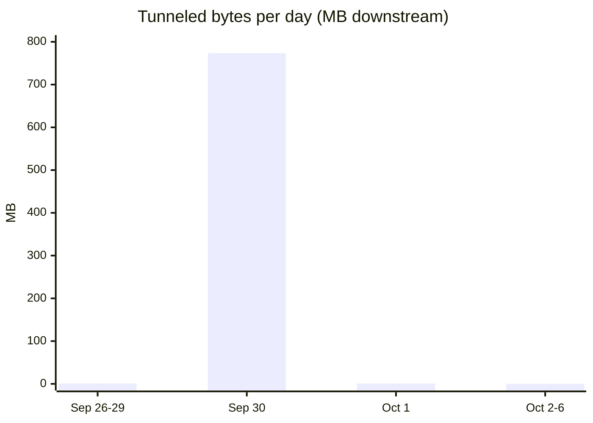

# apt-cacher-rs status — status0

Point-in-time: **2026-10-06 15:45:24 UTC (11:45 EDT)**, taken *during* an in-flight
mkosi full-desktop trixie build (journal streaming debs up to the snapshot instant,
11:45:39 EDT). Baseline for deltas: same morning 15:22 UTC, captured just before
build traffic began. This is a read-only audit — nothing was restarted, reloaded,
or reconfigured.

## 1. Deployment state

| what | state at snapshot |
|---|---|
| unit | `apt-cacher-rs-git.service`, loaded/enabled (`/etc/systemd/system/apt-cacher-rs-git.service` → `/etc/opt/apt-cacher-rs-git/apt-cacher-rs-git.service`), active (running) since **2026-09-26 13:34:49 EDT** (9d22h) — a redeploy/restart, not a reboot (host up since 2026-08-10) |
| unit alias | `Alias=apt-cacher-rs.service` is **declared but not instantiated** — `systemctl status apt-cacher-rs` → "could not be found" (see §6) |
| binary | `/usr/local/bin/apt-cacher-rs`, real file, built ~2026-08-21 from main@≈`ae16747` (2026-08-08) = **v0.8.0+125**; dashboard reports `0.8.0` (unbumped Cargo version on main) |
| source checkout | `/usr/local/src/apt-cacher-rs-git/repo`, main @ `70dce92` (2026-09-08) = v0.8.0+320 → **binary ~195 commits behind the checkout** |
| config | `/etc/opt/apt-cacher-rs-git/apt-cacher-rs.conf` — verified live posture matches the playbook template: `https_upgrade_mode` left at default `Auto` (conf:61), `https_tunnel_enabled = true` (conf:47), `https_tunnel_max_connections_per_client = 25` (conf:49), 14-host managed tunnel allowlist (conf:50–58, `BEGIN/END tunnel-mirrors` block from [`script/apt-tunnel-mirrors.ts`](/script/apt-tunnel-mirrors.ts)), `disk_quota = '5Gi'` (conf:20), client ACLs incl. tailscale `100.64.0.0/10` (conf:30–31) |
| state | cache `/var/lib/apt-cacher-rs-git/cache` (1.1GB at snapshot, per `sudo du` — dir is 0700 to the daemon user), SQLite `apt-cacher-rs.db` 516kB + WAL |
| runtime features | `TLS=rustls hyper=true mmap=true sendfile=true splice=false ktls=false`; bind `:: : 3142`; quota 5.37GB; usage retention 30d, by-hash 90d; max upstream downloads 20 |
| consumers | this host's apt (`Acquire::http::Proxy` snippet shipped as `30proxy`, [`apt-cacher-rs.src.pb:113-119`](/apt-cacher-rs.src.pb)); mkosi builds (`APT_PROXY` default `http://127.0.0.1:3142/` → multiversal `[Build] ProxyUrl=`, [`mkosi.src.pb:29`](/mkosi.src.pb), `:96-101`, README `:429-437`); tailnet clients **allowed but absent** (§5) |
| predecessor | [`apt-cacher-ng.srv.pb`](/apt-cacher-ng.srv.pb) — superseded, kept only for old releases still shipping the package |

## 2. Current numbers vs morning baseline

~23 minutes of live mkosi build traffic between the two readings:

| metric | 15:22 UTC baseline | 15:45 UTC now | Δ |
|---|---|---|---|
| fetched from upstream | 3.01GB | 3.51GB | **+0.50GB** |
| served to clients | 3.35GB | 3.87GB | **+0.52GB** |
| bandwidth saved | 332MB (9.9%) | 365MB (9.4%) | +33MB |
| hit ratio (persisted) | 9.5% (219/2303) | 8.1% (240/2947) | +21 hits, ratio **down** |
| hits / misses (runtime) | 206 / 1852 (10.0%) | 226 / 2528 (8.2%) | +20 / +676 |
| cached files | **1 deb** / 226 meta / 217 by-hash | **671 debs** / 236 meta / 222 by-hash | +670 debs |
| disk usage | 344MB (6.4%, peak 53.7%) | 936MB (17.4%, peak 53.7%) | +592MB, no quota pressure |
| integrity verified | 1842 | 2517 | +675, mismatch still 0 |
| free disk (fs) | 194GB | 192GB | −2GB |

Read: exactly the designed behavior for an empty-deb-pool first build — misses by
design, deb pool repopulating (670 debs in ~23 min), hit ratio *diluted* (8.2%)
because hundreds of one-shot misses now dominate the denominator. The 20 new hits
are mostly volatile metadata re-syncs across the build attempts (`Served cached
volatile file …`, 25 such lines today) plus repeat deb deliveries — e.g.
`libqt6webenginecore6` (64.9MB) shows **3 deliveries / 195MB total delivered** in
Top Packages: fetched once, ~130MB saved across re-attempts. Cross-attempt dedupe
works when the pool is warm; the pool was empty because yesterday's cleanup
evicted it (see §4).

Live-traffic texture at the snapshot instant: 2 connected clients (lifetime peak
13), 1/20 active upstream downloads (peak 5), 1 active client download (peak 3),
0 tunnels. Journal since 15:20 UTC: 2462 lines, 807 new pool-file downloads,
throughputs ~11.5MB/s to the client and ~11MB/s upstream per line, delivery path
`via channel` (late-joiner streaming) dominant. Lifetime delivery counters make
the same point: channel 2545 reqs/3.46GB vs mmap 37/286MB, sendfile **1**/64.9MB,
copy 204/13.7MB — with an empty pool there was almost nothing to serve from a
complete file, so the zero-copy paths barely fired today (they will on re-builds).

Mirror rows moved as expected: `deb.debian.org/debian` 282MB → **716MB** (830
files: 646 debs/184 metadata, 11.1% efficiency); `deb.debian.org/debian-security`
703kB → **158MB** (54 fetches, 134MB — dominated by a 108MB
`linux-image-6.12.111+deb13` security kernel, 0% efficiency, one-shot);
`mirrors.kernel.org/debian` and `debian-debug` unchanged (§5).

## 3. The init0 probe answered

[`init0.glm53.md` §5.3](/design/apt-cacher-https/init0.glm53.md) proposed: *watch
the tunnel/passthrough counters for a week; if tunneled bytes are noise-level,
close the question.* The counters now span 10 days:

| day | tunnel connects | tunneled downstream |
|---|---|---|
| Sep 26–29 | 26 | ~0.8MB |
| **Sep 30** | **191** | **773.5MB** |
| Oct 1 | 9 | 0.7MB |
| Oct 2–6 | 0 | 0 |

The lifetime 775MB/437kB (down/up, 226 connects, 2 transfer failures, peak 12
concurrent) is **99.8% one day**: Sep 30, and 93% of that day is three vendor
installs — clickhouse 269.3MB (20 tunnels), microsoft 242.5MB (16), cursor
208.1MB (14), plus mise 51.5MB; every other host ≤1MB. Since Oct 1: **zero**
tunnel connects. Recurring tunnel traffic is the ~0.7MB of index refreshes an
`apt update` does across vendor repos.

Assessment against the probe's terms:

- Against the *cached-serving* total (3.87GB served) or upstream-fetched total
  (3.46GB), lifetime tunneled bytes are **not** noise — 775MB ≈ 18% of all
  upstream egress. In absolute terms the init0 framing "vendor-repo bytes are a
  modest byte share" undersold one bursty day.
- But the probe's actual trigger — *vendor-repo bytes visibly dominate misses* —
  **has not fired**. The tunneled bytes are episodic one-shot installs, not
  steady-state: today alone the cached path fetched +0.50GB in 23 minutes of
  build (the recurring workload), while tunnels moved 0 bytes in 5+ days. A
  MITM/bump fork would have saved ~700MB once (Sep 30 reinstall-class events)
  and ~1MB/day thereafter, at the cost of the ~500-line fork + CA fleet
  distribution init0 sketched (§2, §4 table).
- Also relevant: the Sep 30 burst was *this host installing tools*
  (clickhouse/microsoft/cursor/mise), not fleet traffic — one-off by nature.

**Verdict: close the question.** Posture stands as init0 §5 left it — flip what
can flip, tunnel the rest, no fork. Reopen only on init0's other trigger (fleet
grows past ~5 mkosi-heavy builders), not on byte counters, which this week
argues are a solved distribution: burst + trivia.

## 4. Health signals

All the failure-mode counters are clean, lifetime, through today's heavy traffic:

- **integrity: 2517 verified, 0 mismatched, 0 throttled**, 17 unverified (no
  known digest — expected for odd pool files), registry 381,902 entries.
- **0**: cache I/O failures, DB operation failures, rate-limit cancellations
  (upstream and client), upstream retries, quota rejections, cache
  non-regular/unexpected files, size corruption, protocol violations,
  unsolicited 206s, logstore evictions. DB queue never blocked (peak 4/128,
  0 dropped; batch flushes by-size 5 / by-time 89, peak 256 — healthy mix).
- **one lifetime blemish, not today's**: a single 5xx to a client, one
  upstream-read timeout, one aborted download, one hyper pre-response failure —
  all the same 2026-09-30 22:22 UTC event, visible in `/logs`: daemon-internal
  https-upgrade fetch of `dists/experimental/InRelease` from deb.debian.org
  timed out once. apt retried; no recurrence in 6 days.
- **startup noise, cosmetic**: every daemon start logs 11 WARNs —
  `https_tunnel_allowed_mirrors entry X is not permitted by allowed_mirrors`
  for each vendor host. v0.8.0-era validation grumbling; tunnels demonstrably
  work (Oct 1 batch). A rebuild onto post-0.8.0 main (fail-closed ACL, commit
  03ef57d) changes this semantics — the deployed explicit allowlist already
  matches what HEAD enforces (playbook README `:289-299`).
- **memory**: dashboard RSS 105MB (baseline 26.9MB idle) — grown with the
  working set, unalarming. The systemd cgroup view is fatter: 705MB current /
  **1.3GB peak**, including page cache for cache-file writes, with **306MB
  swapped** (peak 324MB). Nothing to act on for a one-host fleet; worth a glance
  after rebuilds since main's churn is constant.
- **cleanup**: today's daily run 11:00:53 EDT removed 0 files (retained 218,
  220ms) — the deb pool was *already empty*, emptied by yesterday's cleanup
  (lifetime evictions 1663 files / 2.54GB, unchanged today). So the
  "aggressive eviction" is retention/reference pruning on an idle pool, not
  quota: peak disk ever is 53.7% (2.88GB) of the 5.37GB quota — **quota has
  never bound**. Today's build re-grew the pool to 936MB (17.4%) mid-build.
- **quota sizing for mkosi desktop builds**: today's traffic (+0.50–0.6GB so
  far, still streaming) and the by-size top packages (plasma wallpapers 267MB,
  kicad-packages3d 257MB, qt6webengine 64.9MB×3, linux-image 108MB, firefox
  81.3MB) put a full 846-package desktop build in the ~1.5–2GB range. 5.37GB
  comfortably holds 2–3 builds' debs for cross-build reuse; eviction between
  builds comes from daily reference pruning, not the quota. The durable deb
  layer for *repeated identical builds* is correctly mkosi's own
  `PackageCacheDirectory` ([`mkosi.src.pb:92`](/mkosi.src.pb), README `:96-101`)
  — the cacher's job is the shared HTTP-level dedupe across hosts/attempts, and
  that division of labor is working.

## 5. What's using it

- **Clients: still only `127.0.0.1`** (3.86GB served, 2942 requests). Tailnet
  clients remain absent despite the `100.64.0.0/10` ACL — the fleet's second
  consumer lane is theoretical so far. Journal also shows occasional serves to
  `127.0.0.2`, which the daemon logs as its *internal client*
  (self-revalidation/upgrade fetches; cf. `/logs` "Request of internal client
  …") — not a fleet client, and not broken out in the dashboard table.
- **Mirrors (4)**: `deb.debian.org/debian` 716MB/76.5% (trixie builds),
  `deb.debian.org/debian-security` 158MB (today's security kernel),
  `mirrors.kernel.org/debian` 54.5MB — 30 metadata files, 0 debs, last seen
  Oct 5 02:41 EDT, origin bullseye/main last seen Sep 30: old-release
  (bullseye) index traffic from *some local client whose sources point at
  kernel.org* rather than deb.debian.org. It's an explicit `allowed_mirrors`
  entry (conf:24), so not a bypass — but it splits the bullseye metadata cache
  across two mirrors (both have bullseye rows in Origins). Harmless at this
  scale; worth knowing which config sends it there if it bothers anyone.
  `deb.debian.org/debian-debug` 6.97MB, aging (last seen Sep 13).
- **Uncacheables: 2 lifetime** — `apt_3.3.3.dsc` + `.tar.xz` source-package
  fetches (Sep 30): unsupported pool filenames, proxied without caching (WARN
  in `/logs`). Source-package builds are rare here; fine to leave.
- **Tunnel ACL rejections: 32 lifetime** CONNECTs to hosts outside the
  allowlist (0 today). This is exactly the drift signal
  [`script/apt-tunnel-mirrors.ts --journal`](/script/apt-tunnel-mirrors.ts)
  harvests; a periodic re-run keeps it at zero.

## 6. Observations & recommendations

Sized to a one-host fleet (init0 §5's framing), in rough priority:

1. **The https-serving question is closed** (§3). No action; revisit only on
   fleet growth, not bytes.
2. **Fix the unit alias**: `Alias=apt-cacher-rs.service` is declared in the
   unit but the symlink was never created — `systemctl status apt-cacher-rs`
   says "not found" (verified 2026-10-06). One `sudo systemctl reenable
   apt-cacher-rs-git.service` instantiates it. (Not done: read-only audit, and
   a build was in flight.)
3. **Hit ratio is low by design; don't tune for it.** 8.2% runtime reflects a
   metadata-heavy workload, one-shot vendor kernels/wallpapers, and daily deb
   pruning on an idle pool. The wins that matter — cross-attempt dedupe during
   build sessions (qt6webengine ×3) and volatile metadata hits — show up in
   "bandwidth saved" (+33MB this morning) regardless.
4. **Quota is well-sized; leave `5Gi`.** It has never bound (peak 53.7%).
   If desktop builds become daily-and-varied enough that pool churn between
   builds annoys, the lever is *retention/usage semantics*, not quota — or
   simply lean on mkosi's `PackageCacheDirectory`, which is the intended
   durable layer anyway.
5. **Version drift is real but low-urgency.** Binary = v0.8.0+125 (built ~Aug
   21); checkout main = v0.8.0+320 (Sep 8). The deployed conf is already
   compatible with HEAD's fail-closed tunnel ACL (playbook `:289-299`), so a
   rebuild-on-redeploy (`ansible-playbook … apt-cacher-rs.src.pb` + install.sh)
   is safe whenever one is next in the area; no upstream release beyond 0.8.0
   is being missed, since main never bumped the version string.
6. **Minor journal noise**: ~7.4k INFO lines/day during builds (2462 in 25
   build-minutes) — fine for journald; the 11 startup WARNs (§4) are the only
   misleading lines, and they self-resolve on rebuild.
7. **Tailnet lane unused**: consider actually pointing a second box at
   `workhorse:3142` (snippets + `client-install.sh` already exist, playbook
   `:237-257`) — the cache's whole shared-dedupe pitch is unrealized while the
   client table is one row. The `disk_quota` note in the playbook ("revisit as
   the client population grows") is the only thing to re-check then.

## Cross-references

- [`design/apt-cacher-https/init0.glm53.md`](/design/apt-cacher-https/init0.glm53.md) — prior inquiry whose §5.3 probe this doc answers (§3); §2's fork sketch remains the contingency plan.
- [`apt-cacher-rs.src.pb`](/apt-cacher-rs.src.pb) — deployment source of truth: conf template `:48-112`, client snippet `:113-119`, tunnel posture `:84-109`, redeploy notes `:289-299`.
- [`mkosi.src.pb`](/mkosi.src.pb) — consumer wiring: `APT_PROXY` `:29`, `ProxyUrl` `:96-101`, README apt-caching section `:427-437`.
- [`script/apt-tunnel-mirrors.ts`](/script/apt-tunnel-mirrors.ts) — allowlist manager; its `--journal` mode is the remedy for §5's 32 rejections.
- [`apt-cacher-ng.srv.pb`](/apt-cacher-ng.srv.pb) — superseded predecessor, kept for old releases.
- [`doc/apt.md`](/doc/apt.md) — compfuzor's apt-source declaration layer (how vendor repo stanzas that end up tunneled get declared).

## References

- Dashboard snapshot 2026-10-06T15:45:24Z: `curl -s http://127.0.0.1:3142/` (Daemon Status / Configuration / Cache Statistics / Metrics / Mirrors / Origins / Clients / Top Packages / Uncacheables sections); `/logs` ring (15 entries).
- `systemctl status apt-cacher-rs-git` (11:45 EDT); `systemctl cat apt-cacher-rs.service` → "No files found"; `Alias=` confirmed in `/etc/opt/apt-cacher-rs-git/apt-cacher-rs-git.service`.
- `journalctl -u apt-cacher-rs-git` slices: since 2026-10-06 11:20 EDT (traffic/health), `--since 2026-09-30 --until 2026-10-01` (tunnel burst, per-host awk sum), `grep 'Tunneled client'` since 2026-09-26 (per-day table §3).
- Live conf: `/etc/opt/apt-cacher-rs-git/apt-cacher-rs.conf` (lines cited in §1).
- Cache sizes: `sudo -n du -sh /var/lib/apt-cacher-rs-git/cache/` → 1.1GB (plain `du` hits 0700 perms).
- Upstream: `/usr/local/src/apt-cacher-rs-git/repo` — `main` @ 70dce92 (2026-09-08), `v0.8.0` tag commit date 2026-05-29, `v0.8.0..main` = 320, `v0.8.0..ae16747` = 125; binary mtime 2026-08-21.
- Baseline (15:22 UTC) numbers as captured by the operator pre-build and quoted in the tasking; all deltas computed against them.
