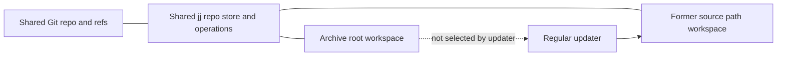

# Converting a standalone checkout into an archive-backed jj workspace

## Result

For a **clean checkout whose canonical archive path is absent**, the tested
topology is:

1. Move the complete checkout directory to `~/archive/<org>/<repo>`, retaining
   its `.git` and (if already present) `.jj` metadata together.
2. If it was plain Git, initialize jj there with `jj git init --colocate`.
   Skip this for an already colocated jj/Git repository.
3. From the archive checkout, use `jj workspace add --colocate --revision @`
   to create a new workspace at the now-vacant former checkout path.
4. Copy the original working-tree files from the archive root into that new
   workspace, **excluding its generated top-level `.git` and `.jj` metadata**.
   This is needed for ignored/runtime files; `jj workspace add` materializes
   versioned files, not ignored local state.
5. Verify both roots, content, refs, worktree linkage, and the workspace list.

This is an actual shared workspace, not a second clone: its `.jj/repo` points
to the archive repository store and its `.git` points to a linked Git worktree
sharing the archive's Git common directory. The archive root remains the
original/main workspace; the former source path gets a distinct per-workspace
working-copy commit. Fixture updates in that second workspace changed its own
`@` while leaving the archive root's `@` unchanged.

**Important limit:** moving the complete root does not preserve path bindings
for already-attached workspaces outside that root. On the current Compfuzor
checkout, read-only inventory found several external jj workspace roots and
Git linked worktrees. A whole-root move makes those paths stale unless each is
deliberately rebound. This migration is therefore not yet safe as a one-shot
operation on the current repository. A plan for existing sibling workspaces
and any pre-existing canonical archive is a separate required decision.

This is structural research only. No production checkout or archive was
converted. All `mv`, workspace creation, and `rsync --delete` experiments ran
in `.test-agent/archive-workspace-conversion/`.

## What is up

The desired result is a whole-repository structural change: the long-lived
repository lives at the canonical archive path, while the familiar source path
continues to exist as a jj workspace of that same repository. This is distinct
from preserving selected Git objects in another existing repository, and
distinct from the later routine that fetches/reconciles an update into a
selected workspace.

The archive toolkit currently distinguishes `refresh` (maintain and mutate
the selected checkout) from `adopt` (take local custody without switching
either checkout); neither command itself makes one existing checkout a jj
workspace of another. See the [operator workflow boundary](/archive/README.md#what-it-is-for)
and the [custody limitations](/doc/archive-toolkit/custody.md#admission-boundary).
The earlier [deployment workspace premise](/design/archive-deployment-premise/draft0.glm53.md)
describes why future refresh/build operations should target a dedicated
workspace rather than make archive-main checkout state load-bearing.

## Evidence and versions

- Installed CLI: `jj 0.45.1-33d3a595429b7e3b54a8ea769560247913bc8a1b`.
- First-party source was checked at `~/archive/jj-vcs/jj`, resolving to
  `/mnt/bitblaster/archive/jj-vcs/jj`, HEAD
  `803ef00a0a6ee4ddc275d3138d5f9e7326399906` (`jj 0.45.1`, 2026-09-27).
  The binary's embedded commit hash differs from this source HEAD, so the CLI
  experiments below are the version-specific behavioral evidence; source links
  explain the corresponding implementation at the checked-out commit. The
  source checkout also has unrelated existing edits; it was read only.
- The checkout at `/home/rektide/src/compfuzor` currently has 9 registered
  workspace names. Several roots are outside that directory; one registered
  root could not be resolved, and Git listed two already-prunable worktree
  entries. This is why the sibling-workspace caveat is concrete, not
  hypothetical.
- At research time, `~/archive/rektide/compfuzor` did not exist, and
  `~/src`/`~/archive` were on the same filesystem. These are observations, not
  preconditions to assume at execution time; recheck the chosen target and
  device at migration time.

## What `jj workspace add` actually permits

The installed command and source agree on these rules:

- The destination can be absent or an **empty** directory. A nonempty
  destination fails with `Destination path exists and is not an empty
  directory` and leaves its marker files intact. There is no force/attach-over-
  files mode.
- `jj workspace add` uses the repository of the current workspace. Its new
  `.jj/repo` file points to that same repository store; it does not absorb or
  import another repository's Git history.
- With `--colocate`, jj asks Git to create a linked worktree. The new `.git`
  file targets the same Git common directory, but the worktree has its own
  `.git/worktrees/<name>/index` and per-worktree HEAD.
- Pass `--revision @` for the observed current working-copy commit. If omitted,
  the new working-copy commit is based on the **parents** of the current
  workspace's working-copy commit; it is not necessarily the selected `@`
  tree.
- Each workspace has a different working-copy commit and sparse patterns;
  bookmarks/refs and repository history are shared.

The occupied-path guard is in [Jujutsu upstream `workspace/add.rs`](https://github.com/jj-vcs/jj/blob/803ef00a0a6ee4ddc275d3138d5f9e7326399906/cli/src/commands/workspace/add.rs#L132-L145).
Creation of the linked Git worktree and invocation of
`init_workspace_with_existing_repo` are at [the same source file](https://github.com/jj-vcs/jj/blob/803ef00a0a6ee4ddc275d3138d5f9e7326399906/cli/src/commands/workspace/add.rs#L147-L173).
That function writes the relative `.jj/repo` pointer and registers a separate
working copy at [upstream `workspace.rs`](https://github.com/jj-vcs/jj/blob/803ef00a0a6ee4ddc275d3138d5f9e7326399906/lib/src/workspace.rs#L374-L413).

### Supported clean conversion: existing plain Git checkout

In the disposable standalone-Git fixture, this sequence preserved the
original refs, tag, main-ref reflog file, and an otherwise-unreferenced Git
object. The original archive-root `.git/index` hash remained unchanged; Git
created a separate linked-worktree index for the source path. An ignored
runtime file remained at the archive root and, after the explicit file-tree
copy, was present in both roots. Tracked filesystem manifests matched.

```sh
# Run only after an explicit clean-input admission and an absent-destination
# check. `source` and `archive` are placeholders, not real paths to execute.
mv -- "$source" "$archive"

(
  cd "$archive"
  jj git init --colocate
  jj workspace add --colocate --name source-workspace --revision @ "$source"
)

# Mirror source files, not the new workspace's repository pointers.
# Restrict this to a freshly-created destination and inspect the excludes.
rsync -a --delete --exclude='/.git' --exclude='/.jj' "$archive/" "$source/"
```

For an already-colocated jj/Git checkout, omit `jj git init --colocate` and
move the complete root (including `.jj` and `.git`) together. The new workspace
step is the same. `jj git init --colocate` is the supported bridge for a plain
Git checkout: when `.git` already exists, jj opens that repo, imports its refs,
and snapshots the current worktree. See [upstream `git/init.rs`](https://github.com/jj-vcs/jj/blob/803ef00a0a6ee4ddc275d3138d5f9e7326399906/cli/src/commands/git/init.rs#L195-L247).

The copy step is not the operation that makes a workspace; it only restores
filesystem state that jj does not materialize from history (notably ignored
files). Excluding `.git` and `.jj` is essential: those are newly-created links
for the added workspace, not the archive root's metadata to copy over. The
fixture used `rsync -a --delete` only in a new disposable workspace. A
production implementation should stage/verify exact inputs and constrain any
delete-capable copy to the known fresh workspace. More complete preservation of
ACLs, xattrs, hardlinks, ownership, or other filesystem-specific attributes
needs its own copy policy; the fixture established content, executable/mode
and ordinary symlink semantics only insofar as represented by `rsync -a`.

### Dirty state and the admission gate

Do not let the first mutating jj command decide whether dirty input is
acceptable. Most jj commands snapshot the working copy at start. In the dirty
Git fixture, `jj git init --colocate` automatically snapshotted staged changes,
unstaged changes, and a nonignored untracked file into the new working-copy
commit. A following named bookmark pinned that whole tree. The ignored runtime
file stayed outside the commit. The staged/unstaged distinction was collapsed;
the Git index hash changed. This matches the archive custody guide's warning
that a worktree snapshot is one tree, not preservation of separate Git index
states.

For a colocated checkout, plain `git status --porcelain` is a read-only way to
detect staged, unstaged, and untracked filesystem state before invoking jj.
`jj --ignore-working-copy status` is **not** a dirty-worktree check: tested
after editing a file, it reported no changes because it deliberately ignored
the filesystem and used the last recorded working-copy state. Plain `jj
status`, conversely, snapshotted the edit and changed `@`. A preflight for a
non-colocated workspace needs an independent no-snapshot filesystem comparison;
do not assume `--ignore-working-copy` provides it.

Recommended policy boundary:

- Default: refuse migration if the selected source worktree has unrecorded
  changes, staged-only changes, merge state, or other unresolved input. Keep
  the source at its original path until the refusal is reported.
- Explicit alternate: snapshot the intended working-tree tree, place a
  durable operator-named bookmark on that snapshot before structural changes,
  and separately disclose that staged/unstaged state is collapsed. Decide
  explicitly whether/how to retain the original Git index bytes.
- Preserve ignored/runtime files by copying them into the new workspace and
  verify path/content manifests; they are not protected by a jj commit or
  bookmark.

The upstream command itself confirms `jj status` snapshot behavior in
[working-copy docs](https://github.com/jj-vcs/jj/blob/803ef00a0a6ee4ddc275d3138d5f9e7326399906/docs/working-copy.md#L5-L18),
and documents that `workspace remove` deletes ignored files at
[the workspace lifecycle section](https://github.com/jj-vcs/jj/blob/803ef00a0a6ee4ddc275d3138d5f9e7326399906/docs/working-copy.md#L74-L99).
Use `workspace forget` rather than `workspace remove` where a directory's
ignored/runtime files must remain on disk.

## Existing external workspaces are a migration blocker

Jj records workspace identity in two path-bearing places:

1. Every secondary workspace's `.jj/repo` is a relative path to the shared
   repository directory. The loader interprets the file contents relative to
   that workspace's `.jj` directory. See [upstream `workspace.rs`](https://github.com/jj-vcs/jj/blob/803ef00a0a6ee4ddc275d3138d5f9e7326399906/lib/src/workspace.rs#L572-L590).
2. The repository's `workspace_store/index` records each workspace root
   relative to the shared repo path. Moving the main `.jj/repo` changes the
   base for every external relative path. See [upstream
   `simple_workspace_store.rs`](https://github.com/jj-vcs/jj/blob/803ef00a0a6ee4ddc275d3138d5f9e7326399906/lib/src/simple_workspace_store.rs#L151-L180).

The disposable external-workspace fixture confirmed both failures. After
moving the main root, an existing sibling's `.jj/repo` still named the old
path and jj could not load the repository. Rewriting that sibling pointer to
the new archive store made `jj status` work again, but
`jj workspace root --name sibling` still failed: the repo-level index pointed
to the old relative location. This manual pointer edit was a diagnostic only,
not a recommended production operation. `jj workspace add` cannot update the
existing populated workspace path in place, and the CLI has no workspace
relocate command in the tested version.

Colocated Git worktrees have their own `.git` pointers and can also break when
the common `.git` root moves. `git worktree repair <path>` repaired the Git
pointer in the fixture (the first run printed a path mismatch warning while
repairing; a second run was quiet and returned success), but it did not repair
the jj `.jj/repo` link or Jujutsu's workspace-store index. Do not treat a Git
repair as a complete jj workspace migration.

Any real plan must inventory *all* registered jj workspaces and Git worktrees,
including missing/prunable ones, and decide whether to:

- stage and recreate external jj workspaces while preserving their exact
  working-copy revisions and filesystem state;
- repair version-specific path metadata deliberately with verified backups; or
- defer migration until those workspaces are resolved by their owners.

Automatic pruning is not appropriate. `workspace forget` leaves workspace
files on disk, while `workspace remove` deletes ignored data. An interrupted
migration must keep the relocated archive and any source-side staging copy
until the operator verifies every attached workspace; no cleanup/reconcile
behavior is inferred here.

## Failure, retry, and rollback boundaries

Treat the move and workspace registration as separate checkpoints, and record
the source/archive paths, current `@`, workspace names, refs, Git common dir,
index state, and file manifests before changing anything.

| Stopping point | Safe next action | Do not do |
|---|---|---|
| Before moving | Abort with source untouched if dirty state, destination occupancy, filesystem boundary, or workspace inventory is unresolved. | Do not initialize jj in the source merely to test it; that can snapshot or alter the index. |
| Whole root now at archive; jj init not yet done (plain Git only) | Confirm archive is the intact moved checkout and source path is vacant; initialize there once. If this was already jj-colocated, skip init. | Do not create a second archive repo or clone over the moved `.git`. |
| jj initialized; old path not yet registered | Inspect `.jj` and workspace list. If initialization completed, proceed with `workspace add`; don't initialize again. | Do not infer from exit status alone that refs/history were checked. |
| `workspace add` succeeded; file copy incomplete | Confirm the registered workspace name/root and `.jj/repo`/`.git` pointers; rerun only the bounded data-copy step from the still-complete archive root, excluding metadata. | Do not rerun `workspace add` into the now-populated destination; don't copy archive `.jj` or `.git` over the new pointers. |
| File copy complete; verification incomplete | Preserve both roots and all metadata; compare manifests and refs, then inspect every existing workspace binding. | Do not delete a staging/source copy, prune worktrees, or declare the migration complete. |

One source-level caveat: jj 0.45.1 creates the Git worktree before initializing
the jj workspace (`workspace/add.rs` lines 147–173). Those are separate Git and
jj metadata writes, not one cross-store atomic transaction. I did not inject a
failure between those calls. If `workspace add` errors or is interrupted,
inspect `git worktree list`, `jj workspace list`, and the destination's `.git`
and `.jj` state before deciding whether to resume or recover; do not retry
blindly.

The tested `mv` was same-filesystem. If source and archive are on different
filesystems, `mv` is not an atomic directory rename; use a separately planned
copy-to-staging plus verification while retaining the original, and account for
filesystem metadata that the chosen copy tool does not preserve. This research
did not test a cross-device transfer. A rollback after `workspace add` is not a
simple `mv archive source`: the old path is occupied by an attached workspace
and Git worktree. Stop at that boundary and recover from the recorded
checkpoint; do not improvise metadata surgery or remove ignored files to make
the path empty.

## Existing canonical archive is a separate case

`jj workspace add` attaches to the jj repository selected by the command's
current workspace; it does not combine repositories. Therefore:

- An archive that merely has the same remote URL, project name, or overlapping
  history is not enough to make the old checkout a workspace of it.
- If the archive is already the repository whose refs/objects should be shared,
  the selected old-checkout revision must already be available there (or first
  be imported through an explicit ref/object-preservation policy). Then create
  a workspace from that archive repo at a deliberately selected revision.
- `jj git init --git-repo <path>` creates a new jj repo backed by an existing
  Git repository; it does not graft that new jj metadata onto a different
  archive's existing jj repository.
- If the archive target is a different repository, stop before moving or
  overlaying anything. Source-object/ref import, local-only objects/reflogs,
  ref-name collisions, and archive working-copy policy need a separate plan.

Thus the absent-target whole-root-move fixture establishes one safe topology,
not a general policy for collisions with `~/archive/<org>/<repo>`.

## One-time conversion vs regular update pipeline

The conversion creates the permanent relationship. It is not a recurring
refresh technique: do not forget/re-add the workspace or move its `.jj`/`.git`
metadata on each update.

After conversion, a routine updater should explicitly target the dedicated
workspace path (or its stable workspace name) for checkout/reconciliation. It
can use the same repository's shared Git remotes, bookmarks, and objects while
changing only that workspace's working-copy commit. The archive's default
workspace remains a real checkout and may still be dirty; the updater must not
implicitly operate on it. This matches the intent in the
[deployment premise](/design/archive-deployment-premise/draft0.glm53.md), but
does not specify bookmark push/pull policy, conflict handling, or deployment
symlink ownership.



## Fixture matrix

All evidence is under the gitignored
[fixture directory](/.test-agent/archive-workspace-conversion/README.md):

| Fixture | What was exercised | Result |
|---|---|---|
| `standalone-git-fixture.sh` | Clean plain Git repo → whole move → `jj git init --colocate` → `workspace add --colocate -r @` → restore ignored runtime files | refs, tag, raw main reflog, unreachable object, and tracked file manifest preserved; new workspace shares Git common dir and has its own index |
| `whole-move-fixture.sh` | Already-colocated jj/Git repo; whole move and workspace add | archive remains original workspace; old path becomes linked workspace; runtime copy required |
| `occupied-add` evidence | Add against populated directory | exact nonempty-destination error; marker bytes and workspace list unchanged |
| `dirty-snapshot-fixture.sh` | Git staged + unstaged + nonignored untracked + ignored input through `jj git init` | jj snapshots tracked/untracked nonignored changes; optional bookmark pins snapshot; stage boundary collapses; ignored file stays outside |
| `jj-preflight-fixture.sh` | Modify working tree then compare ignored vs normal jj status | `--ignore-working-copy` does not inspect dirty disk state; normal `jj status` snapshots it |
| `external-workspaces-fixture.sh` | Existing external jj+Git sibling across main-root move | jj pointer breaks; Git repair and manual jj pointer repair are separate; repo-level workspace root mapping remains stale |
| `sparse-transfer-fixture.sh` | Sparse-empty add then copy files and reset sparsity | reset emitted skipped-update/conflict warnings despite final clean tree; do not use this complication when the ordinary full checkout works |

Run only the shell fixtures in this scratch directory; they refuse to overwrite
an existing case/evidence directory. They are research reproductions, not a
conversion tool or production-ready migration runner.

## Cross-references

- [Archive toolkit operator guide](/archive/README.md#what-it-is-for) — prior
  art for refresh vs custody adoption; this workspace conversion is neither
  command's current contract.
- [Archive custody guide](/doc/archive-toolkit/custody.md#admission-boundary) —
  supporting boundary for worktree snapshots, ignored input, and the loss of
  staged/unstaged distinction.
- [Archive deployment premise](/design/archive-deployment-premise/draft0.glm53.md)
  — downstream update/deployment use of a dedicated workspace; this document
  tests how one can be created from an existing checkout.
- [Jujutsu 0.45.1 upstream working-copy docs](https://github.com/jj-vcs/jj/blob/803ef00a0a6ee4ddc275d3138d5f9e7326399906/docs/working-copy.md#workspaces)
  — normative workspace behavior and lifecycle, including ignored-file caveat.

## Open decisions

1. Should migration require no external workspace entries, or should it
   preserve/rebind every external workspace as part of the same transaction?
2. If existing archive content is present, what exact rule establishes that it
   is the repository to join, and which refs/objects are imported before the
   workspace is created?
3. For optional dirty snapshotting, is one combined tree plus bookmark
   sufficient, or must the original Git index be retained as a restorable
   artifact?
4. Should the eventual updater own one stable workspace path, or should a
   deployment layer create a separate per-consumer workspace? Keep that choice
   separate from the one-time structural conversion.
