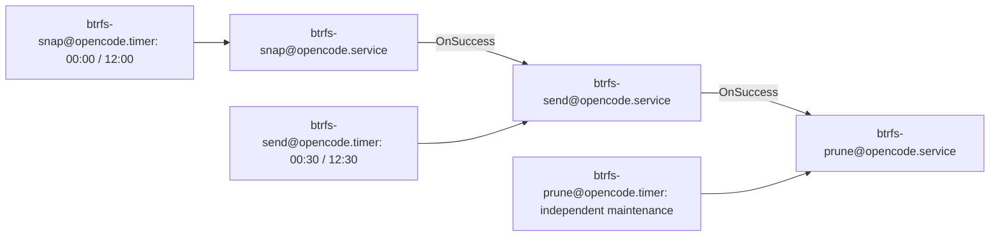

# OpenCode btrfs archive backup: detailed design

## Situation and agreed direction

The [incident handoff](/design/btrfs-opencode-backup/handoff.glm53.md) describes
loss of the only SQLite copy on a nearly-full root btrfs filesystem. Protect the
entire OpenCode data directory, not just its main database. User decisions in
gentle-star: snapshot every **12 hours**, archive **send stream files**, use atomic
**DB + WAL snapshots**, then obtain **g enhancement suggestions** before Sol-medium
implementation. No checkpoint, periodic shutdown, general `gen_btrfs`, or SSH
receiver in this slice.

Archive destination and retention are not yet selected. Build and test inactive
machinery first. Migration, installation/activation, and a real restore drill are
separate operator gates. Existing unrelated working-copy changes are out of scope.

Review prompt: examine archive-chain recoverability, publication after crashes,
mount identity, tight-space outage behavior, migration rollback, and actual btrfs
and systemd semantics; suggest concrete improvements without expanding into a
general backup framework.

## Safety invariants

1. Source is a dedicated btrfs subvolume; snapshot pool is on that filesystem,
   outside the source. Reject overlapping source/pool/archive/state paths.
2. Archive mount is present, explicitly identified, and has a different filesystem
   identity from the source. Never silently write onto root when an external mount
   disappears. An archive directory alone is not proof of a mounted target.
3. Snapshot is readonly. DB, WAL, and other data files are captured together;
   exclude nothing. SQLite recovery/validation happens on a writable restored copy.
4. A successful send is not proof of recoverability: it proves only stream creation
   and durable publication. Restore evidence is a separate status.
5. Publish neither a failed stream nor a manifest advertising missing data.
6. Delete only artifacts positively owned by this dataset and capability. Unknown
   files/subvolumes are errors or ignored foreign entries, never cleanup targets.
7. Preserve a usable incremental parent while possible; if it has to be removed,
   rebase via a new full stream. Do not force parent availability by leaking snapshots.
8. Archive retention operates on complete full+incremental chains, not individual
   streams. Never strand an incremental file whose parent was deleted.
9. Root executes only root-owned installed code and config, never mutable checkout
   or user-owned scripts. No arbitrary shell expansion from config.
10. No migration, service signals, live deletion, or timer activation from tests.

## Implementation ownership and layout

Use TypeScript directly with Node type stripping, existing Vitest and tsgo tools,
async filesystem/process APIs, no new runtime dependency. Place code in
`files/btrfs-backup/` grouped into config, archive, snapshot, retention, and CLI
modules as needed; units in `files/btrfs-backup/systemd/`; targeted tests under
`tests/btrfs-backup/`; maintained operating guide in `doc/btrfs-backup/README.md`.
Keep these separate from the older [btrfs playbook](/btrfs.pb) and
[home subvolume playbook](/btrfs.user.pb), neither of which implements this protocol.

Install reviewed files to `/usr/local/libexec/btrfs-backup/`; config to
`/etc/btrfs-backup/opencode.json`; state under `/var/lib/btrfs-backup/opencode/`;
snapshot pool proposal `/var/lib/btrfs-snap/opencode/`. Actual installation is gated.
Installer is explicit, does not start/enable units, and never migrates data.

## Per-dataset configuration

JSON schema validated at runtime; unknown keys rejected. Dataset names restricted
to a small safe alphabet. Root-owned config contains paths and policy, not commands.

| Field | Meaning |
|---|---|
| `dataset` | `opencode`; must match the unit instance |
| `source` | `/home/rektide/.local/share/opencode` |
| `snapshotDir` | Dedicated owned snapshot pool on source filesystem |
| `stateDir` | Local ownership metadata and operational status |
| `archiveDir` | Dedicated archive directory on chosen off-source filesystem |
| `archiveMount` | Required exact mountpoint, not merely containing `/` |
| `archiveFilesystemUuid` | Operator-pinned expected mounted filesystem UUID |
| `localMaxAgeHours`, `localMaxCount` | Local window and strict count admission cap |
| `localMinAvailableBytes` | Refuse new snapshot below headroom floor |
| `archiveMaxAgeHours`, `archiveMaxChains` | Whole-chain retention limits |
| `archiveMinAvailableBytes` | Destination admission headroom, not a size guarantee |
| `fullEveryHours`, `maxChainLength` | Bound dependency depth and allow chain expiry |

No active example with invented destination/retention. Provide a clearly incomplete
example and validator so missing decisions fail closed. Proposed policy for later
approval: 48h local / max 5 snapshots, 14d archive, full every 7d, max 14 streams per
chain. A 12h timer does not guarantee exactly two snapshots daily (manual runs,
persistent catch-up, failures); enforce both age and count. Retention is not a disk
byte quota: changing 23GB frequently can exhaust space even under small counts.
No balance, VACUUM, qgroup setup, or disk reclamation outside owned snapshots.

## Unit graph and concurrency



System units perform btrfs operations as root; the OpenCode server remains a user
unit. All mutating commands acquire the **same per-dataset advisory flock**; same
service serialization alone is insufficient across snapshot/send/prune. Bounded
lock wait, nonzero failure on contention (not false OnSuccess). Installed wrapper
uses util-linux `flock` around the Node CLI. Timers use `Persistent=true`; calendar
cadence defaults to 00:00 and 12:00 local time, explicitly document DST. Send retry
can be configured independently without another snapshot. No swallowed pipeline
errors. Journald records IDs, full/incremental choice, byte/hash publication, skips,
prune rationale, and failures. Confirm `OnSuccess` support with installed systemd.

Prune has an independent timer because target outage must not disable local
retention. Snapshot admission never exceeds count/headroom caps: maintenance can
delete expired owned snapshots, but a stopped maintenance timer cannot cause
unbounded accumulation. Local pruning does not depend on the destination being
mounted. Archive pruning does; failure there must not prevent local policy.

## Snapshot identity and inventory

Name snapshots with sortable UTC time plus unique suffix, never timestamp alone.
Record btrfs UUID, source UUID, creation time, and readonly property. Publish local
ownership metadata atomically; interrupted snapshot creation is reconciled only
when identity/ownership can be proven. Never adopt arbitrary pool contents by name.
Snapshot creation rechecks source/pool filesystem, source subvolume identity,
nesting, free space, and admission count under the lock. Nested subvolumes are not
recursively snapshotted: reject them in the protected source or document an explicit
coverage failure, rather than silently claiming the directory is fully protected.

## Stream archive protocol

Each chain has a full root followed by zero or more incrementals. Each published
entry is an immutable directory containing `stream.btrfs` and `manifest.json`:

```
archiveDir/<chain-id>/<snapshot-id>/
  stream.btrfs
  manifest.json
```

Manifest version 1 includes dataset, chain ID, snapshot ID/UUID/source UUID,
creation time, full/incremental mode, parent ID/UUID if incremental, byte count,
SHA-256, and completion time. No compression in v1: remove an extra failure stage;
compression/encryption are later explicit extensions. Mode 0700 directories and
0600 files protect sensitive OpenCode content; root-owned manifests are not exposed
to the user server. These permissions do not replace offsite encryption.

Send selects the newest unsent snapshot (intermediate missed snapshots may be
skipped), avoiding an outage backlog. If a prior published snapshot remains locally
readonly with matching UUID and its entire archive chain is present, send with
`btrfs send -p`. Otherwise start a full chain. Force a full when chain age/length
limits demand it. Switching destination/source must not reuse an old parent's state.

Write stream into a unique staging directory **on the archive filesystem**. Wait
for successful btrfs exit; hash and count streamed bytes without loading the stream
into memory; fsync stream, manifest, and staging directory; rename to final entry;
fsync parent directories. Parent hierarchy creation must also be made durable.
Atomic publication of the directory is the completion point. Local last-send state
is only a cache: after a crash reconstruct from verified published manifests and
local UUID inventory. A crash after publication but before local stamp update must
not resend or invalidate the published backup. A manifest is authoritative only
after schema, dataset, parent chain, and file-size validation; restore verifies hashes.

ENOSPC, disconnect, killed send, or fsync failure leave no advertised completion.
Never delete source or parent on failure. Incomplete staging artifacts are reported;
explicit owned-staging cleanup, if implemented, requires identity proof and lock.
No automatic cleanup of unknown target artifacts. Mount identity is rechecked at
operation boundaries; a disappearing mount during I/O must fail, not redirect writes.

## Retention and rebasing

Local policy drops expired/excess owned snapshots oldest first. Keep newest and the
last published parent when within configured limits; if limits require deleting
the parent, record/reconcile its absence and the next send is full. Unsent snapshots
may expire during outage: this is an intentional recovery-point loss, logged visibly.
No promise to retain all unsent snapshots and simultaneously cap local growth.

Archive policy removes **closed complete chains** only. Keep the newest chain
regardless of age; individual expired entries within it cannot be removed. Age is
evaluated from chain's newest recovery point, not the full root date. The active
chain can exceed age retention until rollover succeeds; report this exception.
Archive count caps are chain caps, not stream count. On destination space failure,
delete only eligible older complete chains, never the last chain to gamble on a new
full send. If headroom remains insufficient, fail and request operator intervention.
Actual streamed size is unpredictable, so publication must tolerate ENOSPC safely.

## Restore protocol and evidence

Choose a specific published recovery point, validate manifest relationships and
every SHA-256, then replay full root followed by its ordered incrementals into an
empty **btrfs** restore directory. Require explicit restore target, ensure it is not
source/pool/archive, and never overwrite an existing received subvolume. Receive
without changing parent readonly/received UUID during replay. Make a writable
snapshot of the selected received subvolume for SQLite recovery/inspection; opening
the raw readonly receive may fail when SQLite needs WAL recovery or SHM writes.

Drill under `/home/rektide/tmp-opencode/` only after capacity and btrfs checks. Run
SQLite `PRAGMA quick_check;`, optionally full integrity check, and compare relevant
session counts/IDs with recorded expectations. Do not launch OpenCode against the
live source or scan `$HOME`. Verify a two-stream chain, not just a full receive.
Document CLI replay commands and evidence; automate validation only if it can fail
closed without live-path access. Checksum success alone is not a restore drill.

## Migration: separate reviewed runbook, not auto-install

Recheck incident facts; inspect current service/process tree, writers, mount, bytes,
and source ownership. Inventory only the data directory. Capture unit configuration
and health/session evidence before the outage. Obtain explicit operator approval.

Stop the user service with a bounded wait. Escalation to killing its whole cgroup
requires explicit approval; verify all writers are gone, not just MainPID. This
session may be served by OpenCode: arrange an out-of-band shell before stopping it.
Never silently kill the agent's transport.

Create sibling subvolume, copy preserving ownership/modes/xattrs with reflink where
supported (fail rather than silently incur an unbudgeted full copy), verify contents
while stopped, then swap directories under a controlled outage. Multi-rename swap
is not atomic: record exact names and recovery commands for each intermediate state.
Retain the original directory as rollback evidence. Restart service, verify DB opens
and expected sessions are visible, then take first snapshot/full archive/drill.
Rollback after resumed writes must preserve the new directory: swapping back blindly
would lose post-migration sessions. Original cleanup is a separate explicit action,
never automatic retention. No VACUUM or broad home scan.

## Tickets and acceptance gates

Epic `compfuzor-btrfs-opencode-backup`: recoverable, bounded, off-filesystem archives.
Children use that prefix and these suffixes:

1. `design`: design + g suggestions + Sol decision record; unresolved deployment
   values remain explicit. Commit design before incorporating review.
2. `engine`: config, identity guards, shared lock, inventory, readonly snapshots;
   fake-process tests prove admission and foreign-path refusal.
3. `archive`: full/incremental durable publication, crash reconciliation, manifest
   chain validation; failures cannot advertise completion.
4. `retention`: local outage bounds and complete-chain archive pruning; test parent
   loss/full rebase, unknown ownership refusal, last-chain protection.
5. `units`: independent timers and OnSuccess edges, root-owned explicit installer;
   validate unit files when available, never enable during tests.
6. `restore`: replay/checksum tooling or precise runbook, migration/rollback guide,
   targeted mocked fault tests and isolated privileged scratch integration where
   authorized; report which evidence was actually obtained.
7. `deploy`: blocked on operator destination/policy approval, out-of-band migration,
   installation, successful two-stream SQLite drill, and timers seen enabled. Keep
   open if environment or approval is missing; code tests do not close this ticket.

Engine precedes archive/retention; units consume the established CLI; restore tests
exercise integrated behavior; deployment depends on all build/evidence tickets.
Each coherent implementation stage is committed with explicit owned file paths.

## Verification matrix

Test empty archive/full send; two snapshots/incremental; no work/no-op; missing
parent/rebase; corrupt or foreign manifest; source UUID change; readonly mismatch;
source nesting; absent/wrong/same filesystem mount; symlink escape; concurrent units;
snapshot count/headroom; unreachable target with local expiry; interrupted stream;
manifest/rename/fsync failure; crash after publish; whole-chain expiry; last-chain
preservation; restore checksum and ordering; unsafe restore paths. Fault injection
uses temporary artifacts under `.test-agent/btrfs-backup/` with its own README.

Read installed btrfs/systemd manuals before fixing parser/feature assumptions.
Current reconnaissance: btrfs-progs v7.1 available; `systemd` is not on PATH. Do not
mistake missing executable for proof that systemd is absent; inspect systemctl and
systemd-analyze. Live filesystem facts from the handoff require fresh verification
at deployment, not during design by recursively scanning data.

## Cross-references

- [Handoff](/design/btrfs-opencode-backup/handoff.glm53.md): incident facts, original
  capability boundaries, and migration/drill guardrails.
- [Existing btrfs scripts](/files/btrfs/): historical subvolume tooling, not an
  archive protocol; inspect for relevant behavior, do not invoke on live data.
- [Disk balance tool](/files/disk-cleanup/btrfs-balance.ts): explains why balancing
  this full filesystem is not assumed to provide migration/backup headroom.
- [Project operation guidance](/AGENTS.md): local Ansible connectors/bypass flags;
  this slice deliberately does not introduce a general generator playbook.
