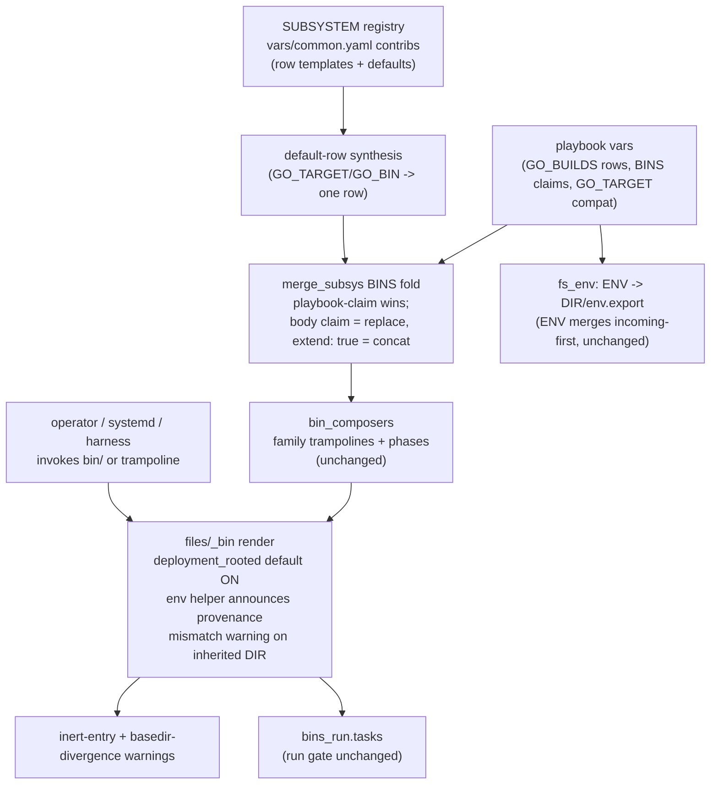

# Build-lane modularization — declared build rows, reversed fold precedence, pinned deployment identity

## Result

The dolt incident's three stacked failures all reduce to one architectural
fact: **a build lane's knowledge lives inside generated shell bodies that the
declaring playbook cannot shape, executed in an environment the bin does not
own**. The go lane hardcodes `basedir: repo` in a `generated:` blob; the
`bins_generated` fold lets the contrib overwrite playbook fields (and
concatenates bodies so a playbook override still runs the contrib text); the
env helper trusts an inherited `$DIR` and sources the wrong deployment's
`env.export` silently; the install half guesses output location with
`$(pwd)/${INSTALL_BIN:-$TYPE}`.

The proposal, in five moves:

1. **Declarative build rows for every compiled lane** (generalize cmake's
   `CMAKE_BUILDS`). Go gains `GO_BUILDS: [{name, module_dir, target, output,
   install}]`; the default row is synthesized from `GO_TARGET`/`GO_BIN` so all
   19 existing GO playbooks render identically. Rows share a controlled field
   vocabulary (`module dir`, `target`, `output`, `exposure policy`) without
   forcing one universal schema — cargo must not fake cmake's `build_dir`/
   `generator`.
2. **Reverse the BINS fold precedence.** Playbook declarations win over
   contribs: same-name claim **with a body** replaces the contrib bin
   entirely; a metadata-only claim patches fields; explicit `extend: true`
   restores today's concat. This completes policy the machinery already states
   — `ENV` and `TOOL_VERSIONS` are merged `incoming-first` (playbook wins);
   `BINS` is the outlier at `current-first`.
3. **Pin deployment identity inside bins.** Generalize the existing
   `deployment_rooted` mechanism (already the default for family trampolines,
   opted into by five hand-authored bins) to all contrib-generated bins:
   derive `DIR` from the script's own location, with an opt-out and a loud
   mismatch warning when an inherited `$DIR` disagrees.
4. **Make env sourcing announce itself.** The env helper prints which env
   file it sourced (and for which deployment); the `bin claims X, sourced
   env of Y` mismatch becomes mechanically visible. `envdefault`'s
   only-unset contract stays untouched.
5. **Warn on inert BINS metadata.** Entries with no body, no src, and no
   `files/<TYPE>/` template — dolt's old `build.sh`/`install.sh`, and
   skyboard's `install.sh` today — get a gen-time warning, plus a
   family-compositor check when members disagree on `basedir`.

Migration is phased with fleet-diff gates; no existing playbook is required to
change, and the two existing escape hatches (`<SUBSYS>_BINS: False`
suppression, same-name tombstones) keep working and become redundant rather
than load-bearing.

## Incident grounding

The [dolt conversion report](/design/archive-workspace/dolt-conversion0.glm53fx.md)
records the failure chain in run 2; the pre-fix playbook (commit `yxsqtmkm`)
confirms the shape:

```yaml
GO: True
GO_TARGET:  ./cmd/dolt
BINS:
  - name: build.sh        # no run/content/exec/src — inert
    basedir: repo/go
  - name: install.sh      # inert
    basedir: repo/go
```

Three independent defects, only one of them dolt's:

1. **Harness env leak** — the opencode harness exports
   `DIR=/usr/local/src/opencode-git` into ansible's local connection;
   `build-go.sh`'s env helper (`files/_helpers/env` L8,
   `[ -z "$DIR" ] && export DIR="{{DIR}}"`) deferred to it and
   `envdefault`-sourced opencode's `env.export`, which lacks `GO_TARGET` —
   stripping dolt's declared `./cmd/dolt` back to the `./...` default.
   Silent: the source line redirects envdefault's output to `/dev/null`
   (L9).
2. **Unfixable cwd from the playbook** — the go contrib hardcodes
   `basedir: repo` ([vars/common.yaml](/vars/common.yaml) go block, L288);
   dolt's module is `repo/go`. Even with cause 1 fixed, `go build` from the
   repo root fails (no root `go.mod`); and the playbook cannot patch it — see
   the fold analysis below.
3. **Latent mislink** — `install-go.sh` links `$(pwd)/${INSTALL_BIN:-$TYPE}`
   from `basedir: repo`, i.e. `repo/dolt`, while the deployment's
   `/usr/local/bin/dolt` pointed at `repo/go/dolt`. Operator-invoked (the bin
   has no `run:`), so nothing at playbook time would have caught it.

Plus the fourth finding: dolt's legacy `build.sh`/`install.sh` entries were
inert metadata that folded into the generated family trampolines, giving one
build flow two working directories (`repo/go` on the family record, `repo` on
`build-go.sh`) with no warning.

The committed fix — retire `GO`, declare a bespoke `build-dolt.sh`
(`basedir: repo/go`, self-contained command), declare `TOOL_VERSIONS: {go:
True}` directly — is the escape hatch working as designed. The design problem
is that the escape hatch is the *only* supported path for a whole class of
repos (any Go monorepo with a non-root module).

## Assessment of current machinery

### The merge pipeline, precisely

Every lane generator is the same three lines ([gen_go.tasks](/tasks/compfuzor/gen_go.tasks),
and identically rust/nodejs/bun/cmake/make):

```yaml
BINS: "{{ lookup('merge_subsys', id='go', contrib='BINS') }}"
when: lookup('subsys', id='go', get='active', default=false) | bool
```

`merge_subsys` ([library/lookup_plugins/merge_subsys.py](/library/lookup_plugins/merge_subsys.py)
L111-152, L300-301) resolves defaults per artifact:

| Artifact | Preset | Order | Effective winner |
|---|---|---|---|
| `BINS` | `bins_generated` | **current-first** `[playbook, contrib]` | **contrib** |
| `ENV`, `ENV_PRIO` | `overlay` | incoming-first `[contrib, playbook]` | playbook |
| `TOOL_VERSIONS` | `tool_versions_overlay` | incoming-first | playbook |
| `PKGS`, `ETC_FILES`, `LINKS` | append-family | current-first | both (union) |

`bins_generated` ([cfmerge.py](/library/filter_plugins/cfmerge.py) L663-682)
is a `keyed_fold` on `name` where **later layers replace ordinary fields**
(`basedir`, `run`, `bypass`, `helpers`…) and **concat** six fields:
`early`, `generated`, `run_all`, `origin_subsystems`, `bypass_scopes`,
`contributors` (L401-444). So today, for a playbook declaring
`name: build-go.sh`:

- its `basedir: repo/go` is **replaced** by the contrib's `basedir: repo`;
- its `generated:` text is **prepended** — the contrib's failing line still
  runs after it ("no way to prevent it short of an `exit 0` trap", per the
  incident report);
- worse, body fields are a *family*: `content`/`exec`/`execs` are ordinary
  fields, not concat fields — a playbook that declares `build-go.sh` with
  `content:` gets its body rendered *and* the contrib's `generated:` rendered
  after it (see [files/_bin](/files/_bin) L123-128: `early`, then
  `generated`(early), then `content`, `exec`, `execs`, then
  `generated`(end)). A naive override attempt yields both bodies.

**BINS is the only artifact where the contrib beats the playbook.** The
inconsistency is not cosmetic: it is exactly why specializing a contrib bin
from a playbook is impossible, and why three separate escape hatches already
exist in the fleet:

1. `<SUBSYS>_BINS: False` — artifact switch ([merge_subsys.py](/library/lookup_plugins/merge_subsys.py)
   L263-267, `artifact_enabled = artifact_switch is not False`). Used by
   `opencode.src.pb` and `kata.src.pb` (`NODEJS_BINS`/`BUN_BINS: False`) and
   — the strongest evidence — `bun-inspector-protocol.src.pb`, which sets
   `BUN_BINS: False` and then declares its own `build-bun.sh`/`install-bun.sh`
   under the very names the contrib would have claimed.
2. Same-name tombstone — `nesbox.src.pb` declares
   `install-rust.sh` with `state: absent` to kill the rust contrib's install
   bin (it would link `GLOBAL_BINS_DIR/server`). This works only because
   `state: absent` is an ordinary field the playbook layer set and the contrib
   layer lacks; [bins.tasks](/tasks/compfuzor/bins.tasks) L22-33 documents
   the tombstone/claim interplay.
3. Retire the subsystem (`GO: False`) — dolt's fix.

That experienced authors reach for suppression-and-redeclare to *modify* one
bin is the machinery telling us the fold direction is wrong.

### Lane maturity, with evidence

| Lane | Contrib model | Module dir? | Output model | Install model | Auto-runs |
|---|---|---|---|---|---|
| **cmake** | `_cmake_builds` rows: `name/source_dir/build_dir/generator/args/build_type/build_target/build_args/configure_always/install/install_args` + configure-state caching ([common.yaml](/vars/common.yaml) L1191-1309) | yes, per row | build dir | `cmake --install` per row, else `CMAKE_INSTALL_BIN` link | build yes; install manual |
| **rust** | env knobs (`RUST_PKG/FEATURES/PROFILE/LOCKED/CARGO_ARGS/BIN/ALL/COPY`) + `cargo metadata` manifest discovery in `install-rust-user.sh` (L512-535) | via discovery/`RUST_PKG` | cargo `target/<profile>` convention | link or copy (`RUST_COPY`), `RUST_ALL` enumerates bins | build yes; install manual |
| **nodejs** | delegate to project scripts (`pnpm i --frozen-lockfile`, `NODEJS_BUILD_SCRIPTS` gated on `package.json`, `NODEJS_BUILD_COMMANDS`; install `pnpm add -g .`, `NODEJS_LINK_DIR`, `NODEJS_PRUNE*`) | no (root convention) | project's own | `pnpm add -g .` link-dep | build yes; install manual |
| **bun** | `bun install` + `BUN_BUILD_SCRIPTS`; install `bun link` | no | project's own | `bun link` | **both yes** |
| **make** | autogen/configure detection, `MAKE_TARGET`, prefix/DESTDIR args (L1327-1347) | no (`REPO_DIR`) | in-tree | `make install` DESTDIR | build yes; install manual |
| **bazel** | `BAZEL_TARGET`; install `BAZEL_INSTALL_TARGETS`/`BAZEL_BIN` from `bazel info bazel-bin` (L1167-1189) | no | bazel-bin | symlink from bazel-bin | build yes; install manual |
| **go** | two substitution vars in one shell line: `go build -o ${GO_BIN:-$TYPE} ${GO_TARGET:-./...}` | **no** | **guessed** (`$(pwd)/$GO_BIN`) | `ln -sfv "$(pwd)/${INSTALL_BIN}"` | build yes; install manual |

Go is the least-modeled lane on every axis. Note also that `go build -o
${GO_BIN:-$TYPE} ${GO_TARGET:-./...}` is fragile even for root-module repos:
with the default `./...` and multiple main packages, `-o <file>` is a hard
error — the output concept needs to be *optional*, not merely declared.

Gating: go/rust/nodejs/bun/python have no explicit `requested` on their
SUBSYSTEM records, so the gate is the uppercase var ([subsys.py](/library/lookup_plugins/subsys.py)
L149-155); cmake/make declare `requested:` templates (`CMAKE is deftruthy or
CMAKE_ARGS is defined or CMAKE_BUILDS is defined`). Both styles work; rows
should keep the cmake style (declared `requested` keyed on the row variable
existing).

### Deployment identity and env flow

- Every non-nuclear bin gets the `env` helper by default
  (`DEFAULT_HELPERS: ["env", "setopts", "loud"]`, [common.yaml](/vars/common.yaml)
  L195; resolved in [files/_bin](/files/_bin) L19-25).
- The helper ([files/_helpers/env](/files/_helpers/env) L8-9): defer to
  inherited `$DIR`; source `envdefault "$DIR/env.export" >/dev/null`. The
  `>/dev/null` hides even envdefault's own assignment echoes.
- `envdefault` (`~/archive/rektide/envdefault/envdefault`,
  L177-182) applies only variables not already set — correct contract, zero
  provenance output.
- Family trampolines and opted-in bins are **already deployment-rooted**
  ([files/_bin](/files/_bin) L26-31): `_deployment_rooted = _is_compositor or
  item.deployment_rooted` → `export DIR="$(dirname "$(dirname "$(readlink -f
  "$0")")")"`. The comment states the intent: "Deployment orchestrators never
  inherit another deployment's DIR." Hand uses: `pnpm.opt.pb` (twice, with a
  comment describing exactly the ambient-DIR hazard the dolt incident hit),
  `tpm-ahiru.src.pb`, `steamos-niri.opt.pb`, plus the registry/keybindings/
  action-audience generators.
- The `_ENV_CONFIG` branch of the env helper (L4-6) already *force-exports*
  `DIR` — pinning is the established direction everywhere the machinery has
  already had to think about it.

So hypothesis-level machinery for identity pinning exists; it is simply not
the default for leaf bins, which is where the incident bit.

### Dead metadata and the run loop

[bins_run.tasks](/tasks/compfuzor/bins_run.tasks) runs a bin at playbook time
only when it has `args`, `run`, `become`, or a bodyless `exec`. Inert entries
(no body, no src, no `run_all`) surface only as `skipping` items — dolt's
run-2 log showed exactly that. Nothing warns. `skyboard.src.pb` still carries
one today (`install.sh` with only `basedir: repo/cli`). Family-name claims
(`build.sh`/`install.sh` authored by the playbook, as crossplane and skyboard
do) are a *legitimate* pattern — they let a playbook own the trampoline and
add body content — but when the claim has no body it is indistinguishable
from an accident, and the family record inherits the claim's `basedir` while
members run elsewhere.

## Evaluation of the four hypotheses

### (a) A shared declared build-row schema — CONFIRMED, refined

The cmake rows are the right pattern and the incident agent's `GO_BUILDS`
field list (`module_dir/target/output/install_to`) survives almost verbatim.
Refinement: adopt a **shared vocabulary, not a shared schema**. The core
concepts every compiled lane should be able to express:

- **module dir** — where the lane's commands run (go: `module_dir`; cmake:
  `source_dir` + `build_dir`, already shipped; rust: discovered or `RUST_PKG`);
- **target** — what to build (go `./cmd/dolt`; cmake `build_target`; bazel
  `BAZEL_TARGET`);
- **output** — the artifact the lane promises, relative to the module dir
  (go needs it added; cmake's is `build_dir`-derived; rust's is
  `target/<profile>` convention; nodejs/bun have none by design);
- **exposure** — how the artifact reaches users: `link` (default, current
  `ln -sfv`), `copy` (RUST_COPY semantics: real files for non-root daemons),
  `none` (the project handles it — nodejs/bun delegation, or `cmake
  --install`'s row flag).

Forcing one literal schema would make cargo fake `generator` and cmake fake
`GO_BIN`; the vocabulary keeps playbooks transferable ("the words mean the
same thing in every lane") while each lane keeps its real knobs. See
[Lane-by-lane mapping](#lane-by-lane-mapping) for each lane's spelling.

One caution from the machinery: **output must be optional**. `go build -o
<file> ./...` with multiple main packages is an error; the default row for a
repo that only wants "build everything" should render plain `go build
${GO_TARGET}` and `install: none` unless an output is declared.

### (b) Reverse the fold precedence — CONFIRMED, two refinements

Refinement 1 — **the flip completes existing policy rather than inventing
it**: `ENV` and `TOOL_VERSIONS` already merge `incoming-first` (playbook
wins); `BINS` is the outlier. There is even an incoming-first precedent
*inside* the bins system: [gen_tool_versions.tasks](/tasks/compfuzor/gen_tool_versions.tasks)
merges `[_build_mise_bin] | merge_list(BINS, ...)` — the synthesized
`build-mise.sh` is the *first* layer so a playbook claiming that name would
win.

Refinement 2 — **an order flip alone is insufficient**, for two reasons
established above: `generated` is a concat field (reversed order still runs
both bodies, just in the other order), and body fields are a family
(`content`/`exec`/`execs` are not concat fields, so a mix of playbook
`content` and contrib `generated` renders both). The required semantics:

- playbook claim **with a body** (`content`/`exec`/`execs`/`generated`/`src`)
  → **full replacement** of the contrib bin (all body and metadata fields);
- playbook claim **metadata-only** (`basedir`, `run`, `bypass`, `helpers`,
  `phase`, …) → **field patch** onto the contrib bin (this also makes the
  nesbox tombstone robust rather than accidental — `state: absent` is just a
  metadata patch);
- explicit `extend: true` on the playbook claim → today's concat behavior,
  for the rare genuine layering case;
- contrib-vs-contrib and composer assembly folds unchanged: `gen_bins`'
  `BINS | merge_list(BINS | bin_composers, ...)` keeps its own ordering
  (composers add `run_all`/`generated_by`/`base_helpers`, complementing
  rather than conflicting).

This makes `bun-inspector-protocol`'s `BUN_BINS: False` + redeclare pattern
unnecessary (though harmless), and gives dolt-class repos the *precise*
option that was missing: declare `build-go.sh` with
`basedir: repo/go, generated: go build -o dolt ./cmd/dolt` and have it mean
what it says.

### (c) Pin deployment identity inside bins — CONFIRMED via an existing mechanism

Deriving `DIR` from script location is not a new design: it is
`deployment_rooted` ([files/_bin](/files/_bin) L26-31), already the default
for compositors and independently discovered by four authors. The proposal is
to change the default: contrib-generated bins (and bespoke BINS generally)
become deployment-rooted unless a bin explicitly opts out with
`deployment_rooted: false`. Two guardrails:

- **Mismatch announcement, not silent override**: when an inherited `$DIR` is
  present and differs from the script-derived deployment, print one loud line
  (`build-go.sh: ignoring inherited DIR=/usr/local/src/opencode-git; this bin
  belongs to /usr/local/src/dolt-git`). This converts the incident's cause 1
  from invisible to self-reporting even in the opt-out case.
- **Keep an escape hatch**: the `-z "$DIR"` deference may be load-bearing for
  some operator pattern (wrapper scripts re-pointing a bin at a scratch root).
  `ENV_BYPASS=1` already skips env sourcing; `deployment_rooted: false` keeps
  the re-pointable behavior available per bin. Fleet-diff the rendered bins
  before defaulting (see [Migration path](#migration-path)).

Note the fix composes with (d): pinning kills the wrong-file *sourcing*;
provenance makes any residual wrong-file *event* visible.

### (d) Make env sourcing announce itself — CONFIRMED as the cheapest fix

Drop the `>/dev/null` on the envdefault source line when loud
(`_cf_loud=1`, which is the default unless `COMPFUZOR_QUIET`), and print one
line: `env: <bin> sourced <deployment> env.export` — or, when the file is
absent, `env: no env.export at $DIR`. The mechanically-checkable mismatch
(`bin baked for deployment X sourced env of deployment Y`) falls out of (c)'s
warning plus this line. `envdefault`'s only-unset contract is correct and
stays; the silence was the helper's `>/dev/null`, not the tool.

### Additional structural problems found

1. **Inert-entry detection is absent** (covered by proposal move 5).
2. **Body-field family split** (`content`/`exec`/`execs` vs `generated`)
   — any precedence fix must treat bodies as a unit (folded into hypothesis
   b's refinement above).
3. **Install auto-run inconsistency**: bun auto-runs its install bin; go/
   rust/nodejs/cmake/make install bins are operator-invoked only. There is no
   declared `install.auto` concept; operators learn per-lane folklore, and
   latent install bugs (dolt cause 3) survive because playbook runs never
   exercise the install half. Rows should carry exposure with an explicit
   run/defer stance.
4. **Two bypass namespaces**: ansible-time `GO_BYPASS`-style vars gate
   generation; runtime `COMPFUZOR_GO_BYPASS`/`COMPFUZOR_GO_BUILD_BYPASS`
   env guards (auto-derived from name + bypass scope by
   [bin_disarm.py](/library/filter_plugins/bin_disarm.py) L194-213) gate
   execution. Consistent but implicit; row-named bins preserve the automatic
   unit derivation (`build-go-<row>.sh` → `GO:BUILD_<ROW>`-shaped units),
   which is worth calling out as a constraint on row bin naming.
5. **Family compositor basedir inheritance**: the composer never sets
   `basedir`, so a bodyless family claim's `basedir` decorates the trampoline
   while members cd elsewhere — the dolt "one flow, two cwds" case. Warning
   when a compositor's effective `basedir` disagrees with a member's is cheap
   and catches the class.
6. **Generator ordering coupling**: lane generators run at fixed positions in
   [compfuzor.includes](/tasks/compfuzor.includes) (cmake L43 … go L100,
   bazel L103); folds are order-insensitive today only because contrib bin
   names are unique. Row rendering should keep names unique by construction
   (`build-<lane>[-<row>].sh`) so this stays true.

## The proposed design

### Data flow after the change



### 1. Build rows

Go's contrib becomes a row renderer (schematic; exact templating follows the
cmake `_cmake_bins` style):

```yaml
_go_builds_raw: "{{ GO_BUILDS | normalize(to='list') }}"
_go_default_build:            # compat row: renders today's command exactly
  name: default
  module_dir: "{{ GO_MODULE_DIR | default('.') }}"
  target: "{{ GO_TARGET | default('./...') }}"
  output: "{{ GO_BIN | default(TYPE) }}"   # keeps `-o $TYPE` for the fleet
  install: link
_go_builds: "{{ _go_builds_raw if _go_builds_raw | deflengthy else [_go_default_build] }}"
```

Rendering per row: `build-go-<row>.sh` (`cd`-equivalent `basedir:
repo/<module_dir>`, `go build [-o <output>] <target>`) and, when
`output` and exposure are set, `install-go-<row>.sh` (`ln -sfv` or
copy mode). The single-row `name: default` case keeps bin names
`build-go.sh`/`install-go.sh` — byte-compat for the existing fleet (the
`<row>` suffix appears only when `GO_BUILDS` is declared with named rows).
Output *optionality* is a property of **declared** rows: a row that omits
`output` renders no `-o` (plain `go build <target>`) and defaults to
`install: none` — the multiple-main-package `./...` case that today's
always-`-o` spelling gets wrong.

Dolt after migration:

```yaml
GO: True
GO_BUILDS:
  - name: dolt
    module_dir: go
    target: ./cmd/dolt
    output: dolt        # -> repo/go/dolt; install links it
```

— no bespoke bin, no retired subsystem, and `TOOL_VERSIONS: {go: True}`
flows from the contrib again.

**Layout options** for where lane code lives (per the commissioning's
ask for alternatives):

- **Option A — in place (recommended now):** contribs stay in
  `vars/common.yaml`; generators stay `tasks/compfuzor/gen_<lane>.tasks`; add
  one shared normalizer (`library/filter_plugins/build_rows.py`) implementing
  the vocabulary (default-row synthesis, field validation, output
  optionality). Smallest diff; the registry stays one place.
- **Option B — lane modules:** `lanes/<lane>/{contrib.yaml, gen.tasks}` per
  lane, imported by a loop in `compfuzor.includes`; `common.yaml` keeps only
  registry pointers. Better when lanes accumulate their own plugins; more
  moving parts now.
- **Option C — domain-grouped split:** row *data* under `vars/lanes/`,
  generators under `tasks/compfuzor/lanes/`, mirroring the existing vars/
  tasks split. Middle ground; buys discoverability without a new top-level
  concept.

A now, C when a second consumer of rows appears (e.g. a `status` lane that
reports stale outputs), B only if lanes grow private helpers.

### 2. Fold semantics

In [merge_subsys.py](/library/lookup_plugins/merge_subsys.py): flip the `BINS`
artifact default to `incoming-first`, and before the fold, classify same-name
playbook claims:

- claim has a body field → emit as replacement (drop the incoming record's
  body *and* metadata except merge-provenance concat fields like
  `origin_subsystems`, which stay additive for attribution);
- claim is metadata-only → patch fields (current behavior for ordinary
  fields under the new order);
- claim sets `extend: true` → exact current behavior (concat bodies).

`gen_bins`' composer merge and `bin_composers`' reserved-name rules are
untouched. The `bins_generated` preset itself stays as-is (the classification
lives in `merge_subsys`, which is the only caller relying on cross-layer
`generated` concat in practice).

### 3 & 4. Identity + provenance in `files/_bin` / `files/_helpers/env`

- `_deployment_rooted` default flips: `item.deployment_rooted | default(true)`
  for contrib-origin bins; playbooks opt out per bin with
  `deployment_rooted: false` (compositors stay rooted unconditionally).
- The rooted prologue gains the mismatch announcement (inherited `DIR` set
  and different → one loud line, then pin).
- The env helper announces (loud mode): which `env.export` it sourced or that
  none exists; keep `ENV_BYPASS` semantics; drop `>/dev/null`.

### 5. Inert-entry detection

A gen-time pass (in `gen_bins.tasks`, next to `partition_bin_states`) that
warns — `debug` with a `WARNING:` prefix or fail-soft assert — when:

- a materialized BINS entry has no body field, no `src`, no `run_all`, and
  no `files/<TYPE>/<name>` template exists (inert), with a hint that
  family-name claims should declare content or `compose: false` intent;
- a family compositor's effective `basedir` differs from a member's
  `basedir` (two-cwds-in-one-flow).

Warnings, not errors: crossplane/skyboard-style family claims with content
are legitimate; the goal is making accidents legible.

## Lane-by-lane mapping

| Lane | Change under the proposal |
|---|---|
| **go** | Full row model (`GO_BUILDS`, above). Default row synthesizes from `GO_TARGET`/`GO_BIN`/`GO_MODULE_DIR`; `output` optional (no `-o` when absent, `install: none`); `install: link\|copy\|none` replaces the `$(pwd)/$TYPE` guess. Bypass units derive from row bin names as today (`bin_disarm`). |
| **rust** | Keep discovery + env knobs (the most evolved lane). Vocabulary alignment only: `RUST_BUILDS` rows (`pkg`, `bin`, `profile`, `install: link\|copy\|none`) as sugar over the knobs — the knobs remain the compat layer and stay authoritative. `install-rust-user.sh`'s `cargo metadata` discovery is the model a go discovery pass could imitate later if desired (not required; rows cover the dolt class). |
| **nodejs** | Delegation stays (right model for script-runners). Add `NODEJS_DIRS` (list) for workspace roots — skyboard's `(cd ..; pnpm i)` from `repo/cli` is the standing bespoke-workaround evidence — symmetric with the existing `NODEJS_LINK_DIR`. |
| **bun** | Same alignment: `BUN_DIRS` if a workspace case appears; otherwise untouched. Its install-auto-run becomes a declared property if install-auto unification is taken (open question). |
| **cmake** | Reference lane; no structural change. Its `install:` row flag already means "run `cmake --install`" — a different but compatible sense of exposure; document rather than rename. |
| **make** | One user; keep knobs (`MAKE_TARGET`, prefix/DESTDIR). Accept a single-row shape only if a second monorepo make consumer appears. No gold-plating. |
| **bazel** | `BAZEL_TARGET`/`BAZEL_INSTALL_TARGETS` already read as a one-row lane; align output vocabulary opportunistically. Low priority. |
| **python** | Out of scope (venv/uv lane, not a compiled build), but its `PYTHON_BUILD_COMMAND` escape hatch is the same pattern as go's bespoke-bin fix — worth keeping as the general "project builds itself" answer. |

## Migration path

Breaking changes are acceptable below 1.0 by house rules, but the real
consumer obligations are: hundreds of deployments whose rendered
`<DIR>/bin/*` are invoked by operators, systemd units, the harness, and
status reporters; the contracts to preserve are **bin names, family
composition order, bypass guard names, and env.export contents**. The phases
each keep the fleet renderable and diffable.

1. **Phase 0 — observability (zero behavior change).** Inert-entry warnings;
   env-provenance line; mismatch announcement behind the *old* default (warn
   without pinning). Ship, run the fleet with `-e BINS_RUN_BYPASS=True -e
   BINS_BYPASS=True`, read the warnings: this alone would have flagged
   dolt's dead entries and the wrong-env sourcing.
2. **Phase 1 — go rows with compat synthesis.** Default row from
   `GO_TARGET`/`GO_BIN` (unset `GO_BIN` synthesizes `output: TYPE` so the
   rendered line keeps today's `-o $TYPE` spelling); fleet-diff rendered
   `build-go.sh`/`install-go.sh` byte-for-byte for the 19 GO playbooks —
   they must be identical, including the `GO_BIN` users (yq, jaeger) and the
   plain root-module users.
3. **Phase 2 — fold precedence.** Flip to incoming-first + body-claim
   replacement; fleet-diff again. Expected diffs: only same-name claims
   (bun-inspector-protocol, kata, nesbox tombstone, family claims with
   content) — each should either render identically (their suppression
   switches already remove the contrib record) or show the *intended*
   override now taking effect. Migrate `bun-inspector-protocol` to drop
   `BUN_BINS: False` as the proof case (optional; both forms remain valid).
4. **Phase 3 — identity pinning.** Default `deployment_rooted` on for
   contrib bins; fleet-diff shows only the prologue lines. Verify a
   harness-driven run sources its own deployment's env (the incident's exact
   repro, now clean), and that any operator `DIR=... bin/x.sh` re-pointing
   still works via the warning path or the documented opt-out.
5. **Phase 4 — playbook migrations (optional, opportunistic).** dolt to
   `GO_BUILDS`; skyboard's inert `install.sh` cleanup; new monorepo Go
   deployments use rows from day one.

No phase requires coordinated playbook edits; every gate is a render diff
plus one playbook run with run-bypasses.

## What not to change

- **The contrib registry shape** — data-driven contribs in
  `vars/common.yaml` keyed under `SUBSYSTEM.<id>.contrib`, merged by one
  lookup, is a good spine; the design adds a renderer to it, not a new
  registry.
- **`merge_subsys` artifact switches and tombstones** —
  `<SUBSYS>_BINS: False` and `state: absent` remain the kill-switches; the
  precedence flip makes them *sufficient rather than necessary* for
  specialization, which is strictly safer.
- **Concat assembly fields in `bins_generated`** (`run_all`,
  `origin_subsystems`, `bypass_scopes`, `contributors`, `early`) — composer
  and attribution assembly depends on them; only cross-layer *body* concat
  changes, and only at the `merge_subsys` boundary.
- **`bin_composers` and the phase lanes** — family trampolines, subsystem
  compositors, `packages/identity/main/units/records` ordering, and reserved
  names are recently designed and working; the row model deliberately keeps
  producing uniquely-named leaves so this machinery is untouched.
- **The evolved lanes' philosophies** — rust's discovery, nodejs/bun's
  delegation to project scripts, cmake's configure-state caching. The design
  generalizes *from* them; it does not flatten them into one schema.
- **`envdefault`'s only-unset contract** — correct tool; the fix is
  provenance and pinning at the helper, not semantics changes in the tool.
- **The `_ENV_CONFIG` branch of the env helper** — already pins `DIR`;
  leave as the precedent it is.
- **`basedir` resolution semantics** in `files/_bin` (True → `$DIR`, False →
  none, `/`|`~` → absolute, else `$DIR/<basedir>`) — composes cleanly under
  rows; no change.
- **Two-namespace bypass (ansible-time vars vs runtime `COMPFUZOR_*`
  guards)** — consistent once documented; row naming preserves the automatic
  unit derivation.

## Open questions

1. **Is inherited-`DIR` deference ever load-bearing?** The
   `[ -z "$DIR" ] && export DIR=…` line exists to let a caller preset `DIR`;
   no playbook or doc found in this survey relies on re-pointing a *rendered*
   bin at a foreign root, but operator muscle memory may. Pinning defaults to
   on with a loud mismatch line and per-bin opt-out; whether the opt-out
   should also exist deployment-wide (`COMPFUZOR_ALLOW_EXTERNAL_DIR`) needs
   an operator call. **This is the sharpest question**: the answer determines
   whether phase 3 can default-on silently or needs a deprecation window.
2. **Does install auto-run unify?** Bun auto-runs install; others defer. Rows
   could declare `install: {mode: link, auto: true|false}` — worth deciding
   before the go install bins render per-row, or the inconsistency
   metastasizes into N row spellings.
3. **Body-claim replacement vs contrib retirement.** If rows make same-name
   collisions structurally rare, is body-claim replacement still wanted, or
   should the rule be "playbooks declare differently-named bins; same-name is
   always a patch-or-tombstone"? Replacement is more expressive; patch-only
   is simpler to reason about and matches the suppression idioms the fleet
   already uses. The fleet diff in phase 2 will show how many claims would
   actually change behavior — decide there.
4. **Row schema location** (layout options A/B/C above) — default A; revisit
   at the second consumer.
5. **A go discovery pass** (walk for `go.mod`, rust-style) was deliberately
   *not* proposed — rows are explicit and cheap; discovery can misfire on
   vendored modules. Worth revisiting only if monorepo Go deployments
   proliferate and row boilerplate starts to chafe.
6. **`cmake`'s `install:` flag** means "`cmake --install`", the vocabulary's
   `install:` means "exposure policy" — same word, two senses. Document, or
   rename the vocabulary field (`expose:`?) before it hardens.

## Cross-references

- [Dolt deployment conversion report](/design/archive-workspace/dolt-conversion0.glm53fx.md) —
  the incident grounding: run-by-run evidence, the three-defect assessment
  (§ "what got in the way in the build lane"), and the hypothesis list this
  design evaluates.
- [Dolt archive dirty-state assessment](/design/archive-workspace/dolt-archive-state0.glm53fx.md) —
  the forensic prior whose preflight the conversion ran; context for why the
  deploy lane looks the way it does.
- [Archive toolkit operator guide](/archive/README.md) — deploy/refresh/adopt
  semantics; the deploy lane's workspace behavior that the build lane runs
  after.
- [Conversion research wave](/design/archive-workspace/conversion0.gpt6luna.md) —
  the original conversion design; this proposal is the build-lane follow-up
  its assessment called for.
