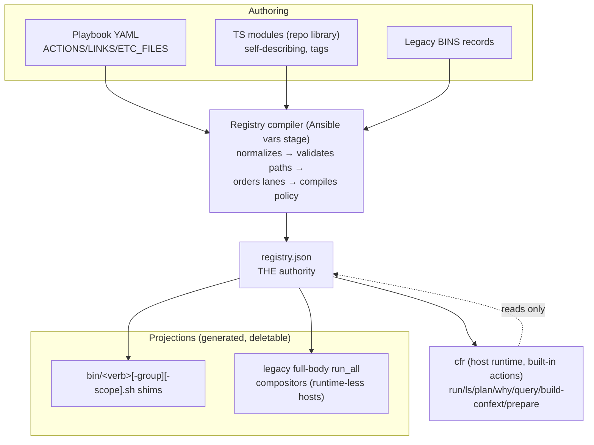

# composition-draft1: one registry, many projections

## What's up

Compfuzor composes action scripts well but describes them twice:
[`bin_composers.py`](/library/filter_plugins/bin_composers.py) assembles
`run_all` shell compositors from BINS records, and then
[`runtime_catalog.py`](/library/filter_plugins/runtime_catalog.py) re-derives
actions and flows by *parsing the generated filenames* (`_ACTION`/`_ROOT`
regexes, `runtime_catalog.py:16-17`). Adding `apply` as a flow — the concrete
gap in [`apply-flow0`](/design/compfuzor-runtime/apply-flow0.glm53.md) —
requires coordinated edits in both places. Meanwhile the operator has welcomed
a stronger direction: an early, common, host-installed runtime with possibly
built-in actions, instead of redistributing `compfuzor-runtime.mjs` into every
deployment ([`runtime_bundles.py`](/library/filter_plugins/runtime_bundles.py)
claims the repo artifact into each deployment's BINS today). The young runtime
is unvetted, so a substantial remake is on the table if justified.

This is an independent wave-1 draft. I did not read
`composition-draft0.gpt6a.md` or any other current-wave composition draft; the
problem brief, the shared confext/apply research, prior execution-model docs,
and the code are my inputs. Research prompt, if one is wanted: *what single
authority should own composition, what does the operator navigate, and what
can every other surface become a projection of?*

## Position

> **Compile one registry per deployment. Make it the only composition
> authority. Make shell compositors, the runtime catalog, and the CLI
> projections of it. Install the runtime once per host as `cfr` with built-in
> actions, and stop shipping code with deployments — deployments ship
> declarations.**

Three claims carry the design:

1. **Identity is a logical path, declared — not a filename, parsed.**
   Actions get ids like `apply/networkd/drop-in`. The enduring
   add-a-component-for-narrower operator pattern becomes prefix navigation:
   `cfr run apply/networkd/drop-in` is the narrow operation, `cfr run
   apply/networkd` the group, `cfr run apply` the broad verb. Filenames are a
   projection (`apply-networkd-drop-in.sh`), display and direct-invocation
   sugar, never the identity source.

2. **The host ships the executor; deployments ship data.** A host-wide `cfr`
   (verified free: no `cfr`/`cf-r`/`compfuzor` exists on PATH today; node
   v26.6.0 is already present and already required by every deployment that
   carries `links.mjs`) owns built-in actions — exposure delivery, confext
   build, layout preparation, query/plan/why. Deployment registries are
   JSON: they may *reference* built-ins but never carry executable code.

3. **Destinations are declared exposures, resolved through named layouts.**
   LINKS already carries src/dest/policy/strategies
   ([`gen_links.tasks`](/tasks/compfuzor/gen_links.tasks),
   `links.json` v2). Generalize it: an exposure says *material M becomes
   visible at (root R, path P) as copy | link | projection*. Confext
   building, the contained single-tree layout, and today's `/etc/opt`
   install all become the same statement under different layout profiles.

## Domain model

| Term | Meaning |
|---|---|
| **Action** | One declared, callable operation with a logical path id (`install/links`), title, tags, scopes, handler, and membership. |
| **Handler** | How an action executes: `exec` (a script under `bin/`, legacy protocols) or `builtin` (a `cfr`-internal op like `links.apply`). |
| **Flow** | An ordered aggregate verb: `build`, `install`, `apply`, `status` initially; custom flows allowed as data. A flow has a lane chart. |
| **Lane** | A scheduling slot within one flow's order (today's `packages/identity/main/units/records`, [`bin_composers.py:21`](/library/filter_plugins/bin_composers.py#L21)). Lanes are barriers only in broad runs. |
| **Group** | A navigational subtree: the intermediate path segments (`apply/networkd`). Optional `atomic` flag; atomic groups occupy one contiguous slot at their earliest leaf's lane. |
| **Membership** | Leaf-local declaration that an action joins a flow at a lane (`joins:`). `joins: false` = direct-only. |
| **Companion** | Consumer-side bridge data: action A declares `after: [status/networkd]` — a reuse relationship that does not absorb identity. |
| **Material** | Rendered bytes with a name and mode, living under a material root (today's ETC_FILES). |
| **Exposure** | A declared visibility of material at a (root, path) with a representation: `copy`, `link`, or `projection` (into an artifact). Generalizes LINKS. |
| **Layout** | A named table binding logical roots (material, `system-etc`, `system-opt`, user roots…) to physical prefixes. `etc-opt` (today), `user-xdg` (USERMODE), `contained` (project tree) are profiles. |
| **Policy** | Compiled suppression/permission entries by plane (compile / ansible-apply / host-runtime), from [`execution-model0`](/design/config-anneal/execution-model0.gpt6.md) § policy. |
| **Registry** | The compiled per-deployment document holding all of the above: `DIR/etc/compfuzor/registry.json`. Single writer: the Ansible-side compiler. |

Allocation of responsibility:



What dies conceptually: the *second* derivation. Flows are no longer inferred
from generated filenames (`runtime_catalog.py`'s `_ROOT` walk and flows dict,
lines 251-273); they are read out of membership data the compiler already had.
The legacy-BINS filename grammar survives in exactly one place — the
compatibility adapter into the registry.

## What authors write

### YAML (playbook contributions — the common case)

```yaml
# systemd-iface-extra-addr.etc.pb, reworked from monolithic apply.sh
ACTIONS:
  - id: apply/networkd
    title: deliver drop-in, reload, reconfigure iface
    tags: [network, disruptive, sudo]
    scopes: [system]
    handler: {kind: exec, path: bin/apply-networkd.sh, protocol: legacy-exit-v1}
    joins: [{flow: apply, lane: main}]
    after: [status/networkd]          # companion: not auto-run, see policy
  - id: status/networkd
    title: iface address/route/drop-in status
    tags: [network]
    scopes: [system]
    handler: {kind: exec, path: bin/status-networkd.sh, protocol: legacy-status-v1}
    joins: [{flow: status}]
EXPOSURES:
  - material: extra-addr.conf
    at: {root: system-etc, path: "systemd/network/{{NETWORK_FILE}}.network.d/{{NAME}}.conf"}
    representation: copy
    mode: "0644"                      # owns the mode-policy question (build-inputs1 R4)
    tags: [networkd]
```

### TypeScript modules (repo library contributions — shared, tagged)

```ts
// files/actions/links.ts — compiles into cfr; descriptor is extracted at build
import { defineAction } from "../registry/mod.ts";

export default defineAction({
  id: "install/links",
  title: "deliver declared exposures (link-or-copy)",
  tags: ["expose", "declarative"],
  scopes: ["system", "user"],
  handler: { kind: "builtin", op: "links.apply" },
  joins: [{ flow: "install", lane: "records" }],
});
```

Module descriptors must be JSON-serializable; `cfr` never imports deployment
TS. Modules with real logic are repo-level (trusted, compiled into the
runtime); deployments get data only. That is a deliberate trust boundary, not
a limitation we failed to solve.

### Legacy BINS (unchanged playbooks)

`install-foo-user.sh` with `subsystem: rust`, `phase: main` adapts to path
`install/rust/foo`, scope `user`, lane `main`. The adapter is the only
filename parser left. Authored `action:` fields and future `ACTIONS:` records
win over the grammar.

## What users discover and invoke

```console
$ cfr ls                       # known deployments (index, see below)
systemd-iface-extra-addr-eno1   /etc/opt/systemd-iface-extra-addr-eno1
$ cfr ls apply                 # narrow/broad: drop path components to broaden
apply/networkd                  drop-in, reload, reconfigure iface
$ cfr plan apply               # the plan, lanes visible, nothing runs
$ cfr run apply/networkd       # narrow: declaration order, lanes ignored
$ cfr run apply                # broad: lane barriers, atomic groups contiguous
$ cfr run apply --verify       # run companions (apply then status/networkd)
$ cfr why apply/networkd       # membership, contributors, compiled-vs-site, policy
$ cfr query 'tag:networkd and flow:status' --json   # scripts read this
```

Scripts are first-class consumers: `cfr ls/plan/why/query` all emit stable,
versioned JSON (`registry.json` schema version, not runtime version). A
generated bin, a CI job, or a shell one-liner can ask "who hooks into apply
with tag network?" without parsing filenames.

## The common runtime: bootstrap, versions, absence

- **Install.** One early playbook (extend `pkgs-base.pb` or a new
  `cfr.opt.pb`) installs the built artifact to
  `/usr/local/lib/compfuzor/compfuzor-runtime.mjs` with a `/usr/local/bin/cfr`
  symlink. It requires only node ≥ 20 — already a de-facto prerequisite for
  any deployment carrying `links.mjs` today.
- **Ordering.** The runtime is *not* needed to compile: registry compilation
  is Ansible/Python and stays controller-side. Bootstrap order is therefore
  benign: install cfr once, then render deployments in any order. For a
  brand-new host, run the base playbook first — it has no dependency on the
  deployments it will later navigate.
- **Version compatibility.** Each registry declares `runtimeFloor` (minimum
  `cfr` that understands its schema) and `schema` (registry format version).
  `cfr` refuses to act above its floor with an actionable error
  (`cfr 0.3 < floor 0.4 — upgrade via cfr.opt.pb`). Floor bumps are decoupled
  from runtime releases; the runtime may be ahead.
- **When cfr is missing.** Render still succeeds. The registry still lands.
  Two degradations: (a) generated shims degrade from thin
  `exec cfr run <path>` to full-body `run_all` compositors if the renderer is
  asked for `--legacy-bodies` (or the compiler detects no host runtime);
  (b) built-in actions (`build-confext`, `prepare`, `links.apply` as builtin)
  are unavailable, and their actions list with instructions. Bundling the
  runtime per-deployment remains available as the explicit compat path via
  `runtime_bundles` — opt-in for air-gapped hosts, no longer the default.
- **What this deletes.** `runtime_bundles.py`'s per-deployment artifact claims
  stop being generated for ordinary deployments; stale-bundle drift across N
  deployment copies (the `/opt/zim-main` half-migration in
  [`assess0`](/design/compfuzor-runtime/assess0.glm53fm.md)) becomes
  structurally impossible — there is exactly one runtime on the host.

## Ordering, groups, phases

Semantics, made explicit where today they are implementation accidents:

1. **Narrow runs ignore lanes.** `cfr run apply/networkd` executes the subtree
   in declaration order. Lanes are scheduling metadata, not identity.
2. **Broad runs honor lane barriers.** `cfr run apply` completes every
   selected entry's `packages` lane before `identity`, etc. — a global
   barrier *between lanes within the run*, which is what operators already
   assume `install.sh` does, made true and visible.
3. **Atomic groups are contiguous.** A declared group defaults `atomic: true`
   (compatibility with today's subsystem compositors, which run as a unit at
   the earliest lane of their leaves — verified
   [`bin_composers.py:209-296`](/library/filter_plugins/bin_composers.py#L209-L296)).
   `atomic: false` lets a plan split a navigational group across lanes, leaf
   by leaf, each leaf in its own lane slot.

**The operator's hypothesis — "a phase might imply a group in that phase" —
inverts better: a group implies a lane; a phase must not imply a group.**
Auto-grouping untagged same-lane leaves from different contributors couples
strangers (rust's `packages` leaf would suddenly bind to an unrelated apt
leaf). Rejected. But at the *project lifecycle* level the hypothesis lands:
prepare, materialize, expose, package, activate are stages, and a stage does
imply a group — of actions attached to that stage. That level appears below
(contained layout, btrfs), not inside flows.

**Mixed-phase test.** Group `install/rust` with leaves at `packages` and
`main`: atomic-by-default keeps current behavior (whole group at `packages`,
internal declaration order preserved); the registry records the choice, and
`cfr plan install` prints the placement, so the behavior is visible data
instead of hidden structure. A group wanting split semantics declares it once.

## Reuse and multiple homes

Two distinct mechanisms, deliberately not unified:

- **Selection is a set.** Any broad invocation selects each matching action
  exactly once (union by id). An action joining two flows is one action, two
  memberships — never two executions inside one run.
- **Reference is an occurrence.** A companion (`after:`) or future step
  sequences name actions by ref; two occurrences are two deliberate
  invocations, and differing args are the point. Acyclicity is validated at
  compile time (a ref cycle is a registry error, which is the no-accidental-
  recursion guarantee).

**Apply then status.** `apply/networkd` declares `after:
[status/networkd]`. Default: companions do *not* run — composition must not
silently expand execution (an operator requirement). `--verify` chains them.
`cfr why apply/networkd` displays the bridge. This answers the brief's
multiple-consumer question with the cheapest machinery that preserves
identity: membership lives on the leaf, companionship lives on the consumer,
and no new graph framework is introduced. If a genuine multi-step *verb*
emerges later (e.g. `cutover/network` = apply + verify + retire-old), it is
just another action whose handler is a builtin `sequence` op over refs —
data, not schema.

## Scope, deployments, identity

- **Scope is a dimension on actions** (as BINS scopes are today), not part of
  the path: `cfr run install --scope user`, default all-scopes
  (system-then-user, order in data).
- **Deployment is the ambient unit.** `cfr` resolves a deployment by walking
  up from cwd for `etc/compfuzor/registry.json`, honoring `$DIR`, or `-d
  PATH`. A maintained index (`/var/lib/compfuzor/deployments.json`, written
  at apply time) backs `cfr ls`. Identity = deployment `NAME` (authoritative,
  per [`execution-model0`](/design/config-anneal/execution-model0.gpt6.md)
  attribution); path and scope are qualifiers; the *execution target* is the
  resolved deployment directory — three different answers to three different
  questions, now separated.

## Confext: built-in `build-confext`, selection by destination

The byte trace in [`build-inputs1`](/design/confext/build-inputs1.fx.md)
shows payload and destinations already exist pre-publication: ETC_FILES bytes
in DIR plus `links.json` v2. The builder is therefore a *reader of declared
exposures*, and belongs in the host runtime as a built-in:

```console
$ cfr build-confext \
    --select 'include dest:/etc/systemd/network/**
              exclude tag:deployment-chrome
              include tag:networkd' \
    --form directory --out build/confext-eno1/
```

- **Selector grammar** (selection-purpose, gitignore-shaped, ordered,
  last-match-wins, default-exclude): `include|exclude
  dest:<glob>|tag:<t>|material:<glob>`. Re-inclusion after exclusion falls
  out of ordering — open decision 8 in the brief, answered with the smallest
  rule language that has negation and re-inclusion.
- **Output**: staged directory tree (`etc/systemd/network/…` +
  `etc/extension-release.d/extension-release.<NAME>` with declared
  `ID`/`ID_LIKE`/`CONFEXT_LEVEL`/`CONFEXT_SCOPE`), plus a provenance
  manifest (material path, dest, bytes hash, mode, contributor) — R5's
  builder-side manifest, keeping the registry observational about *this*
  concern. Mode policy is the declared `mode:` on the exposure (R4).
- **Never activates.** No placement into `/var/lib/confexts`, no merge. The
  action ends at the artifact; activation would be a separate future action
  that does not exist yet. `--form erofs|ddi` are later options (the §4
  comparison in build-inputs1 already bounds them).

static-only is the first pilot (fully declared destination); extra-addr
second with `-e NETWORK_FILE=` per build-inputs1 §2.3.

## Contained layout, link inversion, and lifecycle

The single-tree problem gets vocabulary instead of a new mechanism. A
**layout profile** binds roots; exposures resolve through it:

```yaml
layout: contained
# profile table (repository-level, data):
#   contained:
#     material: {root: "{{PROJECT}}/deploy", prepare: btrfs-subvolume}
#     roots: {system-etc: /etc, system-opt: /opt, user-config: ~/.config}
#     relocatable: link-and-projection-only
```

- **Bytes move; statements don't.** The same exposure (`material:
  extra-addr.conf`, `at: {root: system-etc, path: …}`) is valid in every
  profile. Under `etc-opt` it is a copy into `/etc`. Under `contained`, its
  `link` representation inverts: the *system path* is the symlink pointing
  into the project tree. Direction is a property of the representation under
  the active layout — explicit, inspectable (`cfr plan expose --layout-graph`).
- **Confext staging is a contained layout.** The staging tree is a material
  root; `projection` representations are its exposures. One model covers
  today, the portability goal, and the artifact goal. Containment is checked
  (every material reference resolves inside declared roots); relocatability
  is *declared* (`link-and-projection-only`) and validated as such —
  containment alone still does not mean the tree can be picked up and moved,
  and the profile says so honestly.
- **Lifecycle stages exist at the project level**: `prepare → materialize →
  expose → package → activate`. Actions attach to stages. `prepare` is the
  btrfs test: the profile declares `material.prepare: btrfs-subvolume`; the
  *controller* must run `cfr prepare <project>` (built-in: validate backing
  fs, create subvolume idempotently, refuse nonempty dirs per
  [`runtime0`](/design/confext/runtime0.sm.md) § subvolume) before the first
  write — today [`fs_base.tasks`](/tasks/compfuzor/fs_base.tasks) makes a
  plain directory, so the gate must sit ahead of it in
  [`compfuzor.includes`](/tasks/compfuzor.includes). This is a lifecycle
  *test* of the model, not an implementation commitment: the design must
  merely make "preparation precedes first write" expressible as data plus a
  gate, and it does. A common host runtime is exactly the credible executor
  the brief asked about; bootstrap still needs the base playbook first, which
  the ordering above already covers.

## Execution policy and manual apply

Inherited from [`execution-model0`](/design/config-anneal/execution-model0.gpt6.md)
§ policy, now compiled into the registry: planes (compile / ansible-apply /
host-runtime) × target (action, flow, contributor, effect) × disposition, and
`cfr run --explain` prints matched policy with sources. Current env guards
(`COMPFUZOR_<CONCERN>_BYPASS`, `BINS_RUN_BYPASS`) compile into host-runtime /
ansible-apply entries; nothing user-facing is lost. Two hard rules:

- **Autorun marks are data.** `run:`/`args` on BINS compile to `autorun:`
  entries; during migration the ansible-apply plane keeps executing them via
  `bins_run` exactly as today — composition changes how things are
  *assembled and described*, never when they fire.
- **Apply stays manual by default.** The registry's execution section gains a
  flow allowlist: `execution: {authority: registry, flows: {install: true,
  status: true, apply: false}}`. Broad `cfr run apply` refuses with an
  explanation unless the deployment opted in; a *narrow* direct invocation
  (`cfr run apply/networkd`) is a direct action and remains available,
  respecting only action- and effect-addressed policy. Building a confext
  never implies activating it; the two are different actions in different
  stages.

## gen_bins generalized

`gen_bins` stops composing and starts *projecting*: given `registry.json`,
emit `bin/<verb>[-<group>][-<scope>].sh` shims (`exec cfr run <path> "$@"`)
or, when no host runtime, full-body `run_all` compositors with today's helper
prelude. The two-tier hierarchy is retained as the projection of the path
tree. Reserved-name collision checks move from filename grammar to registry
path validation (`apply/networkd` as both group and leaf is a compile error).
`bin_composers`' ordering and attribution logic survives inside the
*compiler*, which is where it always belonged; the filter's public surface
shrinks to the legacy adapter.

## Retained, removed, replaced

| Existing | Disposition |
|---|---|
| BINS authoring (leaves, `subsystem`, `scope`, `phase`, `compose: false`, bypass fields) | **Retained** — input format; adapter lifts it into the registry |
| Two-tier compositor concept, lane lanes, stable ordering, attribution | **Retained** — becomes registry paths/lanes; projection regenerates shims |
| `files/_bin` helper system | **Retained** for projected shims and authored leaves |
| Site/compiled layering, placement-only overrides, tombstones ([`files/catalog/runtime.ts`](/files/catalog/runtime.ts)) | **Retained** — good machinery; moves under the registry reader |
| Flow executor containment checks, signals, opt-in authority ([`files/flow/runtime.ts`](/files/flow/runtime.ts)) | **Retained** — becomes `cfr run` |
| `links.json` v2 records + delivery | **Retained** — generalized into exposures; `links.apply` becomes a built-in |
| `runtime_catalog.py` flows/`_ROOT`/`_ACTION` derivation | **Removed** — replaced by registry membership; filename parsing survives only in the legacy adapter |
| Per-deployment runtime claims (`runtime_bundles.py` defaults) | **Removed as default** — compat opt-in for air-gapped hosts |
| `install-link-records.sh`-style thunks for built-in ops | **Replaced** by `handler: {kind: builtin}` references |
| Monolithic hand-authored `apply.sh` (iface playbooks) | **Replaced** by `apply/networkd` + companions (apply-flow0's L1, landing in the new shape) |

## Tradeoffs and alternatives

- **vs. the three-line L2 patch** (add `apply` to `_ROOT` and `flows`, per
  apply-flow0 Idea B): cheapest, and compatible with this design's data model
  — but it deepens the dual-derivation (regexes remain authoritative for
  flows) and buys nothing for tags, script discovery, selectors, layouts, or
  the per-deployment runtime duplication. Worth landing *only* if this wave
  stalls.
- **vs. a universal plan graph** (effects, typed outcomes, full
  execution-model0 § vocabulary now): rejected for this draft — the brief
  warns against converting hypotheses into a fixed graph framework before
  testing. Paths + lanes + companions cover the concrete tests; typed
  outcomes remain the executor's future work.
- **Costs of this design.** The registry becomes load-bearing (mitigated:
  single writer, schema-versioned, regenerable from playbooks); path grammar
  forbids hyphens in authored segments to keep logical→physical slugs
  injective (legacy hyphenated names live only in the adapter's one-way
  mapping); a host prerequisite is now real (mitigated: base playbook,
  floor refusal, legacy-body shims); data-only deployments cannot extend the
  runtime in place (deliberate trust boundary; repo-level TS modules are the
  extension path).
- **What it deliberately makes difficult:** silently auto-running anything
  (autorun is visible data; companions default off); identity-by-filename
  (declared only); per-deployment runtime forks; unexplained ordering
  (lanes/groups are printable plans); hidden reuse (companions show in
  `cfr why`); publishing-while-building (confext build physically cannot
  activate).

## Unresolved choices

1. Companion default: explicit `--verify` (proposed) vs verify-on-by-default.
2. Group atomicity default: kept atomic for compatibility; revisit after real
   mixed-phase deployments exist.
3. Custom flow names: allowed as data with validated lane charts — or a fixed
   verb vocabulary until a third-party consumer demands more?
4. Selector grammar depth: ship the include/exclude core; do profiles-by-tag
   need first-class named selections ("bundles")?
5. Deployment index: maintained file vs scan of known roots on `cfr ls`.
6. `prepare` enforcement: hard controller gate vs warning + `cfr prepare`
   manual — the btrfs lifecycle test should decide.
7. Shim form by default: thin `exec cfr` (assumes host runtime) vs
   full-body (portable); per-deployment or per-host choice?
8. Registry location/name: `etc/compfuzor/registry.json` proposed (renaming
   `compfuzor-runtime/`); migration cost for the four live deployments.

## Cross-references

- [`composition-problem0.gpt6a.md`](/design/compfuzor-runtime/composition-problem0.gpt6a.md)
  — primary brief; hypotheses (phase-groups, multiple homes) answered in
  §ordering and §reuse; open decisions 1-8 addressed in §domain model,
  §confext (selection), §policy.
- [`apply-flow0.glm53.md`](/design/compfuzor-runtime/apply-flow0.glm53.md) —
  the apply gap this design closes at L1+L2 simultaneously: composed
  `apply/networkd` *and* first-class apply flow, since flows are now data.
- [`runtime0.sm.md`](/design/confext/runtime0.sm.md) — lifecycle seams; its
  "test projection and lifecycle placement before expanding runtime command
  surface" is satisfied by keeping confext/prepare as built-in *readers* of
  declared data rather than new schema authority.
- [`build-inputs1.fx.md`](/design/confext/build-inputs1.fx.md) — byte trace
  and R1-R5 recommendations adopted directly (input contract, output choice,
  pilot order, mode policy, builder manifest).
- [`execution-model0.gpt6.md`](/design/config-anneal/execution-model0.gpt6.md)
  — contributor/composition/policy vocabulary this draft inherits; its
  `NN-FLOW-SLUG.json` compiled layer becomes the registry's flow sections.
- [`bin_composers.py`](/library/filter_plugins/bin_composers.py) ·
  [`runtime_catalog.py`](/library/filter_plugins/runtime_catalog.py) ·
  [`gen_bins.tasks`](/tasks/compfuzor/gen_bins.tasks) ·
  [`bins_run.tasks`](/tasks/compfuzor/bins_run.tasks) — the machinery
  dispositioned in §retained/removed.
- [`assess0.glm53fm.md`](/design/compfuzor-runtime/assess0.glm53fm.md) —
  the stale-bundle drift class this design deletes by construction.

## Method and verification notes

Verified by source inspection this session (no execution, no deployment, no
host mutation): `BIN_ACTIONS`/`BIN_PHASES` and two-tier compositor behavior
(`bin_composers.py:15,21,209-296`); `bins_run` auto-run fields and the
`BINS_RUN_BYPASS` gate (`bins_run.tasks:8-19`, `compfuzor.includes:240-241`);
catalog `_ACTION`/`_ROOT` regexes and build/install/status-only flows
(`runtime_catalog.py:16-17,251-273`); flow executor's fixed verb set and
containment checks (`files/flow/runtime.ts:58,72-87`); per-deployment runtime
claims (`runtime_bundles.py`); `apply-udev.sh` leaf precedent
(`apollo.src.pb:33`, `sunshine.src.pb:26`) vs monolithic `apply.sh`
(`systemd-iface-extra-addr.etc.pb:125`); static-only's declared destination
(`systemd-iface-static-only.etc.pb:70-77`); `fs_base.tasks` plain-directory
creation; no `cfr`/`cf-r`/`compfuzor` executable on PATH (only `cfsctl`,
unrelated); node v26.6.0 present. All proposal sections above are design, not
landed behavior. systemd/mkosi facts are cited from
[`build-inputs1`](/design/confext/build-inputs1.fx.md) rather than re-read
from the archive checkouts. I did not read any current-wave composition
draft; later cross-review should compare this against
`composition-draft0.gpt6a.md` and sibling wave-1 drafts.
