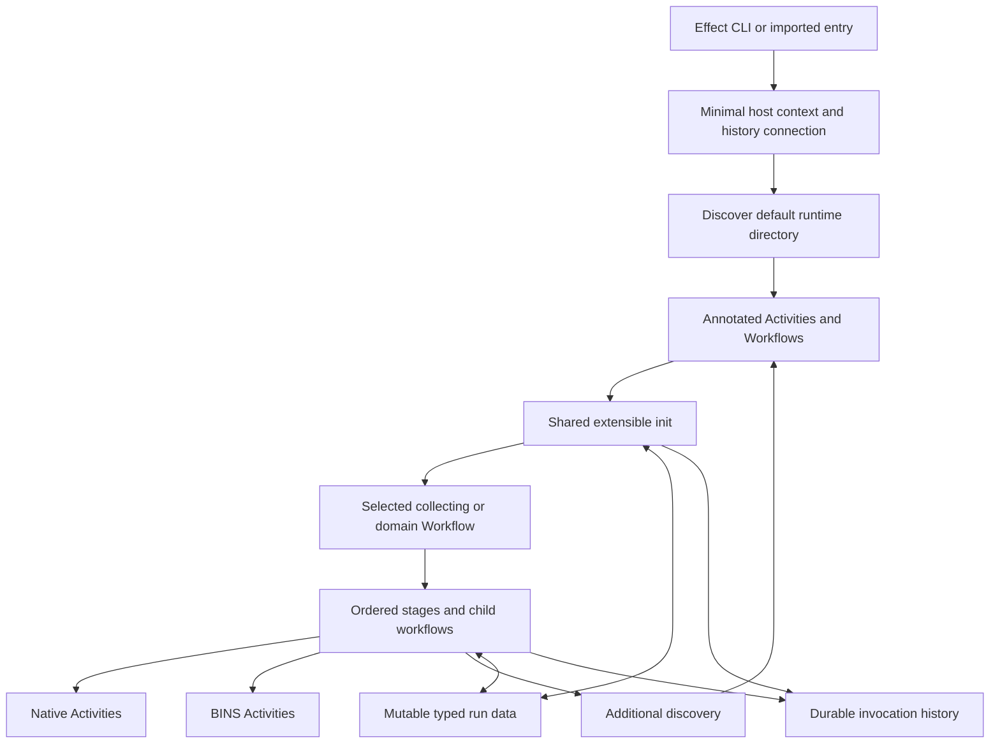

# Direction and status

CFR is becoming a shared runtime for work currently composed through generated
Bash. The first practical requirement is broad BINS compatibility, followed by
native TypeScript contributions. Zim/Mise and OpenCode/mcp-cli test the design;
the complex CONFIG case must not become a prerequisite for ordinary build work.

The operator's latest clarification is important: **mutable collaboration is
normal**. Contributors may add and change shared inputs/state. Loading environment
and Compfuzor state belongs in an extensible initialization stage that most
workflows use by default. The shared context is not restricted to immutable
parameters or append-only outputs.

This draft synthesizes that direction with the discussion since draft1:

- Scan the known local runtime directory by default. Import source modules and
  admit their self-described native Effect exports; ordinary exports contribute
  nothing. No per-file module manifest is required.
- Activities and Workflows are the contributed executable values. A mandatory
  `cfr = defineModule(...)` envelope is withdrawn from the proposed public contract.
- Use typed annotations and schemas for the additional meaning CFR needs.
- A loader may discover more work during a run. Collection is recursive and
  explicit; a pipeline can specialize from its request and selected contributions.
- Support both complete child pipelines and named stage barriers such as
  assembly before publication.
- Record managed execution history durably by default, including bound inputs
  and outcomes, with secret-aware representation.

These are design directions, not claims of implemented APIs. The proposed helper
names and binding rules below need a focused implementation probe. In particular,
mutable-state replay, repeated Activity binding and dynamically supplied handler
Layers are architectural checkpoints, not details already solved by upstream.

## 1. The shape



**Effect owns execution. CFR owns how work joins the run.** Effect supplies
evaluation, sequencing, services, scopes, interruption and Workflow/Activity
execution machinery. CFR supplies discovery, contribution semantics, input and
target binding, shared run data, ordering conventions, legacy admission and
history integration. It does not introduce a second workflow instruction set.

A generic collecting Workflow already knows its job: collect a requested group
for a selected target. Its payload might select `build`, `install` or `config`.
A domain Workflow knows more, such as `prepare → assemble → caches → activate`.
Neither must change its definition or identity halfway through execution. Their
executions specialize by selecting contributors and binding inputs.

## 2. Contributions are native values with self-description

### What upstream already provides

An Activity carries a name, success/error schemas, typed annotations and an
executable Effect. A Workflow adds a stable tag, payload schema and execution-ID
policy; a handler is registered separately with `toLayer`/the engine. Creating
either definition does not evaluate the authored Effect body. Dependencies and
run-specific inputs can be obtained when that body executes.

An export can therefore be a ready-made Activity, not necessarily a factory that
must perform substantial initialization before it can describe itself.

```ts
// Illustrative authoring, not existing CFR exports or a checked implementation.
// Activity, Effect and Schema are upstream; CfrContribution and BuildInputs
// represent the proposed shared annotation/input contracts.
export const build = Activity.make({
  name: "opencode.build",
  success: Schema.Void,
  error: BuildError,
  execute: Effect.gen(function* () {
    const inputs = yield* BuildInputs;
    yield* compile(inputs);
  }),
}).annotate(CfrContribution, {
  version: 1,
  description: "Build the selected OpenCode workspace",
  tags: ["opencode", "build"],
  memberships: [{ group: "build", stage: "compile" }],
});
```

### The extra contract is annotation data and bindings

Use one recognizable, schema-backed contribution annotation as the admission
marker, with typed keys for optional capabilities. This is a proposed admission
rule: an unannotated upstream Activity may be an internal helper, not a public
contribution. Ordinary module exports are ignored.

| Information | Owner/source |
|---|---|
| Canonical local Activity name / Workflow tag | Native Effect value; do not copy it into another required identity field |
| Public description, tags, contract version | Contribution annotation |
| Group/stage memberships, ordering and supported scope | Contribution annotation; lists allow several homes |
| Success/error schemas | Native value |
| Workflow inputs | Native payload schema |
| Activity input binding | Optional shared binding annotation/helper: schema plus run-data selection |
| Workflow handler Layer and domain services | Explicit lazy binding associated with the definition |
| Shared-field contracts | Typed field definitions with stable names and schemas |
| Module path, export name, discovery root, code identity | Loader-owned provenance |

Required discovery metadata should stay small: admission version and a useful
description alongside native identity. Membership is optional: a directly callable
Activity need not join a broad group. Tags describe; group membership selects.
An explicit selector may use tags, but adding a tag is not intrinsically execution.

Workflow handler binding is a live reference, not serializable catalog data. The
proposed helper associates a lazy Layer binding with the native Workflow value,
without acquiring the Layer during import/listing. A prototype must demonstrate
that this preserves service requirements and avoids duplicate registration. The
catalog projects the binding's advertised capabilities; it never serializes code.

No scanner can infer a factory's possible output without calling arbitrary code.
Prefer annotated native values. Where binding truly requires a factory, give it
an explicit recognized factory contract with input schema and description; do
not probe every exported function hoping it returns an Activity.

## 3. Default discovery and loader activities

The selected deployment has a known runtime source directory, domain-grouped
within it. Its final path is still a layout choice; denote it `RUNTIME_DIR` here.
The common runner discovers its executable `.ts` files recursively by default,
excluding declaration-only `.d.ts` files and dependency/VCS trees. The discovery
policy explicitly determines hidden-file, symlink and ignore handling: ambient
`.gitignore` rules must not silently decide which declared runtime modules exist.

`rg --files` can implement enumeration. It does not parse TypeScript to guess
exports. Paths are imported once by canonical module identity in stable order;
recognized native exports and their contribution annotations are checked.

- No admitted self-description: omit from the catalog, not from the filesystem.
- Valid self-description: register its identity, bindings and relationships.
- Malformed advertised contract or failed import: report the source and error.
  Do not quietly treat broken executable contributions as absent helpers.
- Re-exports of the same definition: consolidate provenance; distinct conflicting
  definitions using the same qualified identity fail rather than last-file-win.

Importing trusted runtime code can execute top-level JavaScript. Runtime source
must be import-safe, using the common main-module helper for direct execution.
Metadata discovery does not run Activity bodies, initialize deployment state or
acquire implementation Layers. Pure data-only inspection, when wanted, consumes
a catalog snapshot rather than importing code again.

### Discovery can itself be work in the workflow

A loader Activity may run `rg`, inspect paths and return a schema-backed selection
of module/export references and code identities. The surrounding Effect loads and
binds those references into the run's catalog. The public helper may expose this
as one operation; the durable result stores references, not closures or Layers.

On replay, reusing the selection must still reconstruct live imports and bindings.
New discoveries are appended/updated through the catalog service, with explained
conflict rules, not by mutating a process-global registry on module import.

Each collector snapshots its membership when reached and records the selection.
Discoveries may affect later collections, including a later init substage. They
do not retroactively enter a stage already running. Resuming a collection uses its
recorded selection; deliberately rediscovering is a new occurrence. A changed or
missing referenced module must be detected, not silently substituted during resume.
A source-file digest alone does not pin its imported dependency graph; the code
identity/dependency delivery contract must close that gap before durable resume.

## 4. Shared init is an extensible pipeline

Most public workflows use the standard run entry, which supplies shared init by
default. Contributors can join initialization just as they join build/config
stages. Init loads data into the same mutable workspace later stages use.

Proposed default ordering:

```text
minimal host bootstrap
→ discover built-ins and the selected runtime directory
→ init/load: read environment and Compfuzor deployment state
→ init/adjust: contributed defaults, additions, overrides and extra discovery
→ init/resolve: decode/validate effective inputs for the requested operation
→ requested workflow stages
```

These substage names are a starting convention, not a closed enum of all future
initialization. Reading a spec is distinct from merging an operator override;
an extension can say which prerequisite it follows rather than depend on scan
order. Additional discovery uses roots already known at that point; its new init
contributions participate only in explicitly later collection points.

Bootstrap is intentionally small: choose the explicit target, establish run
identity, process/filesystem access, initial discovery roots and history access.
It cannot depend on the environment-loading Activity it is about to discover.
The full environment/spec interpretation remains visible, replaceable init work.
Read-only catalog listing need not initialize a deployment just to list exports.

A nested domain workflow joins an initialized run workspace explicitly and does
not reset it by repeating init accidentally. A standalone invocation initializes
its own run by default. Workflows needing a fresh environment reload request a
named reload occurrence. Low-level bootstrap workflows can declare a reduced
init profile; init itself is not recursively wrapped in init.

Keep original request and target identity available alongside mutable effective
state. Environment becomes run data, not writes to the process-global
`process.env`. Native services and child processes receive an explicit projection.
Existing `env.export` shell evaluation, if used, is a recorded subprocess adapter;
preserve its override semantics and do not replace it with an inaccurate dotenv
parser. Legacy wrappers may still reload environment themselves, so their final
effective environment remains partly opaque until that contract is migrated.

## 5. Mutable typed run data

**Mutation is first-class, including changes to previous contributors' values.**
Each logical run owns a `RunData` service, keyed by run/workspace identity and
accessed through Effect. Do not extend upstream `WorkflowInstance` with arbitrary
fields: its mutable fields coordinate the engine's suspension and execution.

Schema-backed field keys give an open bag a typed interface. For example:

```text
Environment                         environment map
DeploymentState                     decoded Compfuzor state
ConfigInputs(target, config)        selected and contributed input records
ConfigSettings(target, config)      mutable effective settings
AssembledOutput(target, config)     produced artifact reference
```

Modules can add field definitions without editing a central TypeScript union.
Known consumers retain local types; dynamically discovered bindings decode at
the runtime boundary. A conflicting schema for the same field/version is an
error. Domain partitioning prevents OpenCode and mcp-cli from overwriting one
unqualified `output` field.

Proposed operations include `get/require`, `set`, `update`, `append`, and explicit
removal. Field contracts choose merge behavior where relevant. Sequential updates
take effect in execution order, with writer/occurrence provenance and revision
information; intentional replacement is ordinary behavior. Reject accidental
duplicate definition identities, not intentional changes to shared values.

Reads return immutable snapshots or protected values; mutation goes through the
service so it can validate and record it. This is mutable state with a controlled
write interface, not shared object references modified invisibly. Start with
sequential stages; future parallel writers need atomic updates or revision checks.
Reads do not infer scheduling automatically: pipelines and declared ordering
remain responsible for making required data available.

### Mutation and replay must agree

A completed Activity can return a cached result without rerunning its body.
Therefore, an in-memory `RunData.set` performed only inside that body disappears
on reconstruction. Merely providing a mutable Context service does not solve this.

The simplest correct authoring path is:

```ts
// Conceptual helper syntax. Both fresh and replayed results feed the update.
const discovered = yield* DiscoverInputs;
yield* RunData.update(ConfigInputs, inputs => combine(inputs, discovered));
```

The update is part of the surrounding workflow, outside the cached Activity body.
It runs against the state reconstructed at that point. The service gives the
update a stable occurrence ID: reconstructing it updates the current replay
workspace without appending a second logical change to durable history.

Contributors should also be able to author stateful work conveniently. The
proposed managed-Activity helper must capture its explicit writes as recorded
state changes and apply them when the Activity outcome is reused. It still
produces a native Activity; it cannot merely wrap a mutable object and claim
durability. Exact result-envelope typing and failure/partial-write semantics
are a required probe, not specified as completed machinery here.

Reconstruction replays state changes in workflow order. Do not hydrate the bag
with its final state and then replay early steps against that final state. A
checkpoint needs a matching workflow position/revision. General `update`
functions are not serialized: persist validated changes/results and their input
revision, or deterministically rederive them at the corresponding replay point.

For the initial implementation, support ordinary mutation through explicit
workflow updates and recorded Activity results first, then demonstrate the
stateful convenience helper before advertising arbitrary in-Activity mutation
as replay-safe. This is an implementation order, not an append-only restriction.
Opaque BINS communicate state changes only through declared outputs/protocols;
their subprocess shell variables do not mutate the native bag automatically.

Child workflows receive an explicit workspace reference and namespace; Context
inheritance is not a persistence contract. Initially favor sequential child work.
Sharing revisioned mutable state across independently resumed concurrent children
requires additional coordination and is not implied by this draft.

## 6. Ordering and recursive aggregation

Two compositions are equally valid:

```text
complete-pipeline collector             staged configuration workflow
  OpenCode: assemble → publish             all selected assembly contributions
  mcp-cli:  assemble → publish             all selected publication contributions
```

The named parent workflow chooses which it means. Complete child pipelines stay
contiguous; a parent does not split them by looking inside arbitrary Effect code.
A domain may export both complete workflows and stage Activities for deliberate
reuse, with distinct membership declarations.

Collection selects group/stage/target/scope, resolves order, records the members,
and yields Activities or child Workflows sequentially. Nested collectors are
ordinary contributed workflows. Reject cycles and distinguish overlapping
selection of one membership from two intentionally different invocations.

Proposed ordering within a stage: honor declared `before/after` edges; use a
stable explicit order/provenance tie-break for otherwise unrelated members.
Reject cycles and unresolved required references. Preserve the existing BINS
adapter's order rather than applying a new alphabetical schedule. Stage barriers
come from the workflow body; annotations name membership, not a universal phase
chart. The mutable bag makes dependencies observable but is not a new scheduler.

Live discovery can specialize later stages. The author can write `load → collect
assemble → load more → collect publish`; the execution trace explains the exact
selection at each point. Static inspection exposes the declared structure and
known members, marking future selections/dynamic branches honestly.

## 7. Invocation binding and history

### Reusing definitions without confusing occurrences

An Activity's name is part of its engine identity. In the memory engine, result
lookup uses execution ID, Activity name and attempt. Supplying different inputs
through Context while yielding the same name does not create a new occurrence.

Keep a canonical definition identity for discovery and a distinct occurrence path
for each binding: e.g. `config/opencode/assemble` versus `config/mcp-cli/assemble`.
The common invocation helper must construct/bind a native Activity with that
execution name and preserve the original identity as metadata. Workflow children
likewise use parent occurrence information in their execution-ID inputs.
There is no upstream public Activity rename helper in the inspected source;
the binding helper must use supported construction APIs and preserve schemas,
requirements and retry behavior. In particular, blindly wrapping `activity.execute`
can stack retry wrappers; this must be tested rather than copied as a shortcut.

Bind effective inputs from the current run-data revision when the invocation is
selected. Capture those inputs in a schema-backed invocation record for history;
closures alone cannot reveal them. Expose declared shared-field requirements and
typed service needs honestly: a dynamic loader cannot recover erased TypeScript
`R` requirements from an arbitrary Effect value.

### Durable history by default

Every managed run records lifecycle facts with timestamps, run/parent/occurrence
IDs, definition identity, target, source/code identity and bound input revision.
The proposed event vocabulary includes:

- Run requested/initialized/completed/failed/interrupted.
- Modules discovered/admitted and members selected at a collection point.
- Invocation selected, actual attempt started, completed/failed/interrupted.
- Recorded result reused, where observable, distinguished from actual execution.
- Run-data changes with affected fields and writer provenance.

Use schemas and explicit secret-aware projections for arguments/parameters and
state. Store secret references/redacted representations rather than ambient
environment dumps. The history contract records the known outer invocation for
opaque scripts, not an invented trace of their internal commands.

Effect's `EventLog`/`EventJournal` and SQL-backed journal are viable upstream
building blocks, **not automatically connected to Workflow**. EventLog runs a
handler before committing its event. Log independent lifecycle facts; do not put
provisioning inside a `Started` event handler, which would delay or lose that fact
on failure and risk executing provisioning during projection replay.

Common entry/activity helpers provide the history integration. Native third-party
Activities need admission instrumentation for actual body attempts and invocation
requests; engine-level observation alone does not reliably expose whether a body
executed or a result was reused. Nested public work uses the same helpers.
Arbitrary private Effects remain internal detail unless separately instrumented.

Proposed durability policy: persist intent before beginning managed mutation;
surface history-write failures and stop subsequent managed work. A crash or
failed completion write can leave an incomplete record; mark outcome unknown,
do not retry the host mutation merely to repair its log. Audit writes, Activity
result persistence and external host effects are not one atomic transaction.

Durable history is required by the direction; durable cross-process resumption
is a separate implementation capability. A memory Workflow engine plus persistent
history is a valid first deployment, but cannot claim restart/resume. Exact local
SQL driver, storage location and workflow-engine persistence remain implementation
choices. Persistent run-data recovery must be coordinated with the engine, not
mistaken for a complete durable engine in its own right.

## 8. BINS-first admission and native delivery

The first BINS adapter executes rendered bins as Activities through Effect process
services. Preserve wrappers, guards, working-directory behavior, arguments and
exit protocols. Explicit target binding prevents another deployment's `DIR`
from selecting work. Ansible-triggered `run/args/become` and bypass semantics
remain distinct from later manual execution. Ansible privilege fields are not
automatic runtime elevation instructions.

Preserve the current two-tier scope/subsystem aggregation and stable lane order.
An authored root can contain its own body and already invoke its children. Admit
it as one opaque Activity until extracted; never execute it and also expand its
children. Pure generated aggregates can become native collectors after their
wrapper context is accounted for. A zero exit from an opaque legacy guard is
not proof of an observable structured skip. Status uses its declared protocol.

The 80% goal is practical coverage, not a measured repository percentage. Long-
running service processes, unusual privilege arrangements and unsupported bindings
must remain visibly outside the finite aggregate contract until adapted.

Native TS is normally imported in-process. Provide a shared library containing
annotation/field keys, discovery, collection, input binding, state/history helpers,
the process adapter and Effect CLI entry support. A source module exports native
definitions and uses asynchronous `runIfMain(import.meta.url, ...)` to compare
physical module/argv paths before dynamically importing its CLI. CLI modules are
also import-safe because the default directory scan can encounter them.

Built-ins and local source use the same contribution contract. Deployment of
source and resolution of the shared CFR/Effect dependencies must be proven in an
actual deployment directory, not only from the Compfuzor checkout's node_modules.
Use one compatible dependency/contract family. Distribution mechanics remain open;
do not silently substitute TS subprocess execution as the permanent native path.

## 9. Concrete walks

### OpenCode: start with ordinary build composition

Shared init loads target/environment and effective workspace settings. The BINS
adapter initially executes its complete authored build aggregate as one Activity:
dependency install, two executable builds/artifact merge, then contributed build
children according to the existing wrapper. CORS generation precedes serve-argument
generation. The migration test extracts those meaningful pieces into native
Activities, using shared fields for effective CORS/serve settings while preserving
order. Build does not silently restart the service or clients.

### Configuration and MCP: one input, two consumer bindings

Discovery loads consumer Activities/Workflows; MCP server records remain data.
Init and later contributors can add, disable or change selected servers/settings
in `ConfigInputs(target, config)`. OpenCode and mcp-cli bind different assembly
rules, including command/args/environment adaptation and substitution timing.
Their assembled outputs have separate field keys and publication bindings.

A parent chooses complete consumer pipelines or all-assembly-before-publication.
The current `config-remote put` couples link management with rebuilding; keep that
transaction opaque initially rather than splitting it at an unsafe checkpoint.
Some CONFIG modes assemble directly at the consumer output and need no separate
publication step; a stage can legitimately contribute no work. Application reload
is an explicit later operation.

### Zim/Mise: reusable init, domain-specific pipeline

Zim's proposed named pipeline is init → prepare configuration → assemble → build
channel caches → activate loaders/startup → publish host pointer. Preserve current
behavior through an opaque installer first if necessary; the outline is not an
instruction to arbitrarily reorder its transactional internals. A narrower prepare
workflow supports successor readiness without startup cutover. Zim2 and Mise2
are intended replacements, and Zim2's complete installer targets real dotfiles.

Mise contributes settings/Bash work and participates in the Zim relationship for
Zsh activation. It shares init, field access, process/block-delivery capabilities
and history; it need not become another instance of Zim's CONFIG context model.
Files/templates remain inputs to these operations. A universal material catalog
is not required for this slice; later placement/confext work can add richer data.

## 10. Architectural checkpoints before production implementation

The next bounded probe should demonstrate these consequential interfaces together:

1. **Discovery/admission:** a known runtime directory containing annotated native
   exports, helper-only files, re-exports and a malformed contribution. Import does
   not execute domain work; the resulting catalog explains admitted definitions.
2. **Extensible init and mutable collaboration:** environment/state loading plus
   a local contribution changing an earlier value. Two subsequent operations
   consume the changed typed field; target partitions remain separate.
3. **Sequencing and late discovery:** complete child pipeline and shared-stage
   variants; a loader adds a later-stage member without changing an earlier
   collection's snapshot or duplicating work.
4. **Replay/state/history:** reuse a completed Activity result, reconstruct its
   state changes exactly once per logical occurrence, and distinguish history
   from actual body execution. Exercise failure/interruption, not only success.
5. **BINS and native main:** one real mixed build aggregate, no duplicate children,
   correct argument/environment treatment; the same native definition works both
   through Effect CLI and imported execution outside the authoring checkout.

Review exact Activity occurrence binding, factory admission, handler Layer lifetime,
stateful helper typing, history failure policy and dependency delivery at that
checkpoint. This draft authorizes no implementation by itself. The architectural
destination is concrete enough to test; remaining questions should be answered by
these examples rather than another broad catalog ontology.

## Cross-references

- [Runtime sourcing and receiver rendezvous direction](/design/runtime-sourcing/direction0-syn.gpt61sol.md)
  — later operator preference for editable `changed → canonical → deployed`
  source selection and deployment-time SHA-512 burns. Supplies a source-root
  resolution question for this draft's native discovery/init, not a replacement
  execution language or mandatory module envelope; still unimplemented.
- [Effect draft1](/design/compfuzor-runtime/effect-draft1.gpt61sol.md) — predecessor;
  retains BINS admission and recursive collection, replaces its mandatory-looking
  module envelope with native annotated exports, and adds default discovery,
  collaborative mutable state, initialization and history.
- [Effect draft0](/design/compfuzor-runtime/effect-draft0.gpt6a.md) — foundational
  division between Effect execution and CFR meaning; explicit-target and truthful
  inspection requirements survive without a compulsory CFR program AST.
- [Present-world map](/design/compfuzor-runtime/world-map0.gpt61sol.md) — source
  evidence for current runtime authority, deployments and unresolved adoption.
- [Composition draft0](/design/compfuzor-runtime/composition-draft0.gpt6a.md) —
  action/membership distinction and multiple homes; useful precedent for keeping
  definition identity separate from Activity occurrence and stage membership.
- [CONFIG consumer toolkit](/doc/config/consumer-toolkit.md) — existing domain
  semantics to preserve, including direct assembly, input edits and MCP adaptation.
- [BINS documentation](/doc/bins.md), [composer](/library/filter_plugins/bin_composers.py)
  and [wrapper](/files/_bin) — compatibility ordering and authored-root behavior;
  source is authoritative where the documented action list predates `config`.
- [Earlier execution model](/design/config-anneal/execution-model0.gpt6.md) —
  provenance, argument-bound invocations and multi-plane bypass distinctions;
  its fixed indexed-flow authority is historical, not the new architecture.
- [Installed Activity](/node_modules/effect/src/workflow/Activity.ts),
  [Workflow engine](/node_modules/effect/src/workflow/WorkflowEngine.ts),
  [EventLog](/node_modules/effect/src/eventlog/EventLog.ts) and
  [SQL journal](/node_modules/effect/src/eventlog/SqlEventJournal.ts) — verified
  rc.118 source for lazy construction, result reuse, execution context and
  history-storage capabilities; integration claims above remain proposals.
