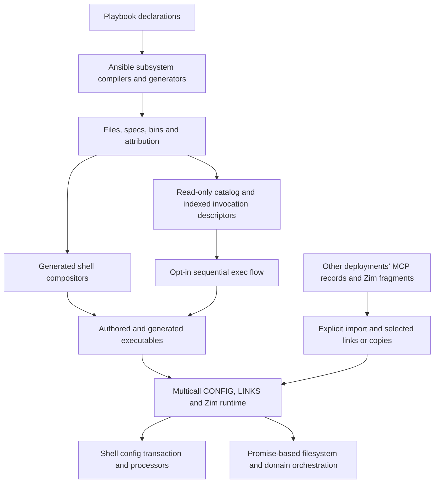

# What is up

We are assessing the present world before writing a new architecture draft, not
implementing the old one. The operator wants more execution through CFR, less
generated shell orchestration, built-in and repository-local contributions, and
eventually more playbooks delivering TypeScript rather than shell scripts.
Zim2/Mise2 are intended successors to Zim/Mise. OpenCode and mcp-cli add the
important case of several consumers of the same external MCP server declaration.

The new hypothesis is a runnable `config.ts` whose top-level Workflow composes
Activities, initially wrapping existing scripts and later calling native Effects.
That is not the prior draft's chosen default; it deserves evaluation rather than
being dismissed or treated as already agreed.

**Working conclusion:** the missing centerpiece is shared contribution discovery
and composition authority, not the ability to execute a sequence. Effect already
supplies sequential execution. Workflow adds identified executions and replay.

## 1. The present world has several authorities



| Layer | What exists | What it does not yet provide |
|---|---|---|
| Playbook/subsystem contribution | `CONFIGS`, `ZIM_MODULES`, `MCP_COMMAND`, `BINS`, `STATUSES`, etc.; generators accumulate shared records | A general native TS module export/registration contract |
| Script delivery | Inline bodies, `files/<TYPE>/...`, shared `../...` sources, raw copies, links and `runtime: node` | Automatic library loading of delivered TS, dependency packaging or handler registration |
| Shell composition | Action/scope → subsystem → leaves; phase lanes and stable declaration order | Arbitrary native program composition or global phase barriers across nested subsystems |
| Catalog | Attributed contributors, commands, actions, resources; compiled/site indexed flow entries | General module discovery; an executable handler for every catalogued command |
| Opt-in flow execution | `build`, `install`, `status`; sequential `exec` handlers; status exit translation | Native TS handler calls, arbitrary exported programs, operator argument forwarding |
| Multicall runtime | Six statically imported domains: catalog, flow, CONFIG, config-remote, LINKS, Zim | Dynamic provider loading or an Effect execution environment |
| Domain composition | Zim calls CONFIG and activation; CONFIG binds contexts and invokes shell assembly | One common described composition used by the domain, catalog and shell entry points |
| External inputs | Explicit portable MCP imports and Zim producer imports | Host-wide automatic discovery/selection of producers |

Source anchors: [`compfuzor.includes`](/tasks/compfuzor.includes),
[`bins.tasks`](/tasks/compfuzor/bins.tasks),
[`bin_composers.py`](/library/filter_plugins/bin_composers.py),
[`catalog/runtime.ts`](/files/catalog/runtime.ts),
[`flow/runtime.ts`](/files/flow/runtime.ts), and
[`runtime/compfuzor-runtime.ts`](/files/runtime/compfuzor-runtime.ts).

The shell action set currently includes `build`, `install`, `apply`, `config`;
the native flow set is still only `build`, `install`, `status`. Static multicall
dispatch is code reuse, not provider discovery. Runtime deployment inference is
still tied to the runtime module's physical location; catalog/flow offer explicit
deployment overrides, but there is no uniform explicit-target contract.

The earlier read-only inspection also found duplicate indexed descriptors in
`/opt/zim2-main` preventing install/status flow resolution. That is a dated
deployment observation, not a repair or a fresh health check. It illustrates why
the current projection cannot be assumed to be a working common authority.

## 2. What Effect draft0 actually defined

The prior draft was substantial about responsibilities and semantics, but not a
finished interface specification. Its construction syntax was explicitly proposed.

| Topic | Defined direction in draft0 | Still empty or insufficiently specified |
|---|---|---|
| Execution | Effect is the foundation; no second CFR scheduler/service container | Production migration and exact handler bindings |
| Invocation | Described, validated inputs plus directly yieldable execution; each evaluation is a fresh occurrence | Open-domain typing, decoding/reconstruction and external handler contracts |
| Composition | Calls, sequences, selected groups and honestly opaque Effect bodies | Final authoring interface and contribution/override rules |
| Discovery | Explicitly selected built-ins, installed/project modules and generated descriptors | Search locations, loading, exports, precedence, dependency resolution and packaging |
| Services | Collect many declarations; select one provider for a service role; use Context/Layer | Concrete provider selection and compatibility contract |
| Inspection | Catalog vs resolved plan vs execution trace; no fake generator dry-run | Metadata export/distribution tooling |
| Ordering | Sequential by default; ordered phase groups; explicit bounded parallelism | Detailed membership and ordering-conflict rules |
| Policy | Explicit targets, nested checks, skipped vs blocked, observations distinct from verification | Complete native/legacy coverage and public policy interface |
| Legacy admission | Wrap scripts as described process operations; preserve opaque internals | Real adapter and rollout |
| First domain | Placement → confext artifact, without automatic publication/activation | Concrete first format and implemented vertical slice |
| Workflow | Deliberately not the default runner; resumption is a separate question | No tested Workflow integration or Activity contract |

The [Effect probe](/design/compfuzor-runtime/effect-probe0.glm53.md) supports the
small yieldable-description/service seam. It does not establish production module
discovery, packaging, Workflow, or a CONFIG/Zim migration.

**Retain:** Effect execution, explicit contribution identity/targets, truthful
inspection and admitting scripts without pretending to know their internals.
**Revisit:** whether CFR needs its own authored program tree as the principal
composition form, whether Workflow is the top level, and which concrete domain
should lead the next draft. Configuration is now a stronger immediate design test
than confext alone; placement and bootstrap remain relevant downstream tests.

## 3. “Provider” covers different relationships

These roles can coexist in one module or deployment; they should not be conflated.

1. **Contributor:** supplies operations, programs or inert data. Many may coexist.
2. **Service provider:** implements an execution capability through an Effect Layer,
   such as process execution or filesystem delivery. This is an implementation
   choice, not an append-only list of contributions.
3. **Configuration producer:** supplies an MCP record, Zim fragment or other input.
   It supplies data; importing/assembling that data is the executable operation.
4. **Configuration consumer:** declares how those inputs become its config and where
   that config is exposed. OpenCode and mcp-cli playbooks currently fill this role
   for MCP. The server deployment supplies the connection record.

If “MCP provider” means the Compfuzor module that knows how to configure MCP for
OpenCode, that is also a useful contributor role. It is distinct from the MCP
server whose connection the resulting application will use.

Today these relationships are partly represented by paths and explicit imports,
not a shared registry. [`gen_mcp.tasks`](/tasks/compfuzor/gen_mcp.tasks) emits
portable `etc/mcp.json`; [`config-remote`](/files/config-remote/runtime.ts) lists
consumer target slots and imports a supplied source. It does not discover every
server on the host. Likewise, Zim producer inventory examines an explicitly given
deployment; its host pointer locates a consumer, not a general module registry.

## 4. Concrete use cases

### Zim: configuration is only part of installation

[`zim2.opt.pb`](/zim2.opt.pb) declares two CONFIG recipes (`zimenv`, `zimrc`),
user-context input/output placement, Zim modules and activation paths. Host
module declarations render into canonical drop-ins; other deployments contribute
their own channel fragments for explicit import.

The complete installer currently composes:

```text
install the context's CONFIG inputs/outputs
→ project/install both startup loaders
→ run zimfw install for zimenv, then zimrc (module work + init.zsh caches)
→ wire startup dotfiles
→ publish the registry pointer
```

This is already TS orchestration in [`zim/runtime.ts`](/files/zim/runtime.ts) and
[`zim/activation.ts`](/files/zim/activation.ts), but it returns Promises and
invokes shell tools. Generic CONFIG installation is excluded from the ordinary
aggregate through `CONFIG_INSTALL_OWNER: zim` to avoid duplicating that work.
Producer import can rebuild only touched channels. Startup consumes prepared
caches and does not rebuild on shell launch.

A new draft should make input preparation, assembly, cache building, loader
delivery, dotfile wiring and registry publication individually meaningful while
retaining an easy complete-install program. These are candidate operation
boundaries, not an instruction to replace existing transactional internals with
arbitrary resumable checkpoints. Zim2's complete install writes real `~/.zshenv`
and `~/.zshrc`; its private cache/config paths do not make activation isolated.

### Mise: a related contributor, not another instance of the same installer

[`mise2.opt.pb`](/mise2.opt.pb) has direct script operations: remove legacy blocks
in its selected startup files, set `npm.package_manager` in its private Mise
config, install Bash activation blocks and inspect those blocks. It does not use
CONFIG contexts. Zsh activation is delegated to Zim's `zimenv` module path.

A native program could use shared managed-block delivery and process capabilities
without pretending Mise settings, Bash activation and Zim cache installation are
one configuration operation. Successor readiness must separately prove that the
shell actually selects the intended Mise settings root; setting it for one
installer command does not establish the runtime consumer path.

### MCP: one producer, several consumer projections

```text
MCP server deployment → portable etc/mcp.json
  ├─ explicit import into OpenCode mcp-portable/*.json
  │    → place under mcp.servers.<selected-name> → assemble opencode.json
  └─ explicit import into mcp-cli mcp-portable/*.json
       → split command/args, rename environment→env
       → place under mcpServers.<selected-name> → assemble mcp_servers.json
```

[`opencode.src.pb`](/opencode.src.pb) and [`mcp-cli.src.pb`](/mcp-cli.src.pb)
also accept already-wrapped `mcp/*.json` fragments. OpenCode opts into sourcing
the producer's declared `env.export` for JSON substitution; mcp-cli leaves
`${VAR}` for its own runtime substitution. This is a materialization/security
difference, not just a different JSON destination key. OpenCode's native
`{env:NAME}` syntax can preserve runtime references instead of baking credentials.

`config-remote put` is **link plus targeted canonical rebuild**, with link-state
rollback on rebuild failure, not just registration. It preserves disabled links.
There is no automatic producer installation hook. Changing a producer file still
requires consumer reassembly and appropriate application reload/restart.

Both playbooks currently use canonical CONFIG output, not consumer-local CONFIG
contexts. mcp-cli then hand-links its output into `~/.config/mcp`; primary
OpenCode hand-links the deployment's etc tree into its user config location.

This case forces a new draft to distinguish available records, selected records,
consumer adaptation, assembled output and exposure. One selected MCP producer
applied to two consumers means two consumer-specific invocations, not automatic
global deduplication of the producer identity.

### OpenCode beyond MCP: real sequential dependencies and native TS delivery

Its build body installs dependencies, builds the Bun executable, builds the Node
variant into a separate outdir, then merges that artifact. Separate build leaves
refresh CORS and derive serve arguments; CORS precedes serve-argument derivation.
The shell wrapper emits its authored body before `run_all`, so these are not
simply one undifferentiated list inferred from filenames.

Installation exposes executables/config and user systemd units. Restart performs
service restart, authenticated health checks and a Watchman environment check.
These are distinct programs: building must not silently restart clients/services.
Primary/secondary instance paths, ports and database ownership also make an
explicit execution target essential.

`backup.ts` is already delivered with `runtime: node`. That demonstrates the
current native-TS **executable** path, not native CFR module loading. A standalone
TS executable can remain a process-adapter operation; becoming a library handler
requires exports, dependency resolution and a typed Effect implementation.

## 5. What config.ts composition could look like

For a known sequence, ordinary Effect already suffices:

```ts
// Illustrative domain calls, not existing CFR exports.
const configure = Effect.gen(function* () {
  yield* importSelectedInputs(target);
  yield* assembleConfig(target);
  yield* publishConfig(target);
});
```

Each `yield*` completes before the next begins. Failure stops the sequence unless
the author deliberately handles it. For selected contributions, `Effect.forEach`
defaults to sequential execution; `{ concurrency: 1 }` makes that explicit.
Effect gives scopes, errors, interruption and tracing in addition to sequencing;
it does not solve contribution discovery or infer prerequisite independence.

**A genuine Workflow variant is also plausible:** `config.ts` exports a Workflow
definition and handler Layer. The handler's `Effect.gen` yields named Activities
in order. Each Activity executes an existing script through Effect's process
service, or directly calls a native Effect operation. It need not nest shell
aggregates inside another aggregate, and native operations need not launch Node
subprocesses just to participate.

```text
config.ts exported program/workflow
  → resolve selected contributors for this target
  → import-input activity
  → assemble activity
  → publish activity
  → optional, explicitly selected reload/verification steps
```

The handler body is a composition layer, but neither `Effect.gen` nor Workflow
reveals its future child calls to static inspection. We can choose a lightweight
declared outline plus actual trace, or explicit sequence data that generates both
the handler and an exact plan. That is an authoring choice to test, not a reason
to build another execution engine.

If using real `effect/workflow`, the new draft needs these additional contracts:

- **Fresh run vs resume:** Workflow IDs derive from the tag and payload's
  idempotency key. A new user request should not accidentally reuse a prior
  completed install; identify fresh runs separately from resuming a specific run.
- **Activity occurrence:** the in-memory engine keys results by execution ID,
  activity name and attempt. Before/after observations and repeated target calls
  need distinct occurrences, not the same Activity name accidentally reused.
- **Stable selection/version:** resuming must have a policy for changed input
  files, module versions and contributor sets; a run ID alone freezes none of them.
- **Replay and interruption:** completed results can be reused; unfinished work
  can repeat. rc.118 Activity also has default interruption retry behavior that
  must be deliberately reviewed for host-mutation scripts. This is not an
  exactly-once guarantee or automatic filesystem rollback.
- **Engine lifetime:** `WorkflowEngine.layerMemory` is available for a local CLI
  experiment, but loses state when its engine lifetime ends. Durable resumption
  across invocations needs persistent storage and registration/lifecycle design;
  it does not inherently require a distributed deployment.
- **Live truth:** saved success is run history, not proof of present config or
  service health. Explicit fresh status remains available outside resumed work.

These constraints refine the Workflow idea; they do not invalidate it. The
smallest useful comparison is the same real sequence authored as an Effect
program and as a Workflow, with the discovery inputs held constant.

## 6. Discovery and authoring are the next substantive seam

A candidate shared route, not an implemented contract:

```text
explicitly selected built-ins + repository-local modules + generated descriptors
  → collect declarations and record provenance
  → validate identities/contracts and choose service implementations
  → select contributions for one target/program
  → execute through Effect (optionally inside Workflow)
```

That route can admit three forms without conflating them:

| Contribution form | Execution path |
|---|---|
| Existing shell or standalone TS executable + descriptor | Effect process adapter |
| Native TS module exporting definitions/programs/handler Layers | In-process Effects |
| Portable MCP record or Zim fragment | Inert input to a selected domain operation |

The unresolved delivery contract is consequential: playbooks can copy TS today,
but arbitrary deployed modules cannot assume `effect` resolves from a host
runtime's dependencies. Static bundling, a managed package/module root, or another
explicit dependency arrangement needs selection. Matching Context service keys
and compatible Effect versions matter too. Metadata-only inspection should not
require importing trusted implementations with arbitrary top-level side effects.

Start by explaining where selected local modules come from and what they export,
not by silently scanning the host or installing everything discovered. Make
selection, provenance, collisions and missing implementations explainable. Do
not default to replacement/cleanup of undeclared files.

## 7. Route toward the new draft

No implementation is authorized by this map. The next draft should walk three
concrete authored examples rather than add more abstract nouns:

1. **Zim complete installation:** preserve its meaningful ordering and separate
   prepared successor state from real startup cutover. Show complete and narrower
   operations through the same contributed definitions.
2. **One MCP record into OpenCode and mcp-cli:** show availability, explicit
   consumer selection, different adapters and secret handling, assembly and
   exposure. Application reload is a separate explicit choice.
3. **Repository-local native TS:** show what a playbook delivers/declares, what
   `config.ts` imports/exports, how CFR discovers it, and how it shares capabilities
   with built-ins without changing the central runner.

For each: what authors write; what users list/select/run; where order is owned;
what inspection can promise; what failures/skips mean; what shell boilerplate
disappears. Compare ordinary Effect and Workflow at this shared seam, rather
than letting the engine choice dictate the whole configuration domain.

The architectural checkpoint is a coherent authoring/discovery/composition
contract supported by these examples. Only afterward choose a bounded real
implementation slice and separate deployment repairs from the new architecture.

## Cross-references

- [Effect draft0](/design/compfuzor-runtime/effect-draft0.gpt6a.md) — predecessor;
  retain its allocation of responsibility, revisit program authoring and Workflow.
- [Composition problem brief](/design/compfuzor-runtime/composition-problem0.gpt6a.md)
  — contribution, navigable specificity and explicit-target requirements that
  still apply beyond these configuration examples.
- [Recovered-docs survey](/design/runtime-direction/docs-survey0.glm53fx.md) —
  chronology and dated deployment/adoption evidence; this map is the narrower
  bridge toward a new draft, not a replacement historical survey.
- [Earlier Effect design](/design/config-anneal/effect-design0.glm53.md) — grounded
  migration of delivery/config/Zim behavior; useful counterweight to the broader
  replacement backbone.
- [CONFIG consumer toolkit](/doc/config/consumer-toolkit.md) — existing input,
  context, transaction, publication and portable JSON behavior to preserve or
  deliberately revise; especially explicit imports and credential materialization.
- [Zim pieces](/design/compfuzor-runtime/zim-pieces0.glm53m.md) — artifact and
  startup constraints; predecessor replacement intent, not permanent experiment twins.
- [Config-lane assessment](/design/runtime-config-lane/assessment0.gpt61sol.md) —
  existing configuration action/native flow mismatch and argument differences.
- [OpenCode V2 MCP documentation](https://opencode.ai/v2/docs/mcp-servers) —
  consumer schema, `mcp.servers`, runtime environment references and connection
  behavior; Compfuzor's assembly/import layer is not MCP protocol discovery.
- Effect rc.118 local source: [`Effect.forEach`](/node_modules/effect/src/Effect.ts),
  [`Workflow`](/node_modules/effect/src/workflow/Workflow.ts),
  [`Activity`](/node_modules/effect/src/workflow/Activity.ts) and
  [`WorkflowEngine`](/node_modules/effect/src/workflow/WorkflowEngine.ts) —
  sequencing, execution identity, replay, interruption and engine-lifetime evidence.
