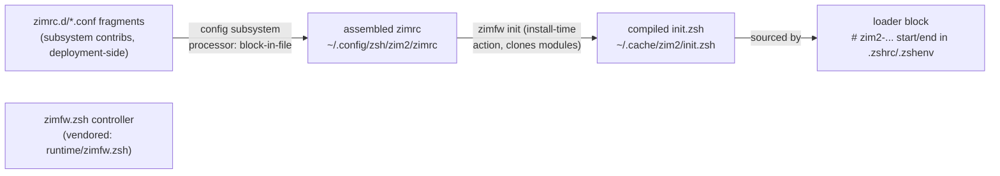

# The zim pipeline, piece by piece (zim-pieces0)

Why this doc: the runtime system is very new and has been rough going; this
map answers "which file is what" once, so future waves don't have to
re-derive it. All paths given for the zim2 deployment (`zim2-main`); the old
world (`zim-main`) is the same shape and is being retired, not maintained.

## The pipeline

## The pieces

| Piece | Where | What it is / is not |
|---|---|---|
| fragments | `/etc/opt/zim2-main/zimrc.d/*.conf`, linked into `~/.config/zsh/zim2/zimrc.d/` | one `zmodule` declaration + comment per subsystem contrib. Drop-ins. Input to assembly, never sourced by zsh. |
| assembled zimrc / zimenv | `~/.config/zsh/zim2/{zimrc,zimenv}` | config-subsystem output (`CONFIGS`, `processor: block-in-file`, inputs `zimrc.d/*.conf`, `validate: zsh -dfn`). **Declarations only** — a list of `zmodule` lines, not executable logic. zimfw's input file. |
| zimfw.zsh (controller) | vendored `runtime/zimfw.zsh`; deployments materialize under `<DIR>/src/` | the framework itself (single script, ~50 KB, fetched via `GET_URLS` from zimfw releases). Reads zimrc, clones/updates modules into `ZIM_HOME/modules/`, **compiles** `init.zsh`. Runs at install time only — never at shell startup (see posture below). |
| compiled init.zsh | `~/.cache/zim2/init.zsh` (+ `modules/`) | the artifact zsh actually sources: concrete `fpath=`, `autoload`, and ordered `source` lines zimfw emitted from the declarations. Regenerable build output; the assembled zimrc in `~/.config` is the source of truth. |
| loader block | `# zim2-... start/end` markers in `~/.zshrc` / `~/.zshenv` | a ~20-line guard projected by `bin/zim/install.mjs` from `etc/zimrc.zsh` / `etc/zimenv.zsh` templates. Defaults `ZIM_HOME`/`ZIM_CONFIG_FILE`, handles the emergency escape, sources `init.zsh`. This — and only this — is what is block-in-file'd into the dotfiles. |
| startup dir | `~/.config/zsh/zim2/startup/` (`loader_root`) | where the projected loader scripts live before block-in-file'ing them into dotfiles |
| registry | `~/.config/zsh/zimfw.conf` → host deployment's `etc/zimrc` | **not config** — a discovery pointer. Contributor subsystems' auto `install-zimfw.sh` finds the host zim via this link (fallback `/opt/zim-main`). |
| emergency module | `/etc/opt/zim2-main/zim-modules/emergency/` | `COMPFUZOR_EMERGENCY=1` cold shell; referenced by the zimrc loader, lives under `/etc/opt` (survives `/opt` deletion) |

## Why the extra hop (zimrc → init.zsh)?

"aren't we just block-in-file'ing zimrc into .zshrc?" — no, and the reasons
are structural: `zmodule` lines are *declarations* (`zmodule rektide/zim-beads`
says what, not where). Turning them into something sourceable requires
resolving URLs, cloning/updating git repos, phase-ordering (core → prompt →
tools → completion → late), deduplication, and fpath/autoload emission —
work block-in-file cannot do. The hop also keeps the blast radius small:
subsystem contribs touch only their own fragment; assembly and compilation
are owned by the config subsystem and zimfw respectively; the dotfiles carry
only the 20-line loader.

## Posture decided 2026-09-19

1. **No rebuilds via `/opt` at startup.** Loader templates never source the
   deployment controller. Missing `init.zsh` → warn naming
   `<deployment>/bin/install.sh`, skip. Stale → warn, source anyway.
   Rebuilds are deliberate install-time actions.
2. **`runtime/` is the local-first artifact home.** `runtime/compfuzor-runtime.mjs`
   (checked-in vite build product; `clean: false` so builds don't nuke the
   vendor) and `runtime/zimfw.zsh` (vendored controller, pinned copy of the
   GET_URLS fetch). Nothing about a deployment requires downloading
   compfuzor itself; zimfw remains GET_URLS-fetched per deployment until
   gen_zim learns to prefer the vendored copy (open item).
3. **ZIM_HOME stays `~/.cache/zim2`** for now — module checkouts are
   re-fetchable and `init.zsh` is a derived artifact; the assembled truth is
   already in `~/.config/zsh/zim2/`. Relocating `zimrc_home`/`zimenv_home`
   (e.g. `~/.local/share/zim2`) is a one-var change if wanted later.

## runtime_bundles.py — role clarified

Not runtime code. An Ansible filter plugin (controller-side python,
compile-time) that emits **delivery claims** merged into `BINS`:
`compfuzor_runtime_bins("links/links.mjs", ...)` returns one raw-copy claim
for the checked-in artifact plus one symlink claim per alias. `bins.tasks`
raw-copies the artifact; `bins_link.tasks` materializes the aliases. The
actual runtime is TypeScript (`files/runtime/compfuzor-runtime.ts` + domain
modules) built by vite-plus into `runtime/compfuzor-runtime.mjs`. Python is
the seam; the `.mjs` is the thing.

## Open items

- gen_zim/GET_URLS preferring the vendored `runtime/zimfw.zsh` over download
- ZIM_HOME relocation decision (cache vs `~/.local/share`)
- emergency module is referenced by absolute `/etc/opt` path in loaders —
  fine under the rot posture, noted for completeness

## Cross-references

- [`assess0.glm53fm.md`](assess0.glm53fm.md) — effort status, architecture
  map, and root cause of the file→symlink migration failure.
- [`doc/config/consumer-toolkit.md`](/doc/config/consumer-toolkit.md) —
  config command surface and the `runtime/` layout block (updated).
- [`zim2.opt.pb`](/zim2.opt.pb) — CONFIGS/ZIM_CONTEXTS and the loader
  templates this map describes.
- [`doc/config/log.md`](/doc/config/log.md) — hardening history for flow
  execution and the isolated-twins rationale.
