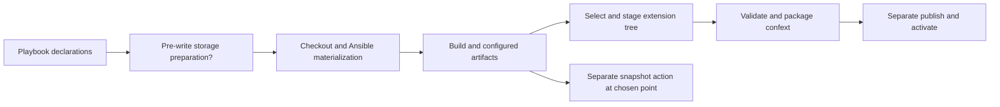

# Runtime lifecycle seams under confext and btrfs pressure

## Situation and research question

Compfuzor's recent `compfuzor-runtime` effort unified CONFIG, LINKS, Zim, and
catalog/flow commands into a distributable host executable. The user now wants
to explore **systemd confext first**, possibly sysext later, with
`systemd-iface*` as a first concrete target: take existing build/render
materials, produce an extension bundle *after* rendering, and distinguish
building from deployment/activation. They also want project btrfs subvolumes
prepared *before initial writes*, plus separate snapshot tools. These are
architectural probes, not an instruction to freeze a barely-used runtime or
replace it wholesale. Research question: which boundary actually owns each
step, and what existing runtime guarantees survive if build output is no
longer simply installed in the host's canonical paths?

I did not read another agent's current confext wave; the FS_CONTAINERD and
specific `systemd-iface*` archaeology is being investigated separately. In
particular, SteamOS bind-mount success is **not** evidence that the
self-contained one-directory-tree problem was solved; the user says that
discussion may have ended at an impasse (cotail current session
`ses_f2198adecffeZm5gWy0G9BCV3h`, 2026-09-26 15:50:49Z).

## Origins: intent versus landed mechanism

The originating discussion was not initially a request for a universal
orchestrator. It started from frustration at oversized CONFIG/Zim-specific
bundles and a desire to anneal useful capability into a coherent package
(cotail `ses_f63a45e2dffem2Br6mcGaBgYYR`, initial user prompt 2026-09-13
20:00:46Z, message `msg_09c5ba1da0`). The user explicitly objected to
jumping immediately to Effect before comparing use cases and simplification
options (2026-09-13 22:23:31Z, `msg_09cde54130`), later preferred TS/Effect/zx
to an early Rust rewrite but did not make zx mandatory (2026-09-14 01:47:28Z,
`msg_09d7ec3700`), and described bypass controls as distinct levels of “don't
do that” across Ansible and host runtime (2026-09-14 10:54:56Z,
`msg_09f8e43660`). Only afterward did they authorize buildout and an isolated
flow-execution experiment (`msg_09fa131640`, `msg_0a0e28b970`). These are
historical intentions, not proof that the implementation attained the design.

The repository history makes the short interval clear: `swvsszxqnznl`
(2026-09-13) unified four runtime bundles into the multicall artifact;
`wrnqmurskkol` (2026-09-14) committed the attributed-flow design;
`vlpvkprnpork` (2026-09-14) added opt-in execution; the same day's review
found then closed alias/containment blockers (`lktmymmtpvll`,
[`flow-execution-review0.gpt6.md`](/design/config-anneal/flow-execution-review0.gpt6.md#closure-addendum--2026-09-14)).
The later assessment notes fresh isolated Zim2/Mise2 deployment renders but
no proven production catalog-authority install
([`assess0.glm53fm.md`](/design/compfuzor-runtime/assess0.glm53fm.md#3-completeness--status-table));
do not extrapolate that dated observation into a claim about today's host.

The [original model](/design/config-anneal/execution-model0.gpt6.md#architectural-shape)
distinguishes contributor, action, invocation, flow, operation, and effect;
reuses domain-specific resource specs rather than a universal plan; and
proposes `build`, `install`, `status` as ordered aggregates. It also says the
catalog was *first observational*, and domain sequencing/ownership should
not disappear into a generic graph. Those are helpful hypotheses, not
immutable APIs. Its broad, typed execution-policy and native-domain-action
aspirations remain mostly prospective.

## Verified capabilities and limits (repository evidence)

| Surface | Present implementation | Consequence for this test |
|---|---|---|
| Artifact and dispatch | Vite+ packages domain-grouped TS as one `runtime/compfuzor-runtime.mjs` ([`vite.config.ts:4-20`](/vite.config.ts#L4-L20)); classifier uses lexical alias chain or explicit domain (`catalog/config/config-remote/flow/links/zim`) ([`files/runtime/compfuzor-runtime.ts:8-23,29-85`](/files/runtime/compfuzor-runtime.ts#L8-L85)). | This is a packaging/CLI boundary, **not** a general Ansible render or filesystem-image builder; neither `confext` nor `btrfs` is a domain. |
| Delivery | `runtime_bundles.py` contributes one raw artifact claim and symlink aliases through BINS ([`runtime_bundles.py:16-54`](/library/filter_plugins/runtime_bundles.py#L16-L54)). | A self-contained runtime *binary* is not a self-contained deployment tree. Aliases and resource data still depend on deployment layout and host paths. |
| Catalog | Python compile projects BINS, STATUSES, LINKS, and safe resource references; derives legacy actions from names and generated compositor children; writes catalog and indexed JSON descriptors ([`runtime_catalog.py:71-130,240-335`](/library/filter_plugins/runtime_catalog.py#L71-L130)). | Inventory is partial, not a complete file manifest or reproducible artifact graph. Existing resources are references to domain specs, not captured file bytes, modes, symlinks, privilege, or side effects. |
| Flow | Closed declared membership, compiled/site selection, placement-only site overrides, tombstones ([`files/catalog/runtime.ts:187-307`](/files/catalog/runtime.ts#L187-L307)); executor accepts only `build/install/status`, exec handlers, fixed arguments, opt-in authority, and sequential ordering ([`files/flow/runtime.ts:15-60,115-179`](/files/flow/runtime.ts#L15-L179)). | Adding a fourth flow is code/compiler/schema work, not dropping in `build-confext` JSON. `flow build` currently runs commands *inside an already materialized deployment*, not an Ansible pre-render stage. |
| Isolation | Executor checks handler realpaths within selected deployment, runs lexical alias, sets `DIR`, forwards SIGINT/SIGTERM to a child group ([`files/flow/runtime.ts:63-122`](/files/flow/runtime.ts#L63-L122)); tests cover successful order, dry-run, authority refusal, escape/signal and status folding ([`catalog_flow.test.py`](/tests/integration/catalog_flow.test.py)). | Safety is scoped to executable *location*, not to its output paths, environment, imports, mounted trees, privileges, or effects. A confined executable can write `/etc`; do not call flow execution a sandbox or assume image-build purity. |
| Controller ordering | Ansible runs repository checkout before filesystem materialization ([`compfuzor.includes:139-183`](/tasks/compfuzor.includes#L139-L183)); filesystem creation precedes BINS and `bins_run` ([`compfuzor.includes:184-241`](/tasks/compfuzor.includes#L184-L241)); catalog synthesis happens during vars, after `gen_bins`, and recompiles artifacts ([`compfuzor.includes:115-136`](/tasks/compfuzor.includes#L115-L136)). | A runtime action launched after Ansible render cannot retroactively establish project subvolume semantics before checkout/first write. Compiled catalog is not yet a controller-side apply plan. |

Tests establish bounded local semantics, **not** artifact equivalence across
direct host installation and extension image output. The read-only catalog
tests use constructed descriptors/site files
([`runtime_catalog.test.py:34-119`](/tests/integration/runtime_catalog.test.py#L34-L119));
execution tests similarly use a temporary deployment containing a shell
handler ([`catalog_flow.test.py:62-75`](/tests/integration/catalog_flow.test.py#L62-L75)).
Existing `doc/config/consumer-toolkit.md` explicitly calls catalog execution
experimental and opt-in
([`consumer-toolkit.md:74-119`](/doc/config/consumer-toolkit.md#L74-L119)).
There is no observed `build-confext` pipeline or proven complete staged `/etc`
tree. That absence is a repository search result, not evidence that no one
could add one.

## Two different lifecycle requirements

**Confext is a projection problem before it is a new flow name.** Selecting
which source files/directories are portable, normalizing their paths into
the image namespace, and packaging them must be explicit. A project that
already wrote into host `/etc`, `/etc/opt`, or systemd directories cannot be
converted safely by running arbitrary existing `install.sh` in a staging
directory: installers can invoke privileged LINKS, `systemctl`, package
managers, or write absolute paths. A bundle built by copying *declared,
already-rendered, side-effect-free files* from a known materialized project
would be a useful narrow first experiment; its manifest must record provenance,
target path, bytes, modes, symlinks, and required metadata rather than infer
them from `catalog.actions` or filename. Distinguish extension construction,
publication, and activation. Whether target `systemd-iface*` supplies enough
source materials without first writing the host should be verified in the
other archaeology before choosing between this small adapter and a real
controller staging/render abstraction. Do **not** equate package presence
with active unit/network configuration, or infer sysext parity from confext.

**Subvolume preparation is a precondition, not a post-build action.** Today
`fs_base.tasks` creates `DIR` as an ordinary directory
([`fs_base.tasks:1-12`](/tasks/compfuzor/fs_base.tasks#L1-L12)); checkout can
start even earlier. For a new project, the desired storage boundary must be
established *before whichever task first creates or populates its root*;
simply making the directory then doing `btrfs subvolume create` there is too
late. Existing nonempty projects require a distinct opt-in migration/refusal
policy, not silent replacement. Validate backing filesystem, mount/subvolume
identity, ownership, and failure/rollback before repository or filesystem
writers run. Snapshot operations are later, explicitly timed actions over an
already established subvolume; choosing a snapshot point, retention, and
consistency while services write are separate policies. Existing btrfs tools
([`files/btrfs/subvolumize.sh`](/files/btrfs/subvolumize.sh),
[`files/repart/repart.ts`](/files/repart/repart.ts)) are precedents to inspect,
not proof they satisfy this project lifecycle.

## Architectural opinion: incremental first, remake conditional

Preserve the genuinely useful boundaries: domain-grouped executable; versioned
domain data; attributed catalog; explicit opt-in execution; lexical ordering
and conservative path validation. None requires declaring the current
`RuntimeDomain` union or catalog v1 a permanent extension API. In fact,
the narrow runtime is *useful* precisely because image projection can begin
as a standalone, inspectable builder over compiled artifacts rather than
embedding packaging in CONFIG, LINKS, Zim, or `flow` immediately.

A responsible incremental probe: select **one** `systemd-iface*` deployment;
inventory its actual generated file bodies and destination relationships;
build an explicit staged manifest with one allowable path mapping; compare
the staged output with current intended host-install output; verify the
extension's upstream metadata and compatibility rules independently; and
keep installation/activation separate. If `build-confext` belongs to the
deployed runtime later, add a named **package** domain/flow only when it has
a durable input/output contract and distinguish `flow build` (executing
legacy leaves) from `build-confext` (artifact projection). A similarly small
pre-write storage declaration could be integrated at the Ansible/controller
stage once first-write ownership is mapped; snapshot tooling can stay a
separate project operation initially. Avoid shoehorning either into the
generic indexed JSON because it happens to exist.

A **heavier redesign** becomes justified if experiments show (a) most desired
extension content exists only after absolute-path host mutation, (b) multiple
outputs must share one deterministic intermediate artifact tree, (c) the
catalog's BINS/STATUSES approximation repeatedly loses necessary material,
(d) a new build depends on typed artifact/effect descriptions and explicit
pre/post lifecycle prerequisites, or (e) opt-in legacy flow execution cannot
be made equivalent to generated shell runs. Then revisit controller-owned
staged materialization and first-class output projections, and decide whether
the catalog should be generated **from** that source of truth. Replacing
everything with Effect/Rust, or turning catalog v1 into a universal IR merely
to say “rewrite,” does not solve the missing render/side-effect boundary.

## Checkpoint and next slice

**Possible now:** isolated runtime deployment, read-only attributed flow
inspection, opt-in sequencing of deployment-local executable leaves, and
independent tooling that consumes explicitly enumerated generated files.
**Not established:** a portable staging/render API, fully self-contained
playbook, complete artifact graph, confext/sysext build semantics, safe
system-wide effect containment, pre-write storage preparation, or snapshot
timing. The major architectural choice is to **test projection and lifecycle
placement before expanding runtime's command surface**; it preserves the
catalog as evidence, not authority over all build materials.

Next coherent investigation: using the independently recovered
`systemd-iface*` evidence, trace each declaration through controller compile,
on-disk render, LINKS exposure and runtime installation; classify whether
its bytes are already available before host mutation. Construct a small
file/path/mode/metadata table and identify required systemd extension
compatibility rules from authoritative references. Separately trace first
write to `DIR`, `SRC`, `ETC`, and external paths in one representative project
with existing repository checkout; only then decide the subvolume hook and
whether snapshot triggers have any relation to packaging. Compare at least
one dry-run/render with the compiled catalog; no host activation is needed.

## Cross-references and recovery limits

- [`design/config-anneal/execution-model0.gpt6.md`](/design/config-anneal/execution-model0.gpt6.md) — origin of the contributor/flow vocabulary; its native composition, execution-policy, and domain-handler plans must not be read as landed capabilities.
- [`design/config-anneal/use-cases0.glm53.md`](/design/config-anneal/use-cases0.glm53.md) — earlier concrete domain/effect survey; especially the distinction between CONFIG assembly, LINKS publication, and systemd activation.
- [`design/config-anneal/flow-execution-review0.gpt6.md`](/design/config-anneal/flow-execution-review0.gpt6.md) — independently documented regression/closure history of the opt-in runner, including alias preservation.
- [`design/compfuzor-runtime/assess0.glm53fm.md`](/design/compfuzor-runtime/assess0.glm53fm.md) — dated deployment observation; use as historical evidence, not live-host status.
- [`doc/config/consumer-toolkit.md`](/doc/config/consumer-toolkit.md) — maintained description of catalog visibility versus experimental execution.

`cotail --help`, `cotail search --help`, `cotail history --help` and
`cotail tail --help` were consulted before searching. `cotail search` returns
matching session snippets rather than arbitrary full transcripts; scoped
`cotail history --digest --shape prompts=all --shape responses=last:2` recovered
the originating user prompts and latest responses above, but long messages
were character-capped and earlier assistant/tool turns were not exhaustively
reconstructed. Session times here are the tool's UTC message times. I did
not inspect other agents' in-progress documents or assert their findings.
