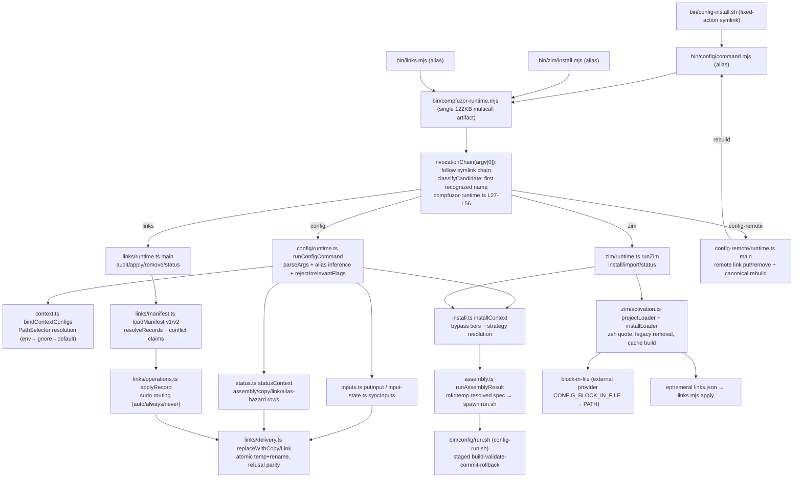

# Migrating compfuzor-runtime to Effect and Effect CLI

## What's up

The parent session has annealed CONFIG, config-remote, LINKS, and Zim into one
multicall `compfuzor-runtime.mjs` artifact (commits `swvsszxqnznl`, then the
formatting follow-up `kpwzvykkzmux`) without changing semantics. The next
question on the table is whether to rebuild that runtime's internals on
[Effect](https://effect.website/) — its typed effects, `Context.Service`
layers, `Schema` errors, `Config`, spans, and the v4 `effect/unstable/cli` —
and what that buys versus what it would cost. This draft is design only: no
package is installed, no source is ported.

The standing constraints from the wave so far: the generic CONFIG context
interface survives and advances ([use-cases0](/design/config-anneal/use-cases0.glm53.md#L41-L47));
effects are shared but ownership and sequencing never are
([use-cases0 L286-L289](/design/config-anneal/use-cases0.glm53.md#L286-L289)); a
universal plan engine is explicitly rejected
([core-rescope0 direction D](/.design/config-user-target/core-rescope0.unknown.md#L509));
and the deletion test governs every step
([simplification §recommended order](/doc/config/simplification.md#L242-L252)).
Effect is therefore evaluated here as an **implementation substrate** — a way
to type the seams that already exist — not as an orchestration framework.

Research prompt for this wave, restated: *which parts of the unified runtime
become deeper, better-typed modules if rebuilt on Effect v4, which contracts
must remain byte-stable at the CLI boundary, and in what order can the two
coexist without a rewrite cliff?*

## Effect v4 ground truth (from source, not memory)

The repo's effect-best-practices skill is written against v3 vocabulary. The
local primary sources say v4 has moved; every pattern below was verified in
the checkout at `~/a/Effect-TS/effect` (commit `96ced895a0`, 2026-07-27,
`4.0.0-beta.102`) and cross-checked against the change guide at
`~/a/d/effect-changes.md` (through `4.0.0-rc.115`, 2026-09-11). Effect v4
lives in the canonical `Effect-TS/effect` repo on `main` since Jul 13
([changes §99](file:///home/rektide/a/d/effect-changes.md)); there is no
separate `@effect/cli` package anymore — the CLI is core:
`packages/effect/src/unstable/cli/`.

| Skill guidance (v3) | v4 ground truth | Source |
|---|---|---|
| `Effect.Service` + `accessors: true` + `.Default` | **does not exist**. Use `Context.Service<Self, Shape>()("Id", { make })` and `Layer.effect(this, this.make)` | `packages/effect/src/Context.ts` L200; pattern proven in `packages/effect/test/ExecutionPlan.test.ts` L6–11 |
| `Schema.TaggedError` | `Schema.TaggedErrorClass` at beta.102; **renamed to `Schema.TaggedError` in rc** — a compile trap either way | `packages/effect/src/Schema.ts` L14455–L14482; [changes §107](file:///home/rektide/a/d/effect-changes.md) |
| `@effect/cli` package | `effect/unstable/cli` in core (`Command`, `Flag`, `Argument`, `Param`, `Prompt`, `GlobalFlag`) | `packages/effect/src/unstable/cli/` |
| `Flag.integer("port")` | `Flag.Int("port")` — `integer→Int`, `float→Finite`, `none→Never`, `choice→Literals` (rc, breaking) | [changes §115](file:///home/rektide/a/d/effect-changes.md) |
| boolean flags default false | **boolean flags are required when omitted**; absence needs `withDefault`/`optional` | [changes §115, #7296](file:///home/rektide/a/d/effect-changes.md) |
| — | CLI decode environment (env, cwd) is exposed to flag schemas; hidden flags exist | [changes §74, §42](file:///home/rektide/a/d/effect-changes.md) |
| `Layer.mergeAll` / `Layer.provideMerge` | unchanged, still the flat-composition recommendation | `packages/effect/src/Layer.ts` L1194, L1490 |
| `Effect.fn("Service.method")` spans | unchanged | `packages/effect/src/Effect.ts` L13755 |
| `Config.*` | lowercase functions `Config.string/int/boolean/nested/schema(codec, path)`; empty env strings count as missing | `packages/effect/src/Config.ts` L905–L1419; [changes §98](file:///home/rektide/a/d/effect-changes.md) |
| platform `FileSystem`/`Command` | core services: `effect/FileSystem` (`Context.Service`, `FileSystem.ts` L751), `unstable/process/ChildProcessSpawner` (`ChildProcessSpawner.ts` L241); node layers in `@effect/platform-node` (`NodeFileSystem`, `NodeChildProcessSpawner`, `NodeStdio`, `NodeTerminal` — each exports `layer`) | platform-node `src/*.ts` |
| — | `NodeRuntime.runMain` maps Effect results to process exit codes with SIGINT/SIGTERM teardown | `packages/platform-node/src/NodeRuntime.ts` |
| — | Workflow machinery is `unstable/workflow` (`WorkflowEngine`, `Activity`, `DurableQueue`, `DurableDeferred`, `DurableClock`) and presumes durable persistence | [changes §29, §33, §47](file:///home/rektide/a/d/effect-changes.md) |
| — | `Otlp.layerFromEnv` wires OTLP traces/metrics/logs from standard `OTEL_*` env vars | [changes §53](file:///home/rektide/a/d/effect-changes.md) |
| — | Core module side effects removed for tree-shaking | [changes §56](file:///home/rektide/a/d/effect-changes.md) |

Two versioning consequences follow. First, the Effect repo itself develops
against TypeScript 7 (`typescript: ^7.0.2`, `tsconfig.base.json` with
`skipLibCheck: true`) — compatible with this repo's `tsgo --noEmit` checker
([package.json](/package.json)). Second, the beta→RC renames
(§107, §115) mean any adopted code should be written against **rc names from
the start** even though the local checkout still shows beta names; pin a rc
release when the dependency is actually added.

## 1. Current pipeline map

Controller side (Ansible, Python filters — never deployed):

1. Playbooks (`.pb`) declare `CONFIGS`/`CONFIG_CONTEXTS`, `LINKS`,
   `SYSTEMD_UNITS`, `ZIM_MODULES`/`ZIM_CONTEXTS`, `BINS`, `ETC_FILES`.
   Example: [`zim.opt.pb`](/zim.opt.pb) L17–L68.
2. [`config_compile.py`](/library/filter_plugins/config_compile.py) and
   [`config_context_compile.py`](/library/filter_plugins/config_context_compile.py)
   compile recipes and contexts into `etc/config.spec.json` (version 2) plus
   BINS records; the legacy-emit-then-rewrite adapter still exists and is
   slated for deletion
   ([simplification §2](/doc/config/simplification.md#L117-L157)).
   [`zim_context_compile.py`](/library/filter_plugins/zim_context_compile.py)
   emits `etc/zim.spec.json` and the Zim aliases.
3. [`runtime_bundles.py`](/library/filter_plugins/runtime_bundles.py) contributes
   the single canonical artifact claim (`compfuzor_runtime_bin()`, one
   `raw: true` BINS record for the checked-in
   [`build/runtime/compfuzor-runtime.mjs`](/build/runtime/compfuzor-runtime.mjs))
   plus per-domain `runtime_alias_bin()` symlink aliases
   (`config/command.mjs`, `config-remote.mjs`, `links/links.mjs`,
   `links.mjs`, `zim/install.mjs`); identical claims dedupe under the
   name-keyed BINS merge
   ([consumer-toolkit](/doc/config/consumer-toolkit.md#L38-L60)).
4. [`bin_composers`](/library/filter_plugins/bin_composers.py) folds leaves
   into scope/subsystem compositors (`install.sh`, `install-user.sh`,
   `install-<subsystem>[-user].sh`) — manual entry points, ordered child
   invocations, `subsystem` as the only grouping axis
   ([doc/bins.md](/doc/bins.md#L52-L115)).

Target side (deployed `DIR` under `/opt/<name>`):



Key contracts at each hop, with the precise seam they imply:

- **Invocation selection**: symlink-chain classification before any flag
  parsing ([compfuzor-runtime.ts L27–L75](/files/runtime/compfuzor-runtime.ts#L27-L75));
  per-domain declared-name precedence (explicit → alias → env → default) in
  [`resolveSelectedName`](/files/config/invocation.ts#L17-L29); CONFIG alias
  grammar in [`configAliasPieces`](/files/config/cli.ts#L186-L214) including
  hostile/ambiguous alias rejection.
- **Context binding**: [`PathSelector`](/files/config/context.ts#L7-L13)
  resolution with `env → ignore-list screen → default` and XDG expansion at
  runtime ([L96–L118](/files/config/context.ts#L96-L118)), then whole-context
  rebinding via [`bindContextConfigs`](/files/config/context.ts#L151-L185).
- **Actions**: six fixed actions dispatched in
  [`runConfigCommand`](/files/config/runtime.ts#L66-L182), with canonical-context
  restriction (assemble/status only, L89–93), irrelevant-flag rejection, and
  env strategy chains (`COMPFUZOR_CONFIG_{INSTALL,DROPINS,PUBLISH}_STRATEGY`,
  L44–64).
- **Domain workflows**: Zim install = typed CONFIG install → skip-with-reason
  under bypass → loader projection → legacy cleanup → cache build → ephemeral
  registry manifest
  ([zim/install.ts L68–L100](/files/zim/install.ts#L68-L100)); status
  aggregates three reporters ([L169–L181](/files/zim/install.ts#L169-L181)).
- **Effects**: atomic copy/link with refusal parity and physical-identity
  checks ([links/delivery.ts L133–L170](/files/links/delivery.ts#L133-L170));
  managed blocks through the external `block-in-file` process
  ([zim/activation.ts L143–L154](/files/zim/activation.ts#L143-L154)); process
  execution with detached process groups and signal forwarding
  ([config/assembly.ts L43–L93](/files/config/assembly.ts#L43-L93)); the
  transaction itself is a shell leaf,
  [`config-run.sh`](/files/config-run.sh) L175–L238 (stage → reserve backups →
  commit → rollback on failure).
- **Status**: representation-aware rows with a shared shape
  ([config/report.ts](/files/config/report.ts)) and the 0/1/2 exit contract;
  LINKS rows with their own vocabulary
  ([links/runtime.ts L23–L125](/files/links/runtime.ts#L23-L125)).

## 2. Proposed module layout

One package, domain-grouped, no flat source directory. The deployed tree and
BINS/alias surface are untouched; only the source layout inside the future
package changes. `files/` currently approximates this; the layout below makes
the kernel/effects/domain split explicit and keeps the existing file names
wherever the module already exists (migration renames are mechanical).

```text
compfuzor-runtime/
  src/
    entry/
      runtime.ts                 # multicall dispatcher: argv0 chain, classify,
                                 #   domain delegation, exit-code conventions
                                 #   (today files/runtime/compfuzor-runtime.ts)
    kernel/                      # small, deep, domain-free
      selection/                 # resolveSelectedName truth tables (invocation.ts)
      spec/                      # PathSelector + context binding (context.ts);
                                 #   Schema codecs for config.spec.json v2,
                                 #   zim.spec.json v2, links.json v1/v2
      settings/                  # Effect Config recipes for COMPFUZOR_* /
                                 #   ZIM_* / OTEL_* env; no process.env elsewhere
      deployment/                # deploymentDir discovery (.ts vs built split)
    effects/                     # generic effect library; providers are external
      fs/                        # entry inspection + physical-identity probes
                                 #   over effect FileSystem
      delivery/                  # replaceWithCopy/Link, executor interface,
                                 #   privilege routing adapter (sudo executors)
      block/                     # managed-block provider seam: resolution
                                 #   (CONFIG_BLOCK_IN_FILE→PATH), capability
                                 #   probe, apply/read/remove, one projection
      process/                   # runCommand over ChildProcessSpawner:
                                 #   capture, stdin bytes, signal forwarding
      transaction/               # staged-commit shape shared by any future
                                 #   TS transaction (reserve→stage→commit→rollback)
    domains/
      config/                    # cli grammar, install, inputs, input-state,
                                 #   assembly invocation, publication, status
      links/                     # manifest, operations, audit, runtime
      zim/                       # activation, cache, registry, orchestration
                                 #   adapter over kernel+effects
      remote/                    # config-remote
    observe/                     # StatusRow model (Schema), renderers
                                 #   (human/jsonl/array), exit-code folding
  test/                          # unit + truth-table property tests
```

Depth rationale (codebase-design vocabulary): `kernel/spec` and `kernel/selection`
are the two proven seams with two real consumers each
([core-rescope0 direction B](/.design/config-user-target/core-rescope0.unknown.md#L509));
`effects/*` are shallow modules with tiny interfaces whose value is the
contract, not logic; `domains/*` stay deep and own their sequencing. The
`entry/` module is an *adapter* and must stay dumb — it exists to preserve the
multicall contract, not to gain features.

## 3. Interfaces and seams

Each seam becomes one `Context.Service` class (v4 pattern:
`class F extends Context.Service<F>()("compfuzor/Fs", { make })` with a
companion `Live = Layer.effect(F, F.make)`), errors as `Schema.TaggedError`
sets, methods as `Effect.fn("Fs.inspectEntry")` spans. Interfaces are stated
in terms of today's behavior — this is a retyping, not a redesign.

| Seam (service) | Interface sketch | Errors | Owner of sequencing |
|---|---|---|---|
| `Selection` | `resolveName({ explicit, invokedAs, inferAlias, environment, fallback, declared })` — truth tables of [invocation.ts](/files/config/invocation.ts#L17-L29) | `UnknownSelectionError` | callers |
| `SpecBinding` | `loadConfigSpec/loadZimSpec/loadLinksManifest` (Schema decode, replacing hand-rolled `object()` guards), `bindContextConfigs`, `resolvePathSelector` | `SpecDecodeError`, `SelectorError`, `RootExpressionError` | callers |
| `Settings` | Effect `Config` recipes: `comfuzor.configContext`, `.installStrategy`, `.dropinsStrategy`, `.publishStrategy`, `zim.*`, bypass booleans | `ConfigError` (native) | callers |
| `FsEffects` | `inspectEntry`, `usableFile`, `byteEquals`, `sharePhysicalEntry/Directory` over `effect/FileSystem` | `FsProbeError` wrapping `PlatformError` | callers |
| `Delivery` | `replaceWithCopy/Link(source, destination)` behind `LinkDeliveryExecutor`/`CopyDeliveryExecutor` (local + sudo adapters, [operations.ts L58–L77](/files/links/operations.ts#L58-L77)) | `DeliveryDestinationError`, `DeliveryAliasError` | callers |
| `BlockProvider` | `resolve()`, `probe()` (envsubst, `--read`, `--remove-match`, stdin), `apply(bytes, block, dest)`, `readProjected(...)`, `removeMatch(...)` | `BlockProviderMissingError` (actionable install message), `BlockApplyError` | domains |
| `ProcessRunner` | `run(file, argv, { capture, input, forwardSignals, detached })` over `ChildProcessSpawner` | `ProcessExitError{code,stderr}`, `ProcessSpawnError` | callers |
| `StagedTransaction` | `withStagedCommit(items, commit)` — Scope-based reserve→stage→commit mirroring [config-run.sh L175–L238](/files/config-run.sh) | `RollbackIncompleteError` (warn-grade) | callers |
| `Observation` | `StatusRow` as `Schema.Struct`, `foldExit(rows)` → 0/1/2, renderers | — | — |
| `ConfigRecipes` | domain API: `installContext`, `runAssembly`, `putInput`, `syncInputs`, `publishOutputs`, `statusContext` — today's typed operations | `CanonicalActionError`, bypass outcomes as values (`skipped{reason}`) | CONFIG |
| `LinksOwnership` | `loadManifest → resolveRecords → apply/remove/status/audit` with sudo routing and compose participation | `ManifestConflictError` | LINKS |
| `ZimOrchestration` | adapter: config install → loaders → caches → registry; import producer; aggregate status | domain set | Zim |
| `MiseOrchestration` *(future)* | independent blocks via `BlockProvider`, settings mutation, pin links via LINKS records — deliberately **not** a CONFIG graph ([doc/config/README.md L63–L68](/doc/config/README.md#L63-L68)) | domain set | Mise |

Boundaries the table encodes: CONFIG consumer copy/link and LINKS durable
records share `Delivery` but keep distinct ownership contracts
([doc/subsys.md L593–L599](/doc/subsys.md#L593-L599)); systemd's
delegate-to-`links.mjs`-with-fallback pattern
([systemd-links0 L75–L101](/design/install-context/systemd-links0.solx.md#L75-L101))
is exactly "domain sequencing over a shared provider seam" and stays that way.

## 4. Where Effect CLI helps — and where it must not dictate

Helps:

- **The explicit-word lane.** Direct invocation
  `compfuzor-runtime.mjs config|links|zim|config-remote …` is currently a
  bare usage string
  ([compfuzor-runtime.ts L70–L74](/files/runtime/compfuzor-runtime.ts#L70-L74)).
  An `effect/unstable/cli` `Command` tree with `withSubcommands` gives that
  lane real help, typed flags, hidden debug flags, completions, and
  `Command.runWith(argv)` for tests — additive, because nothing deployed
  invokes this lane today.
- **Help economics.** Action-specific help strings
  ([config/cli.ts L44–L107](/files/config/cli.ts#L44-L107)) are hand-rolled;
  Flag metadata could generate them. Same for config-remote's terse usage.
- **Parse-error quality.** Strict `parseArgs` errors are minimal; schema-
  backed flags give structured messages (env-aware since
  [changes §74](file:///home/rektide/a/d/effect-changes.md)).

Must not dictate:

- **Multicall classification precedes parsing.** The dispatcher must resolve
  the domain from the symlink chain *before* any flag grammar exists
  ([compfuzor-runtime.ts L37–L75](/files/runtime/compfuzor-runtime.ts#L37-L75)).
  Effect CLI can never own argv[0] semantics — the fixed-action symlinks'
  alias inference (`configAliasPieces`, including ambiguous/hostile alias
  rejection, [cli.ts L186–L214](/files/config/cli.ts#L186-L214)) is domain
  law with truth tables ([command0](/design/config-context/command0.solx.md#L77-L131)).
- **Cross-action validation is policy, not grammar.** `rejectIrrelevantFlags`
  ([cli.ts L216–L221](/files/config/cli.ts#L216-L221)) encodes which flags
  are meaningless per action; a generic flags-object cannot express it
  without becoming a second, competing contract.
- **stdout is an interface.** Tab-separated status rows, `put\tenabled\t…`
  mutation echoes, and quiet/JSON formats are consumed by aggregate
  `status.sh` and tests. CLI rendering/pretty-printing must stay off the
  success path.
- **`config-inputs` subactions** (`put/enable/disable/remove`) are a small
  positional grammar, not a reason to nest a command tree.

Recommendation: adopt Effect CLI **only for the explicit-word lane** and
possibly config-remote, behind the same option model; the deployed
fixed-action surface keeps `parseArgs` and its exact messages until a slice
proves byte-equivalent help/errors under CLI generation.

## 5. Observability — and why Effect Workflow is not warranted

Native wins worth taking:

- `Effect.fn` spans on every seam method give a uniform trace hierarchy
  (`Delivery.replace`, `Zim.installZim`) at near-zero code cost.
- `Otlp.layerFromEnv` ([changes §53](file:///home/rektide/a/d/effect-changes.md))
  makes `OTEL_*` opt-in traces/metrics/log-export a **layer swap** — exactly
  matching the repo's env-var posture (`COMPFUZOR_*` bypass/strategy vars).
- Metrics (`Metric.counter` per action/exit code) and structured logs
  (`Effect.log`) replace `console.log/error` *inside* seams; the human-facing
  row output remains the CLI's own rendering, not the logger's.
- `NodeRuntime.runMain` gives signal-driven interruption and exit-code
  mapping that today's hand-rolled handlers approximate
  ([compfuzor-runtime.ts L123–L143](/files/runtime/compfuzor-runtime.ts#L123-L143),
  [assembly.ts L64–L79](/files/config/assembly.ts#L64-L79)).

Effect Workflow is **not appropriate** for local short-lived install
operations:

- The workflow engine is `unstable/workflow` machinery — `WorkflowEngine`,
  `Activity`, `DurableQueue`, `DurableDeferred`, `DurableClock` — built on
  durable persistence (EventLog/SQL) and aimed at long-running, resumable,
  distributed work
  ([changes §29, §33, §47](file:///home/rektide/a/d/effect-changes.md)). A
  Zim install is seconds-long, single-host, and interrupted only by signals.
- Compfuzor's recovery model is *convergence with explanation*: a partial
  install is allowed and status explains it; re-running converges
  ([use-cases invariant 9](/design/config-anneal/use-cases0.glm53.md#L351-L380);
  core-rescope explicitly refuses cross-tool transactions without a recovery
  contract). Durable workflow machinery would add a persistence substrate to
  avoid a problem the domain already answers with status.
- Core-rescope direction D rejected the generic plan engine for exactly this
  reason; durable orchestration is the same trap with better types.

Use instead: `Scope`/`acquireRelease` for temp dirs and staged commits
(replacing `try/finally` in
[assembly.ts L101–L108](/files/config/assembly.ts#L101-L108)),
interruption via runtime teardown, retries nowhere (deliberate —
[Let It Fail](/AGENTS.md)), spans for observation.

## 6. Incremental migration sequence

Compatibility rule for every slice: the deployed CLI surface (aliases,
flags, stdout bytes, exit codes, spec formats, BINS records) is
frozen; each slice is verified by the existing suites
([tests/integration](/tests/integration): `config_command`,
`config_context_toolkit`, `config_contexts`, `config_remote`,
`links_status`, `mcp_install`, `zim_consumer`, `zim_remote`,
`links/test_runtime_manager`) plus filter-plugin tests, and by compiled
BINS/DIRS/status snapshots. Live reruns get logged in
[doc/config/log.md](/doc/config/log.md).

| Slice | Content | Acceptance evidence |
|---|---|---|
| S1 tooling only | add `effect` + `@effect/platform-node` (+ dev `@effect/vitest`, `@effect/language-service` tsconfig plugin — the repo already deploys that tool via [`effect-language-service.src.pb`](/effect-language-service.src.pb)); measure bundle-size delta with a spike build | `pnpm check` green under `isolatedDeclarations`; size/hyperfine numbers recorded; zero runtime change |
| S2 delivery+fs effects | port `links/delivery.ts` + entry probes to `FsEffects`/`Delivery` services; links runtime `main` becomes an Effect program behind `NodeRuntime.runMain` exit mapping; sudo executors as adapter layers | LINKS integration + `links_status` pass byte-identical; unit tests for refusal parity |
| S3 spec kernel | `Schema` codecs for the three spec formats replacing `object()` guards; `SpecBinding` service | decode round-trips against fixture specs; error messages matched or deliberately improved with fixtures |
| S4 selection + settings | `Selection` truth tables as pure functions with property tests; `Settings` Config recipes replacing scattered `process.env` reads (single read site per var) | truth-table fixtures from [command0](/design/config-context/command0.solx.md#L77-L131); config integration suites |
| S5 status observation | `StatusRow` as Schema; renderers split from computation; exit folding in `Observation` | golden stdout per format; exit 0/1/2 tables |
| S6 process + assembly | `ProcessRunner` over `ChildProcessSpawner` with signal forwarding; assembly invocation effectful; `config-run.sh` **stays shell** (generated transaction leaf) — a TS `StagedTransaction` is optional later | config assembly/install suites; interrupt behavior spot-check |
| S7 Zim adapter | `ZimOrchestration` over seams; registry ephemeral manifest unchanged | zim consumer/remote suites; live run logged |
| S8 CLI explicit-word lane | `effect/unstable/cli` Command tree for the direct-invocation lane; fixed-action surface unchanged | new help output fixtures; no deployed-surface diffs |

Ordering tension with the simplification plan: the block provider seam
(use-cases §"Where block-in-file belongs") and the envsubst deletion
([simplification §1](/doc/config/simplification.md#L48-L115)) overlap in
`zim/activation.ts`. Recommendation: land the **block seam (S7a)** first as
a thin wrapper over the existing calls, then let the envsubst deletion land
against the seam (one projection path either way), matching gating Q1's
either-or.

## 7. No-build zx shebang mode

Assessment of running the `.ts` sources directly (zx or node type-stripping)
on contributor machines, backed by a future recursive compfuzor/mise runtime
tool that provisions node/zx from pinned `.tool-versions`
([gen_tool_versions.tasks](/tasks/compfuzor/gen_tool_versions.tasks),
[mise.opt.pb](/mise.opt.pb)):

- **It already half-exists.** The dispatcher distinguishes `.ts` module paths
  from built ones ([compfuzor-runtime.ts L99–L103](/files/runtime/compfuzor-runtime.ts#L99-L103)),
  and repo policy is to run `.ts` directly during development. The sources
  use explicit `.ts` import extensions and no emit-dependent syntax —
  compatible with node's type stripping.
- **It must not become a second product.** The simplification plan's
  target-side rule is explicit: deployed trees contain built JavaScript, not
  TypeScript source
  ([simplification §3](/doc/config/simplification.md#L168-L187)). A no-build
  deployed lane would reintroduce controller/target source coupling the
  Vite+ boundary just removed, and node version drift would make target
  behavior depend on the toolchain mise happens to provide.
- **Single semantics** are preserved by three rules: (1) one entry — the
  no-build lane invokes the *same* multicall dispatcher, never a parallel
  script; (2) the future recursive runtime tool is a *provisioner* (installs
  node/pins, then execs the same artifact or checkout), not a reimplementation;
  (3) both lanes are exercised by the same integration suite in CI when the
  contributor lane is formalized. `zx` remains what
  [`zx.src.pb`](/zx.src.pb) says it is — a contributor scripting tool whose
  toolchain comes from mise, not a runtime substrate.

## 8. The gating questions

1. **Blocks: third representation or sub-file mutation effect?** Split the
   question by layer. At the *effect* layer a managed block genuinely is a
   third primitive beside copy and link — it lands bytes into a file with
   foreign content, with its own refusal and health contracts, so
   `effects/block` deserves equal rank with `effects/delivery`. At the
   *representation vocabulary* layer (CONFIG status rows, strategy enums) it
   is **not** a third whole-output representation: a block can be healthy
   while the rest of the destination diverges, whole-file status would have
   to model mixed granularity, and no CONFIG recipe declares block outputs.
   Recommendation: sub-file mutation effect + provider seam; domains surface
   block-health rows in their own status (Zim loader rows, mise
   `block-status` folding into one vocabulary per use-cases Q1).
2. **Durable blocks manager?** No — three ad-hoc consumers, zero durable
   ones; keep ad-hoc declarations + shared status. The Zim ephemeral registry
   manifest ([zim/install.ts L34–L66](/files/zim/install.ts#L34-L66)) remains
   the intermediate precedent. What changes the answer: a consumer that needs
   block claims to survive re-render or compose across subsystems.
3. **System-scope CONFIG privilege.** Keep assemble-into-canonical + explicit
   privileged publish; privilege appears only through delivery routing
   (the `Delivery` sudo adapter reuses LINKS' `needsSudo`/`destWritable`
   logic, [operations.ts L51–L56](/files/links/operations.ts#L51-L56)). A
   system context must not become a silent sudo path
   ([use-cases invariant 8](/design/config-anneal/use-cases0.glm53.md#L351-L380)).
4. **Startup-file ownership** stays domain vocabulary (`loader_root`,
   env-overridable destinations). The runtime contributes only `Settings`
   recipes so each domain reads its override once, consistently.
5. **Unobservable effects** (line edits, crudini merges, mise settings):
   document them as controller-side/out-of-guarantee first; add a minimal
   "declared setting" row only when a second consumer appears. Deciding
   explicitly beats the current silence
   ([use-cases §effect coverage gaps](/design/config-anneal/use-cases0.glm53.md#L335-L349)).
6. **Toolchain pins**: yes — `gen_tool_versions` + repo-root LINKS + `mise
   install` is the whole answer; retire block-in-file.src.pb's bespoke pin.
   Mise settings drift observation deferred with Q5.
7. **Complete-install ownership**: structured BINS invocation metadata
   (core-rescope checkpoint 4) is controller-side and orthogonal to the
   Effect migration; land it before a second complete-install adopter.
   `CONFIG_INSTALL_OWNER` remains a compile-time scalar until then.
8. **Runtime as layer or package**: **packaging boundary** — the deployed
   bundle of effect/status/provider modules. The Effect migration must not
   introduce a new architectural "runtime layer" concept; the layers are the
   seams in §3, and they are small.
9. **Donor administration**: keep the Zim protocol; the promotable
   generalization is `ConfigRecipes.putInput` + a promotion *relationship*
   status, deferred until a second fragment-exchanging domain exists.

## 9. Options, tensions, and the first slice

| Option | What it buys | What it costs | Verdict |
|---|---|---|---|
| A. Status quo (no Effect) | zero churn; the omnibus already works and is tested | untyped seams stay; env reads scattered; spans/metrics hand-rolled; error taxonomy ad hoc | legitimate fallback; revisit if S1 measurements are bad |
| B. Edges-only (Effect at `main()` per domain) | exit-code/signal handling via `runMain`; small diff | little of the real value; two styles inside each domain | insufficient alone |
| C. Seams-first (S1–S8 above) | typed deep modules at proven seams; observation for free; domains unchanged in behavior | largest (but incremental) diff; beta→rc pin discipline; bundle growth | **recommended** |
| D. Full rewrite incl. Workflow | uniform substrate | durable machinery for convergent installs; violates direction-D rejection; persistence substrate on targets | rejected |

Tensions to keep visible during annealing: (1) *bundle size vs substrate* —
the single-file artifact grows from 121,661 bytes today by an Effect-core
multiple (mitigated by [changes §56](file:///home/rektide/a/d/effect-changes.md)
tree-shaking; must be measured at S1, and the CLI kept out of the deployed
bundle initially); (2) *typed errors vs string messages* — many `fail()`
messages are interface (tests match them); typed errors must preserve or
consciously upgrade wording with fixtures; (3) *the effect-best-practices
skill is v3-flavored* — every pattern needs the §ground-truth translation
above, and the skill should be updated when adoption starts; (4) *isolatedDeclarations discipline* —
already required by [tsconfig.json](/tsconfig.json) (`isolatedDeclarations:
true`); Effect class/generic patterns are compatible (the Effect repo itself
builds under TS 7 with `skipLibCheck`), but new exports need explicit
annotations and deep `Layer.provide` nesting is to be avoided in favor of
flat `mergeAll`/`provideMerge` for LSP responsiveness.

**Recommended first slice**: S1 (tooling + measurements), immediately
followed by S2 (delivery/fs) — it is the smallest seam with the broadest
reuse (CONFIG and LINKS both consume `delivery.ts` today), it has the
strongest existing test coverage, and it produces the `FsEffects`/`Delivery`
services every later slice builds on. If S1's size/startup measurements are
objectionable, stop at option A with evidence.

## 10. Glossary / action taxonomy

The words "assembler", "installer", and "provider" currently do triple duty.
Proposed taxonomy (supersedes nothing deployed — names in code and CLI stay;
this is shared vocabulary):

| Term | Meaning | Replaces confusion around |
|---|---|---|
| **Deliver** | land bytes at a destination via copy, link, or block overlay (an *effect*) | "provider" for internal code |
| **Assemble** | derive candidate bytes from inputs through processors (CONFIG action; run by the transaction runner) | "assembler" |
| **Transaction runner** | the staged build-validate-commit-rollback leaf ([config-run.sh](/files/config-run.sh)) | "assembler" (second sense) |
| **Publish** | deliver canonical outputs into a context (CONFIG action) | "installer" (loose use) |
| **Install** | a domain-sequenced complete operation (Zim install = config→loaders→caches→registry) | "installer" (third sense) |
| **Provider** | an *external* tool resolved at runtime (block-in-file, `links.mjs` as seen by systemd) | provider-vs-service |
| **Effect** | a typed primitive in `effects/` (fs, delivery, block, process, transaction) | "provider" (internal misuse) |
| **Seam** | a typed service interface where domains access kernel/effects | "API", "helper" |
| **Adapter** | a domain module composing seams with domain sequencing (Zim orchestration) | "runtime" (overloaded) |
| **Status / Observation** | representation-aware rows + 0/1/2 exit contract | "checker" |
| **Owner** | complete-install owner (`CONFIG_INSTALL_OWNER`) | "installer" (fourth sense) |
| **Runtime** | the deployed multicall artifact and its source package — a packaging boundary, not a layer | "runtime" as architecture |
| Context, Recipe, Binding, Representation, Strategy | unchanged, per [consumer-toolkit](/doc/config/consumer-toolkit.md) | — |

## Cross-references

- [`use-cases0.glm53.md`](/design/config-anneal/use-cases0.glm53.md) — the
  six use cases, layer table, and gating questions this draft answers; its
  invariants (effects shared, ownership distinct) shaped §3 and §8.
- [`simplification-assessment0.gpt6.md`](/design/config-anneal/simplification-assessment0.gpt6.md)
  — the omnibus cutover this migration sequences after; its
  isolatedDeclarations findings carry into S1 and §9.
- [`doc/config/simplification.md`](/doc/config/simplification.md) — deletion
  plan whose §1 (envsubst) and §2 (compiler split) interleave with the block
  seam ordering in §6.
- [`doc/config/consumer-toolkit.md`](/doc/config/consumer-toolkit.md) — the
  frozen CLI/spec contract every slice must preserve.
- [`doc/bins.md`](/doc/bins.md) and [`doc/subsys.md`](/doc/subsys.md) — BINS
  composition and the LINKS/CONFIG ownership boundary effects must not blur.
- [`design/config-context/command0.solx.md`](/design/config-context/command0.solx.md)
  — truth tables that become S4 property tests.
- [`design/install-context/systemd-links0.solx.md`](/design/install-context/systemd-links0.solx.md)
  — the provider-delegation pattern generalized by the seam table.
- [`.design/config-user-target/core-rescope0.unknown.md`](/.design/config-user-target/core-rescope0.unknown.md)
  — direction B/D framing; §5 and §9 of this draft apply it to Effect.
- [`doc/config/log.md`](/doc/config/log.md) — where live acceptance runs of
  each slice should be recorded.
- [`effect-language-service.src.pb`](/effect-language-service.src.pb) and
  [`pauljphilp-effect-patterns.src.pb`](/pauljphilp-effect-patterns.src.pb) —
  existing playbooks showing the toolchain already provisioned on this host.
