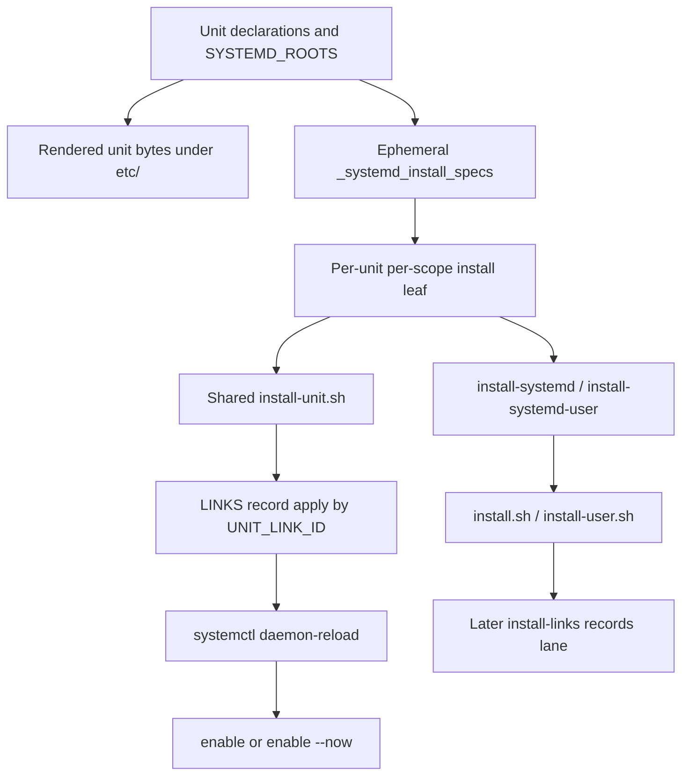

# Systemd scope bindings are not CONFIG contexts

The exact underlying model identifier is not exposed in this session; the
`unknown` filename suffix and `model:unknown` label are intentional. This is a
fresh comparison checkpoint, not migration authority. No playbook or live
system operation was run.

## Verdict

**Systemd is a real second example of a composite domain install, but it is not
a second consumer of CONFIG/Zim's selected-context contract.** Its current
shape is largely healthy:

- one deep [`install-unit.sh`](/files/systemd/install-unit.sh) owns publication,
  manager reload, enablement, and optional immediate start;
- generated leaves bind unit identity, instance targets, activation scope,
  link-record identity, manager command, and authority;
- generated systemd and top-level compositors preserve hard system/user entry
  points and cross-domain ordering.

The leaves are shallow, but their multiplicity is not merely duplicated
behavior. Each is a directly addressable compiled binding for a different unit
and/or authority domain. Removing them today would require a new durable
systemd install spec, selector, ordered executor, and direct-unit CLI. That
moves the binding table; it does not delete it.

Therefore:

1. **Do not adopt `resolveSelectedName` in systemd now.** `scope` is a manager
   and authority selection, not a named consumer context.
2. **Do not extend CONFIG's path-selector compiler/runtime for systemd.**
   systemd already has the compile-time `fsh` expansion and LINKS runtime-root
   contracts it needs; their inputs and expansion times differ from CONFIG.
3. **Do not broaden BINS beyond the accepted explicit `action:` seam now.** A
   command-plus-arguments form becomes necessary only if one systemd command
   replaces scoped leaves, and that migration is not justified yet.
4. **Keep hard system/user aggregates for systemd.** Ordinary CONFIG/Zim
   installation may select a default context from bare `install.sh` because
   those contexts do not grant authority; systemd must not inherit that rule.

The strongest follow-up need is not invocation consolidation. It is a
systemd-specific status contract, plus correction of two LINKS-composition
interactions described below.

## 1. Current topology



### Command and wrapper layers

| Layer | Current form | Responsibility |
|---|---|---|
| Shared domain implementation | `bin/install-unit.sh`, rendered from [`files/systemd/install-unit.sh`](/files/systemd/install-unit.sh) | Parse link/enable/start/copy switches; locate source and destination; publish; reload; enable typed targets; optionally start. It is `compose: false` and sourced by leaves. |
| Unit leaf | `install-<type>[-<unit>][-user].sh` | Bind one compiled unit/scope record and remain directly invokable. |
| Drop-in action | `install-dropin.sh` | Embed all drop-in rows, optionally filter them, publish each drop-in, and reload each affected manager once. It is a separate table-driven action, not a wrapper around `install-unit.sh`. |
| Subsystem compositor | `install-systemd.sh` or `install-systemd-user.sh` | BINS-generated address for all systemd leaves in one hard scope. |
| Scope compositor | `install.sh` or `install-user.sh` | BINS-generated cross-subsystem entry point. Systemd's `units` lane follows identity and ordinary artifacts. |
| Link owner | `links.ts apply --id UNIT_LINK_ID` in each unit install; later `install-link-records[-user].sh` | Apply the exact unit record before reload/enable; later re-apply the whole scope plan in the `records` lane and provide durable status/audit/remove ownership. |

### What differs by system/user scope

| Dimension | System binding | User binding | Behavioral or binding? |
|---|---|---|---|
| Unit bytes | Outside `separate`, bytes are rendered once according to `SYSTEMD_SCOPE`; `both` installs that same file in both managers. | For top-level units in `separate`, a second `-user` unit is rendered with user-loop bindings. | Potentially genuine byte difference, not just destination choice. |
| Unit destination | Usually `/etc/systemd/system`; network/nspawn directory maps take precedence where declared. | `${HOME}/.config/systemd/user` for ordinary units. | Genuine manager search-path difference. |
| Manager command | `systemctl` | `systemctl --user` | Genuine manager difference. |
| Manager authority | `SUDO_CMD=sudo` wraps reload/enable/start. | `SUDO_CMD` is empty. | Genuine authority difference. |
| Caller identity | An ordinary caller may escalate bounded system operations. | The invoking user supplies `HOME`, runtime roots, user bus, and manager identity. There is no arbitrary target-user switch. | Genuine execution-context difference. |
| Install aggregate | Bare `install-systemd.sh` under `install.sh`. | `install-systemd-user.sh` under `install-user.sh`. | Hard operational partition, not a default-context hint. |
| Link record | ID is `system:<destination>`. | ID is `user:${HOME}/...`; `${HOME}` remains literal until LINKS runtime expansion. | Generated binding into a shared ownership mechanism. |
| Default `[Install]` target | `multi-user.target`. | `default.target` when `SYSTEMD_SCOPE=user`. | Unit-byte policy. |
| Runtime path vocabulary | Deploy-mode `fsh` roots. | `%h`/`%t` in unit directives; `${HOME}`/`${XDG_RUNTIME_DIR}` in shell/LINKS records. | Genuine expansion-world difference. |

The addendum in
[`global-usermode/init0.opencode.md`](/.design/global-usermode/init0.opencode.md)
supersedes that document's old characterization of `separate` as generally
broken. Its current top-level-unit `fsh` bifurcation is implemented and tested:
user iterations receive `_fsh_user=true`, `%h`, and `%t`, while system
iterations force the system hierarchy. Two narrower gaps remain visible in
current code. First, `SYSTEMD_INSTALLS_DEFAULT.WantedBy` keys from the
playbook's `SYSTEMD_SCOPE`, not the loop's `_scope`, so a `separate` user
variant needs an explicit user-appropriate target. Second, the
`SYSTEMD_ROOTS` byte-rendering loop does not bifurcate, while its install specs
still add the `-user` source suffix in `separate`; a root-based separate user
leaf can therefore point at an unrendered source. These are current bounded
gaps, not a revival of the superseded claim that separate mode as a whole is
inert.

### Per-leaf bindings

Each generated leaf binds:

```text
UNIT_TEMPLATE
UNIT_ENABLE_TARGETS
UNIT_TYPE
UNIT_DIR
UNIT_LINK_ID
SYSTEMCTL
SUDO_CMD
optional --skip-start
```

`UNIT_ENABLE_TARGETS` is empty for `SYSTEMD_ENABLE=false`; otherwise it is the
single unit name or the declared concrete instance set. `install-unit.sh`
always adds the unit type suffix before calling `systemctl`, preventing socket,
timer, and other unit types from accidentally being treated as services.

`SYSTEMD_ENABLE` and `SYSTEMD_START` are domain policy, not scope selection:

| Enable | Start | Effect after publication/reload |
|---|---|---|
| false | either | Link/copy only; no target is enabled. |
| true | false | `systemctl enable`. |
| true | true | `systemctl enable --now`. |

The compiler preserves declaration order. This is operationally significant in
[`atuin.src.pb`](/atuin.src.pb): the service is a link-only leaf before the
socket is enabled and started. At the outer level, every systemd leaf occupies
the `units` lane so binaries, configuration, and identities exist before
activation.

### Genuine shared behavior versus generated duplication

| Concern | Judgment |
|---|---|
| Link/copy switches, phase bypasses, source/destination handling, typed enable targets, reload, enable, and start | Genuine shared behavior in `install-unit.sh`. |
| Repeated shell assignments followed by `source install-unit.sh` | Generated binding duplication. It is shallow but carries unit and authority identity. |
| One systemd compositor per populated scope | Generated navigation/composition, not domain behavior. It provides a stable subsystem entry point. |
| One scope compositor per populated scope | Cross-domain BINS behavior and a hard authority partition. |
| Unit link application in a leaf and again in the later records lane | Intentional idempotent overlap on the normal link path: activation needs the link early; LINKS owns the durable declaration and later scope-wide apply/status. It has edge-case mismatches below. |
| Drop-in row repetition | Consolidated already: one generated row table and one action handle all drop-ins. |

## 2. Deletion and depth tests

### Delete `install-unit.sh`

Every unit leaf must regain:

- copy versus managed-link versus fallback-link behavior;
- unit-source and destination derivation;
- link, enable, and start bypass handling;
- `daemon-reload` ordering;
- empty-instance/link-only handling;
- fully typed enable target construction;
- enable versus enable-and-start semantics;
- environment sourcing and pass-through manager arguments.

That is substantial behavior with ordering and failure consequences.
`install-unit.sh` passes the depth test.

### Delete the per-unit leaves

The shared helper no longer knows what to operate on. The missing complexity
must reappear as one of:

1. another generated call site carrying the same assignments;
2. a durable systemd install manifest plus parser, selectors, and ordered loop;
3. a generated command with an embedded row table, like the drop-in action.

Options 2 and 3 can reduce files, but only by introducing a new runtime binding
representation. They must also restore direct per-unit operation and preserve
instance, link-ID, ordering, and authority semantics. This is not deletion of
the compiled binding complexity.

### Delete the subsystem compositor

BINS could place every systemd leaf directly in the scope compositor. Runtime
behavior would survive, but the stable “systemd only” entry point would vanish.
This compositor is shallow and deliberately generated; it is not evidence for
a systemd command registry.

### Domain conclusion

CONFIG context says **which named consumer binding** supplies roots, recipe
paths, and action defaults. Systemd scope says **which manager and authority
domain** receives a unit, and may also select different unit bytes. A deployment
can contain many independently operable units in one scope and two variants of
one unit across scopes. The natural systemd selection key is therefore
`(scope, unit identity)`, not one CONFIG-style context name.

## 3. Selection requirements versus CONFIG/Zim

CONFIG and Zim share this runtime rule:

```text
explicit CLI
  > valid context in a manual unresolved-$0 alias
  > domain environment
  > generic environment
  > compiled default
```

[`resolveSelectedName`](/files/config/invocation.ts) is deliberately a declared-
name resolver, with lazy alias parsing. Systemd currently has no matching need:

| Selection question | CONFIG/Zim | Systemd today |
|---|---|---|
| Namespace | Arbitrary declared context names. | Closed `system`/`user` activation scopes plus unit identities. |
| Runtime default | Exactly one compiled ordinary context. | Compile-time `SYSTEMD_INSTALL` determines which scoped leaves exist; aggregates name the scope explicitly. |
| Environment override | Useful consumer switch that does not imply sudo. | A scope override could cross manager and authority boundaries. |
| `$0` alias | Optional user convenience over one real context-aware command. | Generated scoped names are hard aggregate/direct entry points, not optional aliases. |
| Path binding | Runtime context selectors expand recipe inputs/outputs. | Unit bytes are mostly compiled; user link roots expand at invocation, while `%h`/`%t` expand inside systemd. |

Two concrete scenarios make a single scoped systemd command imaginable:

1. A `SYSTEMD_INSTALL: separate` deployment carries system and user variants;
   an operator could choose `--scope system` or `--scope user` from one command.
2. A global deployment such as [`watchman.srv.pb`](/watchman.srv.pb) or
   [`opencode.src.pb`](/opencode.src.pb) lets each invoking user activate a user
   service from shared artifacts without per-user rendering.

Only the first requires runtime selection among variants. The second requires
late caller identity and runtime roots, but its deployment contains only a user
installer; a precedence chain adds no value. Neither demonstrates a need for
domain/generic environment fallback, a compiled runtime default, or manual
scope aliases. The full selected-name seam remains hypothetical for systemd.

## 4. One fixed systemd action command

A command such as `systemd-unit-install.sh --scope SCOPE [--unit GLOB]` could be
made correct, but it would need a systemd-specific compiled spec. The current
`_systemd_install_specs` is an Ansible fact used to generate leaves, not a
durable runtime asset.

| Required preservation | Consequence for one command |
|---|---|
| Direct per-unit operations | Add an exact unit selector and stable listing, or retain generated aliases. One command without selectors regresses the current surface. |
| Instances | Store template identity and concrete enable targets, including the valid empty-target/link-only case. |
| Link records | Store the exact generated `UNIT_LINK_ID`; recomputing from runtime paths risks diverging from `links.json`. |
| Enable/start policy | Store both booleans per unit; do not infer desired steady-state activity from “start now.” |
| Unit order | Preserve top-level type order and `SYSTEMD_ROOTS` order; Atuin depends on service publication preceding socket activation. |
| Cross-domain order | Keep one invocation in BINS' `units` lane. |
| Privilege | Select manager and authority per row. Never let an ambient default silently turn a user aggregate into system work. |
| Pass-through arguments | Define whether options apply to every selected target; current compositors forward the same argv to every leaf. |

The obvious name `install-systemd.sh` is already reserved for the generated
systemd subsystem compositor. An authored leaf with that name collides with the
BINS hierarchy. A differently named command can declare `action: install`, but
if grouped under `subsystem: systemd` it still generates the reserved
compositor. This is solvable, but it confirms that command consolidation is a
hierarchy redesign rather than a free reuse of CONFIG's dispatcher.

Manual `$0` aliases could infer `system` or `user`, but generated aliases would
be needed for current hard aggregate composition unless BINS learns fixed
arguments. User-created aliases do not solve generated composition and are not
needed for a two-value selector. Do not force `$0` into this domain.

## 5. Explicit BINS `action:` assessed independently

No authored systemd unit wrapper exists solely to make filename discovery work:

- `install-unit.sh` is a sourced library and already has `compose: false`;
- per-unit install leaves carry required runtime bindings and direct-unit
  operations;
- `install-dropin.sh` contains the actual compiled drop-in executor and row
  table;
- `install-systemd[-user].sh` and top scope commands are BINS-generated
  compositors themselves.

Adding `action: install` to a renamed fixed command could decouple its name from
composition, as CONFIG does, but it would remove no required file in the current
shape. Applying it to `install-dropin.sh` would only rename that real action.

Structured command-plus-arguments are needed only for the unaccepted design in
which one filename participates twice, once as `--scope system` and once as
`--scope user`. Current BINS `run_all` stores filenames and forwards caller argv;
it cannot bind different fixed args to the same child. Do not broaden BINS to
solve a migration systemd does not yet need. The narrow structured status
reporter record remains a separate, proven exception.

## 6. Ordinary install versus hard scope aggregates

The accepted CONFIG/Zim design puts one ordinary, default-context operation in
bare `install.sh`. That is valid because a CONFIG context classifies paths and
consumer binding; it neither authorizes sudo nor chooses a systemd manager.

Systemd should retain:

```text
install.sh
  -> install-systemd.sh
     -> system-scoped unit leaves

install-user.sh
  -> install-systemd-user.sh
     -> user-scoped unit leaves
```

One ordinary systemd install must not select a default scope through
`COMPFUZOR_CONTEXT`, an alias, or a compiled context default. That would either:

- merge privileged and unprivileged effects behind one ambiguous command;
- make bare `install.sh` activate a user manager depending on ambient state; or
- make `install-user.sh` merely suggest user scope while the child can select
  system scope.

Keep systemd's scope aggregates hard even while ordinary context-bearing
domains use a runtime default. Running both remains an explicit caller choice.

## 7. Privilege and LINKS interactions

### Aligned behavior

- User leaves bind `SUDO_CMD=""` and `SYSTEMCTL="systemctl --user"`.
- User unit records carry `scope: user`; [`links.ts`](/files/links/links.ts)
  never escalates such mutations and rejects `--sudo always` before mutation.
- System records may use LINKS' per-destination `auto` routing, while subsequent
  manager operations use the leaf's `sudo systemctl` binding.
- Global-artifact/user-service deployment correctly depends on the caller's
  `HOME`, runtime directory, and user manager. Running it as root would target
  root's user environment; the model intentionally has no “install for another
  user” authority translation.

This is safe composition, not one shared `SUDO_CMD`: LINKS owns link-mutation
authority and systemd owns manager-command authority. A future fixed command
must preserve that distinction.

### Concrete mismatches to resolve locally

1. **Copy versus declared link ownership.** Copy mode writes a regular unit
   file, but the compiled LINKS record still declares a `policy: replace`
   symlink. Direct leaf or systemd-subsystem invocation with `--copy` leaves the
   copy while `status-links.sh` reports conflict. A full aggregate invoked with
   ambient `SYSTEMD_COPY`/`SYSTEMD_INSTALL_COPY` later runs the records lane and
   can replace the copy with the declared symlink. Passing `--copy` through the
   top aggregate is worse: the same argv reaches `links.ts`, which does not
   accept that option. Copy is therefore not a stable complete-install
   representation.
2. **Systemd link bypass versus later LINKS apply.** The helper honors
   `COMPFUZOR_SYSTEMD_LINK_BYPASS`, but the later scope-wide LINKS installer is
   guarded by the LINKS domain, not the systemd phase. Through `install.sh`, it
   can still apply the systemd unit record. The isolated helper tests do not
   exercise this aggregate interaction.
3. **Separate `SYSTEMD_ROOTS` source mismatch.** As noted above, root install
   bindings gain the separate-mode user suffix without a corresponding second
   root byte render. A runtime selector must not encode or conceal that current
   source mismatch.
4. **Non-unit directory maps with user scope.** `_unit_dir` chooses network or
   nspawn directories before the user-unit directory, while a user row still
   receives no sudo and `systemctl --user`. User installation of such a type is
   not a coherent manager/destination pair and should be rejected or explicitly
   supported at compile time rather than inherited by a generic scope selector.
5. **Fallback parent creation.** When `links.ts` is absent, the direct-link path
   runs parent `mkdir -p` without `SUDO_CMD` and only applies `SUDO_CMD` to
   `ln`. Default systemd directories normally already exist, but a missing
   privileged custom parent fails before the intended escalation. This is a
   bounded failure-routing inconsistency, not unsafe user escalation.
6. **Drop-ins have their own authority path.** `install-dropin.sh` embeds
   manager and sudo words per row and may contain mixed scopes, but the action
   itself is unscoped in BINS. This deserves a local composition decision; it
   is not evidence that all units should become context-selected.

An ambient `COMPFUZOR_LINKS_SUDO=always` causes a user-record apply to fail
safely rather than escalate. That can surprise a caller, but it is preferable
to unsafe reuse.

## 8. Status and activation are not CONFIG status

Systemd installation currently means:

```text
publish unit -> daemon-reload -> enable [-> start now]
```

Its observation surface is fragmented:

| Installed relationship | Current observation |
|---|---|
| Unit source and destination link | `status-links.sh` reports managed, missing, source-missing, override, or conflict. |
| Manager has reloaded changed bytes | No generated generic systemd check. Some application scripts inspect `NeedDaemonReload` ad hoc. |
| Unit should be enabled | No generated check from `_systemd_install_specs`; application-specific reporters such as Atuin/Watchman inspect selected units. |
| Unit should be active now | No generic contract, and one should not infer it blindly. Socket-activated services may be inactive; oneshots finish; timers and sockets have type-specific expectations. |
| Live process matches deployment | Typed proc reporters cover explicitly declared active services only; they are not install status. |

The missing equivalent is a **systemd-domain status derived from the same
compiled unit install bindings**, with explicit semantics for reload and
enablement. `SYSTEMD_ENABLE=false` currently means “do not enable,” not
necessarily “ensure disabled”; `SYSTEMD_START=true` is an install-time action,
not a universal steady-state assertion. Those distinctions must be decided
before generating status rows.

This does not align naturally with CONFIG status. CONFIG observes whether a
selected consumer representation is healthy across copy/link/assembly forms.
Systemd observes manager load state, enablement links, and type-specific
activation. A future direct systemd status should likely retain 0 clean, 1
drift, and 2 evaluation error for aggregate adaptation, but sharing exit
reduction does not make the domain rows equivalent.

## 9. Architecture options

| Option | Shape | Judgment |
|---|---|---|
| **A. Retain generated bindings over the deep helper** | Keep per-unit/scope leaves, hard systemd scope compositors, and `install-unit.sh`. Fix local LINKS interactions and design systemd status without changing invocation selection. | **Recommended.** Smallest truthful model; preserves direct operations and authority boundaries. |
| **B. Systemd-specific durable install spec and selector** | Compile a versioned ordered unit-install spec; add one `systemd-unit-install.sh --scope --unit`; keep hard BINS scope entry points that bind fixed scope. | Plausible only if reducing generated files or programmatic subset operation becomes an accepted requirement. It is not reuse of CONFIG context. |
| **C. Context-selected `install-systemd.sh`** | Reuse `resolveSelectedName`, environment/default/`$0` precedence, and one unscoped BINS action. | Reject now. It conflates scope with context, weakens authority signaling, collides with the subsystem compositor name, and still needs a new unit manifest and status contract. |

### Minimal conditional tracer bullet

No implementation tracer is warranted for shared context/invocation extraction
at this checkpoint. If the human accepts a concrete requirement to remove
per-unit files, the smallest safe sequential probe is:

1. compile a read-only, versioned ordered systemd install spec alongside the
   existing leaves;
2. add a non-mutating `list`/`plan --scope --unit` reader;
3. compare its rows with existing generated leaf bindings before replacing any
   command or changing BINS.

Exact exit evidence would be:

- Atuin plans service link-only before socket enable-and-start;
- OpenCode preserves three unit identities, cleanup service link-only policy,
  timer type, user manager, and link IDs;
- Rclone `separate` exposes distinct system/user source filenames and correct
  empty concrete-instance behavior without reviving the superseded “separate
  is broken” claim;
- Watchman plans global-source/user-destination activation with no sudo and
  caller-expanded `${HOME}`;
- every planned row byte-matches the assignments in its existing leaf, and no
  leaf, compositor, link record, or live effect has yet changed.

Only after that evidence should the parent decide whether file deletion pays
for the new runtime spec. This is intentionally not a command registry or plan
engine.

### Exit evidence for this checkpoint

The comparison is complete because it identifies exact matching and
non-matching contracts:

- matching composite behavior is already deep in `install-unit.sh`;
- wrapper multiplicity carries concrete unit/scope bindings and direct
  operations;
- neither concrete runtime scenario requires CONFIG's full precedence chain;
- BINS has no authored systemd thunk that explicit `action:` can eliminate;
- systemd's authority and status semantics differ from CONFIG context;
- concrete local LINKS and status gaps are named without proposing a universal
  executor.

## 10. Core recommendations revisited

| Prior core recommendation | Systemd decision |
|---|---|
| Share the selected-name kernel across real matching consumers. | CONFIG and Zim remain the proven consumers. **Do not add systemd now.** |
| Share path selector compilation/runtime where path semantics match. | **Do not extend for systemd.** Keep `fsh` compile-time specifier paths and LINKS' bounded runtime-root expansion. |
| Let BINS compose actions independently of filenames. | Retain explicit `action:` as implemented. It removes no current systemd leaf. |
| Consider structured command plus fixed args. | **Defer.** It becomes concrete only under Option B and must preserve hard scope entry points. |
| Keep complete installation domain-local. | Confirmed. Link/reload/enable/start remain systemd vocabulary in `install-unit.sh`. |
| Avoid a universal action/effect plan. | Confirmed by privilege, instance, reload, activation, and status differences. |

Do not generalize:

- systemd scope into CONFIG context;
- system/user manager choice into an ambient generic context variable;
- `SUDO_CMD` across LINKS and manager operations;
- enable/start into a generic desired-state ontology;
- `fsh`, CONFIG selectors, and LINKS runtime roots into one path language;
- application-specific active/healthy checks into generic unit installation;
- the drop-in row executor into a global command registry;
- aggregate rollback, prune, or cross-domain reconciliation.

## Tensions for parent and human review

1. Thin generated leaves are aesthetically costly but currently preserve useful
   unit-level addressability. Is reducing deployed file count an actual product
   requirement, or only a symmetry concern after CONFIG consolidation?
2. Should `install-user.sh` remain a hard authority promise for every domain?
   This checkpoint recommends yes for systemd even if context-bearing domains
   remain unscoped.
3. Is `SYSTEMD_START` only an immediate install action, as current behavior
   implies, or should some unit types gain explicit steady-state expectations?
   That answer gates generic systemd status.
4. Should systemd copy mode be removed, or should LINKS represent copy as an
   accepted state? The current mixed contract should not be carried into a new
   command unchanged.
5. Should mixed-scope drop-ins be split into hard BINS scope entry points? This
   is a local systemd question and can be resolved independently of unit command
   consolidation.

## Cross-references

- [`command0.solx.md`](/design/config-context/command0.solx.md) is the accepted
  CONFIG behavior being tested for reuse: fixed actions over runtime-selected
  contexts, with no generated context aliases.
- [`command0-review0.solx.md`](/design/config-context/command0-review0.solx.md)
  matters because bypass, status error classification, and action-local lazy
  resolution are part of the comparison; systemd does not currently share
  those complete contracts.
- [`core-rescope0.unknown.md`](/.design/config-user-target/core-rescope0.unknown.md)
  requested this checkpoint and distinguishes context, scope, strategy, action,
  and domain-owned complete install.
- [`consumer-toolkit.md`](/doc/config/consumer-toolkit.md) documents why CONFIG
  can safely place one default-context ordinary action in bare `install.sh`.
- [`doc/bins.md`](/doc/bins.md) defines the current leaf/subsystem/scope
  hierarchy and shows Atuin's per-unit ordering and direct systemd tier.
- [`doc/subsys.md`](/doc/subsys.md) defines phase lanes, systemd phase bypasses,
  explicit BINS actions, and LINKS ownership of unit symlinks.
- [`doc/arch.md`](/doc/arch.md) supplies the compile/apply and domain/subsystem
  boundaries; a durable runtime install spec would be a new compiled contract,
  not merely a renamed wrapper.
- [`vars/systemd.yaml`](/vars/systemd.yaml),
  [`vars_systemd_unit.tasks`](/tasks/compfuzor/vars_systemd_unit.tasks), and
  [`install-unit.sh`](/files/systemd/install-unit.sh) are the current source of
  scope defaults, generated bindings, and deep install behavior.
- [`install-dropin.sh`](/files/systemd/install-dropin.sh) is useful local
  counterevidence: a table-driven single command works where rows only publish
  and reload, but does not prove unit activation should use CONFIG selection.
- [`links.ts`](/files/links/links.ts) and
  [`gen_links.tasks`](/tasks/compfuzor/gen_links.tasks) explain runtime-root
  expansion, user no-sudo enforcement, record status, and the later records
  lane that interacts with systemd copy/bypass behavior.
- [`global-usermode/init0.opencode.md`](/.design/global-usermode/init0.opencode.md)
  is the hybrid-deployment history. Its addendum supersedes the old broad
  separate-mode finding and documents the current `fsh` implementation and
  remaining default-target gap.
- [`opencode.src.pb`](/opencode.src.pb), [`atuin.src.pb`](/atuin.src.pb),
  [`rclone.srv.pb`](/rclone.srv.pb), and [`watchman.srv.pb`](/watchman.srv.pb)
  provide concrete multi-unit, ordered socket activation, separate-mode, and
  global-artifact/user-activation cases. [`mise.opt.pb`](/mise.opt.pb) is a
  negative control: its disabled user unit and independent Bash blocks should
  not drive a systemd invocation abstraction.
- [`systemd_disarm.test.py`](/tests/integration/systemd_disarm.test.py),
  [`systemd_install_valid.test.py`](/tests/integration/systemd_install_valid.test.py),
  [`bin_composers.test.py`](/tests/filter_plugins/bin_composers.test.py), and
  [`links_status.test.py`](/tests/integration/links_status.test.py) prove the
  helper's phase behavior, install enum, hierarchy/order, and user no-sudo
  contract. They do not currently cover the complete aggregate's later LINKS
  interaction with systemd copy or link bypass.
