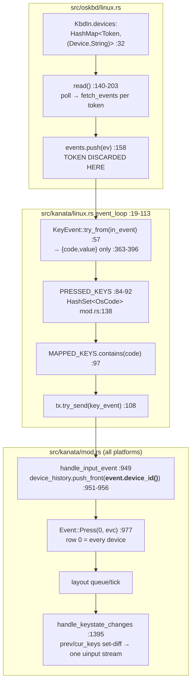

# Stage

The user calls the inability to do device-conditioned keyboard processing in
one Linux kanata instance "a huge limit" and asked for a real investigation of
whether kanata can be hacked to do better. The deployed binary is now the
source-built `1.12.1-prerelease-1` (upstream `2f84d17`, verified in
[cutover0](/design/kanata-source/cutover0.glm53.md)), which — unlike the
v1.9.0 the earlier
[assessment](/design/surface-dial-input/kanata-assessment0.gpt61s.md) examined
— already contains the cross-platform `device_id` plumbing, the
`definputdevices` parser, and the gamepad device-matching engine. That changes
the question from "would this require inventing provenance end-to-end" to
"what exactly is still missing on Linux, and how big is each candidate hack."

Everything below is read-only source analysis plus pure-tooling reproduction;
no source patches, no device access, no service changes. All file:line pins
are `2f84d17` in [`~/archive/jtroo/kanata`](https://github.com/jtroo/kanata/tree/2f84d17)
(byte-identical to the deployed build's tree; the managed worktree
`/usr/local/src/kanata-git/repo` was used only to build the existing
simulator binary into its already-populated `target/`).

# Verdict up front

**Yes — kanata can be hacked to do meaningfully better, in three coherent
steps of increasing depth, and the first step is smaller than the brief
expected because upstream already shipped ~80% of it dormant.**

1. **Device-conditioned actions already have a complete, documented,
   cross-platform config language** — `definputdevices` +
`switch (device-history …)` — and its parser, keyberon condition evaluation,
and `KeyEvent.device_id` field all **compile and run on Linux today**
([src/oskbd/mod.rs:104-144](https://github.com/jtroo/kanata/blob/2f84d17/src/oskbd/mod.rs#L104-L144),
[src/kanata/mod.rs:951-956](https://github.com/jtroo/kanata/blob/2f84d17/src/kanata/mod.rs#L951-L956)).
The Linux backend simply never stamps the ID, so the history only ever holds
`None`. Upstream's own docs mark this "Linux support is planned"
([docs/config.adoc:4293](https://github.com/jtroo/kanata/blob/2f84d17/docs/config.adoc#L4293))
— **design A is literally the planned feature**, not a fork.
2. **Independent held-key state is the harder half** and press-time switch
   dispatch does *not* deliver it: releases in keyberon strip **all** states
at a coordinate regardless of origin
([keyberon/src/layout.rs:1737-1797](https://github.com/jtroo/kanata/blob/2f84d17/keyberon/src/layout.rs#L1737-L1797)).
Fixing the motivating Shift collision requires giving per-device keys
**disjoint coordinates before merger** (design B), for which there are two
in-tree precedents (synthetic input-only `OsCode` ranges for gamepads;
`FAKE_KEY_ROW`).
3. **Per-device layers/tap-hold/chords** (design C) are a genuine architectural
   fork — N keyberon layouts with a shared logical output — with the gamepad
engine as a small-scale precedent. Desirable for multi-keyboard
personalities; overkill for the Dial, and not needed to absorb the current
scoped-instance workaround.

The practical recommendation is **A first (upstreamable, additive,
backward-compatible), then B-lite scoped to per-device key *aliasing*** for
the Dial's synthetic keys, preserving C's option space without building it.

# Where provenance is lost — exact trace

The Linux input path knows the device at exactly one moment and discards it
immediately after:

| # | Loss point | Primary evidence |
|---|---|---|
| 1 | Device handles tracked per poll token for capture/removal/rediscovery | [`linux.rs:31-42`](https://github.com/jtroo/kanata/blob/2f84d17/src/oskbd/linux.rs#L31-L42) |
| 2 | `read()` merges all devices' `InputEvent`s into one untagged `Vec`; the token is consumed by the `devices.get_mut` dispatch and dropped | [`linux.rs:140-203`](https://github.com/jtroo/kanata/blob/2f84d17/src/oskbd/linux.rs#L140-L203) (push at :158) |
| 3 | `TryFrom<InputEvent> for KeyEvent` carries code+value only | [`linux.rs:363-396`](https://github.com/jtroo/kanata/blob/2f84d17/src/oskbd/linux.rs#L363-L396) |
| 4 | Event loop keys all pre-layout state by bare `OsCode` | [`src/kanata/linux.rs:84-105`](https://github.com/jtroo/kanata/blob/2f84d17/src/kanata/linux.rs#L84-L105), `PRESSED_KEYS` at [`mod.rs:138`](https://github.com/jtroo/kanata/blob/2f84d17/src/kanata/mod.rs#L138) |
| 5 | Layout coordinate is `(row 0, keycode)` for every device | [`mod.rs:977-981`](https://github.com/jtroo/kanata/blob/2f84d17/src/kanata/mod.rs#L977-L981); `NORMAL_KEY_ROW=0` at [`fake_key.rs:223`](https://github.com/jtroo/kanata/blob/2f84d17/parser/src/cfg/fake_key.rs#L223) |

**But the field that fixes step 3 exists on Linux already.** `KeyEvent` has
`device_id: Option<NonZeroU8>` behind a cfg that excludes only Windows
LLHOOK ([src/oskbd/mod.rs:104-144](https://github.com/jtroo/kanata/blob/2f84d17/src/oskbd/mod.rs#L104-L144)),
and the processing loop already records it on every Press
([src/kanata/mod.rs:951-956](https://github.com/jtroo/kanata/blob/2f84d17/src/kanata/mod.rs#L951-L956))
into `Layout.device_history`
([keyberon/src/layout.rs:136-138](https://github.com/jtroo/kanata/blob/2f84d17/keyberon/src/layout.rs#L136-L138)),
where `(device-history id recency)` switch conditions read it
([keyberon/src/action/switch.rs:537-540](https://github.com/jtroo/kanata/blob/2f84d17/keyberon/src/action/switch.rs#L537-L540)).
On Linux `device_id()` is always `None` — a Linux `KbdIn` that stamps it is
the entire content of design A.

# What exists and is reusable (per subsystem)

## macOS device history — the porting reference

macOS carries provenance end-to-end, and the shape is exactly what Linux
needs, modulo the hash-vs-evdev identity difference:

| Concern | macOS implementation | Linux port cost |
|---|---|---|
| Per-event identity | `InputEvent { value, page, code, device_hash }` — [`macos.rs:611-628`](https://github.com/jtroo/kanata/blob/2f84d17/src/oskbd/macos.rs#L611-L628) | Linux equivalent is the poll `Token` (already in `KbdIn`); map token→device-id |
| Matcher | `InputDeviceMatcher { name, hash, vendor_id, product_id }` — [`parser/src/cfg/definputdevices.rs:5-11`](https://github.com/jtroo/kanata/blob/2f84d17/parser/src/cfg/definputdevices.rs#L5-L11); name=substring, hash=hex-equal, ids=equal ([macos.rs:908-945](https://github.com/jtroo/kanata/blob/2f84d17/src/oskbd/macos.rs#L908-L945)) | Parser is platform-neutral and **already parses on Linux** (sim test below). evdev exposes name/vendor/product via `input_id()`; `hash` has no evdev meaning — reuse the gamepad precedent of warning on unusable fields ([gamepad/mod.rs:344-353](https://github.com/jtroo/kanata/blob/2f84d17/src/gamepad/mod.rs#L344-L353)) |
| hash→id map | `KbdIn.device_hash_to_id` built once in `new` ([macos.rs:644, 723](https://github.com/jtroo/kanata/blob/2f84d17/src/oskbd/macos.rs#L644)) | Linux: token→id built in `new` **and re-evaluated on rediscover** — cheap, and fixes the documented macOS hotplug gap ([config.adoc:4290-4291](https://github.com/jtroo/kanata/blob/2f84d17/docs/config.adoc#L4290-L4291)) |
| Stamping | `ev.set_device_id(kb.device_id_for_hash(event.device_hash))` in the event loop — [`src/kanata/macos.rs:165-169`](https://github.com/jtroo/kanata/blob/2f84d17/src/kanata/macos.rs#L165-L169) | One lookup + one call in [`src/kanata/linux.rs:57`](https://github.com/jtroo/kanata/blob/2f84d17/src/kanata/linux.rs#L57) |
| Duplicate-press policy | Second press of an already-pressed code is **converted to `Repeat`** ([macos.rs:209-222](https://github.com/jtroo/kanata/blob/2f84d17/src/kanata/macos.rs#L209-L222)) | Linux just set-inserts ([linux.rs:84-92](https://github.com/jtroo/kanata/blob/2f84d17/src/kanata/linux.rs#L84-L92)); worth harmonizing under A, see risks |

What macOS device-history **does not** give (important scoping): independent
held-key state — macOS still uses one shared coordinate namespace and one
`PRESSED_KEYS`; and the history records **presses only** with recency ≤ 8
([config.adoc:4261-4263](https://github.com/jtroo/kanata/blob/2f84d17/docs/config.adoc#L4261-L4263)).
It is a dispatch condition, not an ownership model.

## Gamepad engine — the "separate per-device state" precedent

The recently-merged gamepad support (#2186) is a working in-tree example of
design C in miniature: a `PadEngine` with its own per-device held state
(`PadSet`, edge diffing — [`gamepad/mod.rs:216-223`](https://github.com/jtroo/kanata/blob/2f84d17/src/gamepad/mod.rs#L216-L223)),
device selection via the *same* `definputdevices` matchers
([mod.rs:230-238, 339-355](https://github.com/jtroo/kanata/blob/2f84d17/src/gamepad/mod.rs#L230-L238)),
feeding the shared processing loop through a `MAPPED_KEYS` gate
([mod.rs:368-383](https://github.com/jtroo/kanata/blob/2f84d17/src/gamepad/mod.rs#L368-L383))
— and, notably, **also merging untagged**: `gate_on_defsrc` emits
`KeyEvent::new(code, value)` with no device id. Its edges land in the shared
coordinate namespace exactly like keyboard events. So per-device *engines*
precedent exists; per-device *keyberon layouts* do not.

## Parser — already done, Linux included

`definputdevices` parsing (IDs 1–255, AND-semantics matchers, quoted-value
trimming) is platform-neutral
([definputdevices.rs](https://github.com/jtroo/kanata/blob/2f84d17/parser/src/cfg/definputdevices.rs));
`(device-history id recency)` switch ops validate IDs against it
([switch.rs:431-463](https://github.com/jtroo/kanata/blob/2f84d17/parser/src/cfg/switch.rs#L431-L463));
`Kanata` stores `input_devices` on all platforms
([mod.rs:256](https://github.com/jtroo/kanata/blob/2f84d17/src/kanata/mod.rs#L256)).
The existing sim test
[`switch_sim_tests.rs:104-119`](https://github.com/jtroo/kanata/blob/2f84d17/src/tests/sim_tests/switch_sim_tests.rs#L104-L119)
parses a full `definputdevices`+`device-history` config **on Linux** and
asserts the fallback branch — positive proof the parser side needs zero work.
`kanata --list` on Linux already prints name/path/vendor/product
([main_lib/mod.rs:79-122](https://github.com/jtroo/kanata/blob/2f84d17/src/main_lib/mod.rs#L79-L122))
— everything a Linux matcher needs, no hash required.

# The three capabilities, separated

The brief asks to distinguish these; they have very different costs and very
different current support:

1. **Device-conditioned actions** ("`a` from keyboard 1 → `x`, from
   keyboard 2 → `y`"). Delivered by A. Upstream documents exactly this
   example ([config.adoc:4286-4288](https://github.com/jtroo/kanata/blob/2f84d17/docs/config.adoc#L4286-L4288)).
2. **Independent held-key state** (physical Shift held + Dial Shift
   press/release must not disturb the physical Shift; two keyboards holding
   the same key must each own their state). **Not** delivered by A: the
   release path strips all states at a coordinate
   ([layout.rs:1741-1744](https://github.com/jtroo/kanata/blob/2f84d17/keyberon/src/layout.rs#L1741-L1744))
   and output aggregation is a keycode set-diff that dedups holders
   ([mod.rs:1518-1568](https://github.com/jtroo/kanata/blob/2f84d17/src/kanata/mod.rs#L1518-L1568)).
   Delivered by B for keys given per-device coordinates. Output *emission*
   stays shared/single (correct — see below).
3. **Per-device context** (independent layers, tap-hold timing, oneshot,
   chords per device). Only C delivers; B shares one layout state machine.

Note on output: a single uinput node has binary key state — emitting two
"Shift held" streams is meaningless. So "shared logical output with
reference-counted dedup" is the *correct* aggregation for identical real
keys; what must be independent is **input-side state ownership** (who is
holding what), not the emitted edge stream. C's merge problem is exactly
this aggregation done across layouts; B keeps the existing set-diff but
gives colliding inputs distinct *logical* keys whose output actions can
still both map to real Shift if wanted (reference semantics via the set-diff).

# Designs

## A — Linux device-history port (stamp IDs, keep shared state)

**Hack surface (sized against source):**

- `KbdIn::new`/`register_device`: evaluate `definputdevices` matchers
  (name-substring / vendor / product / new `path` equality field) against
  each opened evdev `Device`; store `token → Option<NonZeroU8>` alongside
  the existing `devices` map. ~40-60 lines including the matcher port from
  `macos.rs:908-945` (adapted: no `fetch_devices()` — the `Device` is in
  hand at registration; drop `hash` with a warning like gamepad's).
- `KbdIn::read`: return `(InputEvent, Option<NonZeroU8>)` (or zipped vec);
  rediscover path re-evaluates matchers on every `register_device` —
  *better* than macOS's startup-only map, and trivial since registration
  already re-opens the device.
- `event_loop` (linux.rs): `ke.set_device_id(id)` after `try_from`, mirroring
  macos.rs:167. ~3 lines.
- `KbdIn::new` signature gains `input_devices: Option<&[(NonZeroU8, InputDeviceMatcher)]>`
  (macOS parity; `Kanata.input_devices` already exists at mod.rs:256).
- Sim verbs for tests (see test seams). Docs: flip the "macOS only" note.

**Delivers:** the documented per-device dispatch pattern on Linux; switch
conditions, including the Dial's `volu/vold → F23/F24` *press-time*
dispatch; full backward compat (no `definputdevices` → all `None` →
`device-history` never matches, exactly today's behavior — the sim test
already asserts this branch).

**Leaves broken (must be stated, not hidden):** the identical-key release
collision (reproduced below); shared `PRESSED_KEYS`; single layer/tap-hold
context; hardware-repeat of a key held on another device repeats the shared
layout's `rpt_action`. For the Dial specifically: dial `lsft → XX` via
switch works at press time, but the dial's **release** of `lsft` still
strips a concurrently held physical `lsft` state — A alone does *not* close
the motivating case.

**Upstreamability: high.** It is the documented "planned" feature; the
macOS port is nearly mechanical; additive and cfg-gated.

## B — device-conditioned normalization before merger (disjoint coordinates)

Give selected per-device keys their **own coordinate** before they enter the
shared namespace, so press *and* release, tap-hold participation, and layer
lookups all become naturally device-scoped for those keys. Two concrete
encodings, both with in-tree precedent:

- **B1, synthetic keycode mirrors (preferred):** extend the existing
  input-only `OsCode` range pattern (PAD_* occupies 769–822 with a
  constructor/round-trip discipline —
  [keys/mod.rs:1364-1400](https://github.com/jtroo/kanata/blob/2f84d17/parser/src/keys/mod.rs#L1364-L1400))
  with per-device mirrored slots for *declared* keys only, e.g.
  `(defdevicekeys dial (lsft volu vold))` allocates `dial:lsft`,
  `dial:volu`, `dial:vold` as synthetic input codes. The Linux event loop
  translates `(token=dial, lsft) → dial:lsft` before `MAPPED_KEYS`;
  `defsrc`/`deflayer` address `dial:lsft` like any key (`XX`, `f23`, a
  tap-hold, anything); the existing output gate gains the mirror range
  exactly where `is_ignored_output` already drops PAD codes
  ([output_logic.rs:44-53](https://github.com/jtroo/kanata/blob/2f84d17/src/kanata/output_logic.rs#L44-L53))
  — *output* comes from the action's real keycode, never the mirror itself.
  `u16` headroom is ample (OSCODE_MAX=823; +768×k fits easily); memory grows
  only by (declared keys × layers) row entries.
- **B2, row-per-device:** raise `LAYER_ROWS` and remap `(0,code)` →
  `(2+devslot, code)` at ingress. Precedent: `FAKE_KEY_ROW=1` lives in the
  same namespace ([fake_key.rs:223-229](https://github.com/jtroo/kanata/blob/2f84d17/parser/src/cfg/fake_key.rs#L223-L229)).
  But `LAYER_ROWS`/`KEYS_IN_ROW` are baked into the `KLayout` const-generic
  type ([cfg/mod.rs:255](https://github.com/jtroo/kanata/blob/2f84d17/parser/src/cfg/mod.rs#L255),
  [layers.rs:13-20](https://github.com/jtroo/kanata/blob/2f84d17/parser/src/layers.rs#L13-L20))
  and `resolve_coord`'s row-0 fallback
  ([layout.rs:1898](https://github.com/jtroo/kanata/blob/2f84d17/keyberon/src/layout.rs#L1898))
  hardcodes one real row — B2 changes types across parser+keyberon for the
  same power as B1. **B1 dominates B2.**

**B-lite subset worth carving out first:** with A's token→device map in
place, B1's first slice is just the ingress translation table + mirror
allocation + output-gate range: a device's declared keys become addressable
as `$dial:lsft` etc. For the Dial that is the whole fix:
`dial:lsft → XX`, `dial:volu → f23`, `dial:vold → f24`, physical `lsft`
untouched and independently owned.

**Delivers:** independent state ownership *for declared keys*; identical-key
collisions eliminated wherever declared; per-device keys can carry arbitrary
actions (tap-hold, macros, layer-switches that affect the shared layer).
**Leaves shared:** the layer stack itself, oneshot/chord/tap-hold queues
(one layout), `PRESSED_KEYS` bookkeeping (must become per-device or
mirror-aware — see risks), and undeclared keys.

**Upstreamability: medium.** New config vocabulary and a synthetic range are
real design discussions upstream (naming, interaction with
`process-unmapped-keys`, parser support for `dev:key` terms). But every
mechanism it needs has an in-tree precedent, which is exactly what makes it
arguable.

## C — per-device layouts + shared logical output

N keyberon layouts (one per declared device-class, plus a default/shared
one), each with full state; a merge stage computes the union of keycodes and
emits via the existing set-diff. The gamepad engine demonstrates the shape
at small scale. Costs and open semantics:

- Memory/tick: ×N layouts (each ~2 rows × 823 actions + queues). For 2–3
  device classes this is fine; it is not a scaling concern at hobby scale.
- Cross-device semantics become config questions: does a layer-switch on the
  pedal-board affect the keyboard's layout (shared logical layers) or not?
  Can a chord span devices? Do dynamic macros record across devices? These
  need answers upstream would want settled before merging.
- TCP push messages (`LayerChange`), `device_history`, overrides
  (`override_keys` runs on the single layout at
  [mod.rs:1495-1499](https://github.com/jtroo/kanata/blob/2f84d17/src/kanata/mod.rs#L1495-L1499))
  all assume one layout.

**Verdict:** C is the right *shape* for "several keyboards with different
personalities in one instance" and the wrong first move for the Dial. A+B1
preserve the option: the per-device declaration vocabulary designed for B1
(`defdevicekeys`-style) can later be extended to own layer sets, and the
token→device routing A builds is C's demux. **Preserve C, implement A→B.**

# Edge-case matrix (source-answered)

| Concern | Current behavior | A | B1 | C |
|---|---|---|---|---|
| Duplicate identical key, two devices | One state; first release strips all (repro'd) | still broken | fixed for declared keys | fixed |
| Modifier release collision (Shift case) | broken (repro'd) | still broken | fixed for declared keys | fixed |
| Hardware repeat | dropped unless `allow_hardware_repeat` ([linux.rs:73-75](https://github.com/jtroo/kanata/blob/2f84d17/src/kanata/linux.rs#L73-L75)); repeats replay shared `rpt_action` | same; macOS-style press→Repeat conversion ([macos.rs:213-219](https://github.com/jtroo/kanata/blob/2f84d17/src/kanata/macos.rs#L213-L219)) worth adopting per-device | per-declared-key repeat correct | per-device correct |
| Unmapped passthrough | raw `write_raw(in_event)` of the *original* event ([linux.rs:97-105](https://github.com/jtroo/kanata/blob/2f84d17/src/kanata/linux.rs#L97-L105)) | unchanged | translated codes must be force-mapped or the raw original leaks — B must define unmapped-mirror policy | unchanged |
| Scroll/mouse relative events | shared `handle_scroll`, `mouse_movement_key` fake Tap ([linux.rs:48-82](https://github.com/jtroo/kanata/blob/2f84d17/src/kanata/linux.rs#L48-L82)) | unchanged | out of scope initially | per-device possible later |
| Hotplug / removal / reconnect | ENODEV removal + inotify rediscover, path-deduped ([linux.rs:163-293](https://github.com/jtroo/kanata/blob/2f84d17/src/oskbd/linux.rs#L163-L293)); identity = path/name at open | token→id re-evaluated on rediscover — strictly better than macOS's static map; keys held at removal already release via `wait_for_all_keys_unpressed` on re-registration ([linux.rs:837-885](https://github.com/jtroo/kanata/blob/2f84d17/src/oskbd/linux.rs#L837-L885)) | mirror slots rebind to new token; held mirror keys must be force-released on device loss (new code needed) | engine per device dies with it — cleanest |
| Live reload | `input_devices` deliberately not re-read ([mod.rs:807-810](https://github.com/jtroo/kanata/blob/2f84d17/src/kanata/mod.rs#L807-L810)) | keep parity; note in docs | same; mirror allocation is config-derived so reload needs re-alloc policy | same |
| TCP fake events | `ActOnFakeKey` manipulates named vkeys only; no arbitrary key injection; wakeup `KEY_RESERVED` ([tcp_server.rs:229-231, 436-441](https://github.com/jtroo/kanata/blob/2f84d17/src/tcp_server.rs#L229-L231)) | unaffected (stays device-less) | could later address `dev:key` mirrors — decide explicitly | unaffected |
| Ordering within a batch | mio poll order across devices; `collect_and_sort_events` reorders modifiers-first-on-press ([mod.rs:12-40](https://github.com/jtroo/kanata/blob/2f84d17/src/kanata/mod.rs#L12-L40)); per-event `device_history.push_front` precedes its own layout event, so self-attribution survives the sort | unchanged | unchanged | per-queue ordering trivially preserved |
| `device-history` semantics | press-only, recency 1–8; interleaved presses from two devices make recency>1 unreliable attribution | inherits; docs should recommend recency 1 | mirrors sidestep for declared keys | n/a |
| Fake keys / sequences | FAKE_KEY_ROW namespace unaffected | unchanged | unchanged | unchanged |

# Test seams — actual vs proposed

**Executed now (pure tooling, no devices):** built the existing
`kanata_simulated_input` binary from the managed worktree (additive
`target/debug` artifact only) and ran two repros from
[`.test-agent/kanata-devices/`](/.test-agent/kanata-devices/README.md):

1. **Premature modifier release** (`collision.kbd` + `collision-sim.txt`):
   `d:lsft … d:lsft … u:lsft … d:a …` — simulating physical-Shift-held +
   dial-Shift-press/release + typing. Output:
   `↓LShift … ↑LShift ↑LShift … ↓A` — the dial's release emits Shift-up
   (twice — dedup'd press, double release) **while the physical Shift is
   still held**, and the subsequent `a` arrives unshifted. This is the
   motivating failure, reproduced with zero hardware on the deployed
   revision.
2. **Shared suppression** (`suppress-shared.kbd`): a single instance with
   `lsft → XX, volu → f23` — the physical keyboard's Shift produces **no
   output at all**. Proves the scoped-instance workaround's premise: the
   transformation cannot be scoped without provenance.

The sim harness itself — `simulate()` in
[`src/tests/sim_tests/mod.rs:155-231`](https://github.com/jtroo/kanata/blob/2f84d17/src/tests/sim_tests/mod.rs#L155-L231)
and the CLI ([`simulated_input/src/sim.rs`](https://github.com/jtroo/kanata/blob/2f84d17/simulated_input/src/sim.rs)) —
is the canonical no-hardware seam, but it has **no device-attribution verb**
(`d:`/`u:`/`r:`/`t:`/`vk:`/`ls:`/`pad:` only). Keyberon-level switch tests
set `device_history` directly on the layout
([switch.rs:941-1022](https://github.com/jtroo/kanata/blob/2f84d17/keyberon/src/action/switch.rs#L941-L1022)).

**Proposed (the concrete seam for each design):**

- **A:** add a `@id` suffix to the existing sim verbs (`d:lsft@1`) in both
  the test harness and the CLI — a ~10-line change calling the existing
  `set_device_id`. Acceptance tests then fall out directly:
  upstream's doc example (a→x on dev 1, a→y on dev 2, a→a otherwise), and
  the Dial case `(switch ((device-history $dial 1)) f23 …)` for volu.
- **B1:** sim tests address mirrors (`d:dial:volu`) plus a translation unit
  test `(token=dial, KEY_VOLUMEUP) → dial:volu`; the two repro scenarios
  above become the acceptance bar — **assert no `↑LShift` between the dial's
  press/release while physical Shift is held, and `a` arrives shifted**;
  assert `↓F23` with physical Shift still down. Both assertions fail on
  current code (verified above) — they are the definition of done.
- **Coverage honest limit:** all of this exercises the processing engine,
  parser, and normalization; it cannot exercise real evdev grab/token
  bookkeeping or uinput emission. A's token→id map and B's ingress
  translation live in the event loop, which the sim bypasses — those need
  either a small refactor making the translation a pure function over
  `(device-descriptor, InputEvent)` (unit-testable, my recommendation) or
  one agreed hardware smoke test at deployment time.

# Schema options and backwards compatibility

- **A:** no schema change. `definputdevices` already parses on Linux. A
  Linux-appropriate matcher addition (`(path "...")` equality — stable
  `/dev/input/by-id/...` paths being the best identity) is additive; `hash`
  on Linux should hard-error rather than silently never-match (or reuse the
  gamepad warning). Default with no block: behavior byte-identical to today
  (sim test asserts the fallback branch already).
- **B1:** new vocabulary. Sketch: `(definputdevices …)` stays the
  identity/matching block; a companion `(defdevicekeys $dial (lsft volu vold))`
  allocates mirrors addressable as `$dial:lsft`. Defaults: devices not
  declared, or keys not listed, keep today's shared semantics — so existing
  configs are untouched and migration is per-key. `process-unmapped-keys`
  interaction must be specified: unmapped mirrors should be **dropped**
  (they are synthetic; emitting the raw original would resurrect the
  collision) — a deliberate difference from ordinary unmapped keys that
  needs documenting.
- **Versioning:** A could land upstream as the planned feature with no
  compat note; B1 is a minor-version feature behind new syntax only.

# Key risks

1. **A's residual collision is easy to oversell.** Shipping A and telling
   users "device-aware now" would leave the Shift bug half-fixed; docs and
   commit messages must scope A to *dispatch conditions* (upstream's own
   framing).
2. **Release-path ownership is the real invariant** — any design that keeps
   one coordinate namespace keeps the bug for *undeclared* keys. B1's
   default-shared behavior means users must declare colliding keys; a
   diagnostic (warn when two devices send the same code while both are
   grabbed) would make the failure visible instead of mystical.
3. **`PRESSED_KEYS`/repeat interactions:** per-device pressed sets are
   needed eventually (hardware repeat from device A while device B holds the
   same code; macOS's press→Repeat conversion). Scope explicitly per slice.
4. **Upstream divergence pressure:** B1's synthetic range and vocabulary
   need upstream buy-in; a private fork would freeze the deployed binary
   off main. Keep A strictly upstreamable; prototype B1 behind tests that
   don't leak into default behavior.
5. **Hotplug identity on Linux is name/path-based** — the Dial's uinput node
   name is stable but `eventN` is not; matchers must prefer by-id paths or
   name+vendor/product. Reconnect re-binding of held mirror keys (B) is new
   code with stranding hazards; reuse the `wait_for_all_keys_unpressed`
   pattern on re-registration.

# Ranked next slices

1. **A-core (recommended first slice):** Linux `KbdIn` matcher map +
   `set_device_id` stamping + rediscover re-evaluation + `@id` sim verb +
   the upstream-doc-example sim test. Additive, upstreamable, unblocks the
   documented config pattern, and builds B's routing. Deliverable as one
   small PR-shaped change with zero behavior change without
   `definputdevices`.
2. **A-polish:** `path` matcher field; `hash` error on Linux; duplicate-press
   → Repeat harmonization decision; docs flip; collision-diagnostics log
   line (two grabbed devices sending same code).
3. **B-lite:** `defdevicekeys` mirror allocation + ingress translation +
   output-gate range + the two acceptance repros as tests. Absorbs the
   [dial scoped instance](/design/surface-dial-layers/dial-remap0.gpt61s.md)
   into main.
4. **B-full decisions:** unmapped-mirror policy, reload re-allocation,
   reconnect force-release, TCP addressing of mirrors.
5. **C (preserve, don't build):** revisit only with a real multi-personality
   keyboard use case; the A+B1 vocabulary should be designed so a device
   declaration can later own layer sets.

# Unresolved questions (for parent)

- Do we want hotplug re-matching (A's Linux improvement over macOS's
  documented startup-only behavior), or strict macOS parity first for
  upstreamability? I recommend re-matching — it is cheaper on Linux than on
  macOS and fixes a documented gap — but it diverges from documented
  cross-platform behavior and upstream may prefer parity.
- B1 mirror *naming* in config (`$dial:lsft` vs a `deflocalkeys`-style
  block) — parser ergonomics decision worth an upstream issue before any
  code.
- Should unmapped mirrors be dropped, or should they fall back to emitting
  the original code (preserving passthrough semantics at the cost of
  re-introducing collisions for unmapped keys)? I lean drop+warn.
- Is absorbing the dial scoped-instance into main actually desired once B1
  exists, or does the compositor-facing F-key vocabulary decision (media-keys
  coordination, Kinefolk F23/F24 allocation noted in
  [dial-remap0](/design/surface-dial-layers/dial-remap0.gpt61s.md)) stay
  the pacing constraint?

# References

- Brief: [`brief0.gpt61s.md`](/design/kanata-devices/brief0.gpt61s.md)
- Scoped-instance workaround being absorbed: [`dial-remap0.gpt61s.md`](/design/surface-dial-layers/dial-remap0.gpt61s.md)
- Prior v1.9.0 analysis (merger, selection, chaining): [`kanata-assessment0.gpt61s.md`](/design/surface-dial-input/kanata-assessment0.gpt61s.md)
- Deployed binary lineage and instance topology: [`build0.glm53.md`](/design/kanata-source/build0.glm53.md), [`cutover0.glm53.md`](/design/kanata-source/cutover0.glm53.md)
- Upstream device-history docs (macOS-only note + worked example): [`config.adoc:4206-4294`](https://github.com/jtroo/kanata/blob/2f84d17/docs/config.adoc#L4206-L4294)
- Upstream gamepad PR establishing the per-device engine + matcher reuse: [jtroo/kanata#2186](https://github.com/jtroo/kanata/pull/2186)
- Scratch repro materials: `.test-agent/kanata-devices/` (collision + suppression configs, sim inputs, README)
