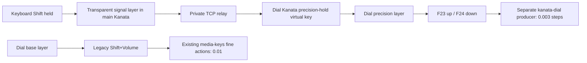

# User-confirmed choices

- **Precision increment is `0.003`** in wpctl notation: 0.3 volume percentage points. This supersedes the initial `0.005` candidate, the accidentally typed `0.03`, and the subsequent `0.0003` interpretation.
- **OFF means enhancement-only off.** Stop/reset the precision relay and disable the extra producer contribution; leave the dial remapper in legacy Shift+Volume fallback. Do not churn main's raw-device ownership on every toggle.
- Finish the contribution first. The [device-ID/history inquiry](/design/kanata-devices/index.md) is saved for later review, not a dependency or a source-patch implementation task now.
- Implementation is offline. No listener, live input service/config, compositor membership, or reload deployment is authorized by these code slices.

# Intended state/action flow

Plain and physical-Shift F23/F24 variants select the same precision action. Consequently, the TCP layer switch actually changes action vocabulary; the bridge is not redundant with the compositor's existing physical modifier matching. Volume amounts remain producer-owned, and Surface Dial source remains unchanged.

Main must exclude the raw dial virtual keyboard and the renamed normalized output. The dial instance alone consumes that raw device's synthetic Shift. This avoids publishing the dial's own Shift as keyboard intent or merging its synthetic release into physical keyboard state.

# Parent review of the first slice

The first slice packages a separate ordered producer, dial config, keyboard signal example, dependency-free TypeScript relay, and mock TCP tests. It does not yet contain the main-owner or service integration.

Two runtime safety corrections are required before integration is considered complete:

1. **Native TypeScript execution:** parameter properties such as `constructor(public options: …)` are not erasable under Node's normal native stripping. Use explicit members/assignments and prove the actual Node entrypoint, not only Vitest's transformed execution.
2. **Observed reset state:** a `CurrentLayerName` reply after a Release proves dispatch ordering, not that the keyberon processing loop has applied the queued release. OFF must wait until the target reports its known fallback layer, with bounded retries, or fail without removing precision bindings. A mock with delayed layer processing must exercise this distinction.

Fake-key state remains single-owner. TCP client disappearance does not automatically release it; reconnect reset, graceful stop, restart/stop-post reset, and the failure path must be explicit. If reset cannot be established, retaining bindings or stopping the dial instance is safer than leaving live precision events unbound.

# Approved offline integration direction

- A stable, non-input network anchor shares one private network namespace with main, dial, and relay through `PrivateNetwork` and `JoinsNamespaceOf`. Only those participants get narrowly permitted private loopback TCP; no unauthenticated listener is exposed on host loopback.
- Keyboard and dial endpoints are provisionally `127.0.0.1:5828` and `:5829` inside that namespace. These are configuration values, not currently listening ports.
- Main integration is opt-in and disabled by default. Preserve existing caps behavior, authored defaults, config-preservation support, and the live/authored Kinesis distinction. Make the actual exclusion list selectable for a future operator rather than silently adopting kinata.
- Keep home-local producer membership distinct from system service artifacts. System installation explicitly copies runtime assets to a stable readable root such as `/etc/opt/kanata-dial-main`; protected services must not dereference producer assets under HOME or disposable scratch roots.
- The dial remapper consumes the existing source binary, `_kanata` identity, and input rule. The relay and namespace anchor do not need input access. Node runtime/JIT/type-stripping requirements must be tested before assuming the input daemon's executable-memory policy applies to Node.
- ON requires the intended consumer bindings to be ready and explicitly applied before starting the relay. OFF requires stopping/preventing relay restart and confirming fallback before disabling/applying the producer group. Membership transactions do not roll back systemd or compositor reloads.

Sol M owns this next coherent integration slice and its tests. Parent reviews the generated interfaces, copy/audience boundary, namespace/order contract, and failure behavior before any live deployment is considered.

# Cross-references

- [First implementation checkpoint](/design/kanata-dial/implementation0.gpt61sm.md): code and first test evidence; its `0.005` amount is the predecessor candidate, not the current decision.
- [Optional producer machinery](/doc/config/keybinding-producers.md): group enablement/disabled preservation; the current checkout's installer interfaces must be followed rather than older command examples assumed literally.
- [Source Kanata guide](/doc/input/kanata.md): existing account/binary/unit ownership and the absence of current listeners.
- [Parked device-aware inquiry](/design/kanata-devices/init0.glm53.md): promising dormant Linux ID/history plumbing, plus the separate input-state ownership problem. No hack is authorized by this implementation decision.

# Addendum: system runtime evidence during integration review

The system Node is `/usr/bin/node` v26.10.0. A standalone device-free `.ts` fixture with one typed number prints `42` under plain Node. The same fixture fails under `--jitless` with `ERR_WEBASSEMBLY_NOT_SUPPORTED`: native TypeScript stripping requires WebAssembly. The previously suggested `--no-expose-wasm` flag is also rejected by this version. Do not put either invocation into a purportedly working relay unit.

This justifies a narrowly scoped relay-runtime executable-memory policy rather than copying the input daemons' `MemoryDenyWriteExecute=true` blindly. Keep input-daemon restrictions unchanged, and retain the relay's no-input/private-network/no-new-privileges/capability restrictions. Fixture and command notes: `.test-agent/kanata-dial-parent/`.

The installed systemd is 262. The archived primary manuals confirm shared private networking through `JoinsNamespaceOf`; sharing private temporary directories requires both participants to enable that setting. An anchor with `PrivateTmp=false` therefore avoids accidentally making main/dial/relay share their private temporary directories through this relationship.

Parent source review also confirmed that `handle_fakekey_action(Release)` queues a layout event. A query-dispatch barrier is not a substitute for observing the fallback layer after processing. The delayed-application reset regression remains an integration gate.
