# Stage

The user wants a faster key repeat rate, and specifically wants **single-key rate
control**: holding `pgup` should synthesize page-ups at a rate that *increases
the longer the key is held*, reverting on keyup. They asked what
[`kanata.srv.pb`](/kanata.srv.pb) and the sibling kanata playbooks can do, mused
about a helper program that listens for kanata key changes and synthesizes at
its own pace ("ideally there's guards in the tcp proto communication to keep
from sending a new keydown"), then correctly suspected that "this isn't the
kanata layer at all" and that umbriel is the real lever. Companion
investigations cover the umbriel side; this doc covers the whole stack from the
kanata lane and proposes the concrete build there.

Topology today (see [cutover0](/design/kanata-source/cutover0.glm53.md) and
[kanata-devices](/design/kanata-devices/init0.glm53.md)): all real keyboards are
grabbed by the main kanata instance ([`kanata.srv.pb`](/kanata.srv.pb), binary
from [`kanata.src.pb`](/kanata.src.pb), upstream `2f84d17`, `tcp_server`
feature compiled in), which re-emits onto a uinput keyboard named `kanata`; the
BlueTurn pedal has a second instance ([`kanata-blueturn.srv.pb`](/kanata-blueturn.srv.pb))
whose pgup/pgdn are also momentary; umbriel (wlroots 0.20, [`umbriel.src.pb`](/umbriel.src.pb))
is the compositor. The dial TCP relay
([`kanata-dial.etc.pb`](/kanata-dial.etc.pb), [`relay.ts`](/files/kanata-dial/relay.ts))
already demonstrates every protocol technique this design needs.

# Verdict up front

1. **Repeat as clients experience it is 100% client-side, and nothing else
   survives to race it.** libinput drops kernel autorepeat outright
   (`evdev-fallback.c:591` "ignore kernel key repeat" — so hardware repeats
   kanata passes through die before umbriel), wlroots 0.20 has **no
   server-side repeat timer for clients** (umbriel's own `m_repeatTimer`
   repeats *bind actions* only, `keyboard.cpp:402-449`), and the compositor's
   whole contribution is one keydown plus the `wl_keyboard.repeat_info`
   (rate, delay) it publishes — currently `repeat_rate = 25,
   repeat_delay = 600` from
   [`/usr/local/share/umbriel/config.toml`](/usr/local/share/umbriel/config.toml#L219-L225).
   Hardware repeats still matter *inside* kanata (the `rpt_action` replay
   trap below), but downstream there is exactly one repeat mechanism.
2. **The immediate, zero-code win is umbriel's config**, not kanata's: raise
   `repeat_rate` / lower `repeat_delay` (valid ranges 0-1000 Hz / 0-10000 ms).
   That is flat and global — exactly what the user asked to move beyond.
3. **Kanata config alone cannot express an accelerating repeat** — macros are
   finite fixed-delay sequences and there is no loop construct. But kanata
   **can host the feature with no fork**: map pgup/pgdn to an instant tap plus
   `layer-while-held`, let kanata's TCP server push the layer edges to a tiny
   daemon, and have that daemon emit `ActOnFakeKey` **Taps** on a
   `defvirtualkeys` pgup-tap macro at a ramping cadence. This is the dial
   relay's pattern, *simplified* — Tap-only emission eliminates the dial
   relay's hardest problem (the fake-key lease).
4. The trap to respect: if the mapped key outputs a **held** pgup, client-side
   repeat fires in parallel with daemon taps (double paging). The initial
   press must be a completed tap (`(macro pgup)`), and main should set
   `allow-hardware-repeat no` — kanata's own Wayland recommendation — because
   hardware repeats replay the **entire outer `multi` action**
   ([layout.rs repeat comment](https://github.com/jtroo/kanata/blob/2f84d17/keyberon/src/layout.rs#L1984-L1996):
   "multi will repeat the entire outer multi action"), which would re-run the
   macro and re-enter the layer at the hardware's fixed rate.

# The repeat stack, traced

```mermaid
flowchart LR
    K["physical key held<br/>(keyboard fw repeat)"] --> KR["kernel EV_REP<br/>value=2 events"]
    KR --> KA["kanata main (2f84d17)<br/>allow-hardware-repeat default TRUE<br/>Repeat → replays saved rpt_action"]
    KA -->|"managed keys: replay is a<br/>set-diff no-op (or macro re-run trap)"| KA2["fresh keydown/keyup events only"]
    KA -->|"passthrough value=2"| UI["uinput 'kanata'"]
    KA2 --> UI
    UI --> LI["libinput: kernel key repeat<br/>DROPPED (evdev-fallback.c:591)"]
    LI --> UM["umbriel (wlroots 0.20)<br/>[input.keyboard] repeat_rate=25 delay=600<br/>set_repeat_info → re-sends repeat_info<br/>to all clients live"]
    UM --> RI["wl_keyboard.repeat_info<br/>→ focused client"]
    RI --> CL["client-side repeat<br/>(kitty, GTK…) — the ONLY repeat"]
    UM --> CL
```



| Layer | Who controls it | Per-key? | Accelerating? | Actionable via |
|---|---|---|---|---|
| Keyboard firmware | keyboard itself | no | no | rarely |
| Kernel EV_REP | udev/hwdb per device | per-device | no | moot — dropped by libinput before umbriel (`evdev-fallback.c:591`) |
| kanata passthrough | `allow-hardware-repeat` (default **true**, [defcfg.rs](https://github.com/jtroo/kanata/blob/2f84d17/parser/src/cfg/defcfg.rs)) | per-key (rpt replays outer action) | no | ingress-side only — see rpt trap |
| uinput → compositor | kanata output logic | no | no | — |
| umbriel repeat info | `[input.keyboard]` (+ `[[input.device]]` per-name!) | per-keyboard | no | config today; **re-sent live** to clients on change |
| client repeat | each client | no | no | via repeat_info only |
| **synthesized tap streams** | any emitter (kanata TCP vkeys, patched kanata, patched umbriel) | **per-key** | **yes** | the design below |

Notable finds along the trace:

- **umbriel per-keyboard config exists — but the syntax is
  `[[input.device]] name = "kanata"`** (exact-name match,
  [config.cpp:2533](https://github.com/noctalia-dev/umbriel/blob/71291ac/src/config/config.cpp#L2533);
  `Keyboard::applyConfig` → `findDevice(m_deviceName)` → per-device
  `repeatRate`/`repeatDelay` → `wlr_keyboard_set_repeat_info`,
  [keyboard.cpp:47-79](https://github.com/noctalia-dev/umbriel/blob/71291ac/src/input/keyboard.cpp#L47)).
  Note: the shipped default config's commented example
  `[input.keyboard."Acme Split Keyboard"]` does **not** match the implemented
  array-of-tables syntax (config.cpp errors on it) — the shipped comment is
  misleading. Both kanata instances name their uinput output `kanata`
  (deliberately, see [pedal.srv.pb](/kinesis/kanata/tcp-control/pedal.srv.pb)
  output-naming note) and neither is a Wayland-virtual keyboard, so **one
  `[[input.device]]` section covers everything** — usable, but still flat.
  Validated ranges: rate 0–1000, delay 0–10000
  ([config.cpp:1561-1562](https://github.com/noctalia-dev/umbriel/blob/71291ac/src/config/config.cpp#L1561)).
- **kanata TCP protocol is richer than the dial use needed**
  ([tcp_protocol/src/lib.rs](https://github.com/jtroo/kanata/blob/2f84d17/tcp_protocol/src/lib.rs)):
  server pushes `LayerChange` on *every* layer change
  ([mod.rs:930](https://github.com/jtroo/kanata/blob/2f84d17/src/kanata/mod.rs#L930))
  **plus** an initial `LayerChange` snapshot on client connect
  ([tcp_server.rs:150-163](https://github.com/jtroo/kanata/blob/2f84d17/src/tcp_server.rs#L150-L163));
  `HoldActivated`/`TapActivated` push on tap-hold transitions; clients can
  `ActOnFakeKey {Press|Release|Tap|Toggle}` any `defvirtualkeys` key
  ([config.adoc:5876-5893](https://github.com/jtroo/kanata/blob/2f84d17/docs/config.adoc#L5876-L5893)) —
  the docs' own example vkey is a macro. There is deliberately **no arbitrary
  key injection** and **no raw key-event feed** over TCP (confirmed by
  [init0](/design/kanata-devices/init0.glm53.md) TCP row) — layer edges are the
  sanctioned observation channel, and they are exactly enough.

# Option 0 — flat bump today (no code, no kanata)

Edit the managed default template behind
[`umbriel.etc.pb`](/umbriel.etc.pb) / user config include: e.g.
`repeat_rate = 50`, `repeat_delay = 350` (or scope it to the kanata uinput
keyboards via `[[input.device]] name = "kanata"`). Applies session-wide — and
per the companion investigation, a repeat_info change **is re-sent live to all
clients** (`wlr_keyboard_set_repeat_info` → seat listener →
`wl_keyboard_send_repeat_info` per client resource,
[wlr_seat_keyboard.c:379-397](https://gitlab.freedesktop.org/wlroots/wlroots/-/blob/0.20.2/types/seat/wlr_seat_keyboard.c#L379)).
Reload is fully solved: inotify hot-reload (150 ms debounce, watches the whole
include chain), a `config-reload` keybind, and `umbriel msg config-reload`
IPC over `$XDG_RUNTIME_DIR/umbriel-$WAYLAND_DISPLAY.sock` — socket verified
live ([umbriel-live-reload](/design/key-repeat/umbriel-live-reload.glm53fx.md)).
Reload is diff-driven and preserves focus/windows; the one cost is an
unconditional xkb keymap rebuild per reload. The open question is only
whether *repeating clients* re-read repeat_info mid-hold — see Next slices.
This satisfies "increase the key repeat rate somehow" but not the per-key ramp.

# Option 1 — kanata-hosted ramp daemon (recommended build)

## Config side (kanata.srv.pb content)

```lisp
(defcfg
  process-unmapped-keys yes
  ;; Wayland: clients repeat client-side; also prevents hw repeats from
  ;; re-firing the outer multi (macro re-run + layer re-entry) mid-hold
  allow-hardware-repeat no
  linux-dev-names-exclude ( …unchanged… )
)

(defsrc
  caps pgup pgdn            ;; + lsft rsft when KANATA_DIAL_ENABLED
)

(deflayer base
  (tap-hold 100 100 esc lctl)
  (multi (macro pgup) (layer-while-held ramp-pgup))
  (multi (macro pgdn) (layer-while-held ramp-pgdn))
)

(deflayer ramp-pgup _ _ _)   ;; transparent: other keys unaffected while held
(deflayer ramp-pgdn _ _ _)

;; bare keycodes, NOT (macro …): Tap = discrete down+up (tap phase),
;; Press/Release = genuinely held key (continuous phase — see cruise
;; strategies). A macro vkey self-completes and cannot be held.
(defvirtualkeys
  pgup-tap pgup
  pgdn-tap pgdn
)
```

Why each piece:

- **`(macro pgup)` not `pgup`** inside the multi: the initial page-up must be
  a *completed tap*. A held keydown would combine with client-side repeat
  (double paging) — this is the "keep from sending a new keydown" guard the
  user asked for, enforced structurally.
- **`layer-while-held`** is the press/release edge feed: kanata owns keyup
  semantics (layer exits on keyup even mid-tap of another key), pushes
  `LayerChange` to TCP clients instantly, and sends a fresh snapshot to
  reconnecting clients. No daemon-side keyup inference, ever.
- **Transparent ramp layers** mean holding pgup changes nothing else: chords,
  modifiers, typing during the hold all pass through base.
- **`defvirtualkeys` + Tap** is the emission path: each Tap is an atomic
  press+release of a kanata macro — discrete, ordered through kanata's single
  event pipeline, impossible to double-down or strand (nothing is ever held on
  behalf of the daemon). Contrast the dial relay, which must manage a
  Press/Release *lease* across disconnects with reset barriers
  ([relay.ts](/files/kanata-dial/relay.ts)); we inherit its other guards and
  drop that one entirely.

Deployment notes: adding pgup/pgdn to `defsrc` moves them from passthrough to
managed (required). The live config was `once:`-preserved at cutover
(`KANATA_CONFIG_PRESERVE`), so shipping new bytes is a deliberate render or a
manual `/etc/kanata/config.kbd` edit + kanata restart. Main currently opens its
TCP port **only under `KANATA_DIAL_ENABLED`** — that gate should generalize to
e.g. `KANATA_TCP_ENABLED` (port, `RestrictAddressFamilies AF_INET`,
`IPAddressAllow 127.0.0.1/32`, namespace anchor) so the repeat daemon doesn't
drag the dial topology in; the sandbox/namespace pattern to copy is all in
[`kanata.srv.pb`](/kanata.srv.pb) + [`kanata-dial.etc.pb`](/kanata-dial.etc.pb).

## Daemon side ("kramp", one TCP connection to main)

Behavior:

1. Connect to main kanata TCP (127.0.0.1:5828). On connect the server's
   initial `LayerChange` snapshot reconciles state — a daemon restart mid-hold
   picks the ramp back up (or cleanly does nothing if the layer is gone).
2. `RequestFakeKeyNames` once: verify `pgup-tap`/`pgdn-tap` exist; if a config
   reload dropped them, log and idle (taps would error anyway).
3. On `LayerChange`: name `ramp-<key>` → start that key's session (any other
   name stops all sessions). Sessions are keyed by layer name so
   start-while-running is idempotent — a duplicate start is a no-op, not a
   second keydown storm.
4. Session loop: sleep `initial_delay` (~350ms), then emit
   `{"ActOnFakeKey":{"name":"<key>-tap","action":"Tap"}}` and sleep again, with
   the interval ramping (e.g. 200ms → 25ms over ~2.5s, exponential decay to a
   floor; all knobs configurable). Stop on layer exit, poll mismatch, or abort.
5. Liveness: periodic `RequestCurrentLayerName` poll (the dial relay's 2s
   cadence) reconciles missed pushes; write-backpressure → destroy + reconnect
   ([relay.ts write()](/files/kanata-dial/relay.ts) pattern — never buffer
   unboundedly).

Guards summary (user's ask, mapped):

| Hazard | Guard |
|---|---|
| new keydown/repeat while one in flight | Tap-only emission; kanata serializes its own pipeline; no held state exists |
| daemon crash mid-hold | nothing held; layer exits on real keyup by kanata; snapshot resync on restart |
| duplicate start (re-press, push+poll race) | sessions idempotent per layer name; poll reconciles |
| kanata config reload mid-hold | `FakeKeyNames` check + layer-name mismatch stops session |
| slow/stuck TCP | backpressure destroy, liveness poll, bounded reconnect |
| runaway rate | floor clamp on interval (e.g. ≥10ms); profile fully configurable |

This daemon is materially *simpler* than the dial relay (one socket, no lease,
no reset barrier, no two-instance fan-out) and could even live in the same
`files/kanata-dial/`-style playbook family as a sibling TYPE.

## Cruise strategies — "de-hold and switch to continuous"

After the ramp converges there are three ways to run the long tail of the hold
(kanata can inject all of them: vkey `Tap` and vkey `Press`/`Release` are both
first-class, [config.adoc virtual keys](https://github.com/jtroo/kanata/blob/2f84d17/docs/config.adoc#L6138-L6180)
— "press-virtualkey … will not be released until another action triggers a
release or tap", and Press on an already-pressed vkey is an idempotent no-op):

- **A. Cruise on floor-rate taps (default).** Keep emitting Taps at the ramp's
  floor interval. For scrolling this is indistinguishable from real repeat;
  no lease, no re-arm hitch, and the per-key rate can exceed umbriel's global
  `repeat_rate` freely. Costs one ~50-byte loopback message per repeat —
  nothing at 40/s.
- **B. Switch to a held key.** One final `ActOnFakeKey Press` on the bare-keycode
  vkey and pgup is genuinely down; repeats now come from client-side repeat
  (confirmed: there is **no** compositor-side repeat for clients in this
  stack — wlroots 0.20 has none, umbriel's timer repeats bind actions only);
  `Release` on layer exit. X11-via-satellite repeat behavior is uninspected.
  Two real catches with today's umbriel config (`repeat_rate = 25`,
  `repeat_delay = 600`):
  1. **Re-arm hitch**: the client's repeat timer starts when it sees the
     keydown, so the switch moment stalls `repeat_delay` (600ms) and then
     repeats at the *flat global* rate — likely slower than the ramp floor.
     B is only worth it if umbriel's rate/delay are raised — globally via
     config, or live (which is exactly the companion live-reload lane).
  2. **Lease**: a held Press *must* be Released; daemon crash = pgup stuck
     down, scrolling forever. This reintroduces the dial relay's full lease
     discipline (release-before-reapply on reconnect, ExecStopPost reset,
     watchdog). Safety valve: kanata's output is a keycode set-diff that
     dedups holders ([init0](/design/kanata-devices/init0.glm53.md)), so a
     stuck pgup clears by tapping the physical pgup — its down/up cycle
     releases the held output key.
- **C. The pure-native graduation B hints at.** Skip synthesis entirely:
  physical pgup maps to a *real* held pgup plus the layer edge
  (`(multi pgup (layer-while-held rate-ramp))` — no macro-tap, no double-fire
  because the daemon never taps), and the daemon uses the layer edges not to
  tap but to **step umbriel's repeat_rate up over time**, restoring on keyup.
  All repeats are then native (client repeat semantics just work), and
  kanata's only job is the edge feed — its most robust role. This now has
  **strong protocol backing** from the companion investigation: live
  repeat_info re-sends are protocol-blessed and already wired end-to-end
  (reload → `applyConfig` → `set_repeat_info` → immediate re-send to all
  clients). The single remaining unknown is whether a mid-repeat client
  re-reads the new rate without restarting its delay timer — decidable by
  the zero-code experiment in
  [umbriel-repeat](/design/key-repeat/umbriel-repeat.glm53.md) (edit rate +
  reload while holding a key in kitty). For the mutation path itself,
  [live-reload](/design/key-repeat/umbriel-live-reload.glm53fx.md) ranks:
  **(fx-A)** a new `input-repeat-rate:<hz>` IPC msg action (~60–90 LoC, no
  keymap rebuild, no file churn — the clean daemon/observer target), vs
  **(fx-B)** zero-patch TOML-rewrite + inotify auto-reload — works today but
  ~150–250 ms latency and a full keymap rebuild per bump (prototype-grade).
  It also ranks an **umbriel-native alternative** (~60–100 LOC patch, option
  A″ in [umbriel-repeat](/design/key-repeat/umbriel-repeat.glm53.md): an
  in-compositor ramp timer re-sending repeat_info) which delivers C without
  any daemon or TCP — the kanata-edge version matters only if we refuse to
  patch umbriel.

Recommendation: A now; B never without raised rates (it exists on the menu
mostly to explain C); C as the end-state if live mutation proves out — the
user's original "detect the page down, alter behavior live, undo on keyup"
instinct realized with kanata supplying the edges and umbriel the rate.

# Option 2 — patch kanata (source lane)

We own the build ([`kanata.src.pb`](/kanata.src.pb)). A native action — e.g.
`(tap-ramp pgup init-ms min-ms decay)` implemented on keyberon's tick/timer
machinery near the `rpt_action` handling
([layout.rs:1984-1996](https://github.com/jtroo/kanata/blob/2f84d17/keyberon/src/layout.rs#L1984-L1996))
— would need no daemon and no TCP. But it is fork pressure on a fast-moving
upstream (init0's warning about divergence applies double for *behavioral*
actions), the config language upstream would want design discussion (there are
long-standing upstream asks for repeat-rate control worth checking first), and
Option 1 delivers the same UX with zero kanata code. Defer; keep as the
graduation path if the daemon proves annoying.

# Option 3 — umbriel side

The compositor sees every key before forwarding and owns `repeat_info`; a
per-key repeat override or synthesized-repeat patch there is arguably the
"right" layer (no coordination protocol needed at all). That lane is now
mapped by [umbriel-repeat.glm53.md](/design/key-repeat/umbriel-repeat.glm53.md):
headline verdicts — repeat is client-side only, live repeat_info re-sends are
protocol-blessed and already wired through config reload, per-device config
is `[[input.device]] name = "kanata"` (the shipped dotted-example comment is
wrong syntax), and patch options rank A′ (two-rate toggle, ~20–40 LOC) /
A″ (stepped acceleration, ~60–100 LOC) / B (compositor-synthesized taps,
~150–250 LOC, most uniform) / C (`key-tap` IPC action). One zero-code
experiment gates the cheap ones: raise `repeat_rate`, reload, and see if a
key already held in kitty speeds up mid-hold.
[live-reload](/design/key-repeat/umbriel-live-reload.glm53fx.md) covers the
reload/runtime-set mechanics. Tradeoff vs Option 1: no helper daemon, but a
patch to maintain on a third-party compositor (or upstreamable feature
request), vs kanata's already-deployed, already-proven TCP surface.

# Not pursued (noted for completeness)

- kitty remote-control scrolling daemon (`kitty @ scroll-window` from a
  keydown-triggered cmd) — kitty-only, bypasses keys entirely.
- Hardware/kernel repeat tuning — consumed by kanata, moot downstream.
- `(macro pgup d200 pgup d150 …)` fixed sequences — finite, fixed-rate, no ramp.

# Open questions for the user

- Which physical keys get the ramp — main-keyboard pgup/pgdn only, or the
  BlueTurn pedal's pgup/pgdn too (pedal instance currently has no `--port`;
  adding one is the established pattern)?
- Is a flat global rate bump (Option 0) wanted *in addition*, or does per-key
  ramp make the global setting moot?
- Ramp curve preferences: initial delay, start interval, floor interval, ramp
  time — defaults above are guesses to tune live.
- Tolerance for a second always-on daemon (Option 1) vs appetite for patching
  upstream code (Options 2/3)?

# Next slices (ranked)

1. **The kitty experiment** (zero code, decides the cheap families): set
   `repeat_rate = 5`, reload, hold a key in kitty, flip to 40, reload again —
   does the ongoing repeat accelerate? Script staged at
   `.test-agent/key-repeat/repeat-experiment.sh`. Outcomes: accelerates →
   live-rate lanes (Cruise C / fx-A / g-A″) are real; next-press-only → tap
   synthesis (Option 1 / g-B) is the only accelerator; repeat *dies* on
   reload mid-hold → also rules out fx-B stepping (keymap rebuild
   disruption).
2. Option 0 config bump if wanted immediately (`umbriel msg config-reload`
   or just edit-and-wait for inotify).
3. `KANATA_TCP_ENABLED` generalization in [`kanata.srv.pb`](/kanata.srv.pb)
   (small, self-contained, useful to dial work too).
4. `kramp` daemon + config change behind a new playbook; validate with
   `kanata --check` and the sim harness
   ([init0 test seams](/design/kanata-devices/init0.glm53.md)).
5. Post-experiment decision between the end-states: fx-A `input-repeat-rate`
   IPC + kanata edge observer vs g-A″ in-compositor ramp vs plain kramp —
   all three docs now cross-reference the same `Server::setKeyboardRepeat`
   seam.

# Cross-references

- [init0.glm53.md](/design/kanata-devices/init0.glm53.md) — deployed kanata
  source map (event loop, TCP server, rpt/repeat handling); the repeat row of
  its edge-case matrix is this doc's starting point.
- [cutover0.glm53.md](/design/kanata-source/cutover0.glm53.md) — instance
  topology and binary lineage this doc assumes.
- [relay.ts](/files/kanata-dial/relay.ts) + [dial.kbd](/files/kanata-dial/dial.kbd)
  — the producer/consumer TCP pattern (vkey lease guards) this design
  simplifies; [pedal.srv.pb](/kinesis/kanata/tcp-control/pedal.srv.pb) shows
  the ChangeLayer consumer side and uinput output-naming constraint.
- [umbriel-repeat.glm53.md](/design/key-repeat/umbriel-repeat.glm53.md)
  — landed: repeat pipeline trace (client-side only; libinput drops kernel
  repeats; live repeat_info re-send wired), per-key patch options A′/A″/B/C
  with the kitty hold-reload experiment gating them.
  [umbriel-live-reload.glm53fx.md](/design/key-repeat/umbriel-live-reload.glm53fx.md)
  — landed: three reload triggers (inotify hot-reload, `config-reload`
  keybind, `umbriel msg config-reload` IPC — socket verified live),
  diff-driven input reapply, and the ranked live-mutation options (fx-A
  `input-repeat-rate` IPC recommended, fx-B zero-patch TOML rewrite
  prototype-grade, keybind observation a documented dead end).
- [config.adoc allow-hardware-repeat](https://github.com/jtroo/kanata/blob/2f84d17/docs/config.adoc#L5021-L5039)
  — upstream's own Wayland guidance this design adopts.
