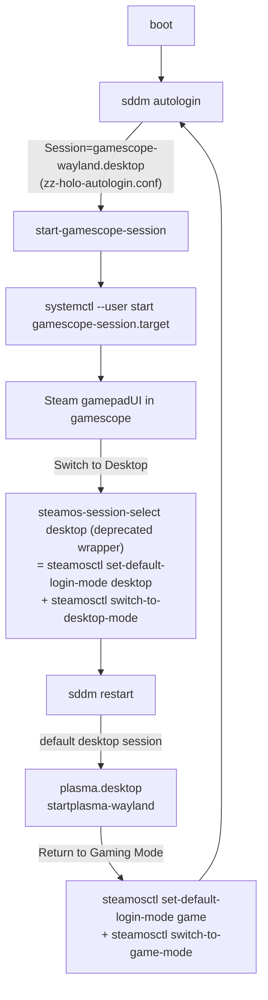

# niri on the Steam Deck (`deck`)

**TL;DR: this is close to a best-case scenario.** `deck` runs SteamOS 3.9 (holo) with
read-only already disabled, and its frozen Arch snapshot (`extra-3.9`) **contains
`niri 26.04-1` with zero missing dependencies**. The gamemode↔desktop transition is
driven by `steamosctl`, which has a first-class knob for exactly this:
`steamosctl set-default-desktop-session niri.desktop`. Switching is one package
install plus one CLI call; rolling back is one CLI call. The only real engineering
problem is SteamOS's `/usr` being wiped on every OS update, and compfuzor already has
the machinery (persistent `/srv` offloads, `/etc` overlay, pacman prep script) to
re-apply state after updates.

## What deck is today

Verified over SSH (`ssh deck`, read-only commands only — nothing was changed):

| Fact | Value |
|---|---|
| OS | SteamOS 3.9, `ID_LIKE=arch`, codename `holo`, kernel `7.2.0-valve1-1-neptune` |
| `steamos-readonly` | **disabled** (already) |
| Display manager | `sddm 0.21.0-7`, active, autologin via `/etc/sddm.conf.d/zz-holo-autologin.conf` → `Session=gamescope-wayland.desktop` |
| Desktop sessions installed | `plasma.desktop` (Wayland, Plasma 6.7.3), `plasmax11.desktop` |
| Game session | `gamescope-wayland.desktop` → `/usr/bin/start-gamescope-session` → user systemd `gamescope-session.target` |
| Steam | `steam-jupiter-stable 1.0.0.85-12` |
| pacman repos | `jupiter-3.9 holo-3.9 core-3.9 extra-3.9 multilib-3.9`, `DBPath = /usr/lib/holo/pacmandb/` |
| niri availability | **`niri 26.04-1` in `extra-3.9`; `pacman -S --print niri` resolves to niri alone — all deps (seatd, mesa, libdisplay-info, libinput, pipewire, xdg-desktop-portal-impl) already installed** for gamescope/plasma |
| Shell bits in repo | xwayland-satellite 0.8.1, xdg-desktop-portal-gnome 50.0, waybar, fuzzel, mako, swaylock, swaybg, kanshi, alacritty, foot, squeekboard 1.43.1, brightnessctl |
| Tooling on deck | distrobox, podman, flatpak; **no cargo/rust** (rules out the git-build route without bootstrapping a toolchain) |
| Root fs | 5.0G, **767M free** (CheckSpace on; see caveats) |
| sudo | password required (playbooks need interactive sudo, as `steamdeck-pacman.etc.pb` already assumes) |

## How "Steam starts KDE" actually works (the transition machinery)

Steam never starts Plasma itself. The whole thing is SDDM autologin + a session
selector CLI:



Key interfaces (from `steamosctl --help`, verified on deck):

- `steamosctl get-default-login-mode` → currently `game`
- `steamosctl get-default-desktop-session` → currently `plasma.desktop`
- `steamosctl set-default-desktop-session <SESSION>` — "valid sessions can be
  obtained using `get-valid-desktop-sessions`" (currently lists `plasma.desktop`,
  `plasmax11.desktop`; it enumerates installed session `.desktop` files, so
  `niri.desktop` should register once installed — **verify after install**)
- `steamosctl switch-to-desktop-mode [SESSION]` — live-switches now

`start-gamescope-session` is itself a nice template of "good systemd things" on this
box: it stops/starts user targets, exports `XDG_*` into the user manager via
`dbus-update-activation-environment`, constrains portals with
`XDG_DESKTOP_PORTAL_DIR`, and traps signals to tear down `gamescope-session.target`.
niri's session story is the same shape.

**Therefore: changing KDE→niri does not touch the gamemode path at all.** Gamescope
session, autologin, fan/steamclient machinery all stay. We only repoint what
"desktop mode" means.

## What the switch entails

### 1. Packages (one pacman transaction)

```sh
sudo pacman -S niri xwayland-satellite xdg-desktop-portal-gnome
# + optional shell: waybar fuzzel mako swaylock swaybg kanshi alacritty squeekboard brightnessctl
```

Dry-run (`pacman -S --print`) verified on deck:

- `niri` alone pulls in **nothing new** — deps already satisfied.
- `xwayland-satellite` + shell bits: each is a leaf package with small deps.
- `xdg-desktop-portal-gnome` is the heavyweight: ~35 extra packages (nautilus,
  gvfs, localsearch, libadwaita, gnome-desktop-4, …). It exists only for portal
  **screencasting** (Discord/screenshare) and screenshot portals. niri's built-in
  screenshot UI works without it. If the 100–200MB on the 5G root is a concern,
  skip it initially; `xdg-desktop-portal-gtk` is already installed and satisfies
  niri's hard `xdg-desktop-portal-impl` dependency.

The Arch `niri` package ships everything upstream lists for manual installs:
`/usr/bin/niri`, `niri-session`, `/usr/share/wayland-sessions/niri.desktop`,
`/usr/share/xdg-desktop-portal/niri-portals.conf`, and user units
`niri.service` + `niri-shutdown.target` (in `/usr/lib/systemd/user/`).

### 2. Point desktop mode at niri

```sh
sudo pacman -S niri xwayland-satellite
steamosctl get-valid-desktop-session        # expect niri.desktop to appear
steamosctl set-default-desktop-session niri.desktop
steamosctl switch-to-desktop-mode           # or: log out / pick niri in SDDM
```

**Rollback** is `steamosctl set-default-desktop-session plasma.desktop`. Plasma
stays installed and remains selectable in the SDDM greeter (or via
`switch-to-desktop-mode plasma.desktop`). Nothing destructive happens to the
current desktop.

The exact file `set-default-desktop-session` writes wasn't pinned down (likely
`/etc/sddm.conf.d/`; not in `/var/lib`) — the CLI is the supported interface and is
idempotent, which is what compfuzor should call. Verify after first switch with
`cat /etc/sddm.conf.d/*.conf`.

### 3. The systemd shape (this is the nice part)

niri runs as a **user service**, started by the `niri.desktop` session via
`niri-session`:

- `niri.service` — the compositor; imports env into the user manager, starts
  `graphical-session.target`-aligned targets, portals start bound to the session.
- Session companions via `systemctl --user add-wants niri.service mako.service`
  (creates `~/.config/systemd/user/niri.service.wants/`) — the upstream-blessed way
  to run waybar/mako/swaybg/swayidle with proper supervision. Deck already has
  `~/.config/systemd/user/` in active use (ssh-agent from `/srv/ssh-agent-main`),
  so this pattern is established on the host.
- Steam OSK/portal hygiene is already solved per-session on SteamOS (gamescope uses
  `XDG_DESKTOP_PORTAL_DIR`; niri ships `niri-portals.conf` doing the equivalent).
- **Xwayland is automatic since niri 25.08**: with `xwayland-satellite ≥0.7` in
  `$PATH`, niri creates X11 sockets, exports `$DISPLAY`, and spawns it on demand —
  verified-compatible with Steam and games per upstream docs. Steam and Proton
  games work as normal windows.

## Steam under niri

Two modes, can coexist:

1. **Desktop Steam client as windows** — `steam-jupiter-stable` already installed;
   runs over xwayland-satellite; games are windows on the strip. Steam Input works
   with the client running.
2. **Full Deck UI nested in gamescope** — `gamescope -W 1280 -H 800 -f -e -- steam
   -gamepadui -steamdeck` as a niri bind/launcher (precedent:
   [`gamescope.src.pb`](/gamescope.src.pb) `run.sh`). Gets gamepadUI, QAM, HDR
   pipeline inside a single fullscreen window. Good "couch mode" without leaving
   niri.

Open items worth checking during bring-up: HDR status in niri for the OLED panel
(niri has been landing color-management/HDR support through 2025–26 releases —
verify against 26.04), and touch/OSK ergonomics (`squeekboard` is packaged if
gamepad-only text entry matters).

## The real problem: SteamOS updates wipe `/usr`

Mount table evidence:

| Path | Device | Survives `steamos-update`? |
|---|---|---|
| `/usr` (with pacman-installed niri, units, wayland-sessions) | btrfs root `nvme0n1p4` | **No** — A/B partition swap |
| `/etc` | overlay (upper in `/var/lib/overlays/etc`) | Yes |
| `/home`, `/root`, `/opt`, `/srv`, `/nix`, `/var`, `/var/log` | ext4 `nvme0n1p8` offloads | Yes |

Also: updates re-enable `steamos-readonly`, and the pacman db lives at
`/usr/lib/holo/pacmandb/` inside the image, so post-update the install is simply
gone and consistent-to-forget.

This is a solved class of problem for us:

- **Route A (recommended): pacman + re-apply.** Post-update run: `sudo
  steamos-readonly disable` (already scripted in
  [`steamdeck-pacman.etc.pb`](/steamdeck-pacman.etc.pb) along with pacman-key init),
  `sudo pacman -S --needed niri xwayland-satellite …`, then `steamosctl
  set-default-desktop-session niri.desktop`. A compfuzor playbook makes this one
  command after any update.
- **Route B: `/srv` source + symlinks** (what
  [`niri.src.pb`](/niri.src.pb) does on other hosts). Source persists in SRVS_DIR;
  `install.sh` re-links into `/usr`. Requires cargo on deck (absent) — only worth it
  for tracking git niri.
- **Route C: overlay mount over `/usr/share/wayland-sessions`** via the existing
  [`overlay.etc.pb`](/overlay.etc.pb) pattern (upperdir in persistent
  `/var/lib/overlays`). Keeps the session file across updates without re-running
  pacman, but the niri binary itself still needs Route A/B — so this is a
  supplement, not a substitute.

User-level state (`~/.config/niri/config.kdl`, `niri.service.wants/` drop-ins) and
`/etc` all persist, so the session is *configured* forever and only *installed*
ephemerally.

## Proposed compfuzor slice

**Implemented** (2026-09-21):

- [`steamos-niri.opt.pb`](/steamos-niri.opt.pb) — `ARCH_PKGS`-driven package
  list (archlane), `install.sh` = `steamos-readonly disable` + composed
  `install-arch.sh` lane (one command re-applies everything after a SteamOS
  update), `session.sh`/`session-plasma.sh` for the `steamosctl` session
  switch/rollback, `user-config.sh` for the niri config include +
  `niri.service` wants, `ETC_FILES` deck binds overlay (ghostty, nested
  gamescope gamepadUI couch mode, brightness/volume keys).
- **archlane subsystem** — `ARCH_PKGS`/`ARCH_PKGSET`/`ARCH_PKGSETS` are now
  real machinery (previously informational-only, as in `zed.src.pb`):
  [`gen_arch.tasks`](/tasks/compfuzor/gen_arch.tasks) gathers `_arch_pkgs`
  once and synthesizes `install-arch.sh` (packages lane, pacman
  `--needed` self-gated on the pacman binary) + `status-arch.sh` drift
  reporter; `pkgs.tasks` dispatches render-side on `ansible_pkg_mgr` (apt vs
  pacman). Covered by `tests/integration/archlane.test.py`.
- `niri.src.pb` PKGS bug fixed: the duplicate `PKGS` keys are split into
  Debian build deps (`PKGS`) and the Arch list (`ARCH_PKGS`, companions +
  PKGBUILD deps), so the playbook is now host-correct on both families.
- [`steamos-niri.srv.pb`](/steamos-niri.srv.pb) — operator session tools in
  `/srv/steamos-niri-srv` (durable across updates): `to-niri.sh` /
  `to-plasma.sh` live switches (`switch-to-desktop-mode`, ends the current
  session), `to-game.sh` ("Return to Gaming Mode" from any desktop session),
  `default-niri.sh` / `default-plasma.sh` commit the persistent default
  without switching, `sessions.sh` state overview. Global-linked into
  `/usr/local/bin` for convenience; `/srv` copies are the durable home.

## Gaps & risks

| Gap | Note |
|---|---|
| Root fs headroom | 767M free; full stack w/ portal-gnome ≈ 100–200M. CheckSpace will refuse if tight; `/var/cache/pacman` is already offloaded to the home partition. |
| `get-valid-desktop-sessions` | Should pick up `niri.desktop` by enumeration; verify post-install before relying on `set-default-desktop-session`. |
| steamosctl state file | Location not identified (not `/etc`, not `/var/lib` greps); manage via CLI only. |
| Desktop-mode niceties | OSK (squeekboard), brightness (brightnessctl), idle/lock (swayidle+swaylock), notifications (mako) — all packaged in `extra-3.9`; KDE ones stop applying in niri sessions. |
| HDR/VRR | Verify on 26.04 for the OLED panel; worst case use nested gamescope for HDR titles. |
| Updates | Everything above re-applied by playbook; readonly re-enable is already handled by existing deck flow. |

## Cross-references

- [`steamdeck-pacman.etc.pb`](/steamdeck-pacman.etc.pb) — deck pacman prep
  (readonly disable, pacman-key) and package-list pattern to extend.
- [`niri.src.pb`](/niri.src.pb) — git-build niri install for other hosts; has the
  PKGS bug noted above.
- [`gamescope.src.pb`](/gamescope.src.pb) / [`gamescope-session-steam.src.pb`](/gamescope-session-steam.src.pb) — nested gamepadUI precedent.
- [`overlay.etc.pb`](/overlay.etc.pb) — generic persistent-overlay mount pattern (Route C).
- Upstream: [niri Getting Started](https://niri-wm.github.io/niri/Getting-Started.html),
  [Example systemd Setup](https://niri-wm.github.io/niri/Example-systemd-Setup.html),
  [Xwayland](https://niri-wm.github.io/niri/Xwayland.html),
  [Screencasting](https://niri-wm.github.io/niri/Screencasting.html).
