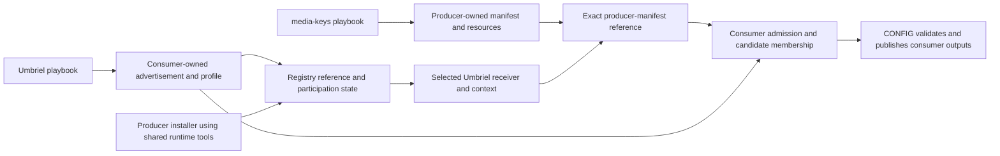

# The ownership contract comes first

The operator clarified that media-keys must retain ownership of its producer-side
contributions, Umbriel must retain ownership of its consumer side, and reusable
tools should live under `runtime/`.

The previous `files/discovery/` proposal described repository implementation
modules, but failed to distinguish those from generated deployment artifacts and
host registration locations. This document supersedes that proposed **code
placement** and makes all three locations explicit.

| Location | Contains | Owner |
|---|---|---|
| Compfuzor repository `runtime/<domain>/` | Reusable discovery, registry and CLI implementation | Compfuzor toolkit |
| Each rendered deployment's `ETC` / `BINS_DIR` | That playbook's declarations, manifests, profiles and entrypoints | The producer or consumer playbook |
| Invocation host's configured registration locations | References exposing those owned declarations, plus operator participation controls | The applicable host/user registry policy |

**Playbooks do not contribute application declarations into the repository's
`runtime/discovery/` directory.** That directory holds the code that knows how
to discover declarations at their configured locations.

# Follow media-keys to Umbriel

## 1. Media-keys owns the offered contribution

[`media-keys.etc.pb`](/media-keys.etc.pb) authors `KEYBINDING_ACTIONS` and
`KEYBINDINGS`. The existing compiler packages them under **that deployment's ETC**:

```text
<media-keys ETC>/
  action/media-volume-up.yaml
  action/media-volume-down.yaml
  ...
  keybinding/media-volume-up.yaml
  keybinding/media-volume-down.yaml
  ...
  keybinding-producer.json
```

The manifest names the exact resources emitted by that producer. The generator
provides common packaging conventions; it does not acquire ownership of the
media-key declarations or move them into shared tool-source directories.

With `TYPE: media-keys`, `INSTANCE: main`, and the current prefix policy, the
deployment name is `media-keys-main`. For this `.etc.pb`, `ETC: "{{DIR}}"` means
the physical ETC is the deployment root; conventional `etc/` exposure can alias
it. Runtime references should use the emitted exact manifest locator rather than
reconstructing ownership from an assumed directory suffix.

## 2. Umbriel owns the receiving contract

[`umbriel.etc.pb`](/umbriel.etc.pb) owns its profile, native root template,
placement/registration choices and late consumer patch layer. Its packaged
profile remains under its own ETC:

```text
<umbriel ETC>/
  keybinding-umbriel.json
  config.toml
  ...
  <receiver advertisement generated from this host's declaration>
```

The proposed advertisement names its profile/context and where contributions may
be registered. An entry in a shared lookup location **references this owned
advertisement**. The advertisement and profile are the consumer's declarations;
the registry makes them findable by an independent producer.

For an invocation selecting the current user context, the consumer owns:

```text
${XDG_CONFIG_HOME}/umbriel/
  config.toml
  .keybindings/
    membership.json
    source/<producer-id>/...
    generated/...
    producers.d/<producer-id>.json   # proposed manifest-reference rendezvous
```

The rendezvous basename/path is still a proposal. Its ownership is the important
contract: registration enters **this selected consumer context**, and consumer
policy governs admission and enabled state.

## 3. Shared tools connect the two owners



The producer entry selects compatible receivers and offers its manifest. The
consumer adapter interprets the contribution using its own profile, existing
membership and patches. CONFIG accepts candidate membership together with native
outputs. Shared code supplies reusable operations to both sides.

The current [`installProducer()`](/files/config/keybindings/membership.ts#L458-L503)
already demonstrates this ownership: it reads producer resource paths, places
managed source registrations beneath the bound consumer base, preserves the
consumer group's enabled state, and applies that consumer's registration strategy.
Source material may be linked or copied according to that strategy; authoring
ownership remains with the producer, and consumer overrides remain consumer-owned.

# Discovery visibility and accepted configuration are distinct milestones

A receiver can be advertised with retained disabled configuration. Its declaration
is available for inspection while ordinary participation remains inert.

That requires a clarification to the earlier plan's suggestion that advertisement
publication always accompany successful native assembly:

- **Publishing a receiver declaration** establishes discoverability and its
  declared participation state.
- **Accepting a producer contribution** updates the consumer's closed membership
  through native validation/publication.
- **Native assembly/activation** establishes the domain's applied output state.

An inert receiver declaration should be publishable without requiring successful
native activation first. Registry listings can report definition availability,
disabled/masked state and application health separately. The actual command and
publication ordering will be specified against these milestones before generator
cutover; a discoverable advertisement must not claim that pending membership or
native output has already been accepted.

# Reusable tool placement

Use the repository's `runtime/` home for the proposed common code, grouped by
domain:

```text
runtime/
  discovery/    # source roots and entry observations; delegates reusable loading
  registry/     # named registration views and participation/control policy
  cli/          # Router definitions and tab completion
```

`runtime/` already contains the packaged `compfuzor-runtime.mjs` and vendored
`zimfw.zsh`. New grouped TypeScript sources can coexist with those artifacts;
packaging must preserve sources and vendored material, as the current
[`vite.config.ts`](/vite.config.ts) already preserves that output directory.
These paths describe code ownership, not a location where rendered media-key or
Umbriel declarations are deposited.

# Figments work and the next checkpoint

The operator requested a **G** agent to make the Figments drop-in loader suitable
for this reusable role. That agent is working in `~/src/figments`, with the
[source/probe evidence](/design/registry-discovery/evidence0.gpt6a.md) as context.
Its first deliverable is an interface proposal before implementation, covering
ordinary layered config and retained registration entries.

The desired leverage is shared loading/observation of symlinks, disabled entries,
masks, literal identities and real acquisition errors. Compfuzor supplies its
producer/consumer schema, admission and publication behavior. The interface review
will decide how much discovery should be supplied by Figments so Compfuzor's
`runtime/discovery/` remains a thin integration where upstream already suffices.

# Cross-references

- [Broader direction](/design/registry-discovery/direction0.gpt6a.md) — registry,
  catalog and receiver roles; read its proposed `files/` tree through the corrected
  `runtime/` placement and ownership contract here.
- [Earlier receiver plan](/design/runtime-sourcing/receiver-plan0.gpt6a.md) — useful
  admission/publication seams, with advertisement visibility clarified above.
- [Producer guide](/doc/config/keybinding-producers.md) — current per-deployment
  authoring ownership and consumer membership behavior that this design extends.
