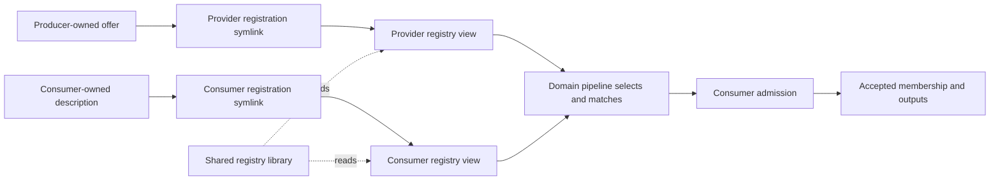

# The clarified shape

The operator describes **registry as a reusable library/construct used by pipeline
tools**. Producers and consumers expose their own offers into separate XDG
directories through symlinks. Zim offers use another such directory. Common
installer-material helpers can support that self-registration.

This sharpens the [ownership clarification](/design/registry-discovery/ownership0.gpt6a.md):
the primary registration act is publishing into a shared rendezvous for that
kind of contribution. Per-consumer accepted membership is downstream domain state.
The earlier proposed consumer inbox is therefore not a required universal step
for making a producer discoverable.

Three useful names:

- **Registry library:** reusable observation, lookup, state, provenance and
  registration-planning helpers.
- **Rendezvous:** one configured collection of registration sources for a kind of
  offer, such as keybinding providers or Zim providers.
- **Register:** install a reference exposing an owned declaration in that
  rendezvous. In the intended filesystem representation, this is a symlink.

The registry is used through ordinary code. It does not require a central daemon
or an owner for all the participating deployments' payloads.

# Concrete registration picture

Illustrative domain-grouped paths; final naming and search-layer policy remain
part of implementation review:

```text
${XDG_DATA_HOME}/compfuzor/
  keybindings/
    providers.d/
      media-keys-main.json -> <media-keys ETC>/keybinding-producer.json
    consumers.d/
      umbriel.json         -> <umbriel ETC>/<owned receiver description>
      niri.json            -> <niri ETC>/<owned receiver description>
  zim/
    providers.d/
      <producer>.json      -> <producer ETC>/<owned Zim offer description>
```

For media-keys, the target can be the existing exact producer manifest. Its action
and binding YAML remains in the producer deployment. For consumers, the owned
description points to the profile and advertises supported contribution kinds,
contexts and domain options. A Zim offer description can expose its existing
channel fragments using a domain-owned schema.

The schema belongs to the pipeline/domain that interprets each rendezvous.
Filesystem symlink handling, logical identity, disabled slots, mask overlays,
ordered roots and source provenance are shared machinery. References to owned
descriptors intentionally cross registration-directory boundaries.

# Who does what

| Actor | Responsibility |
|---|---|
| Producer playbook | Author and package its offer; declare where its own registration link should be exposed |
| Consumer playbook | Author and package its receiving contract; declare its own registration link |
| Registration helper | Resolve the invocation's rendezvous/slot and create/update the declared reference while preserving applicable local state |
| Registry reader | Observe entries, resolve configured layers and explain effective enabled/disabled/masked state |
| Domain pipeline | Query relevant registries, select compatible participants, admit exact inputs and run domain work |
| Consumer publication | Accept membership and native output under the consumer's existing validation/commit contract |

The reusable runtime may be invoked from either deployment. The same helpers are
available to a host-driven assembly, a producer's installer, a status tool or an
inspection CLI.



This gives two natural uses of the same registries:

- A **producer installer** registers its offer, then a keybinding pipeline can
  apply that producer to selected enabled consumers.
- A **consumer assembly** collects currently offered compatible providers and
  derives candidate membership while preserving that consumer's disabled groups,
  ordering and patches.

Registering advertises availability. Which requested pipeline also performs
assembly is a domain action/composition choice. A disabled declaration remains
inspectable; ordinary discovery/registration does not itself activate it.

# Installer-material helpers

Helpers should turn a declaration such as “expose this owned source as this ID in
this rendezvous for this audience” into ordinary installable link material. The
existing LINKS machinery is the delivery seam to reuse:
[`Zim runRegistry()`](/files/zim/runtime.ts#L43-L84) already builds a link manifest
and delegates its publication/status to LINKS.

A registry-aware planner still needs to select the correct active/disabled slot
and respect mask/override provenance before delegating link delivery. Generic
LINKS replacement alone does not encode those participation rules. Source paths
come from the owner's generated declarations; XDG destinations bind at invocation.

This suggests shared code under:

```text
runtime/registry/     # read/resolve views and plan registration material
runtime/discovery/    # integrate reusable Figments discovery and XDG helpers
runtime/cli/          # Router entrypoints and tab completion
```

Domain tools supply their offer/consumer schemas and execution semantics. They
consume registry views rather than requiring the registry library to know Niri,
Umbriel, Zim, or a global union of contribution kinds.

# Collection and publication checkpoints

Registry enumeration has an explicit observation point. If one pipeline registers
then collects, that later collection can observe the newly published link. A
selection already admitted for an operation retains its selected membership.

When integrating this with today's pre-effects typed-action admission, make the
producer's prospective self-registration an explicit input or introduce an
explicit later collection step. Do not silently rescan and widen a previously
admitted batch. This is an integration decision to demonstrate with generated
installer tests, not a reason to place application publication inside the loader.

# Figments alignment

G's approved substrate work is compatible with this direction: read-only
topology-aware discovery, retained states, explicit identity resolution and
literal registry keys. The parent has relayed this clarification while that work
continues. Payload ownership, registration writes and pipeline matching remain
Compfuzor integration responsibilities.

# Cross-references

- [Ownership clarification](/design/registry-discovery/ownership0.gpt6a.md) — keeps
  producer/consumer material with each playbook and locates shared code in runtime.
- [Broader direction](/design/registry-discovery/direction0.gpt6a.md) — separates
  registry lookup from domain selection and catalog projection; this document
  clarifies symmetric self-registration and the library-first interface.
- [Source evidence](/design/registry-discovery/evidence0.gpt6a.md) — existing Zim
  link registration, CONFIG participation controls, and library capabilities.
