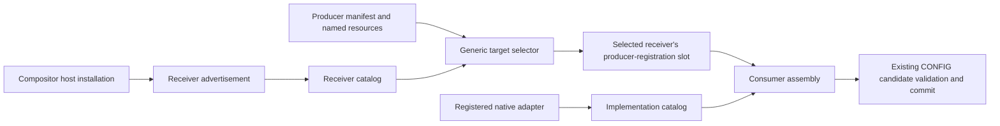

# What is up

Moving the duplicated Vicinae/media-keys wiring into
[`vars/common.yaml`](/vars/common.yaml#L204-L220) solved producer repetition,
not runtime freedom. The operator now wants targets to advertise their own
rendezvous, producers to register by dropping a declaration into place, and
runtime/tool/catalog delivery to stop growing with every deployment.

The latest explicit direction is:

- Support **runtime target selection**, **arbitrary named receivers**, and
  **new compositor adapters**. Niri/Umbriel should provide their own rendezvous;
  the generic producer should not hard-code where either lives.
- A playbook's Ansible variable sets a preferred runtime resolution chain.
  Deploy that policy as **editable data**, not only baked launcher logic.
- Preferred order: **`changed → canonical → deployed`**.
- `changed` checks pertinent files against a **SHA-512 burn recorded at
  deployment**. An unchanged candidate falls through.
- Permit not shipping the whole CFR, domain tools and catalogs when they can
  instead be sourced at invocation. No live installation has been authorized.

**Working assumption, not yet confirmed:** `changed` examines the checkout that
rendered the deployment. Its root is recorded in the policy and can be edited.
`canonical` means the invoking environment's standard Compfuzor checkout,
normally `${HOME}/archive/rektide/compfuzor`.

Research prompt: *How can a small deployment entry select a coherent runtime/tool
provider from editable policy, retain the deployment's workload identity, and
discover explicitly registered receivers without hard-coded compositor routing
or a second CONFIG publisher?*

# 1. Existing affordances and limits

| Concern | Present implementation | Missing behavior |
|---|---|---|
| Different receiver/profile | `--profile`, `--profile-selector`, context/scope; common `COMPFUZOR_NIRI_PROFILE` / `COMPFUZOR_UMBRIEL_PROFILE` selectors | A discoverable catalog of independently named receivers |
| Choose a target | Individual generated target installers; low-level `--target` | List/select a catalog subset through a generic producer entry, without rerendering |
| Supported compositor | Python `TARGETS`, TypeScript target unions, decoder/renderer/closure branches | Registered adapter implementations rather than repeated closed-name checks |
| Transfer target data | Manifest stores target names; wrappers and action spec store delivery settings | One inspectable target catalog/selector description, available to invocation-time selection |
| Choose runtime source | Archive runner has controller-side canonical-first resolution; Zim has receiver-side host discovery | General runtime source policy and deployment-time SHA-512 baseline |
| Omit copied tooling | Bundle contributions are shared/deduplicated within a deployment | A lean deployment that does not require/copy the rendering checkout's built runtime |

Evidence: [compiler role/target checks and manifest](/library/filter_plugins/keybindings_compile.py#L131-L149),
[generated wrappers and action operations](/library/filter_plugins/keybindings_compile.py#L158-L233),
[CLI admission](/files/config/keybindings/runtime.ts#L64-L111),
[target model](/files/config/keybindings/model.ts#L14-L15),
[native serializers](/files/config/keybindings/render.ts#L82-L117), and
[runtime artifact claims](/library/filter_plugins/runtime_bundles.py#L16-L54).

The general [runtime catalog](/files/catalog/runtime.ts#L9-L18) is currently an
attributed workload inventory, not a keybinding receiver or implementation registry.
Its [resource projection](/library/filter_plugins/runtime_catalog.py#L133-L149)
does not carry a full keybinding target catalog. A data-driven target list alone
cannot supply a new native serializer or validator.

# 2. Keep three catalogs and two roots distinct

| Concept | Owns |
|---|---|
| **Implementation catalog** | Tool/adapter identities, compatible interfaces and their executable/module/worker resources |
| **Receiver catalog** | Advertised target identities, adapter references, profile selectors, contexts/scopes and producer-registration rendezvous |
| **Deployment workload catalog** | This deployment's contributed actions, plans, resource identities and manifests |

These may share descriptor and locator machinery, but they answer different
questions. Loading live implementation code must not replace the deployment's
workload with the canonical checkout's workload.

Likewise distinguish **provider root** (selected implementation/assets) from
**deployment root** (the workload being operated on). Today the
[multicall runtime](/files/runtime/compfuzor-runtime.ts#L153-L174) infers deployment
from its own real module path. Its keybinding branch assumes
[`deployment/bin/config/run.sh`](/files/runtime/compfuzor-runtime.ts#L130-L139).
[Typed actions](/files/actions/operations.ts#L43-L64) make the same worker assumption.
Simply symlinking the local runtime to a checkout is therefore not sufficient.

The proposed deep module is **runtime resolution**: callers supply deployment
identity, tool identity and policy; its implementation hides chain eligibility,
fingerprints, compatible provider lookup and worker/resource locations. Changed
and canonical are source-provider selections with different predicates;
deployed is a packaged-provider adapter, not merely a different filename.

# 3. Resolution and delivery are independent data

Illustrative future authoring interface — **not implemented names**:

```yaml
COMPFUZOR_RUNTIME:
  resolve: [changed, canonical, deployed]
  deploy: false
```

The deployed policy must also retain the changed-source locator, canonical
locator, burn reference, provider/interface requirements and any deployed
fallback locator. It is ordinary local data the operator can inspect/edit.
Omitting a chain stage is a source-selection bypass; skipping the operation
entirely is a different concern.

| Stage | Eligibility | Fall-through |
|---|---|---|
| `changed` | Relevant source set differs from the deployment burn **and** can supply the required tool/worker interfaces | Unchanged, absent or unavailable candidate |
| `canonical` | Standard checkout/registration can supply the required implementation | Absent or unavailable candidate |
| `deployed` | This deployment has a compatible shipped implementation closure | No shipped copy, or unavailable candidate |

The comparison is **not Git/jj dirty state** and is not a freshness timestamp.
Record a reproducible SHA-512 source manifest: relative paths, content digests,
and the membership of pertinent discovery/source sets. Include transitive tool
imports and required worker assets; include dependency declarations/lock state
where they affect source-mode loading. Hashing only a CLI entry misses changes
to its imported modules; hashing every repository document creates false matches.
Precisely extracting this pertinent set remains an implementation question.

A burn is a selection baseline, **not a signature or trust guarantee**. Do not
refresh it just because a command ran. Missing baseline and malformed policy
need explicit diagnostics, not "assume unchanged" behavior.

Resolution happens before authored effects. Report the winning stage/root and
why earlier stages fell through, then use one coherent provider closure for the
invocation. **Do not retry the next provider after execution failure**: the
operation may already have effects. Live source changes during an invocation
also require an honest observation/pinning contract, not a claim of immutable
code simply because the root was selected once.

`deploy: false` affects new artifact claims; it does not prune old files. If all
configured providers are unavailable, fail with an actionable error. The presence
of `deployed` in the chain is not evidence that a fallback was shipped.

# 4. Rendezvous rather than producer-side compositor knowledge

The desired shape is complementary registration:



Suggested conventions are **domain-grouped**, not a flat global directory:
a user receiver-registration area such as
`${XDG_DATA_HOME}/compfuzor/keybindings/targets.d/`, and a producer-registration
area advertised by each receiver's profile. Exact paths and system/user search
precedence remain to be agreed. Do not resolve them against the rendering
controller's home.

A receiver advertisement needs a stable arbitrary target ID, an adapter
reference, a profile selector and allowed context/scope choices, plus its
registration rendezvous. Several target IDs may share one native adapter.
A producer registration should reference the producer's **exact manifest**,
not invite an uncontrolled scan of native/YAML fragments.

"Drop a file" means a typed, admitted declaration, not arbitrary executable
discovery from PATH. A host may then assemble it using its registered adapter.
Discovery, availability, selection and execution remain distinguishable:
**whether advertisement automatically enrolls a receiver in default producer
installation is still a policy decision**, not something to hide in directory order.
The runtime should support listing targets, explicit one/many selection, and
catalog-defined defaults without hard-coded compositor names.

This extends the current deliberately **closed**
[membership contract](/files/config/keybindings/membership.ts#L118-L159).
Do not make registration-directory contents and `membership.json` competing
authorities. The design must choose how advertised declarations become the
closed, validated selection and preserve enabled state, ordering, exact resource
identities and consumer-owned patches.

Retain CONFIG's commit seam: [membership updates](/files/config/keybindings/membership.ts#L400-L420)
are supplemental candidates alongside native outputs/root, and
[consumer assembly](/files/config/keybindings/consumer.ts#L458-L494) runs ordinary
recipes through the existing runner. A newly discovered registration must not
be called accepted state before native validation/publication succeeds. Discovery
does not authorize pruning physical artifacts or restarting compositors.

# 5. Meaningful implementation checkpoints

1. **One source-selection interface, two real provider adapters.** Deploy/edit
   policy and SHA-512 burns; exercise source and packaged providers against an
   isolated harmless tool. Keep workload and provider roots separate. Prove
   unchanged source falls through, changed source wins, canonical absence falls
   through, forced deployed-only selection works, and lean rendering does not
   require a local built omnibus. Resolve the CONFIG worker closure too, not just
   the JavaScript entry.
2. **Advertised receivers and transferable target selection.** Niri/Umbriel
   advertise themselves; a producer lists/selects arbitrary registered IDs via
   catalog data. Preserve current profile overrides and scoped pre-effects
   admission. Settle default enrollment before changing install behavior.
3. **Registration and adapter extension through that interface.** Typed
   producer drops enter the consumer's selected graph; native adapters own
   decoding, rendering, material naming/include semantics and validation. New
   adapters register implementations instead of adding name checks throughout
   the generic compiler/runtime. Verify rollback, dormant consumer patches,
   explicit disable state and absence of implicit cleanup/reload.

These are proposed checkpoints, not authorization to build the whole destination.
This session has researched/written direction only; the new resolver, burns,
rendezvous catalogs and lean delivery are **not implemented**.

# Cross-references

- [GH sourcing precedents](/design/runtime-sourcing/precedents0.glm53.md): evidence
  for existing baby steps; this document adds the later operator clarification
  and distinguishes runtime policy from controller-side tool selection.
- [Archive runner resolution](/tasks/compfuzor/repo_jj_archive.tasks#L22-L43):
  implemented canonical checkout preference, explicit override and announcement.
- [Archive source/bundle launcher](/script/repo-jj-archive.ts#L23-L38): real source
  availability checks and bundle fallback, but no SHA-512 changed predicate.
- [Zim registry discovery](/tasks/compfuzor/gen_zim.tasks#L166-L189): a receiver-side
  rendezvous already replaces repeated producer knowledge of a host location.
- [Runtime world map](/design/compfuzor-runtime/world-map0.gpt61sol.md#L64-L86):
  static multicall dispatch is not dynamic provider discovery; root separation
  and a uniform explicit workload contract remain consequential gaps.
- [Shared runtime bootstrap draft](/design/compfuzor-runtime/composition-draft1.glm53.md#L218-L242):
  prior art for host executor/deployment data and optional bundled fallback;
  its exact installation layout is a proposal, not an installed capability.
- [Consumer CONFIG reuse](/doc/config/keybinding-consumers.md#how-this-reuses-config):
  the existing publisher and worker machinery to retain while opening discovery.
- [Current producer guide](/doc/config/keybinding-producers.md): current, narrower
  supported affordances; common defaults are not yet the rendezvous design.
