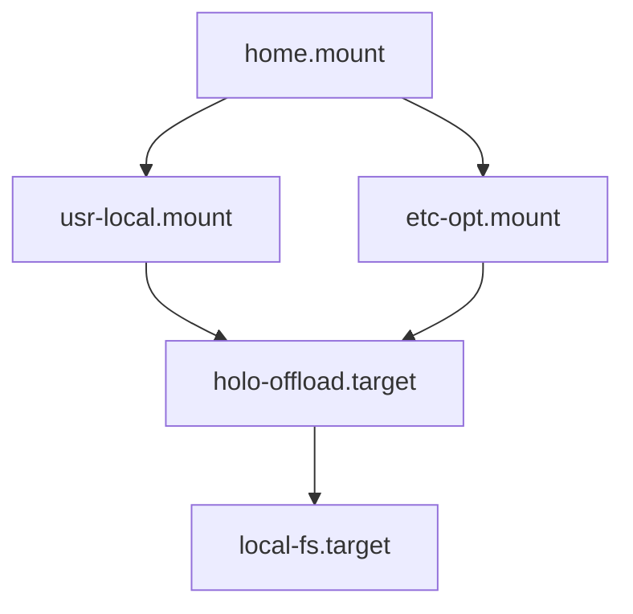

# SteamOS mount-centric installation

## Status

This proposal replaces the path-rewriting direction in the initial inquiry.
It is a draft for iteration, not an accepted implementation.

## Decision in one sentence

Preserve Compfuzor's ordinary recipe types by adding persistent bind mounts for
the two image-owned hierarchy roots it relies on—`/usr/local` and `/etc/opt`—and
keep SteamOS-specific behavior confined to one bootstrap deployment plus
package and host-integration edges.

## Why this collapses the problem

SteamOS already persists three important domains:

- `/opt` is a native bind mount from `/home/.steamos/offload/opt`;
- `/srv` is a native bind mount from `/home/.steamos/offload/srv`;
- user deployments live on the shared `/home` filesystem.

Two additional mounts complete Compfuzor's normal type layout:

| Recipe type | Ordinary root | Persistence owner |
|---|---|---|
| `opt` | `/opt/<name>` | SteamOS native offload |
| `srv` | `/srv/<name>` | SteamOS native offload |
| `src` | `/usr/local/src/<name>` | Compfuzor `/usr/local` bind |
| `etc` | `/etc/opt/<name>` | Compfuzor `/etc/opt` bind |
| `user` | `$HOME/...` | SteamOS shared home |

With those roots durable, ordinary hierarchy materialization and links are
already correct. SteamOS no longer needs:

- `TYPE_DIRS` storage remapping;
- a Steam-specific contained layout;
- reciprocal `<KIND>_LINK` overrides;
- `FS_CONTAINERED` or replacement root-pair machinery.

## Observed host state

On `deckercaned`:

| Path or unit | Observed state |
|---|---|
| `/home/.steamos/offload/usr/local` | existing durable tree, approximately 31 GiB |
| `/usr/local` | currently unmounted image tree, approximately 100 KiB |
| `/home/.steamos/offload/etc/opt` | absent |
| `/etc/opt` | currently unmounted overlay tree, approximately 8 KiB |
| `holo-offload.target` | loaded and active; native SteamOS offload target |
| `steamos-offload.target` | not found |

The old custom mounts failed for two independent reasons:

1. their unit sources lived beneath `/etc/opt`, which disappeared during the
   A/B switch;
2. they were enabled under nonexistent `steamos-offload.target`.

## Proposed bootstrap deployment

One `steamos-offload` deployment lives under the already-persistent `/srv`:

```text
/srv/steamos-offload-main/
├── bin/
│   └── generated systemd installers
└── etc/
    ├── usr-local.mount
    └── etc-opt.mount
```

This deployment is intentionally self-contained: its generated unit sources
must not depend on `/etc/opt` or `/usr/local` being mounted.

### Use the new multi-unit systemd model

The playbook uses `SYSTEMD_ROOTS` to declare two plain bind mount units,
mirroring Valve's own `opt.mount`/`srv.mount`:

```yaml
SYSTEMD_ROOTS:
  - STEAMOS_OFFLOAD_USR_LOCAL
  - STEAMOS_OFFLOAD_ETC_OPT

STEAMOS_OFFLOAD_USR_LOCAL:
  SYSTEMD_MOUNT: usr-local
  SYSTEMD_UNITS:
    ConditionPathExists: /home/.steamos/offload/usr/local
  SYSTEMD_MOUNTS:
    What: /home/.steamos/offload/usr/local
    Where: /usr/local
    Type: none
    Options: bind
  SYSTEMD_INSTALLS:
    WantedBy: holo-offload.target

STEAMOS_OFFLOAD_ETC_OPT:
  SYSTEMD_MOUNT: etc-opt
  SYSTEMD_UNITS:
    ConditionPathExists: /home/.steamos/offload/etc/opt
  SYSTEMD_MOUNTS:
    What: /home/.steamos/offload/etc/opt
    Where: /etc/opt
    Type: none
    Options: bind
  SYSTEMD_INSTALLS:
    WantedBy: holo-offload.target
```

`ConditionPathExists` on the backing path keeps boot ordering safe if a
source directory is absent (Valve's own `nix.mount` precedent). The playbook
creates both backing directories; `usr/local` already holds the pre-update
31 GiB tree, `etc/opt` is created on first run.

### Copy bootstrap units into `/etc/systemd/system`

The bootstrap units cannot be symlinks to `/opt`: systemd discovers units
before the native `/opt` mount is guaranteed to expose their targets. Use the
systemd subsystem's copy strategy:

```yaml
SYSTEMD_INSTALL_STRATEGY: copy
```

SteamOS already retains `/etc/systemd/system/*.service`, `*.mount`, and their
`.wants` links across atomic updates. This relies only on SteamOS's built-in
systemd-unit policy; it does not add a broad custom retention list.

The bootstrap playbook may bypass the generic LINKS runtime so its generated
unit installers take the direct copy fallback and do not require Node during
recovery.

## No seed or merge layer

An earlier draft ran a root oneshot "seed" service that rsynced image content
from `/usr/local` and `/etc/opt` onto the backing trees (with build-ID stamps
and an archive directory) before mounting. That was rejected and removed:

- SteamOS ships essentially nothing in those paths (observed: ~100 KiB
  skeleton under `/usr/local`, ~8 KiB under `/etc/opt`), so there is no image
  content worth merging;
- Valve's own offload mounts (`opt.mount`, `srv.mount`) are plain binds with
  no seeding — that is the native pattern to mirror;
- the machinery was pure downside: root rsync at early boot, unbounded archive
  growth, extra ordering constraints, and merge semantics that could stomp
  local files if an image ever did ship something.

If a future image ever places files under these paths that matter, handle it
deliberately then; do not reintroduce boot-time merging.

## Boot flow



The diagram expresses required order, not necessarily the final exact set of
systemd directives.

## What remains SteamOS-specific

The mounts solve recipe placement, but not every immutable-host concern:

1. **Packages.** `ARCH_PKGS` is currently metadata; render-time installation
   and generated package lanes remain apt-specific. SteamOS needs an explicit
   pacman/replay policy.
2. **Host projections outside mounted roots.** System units, sysusers, udev,
   modules-load, sysctl, desktop files, `/usr/share`, and `/usr/lib` may need
   replay after an update.
3. **Large mutable state.** SteamOS copies most `/var` state between A/B slots,
   but large service state may deserve an explicit offload.
4. **Activation privilege.** Unit installation and system service activation
   still require an interactive sudo step when passwordless sudo is absent.
5. **Desktop/user software.** AppImages and user installs may remain preferable
   to modifying the host package image.

## Cleanup of the abandoned path-rewriting direction

If this proposal is accepted, remove:

- `TYPE_DIRS` from `vars_base.tasks`;
- `vars/steamos.yml` path remapping;
- `vars/containered.yml` unless independently justified outside SteamOS
  (update: retained — the container/single-tree portability use case justified
  it; see the README "Vars profiles" section);
- `<KIND>_LINK` overrides in `fs_hierarchy.tasks` if the generic contained
  profile is removed;
- dormant `FS_<KIND>_{MATERIALIZED,EXPOSURE}_ROOT` code;
- README guidance for stacking path-rewriting profiles.

Keep the independent improvements discovered during the spike:

- base discovery runs in check mode;
- systemd path discovery falls back when `systemd.pc` is absent;
- Interception Tools uses the current multi-section systemd model and declares
  its Arch packages;
- Zim and Vicinae Arch package metadata is more complete;
- the `block-in-file` Deno wrapper has explicit runtime permissions;
- `FS_CONTAINERED` remains removed.

## Migration of current Deck deployments

Do not bulk-move their current contained directories. After the mounts are
active, rerun each recipe in its ordinary layout and let declared state
materialize under persistent `/etc/opt` and `/usr/local`.

Current contained trees under `/srv/<name>/etc` or `/opt/<name>/etc` remain
useful predecessor state until each recipe is verified. Cleanup is a separate,
explicit operation.

## Acceptance checks

1. Render both mount units from one `SYSTEMD_ROOTS` playbook.
2. Verify unit files contain no source dependency on `/etc/opt` or `/usr/local`.
3. Verify backing directories are created by the playbook and that
   `ConditionPathExists` guards both mounts.
4. Verify generated installers use copy strategy without the LINKS runtime.
5. Activate on the Deck (`bin/install-systemd.sh` with sudo) and verify exact
   mount sources with `findmnt`.
6. Reboot and verify both mounts come up under `holo-offload.target`.
7. Rerun representative `opt`, `srv`, `src`, and `etc` recipes without a
   SteamOS path profile.

## Open decisions

1. Should the bootstrap retain generated direct installers only, or also ship
   one hand-written recovery command independent of Compfuzor's runtime?
2. After `/usr/local` is restored, should user source checkouts return there
   immediately or remain under `~/src` by preference?

## Below the line for the first implementation

The first direct implementation intentionally does **not** include:

- installing, enabling, or starting the units on the Deck without the
  operator's interactive sudo authorization;
- proving behavior across a real SteamOS A/B update or rollback;
- a pacman backend or automatic consumption of `ARCH_PKGS`;
- migration or deletion of the temporary contained deployment trees created
  during the earlier spike;
- automatic reruns of application recipes after the mounts become active;
- persistence policy for arbitrary `/etc`, `/usr/share`, `/usr/lib`, udev,
  sysusers, sysctl, modules-load, desktop, or package-owned files;
- new offloads for `/var` service state;
- any image-to-backing merge, seed, or archive layer (rejected; see above);
- Vicinae installation or other application-specific packaging choices;
- removal of SteamOS's native `/opt` or `/srv` offloads;
- a SteamOS-specific path profile (the generic `containered.yml` profile
  remains for single-tree portable deployments such as containers).

## Cross-references

- [`/steamos-offload.srv.pb`](/steamos-offload.srv.pb) — existing single-mount
  recipe to replace with a multi-unit bootstrap deployment.
- [`/tasks/compfuzor/vars_systemd_unit.tasks`](/tasks/compfuzor/vars_systemd_unit.tasks)
  — current `SYSTEMD_ROOTS`, per-unit installer, link/copy strategy, and
  compositor implementation.
- [`/files/systemd/install-unit.sh`](/files/systemd/install-unit.sh) — direct
  copy fallback used when the bootstrap bypasses LINKS generation.
- [Initial SteamOS inquiry](/design/steamos-install/steamos-install.gpt6.md) —
  host evidence and the superseded path-rewriting design.
