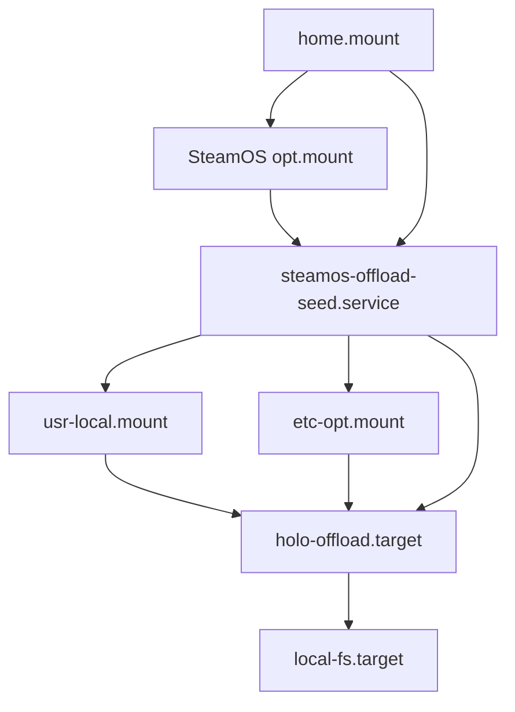

# SteamOS mount-centric installation

## Status

This proposal replaces the path-rewriting direction in the initial inquiry.
It is a draft for iteration, not an accepted implementation.

## Decision in one sentence

Preserve Compfuzor's ordinary recipe types by adding persistent bind mounts for
the two image-owned hierarchy roots it relies on—`/usr/local` and `/etc/opt`—and
keep SteamOS-specific behavior confined to one bootstrap deployment plus
package and host-integration edges.

## Why this collapses the problem

SteamOS already persists three important domains:

- `/opt` is a native bind mount from `/home/.steamos/offload/opt`;
- `/srv` is a native bind mount from `/home/.steamos/offload/srv`;
- user deployments live on the shared `/home` filesystem.

Two additional mounts complete Compfuzor's normal type layout:

| Recipe type | Ordinary root | Persistence owner |
|---|---|---|
| `opt` | `/opt/<name>` | SteamOS native offload |
| `srv` | `/srv/<name>` | SteamOS native offload |
| `src` | `/usr/local/src/<name>` | Compfuzor `/usr/local` bind |
| `etc` | `/etc/opt/<name>` | Compfuzor `/etc/opt` bind |
| `user` | `$HOME/...` | SteamOS shared home |

With those roots durable, ordinary hierarchy materialization and links are
already correct. SteamOS no longer needs:

- `TYPE_DIRS` storage remapping;
- a Steam-specific contained layout;
- reciprocal `<KIND>_LINK` overrides;
- `FS_CONTAINERED` or replacement root-pair machinery.

## Observed host state

On `deckercaned`:

| Path or unit | Observed state |
|---|---|
| `/home/.steamos/offload/usr/local` | existing durable tree, approximately 31 GiB |
| `/usr/local` | currently unmounted image tree, approximately 100 KiB |
| `/home/.steamos/offload/etc/opt` | absent |
| `/etc/opt` | currently unmounted overlay tree, approximately 8 KiB |
| `holo-offload.target` | loaded and active; native SteamOS offload target |
| `steamos-offload.target` | not found |

The old custom mounts failed for two independent reasons:

1. their unit sources lived beneath `/etc/opt`, which disappeared during the
   A/B switch;
2. they were enabled under nonexistent `steamos-offload.target`.

## Proposed bootstrap deployment

One `steamos-offload` deployment lives under the already-persistent `/opt`, for
example:

```text
/opt/steamos-offload-main/
├── bin/
│   ├── seed-offloads.sh
│   └── generated systemd installers
└── etc/
    ├── steamos-offload-seed.service
    ├── usr-local.mount
    └── etc-opt.mount
```

This deployment is intentionally self-contained: its generated unit sources
must not depend on `/etc/opt` or `/usr/local` being mounted.

### Use the new multi-unit systemd model

The playbook should use `SYSTEMD_ROOTS` to declare three units:

```yaml
SYSTEMD_ROOTS:
  - STEAMOS_OFFLOAD_SEED
  - STEAMOS_OFFLOAD_USR_LOCAL
  - STEAMOS_OFFLOAD_ETC_OPT
```

Conceptual root declarations:

```yaml
STEAMOS_OFFLOAD_SEED:
  SYSTEMD_SERVICE: steamos-offload-seed
  SYSTEMD_UNITS:
    RequiresMountsFor: [/home/.steamos/offload, /opt]
    Before: [usr-local.mount, etc-opt.mount]
  SYSTEMD_SERVICES:
    Type: oneshot
    ExecStart: /opt/steamos-offload-main/bin/seed-offloads.sh
    RemainAfterExit: true
  SYSTEMD_INSTALLS:
    WantedBy: holo-offload.target

STEAMOS_OFFLOAD_USR_LOCAL:
  SYSTEMD_MOUNT: usr-local
  SYSTEMD_UNITS:
    Requires: steamos-offload-seed.service
    After: steamos-offload-seed.service
  SYSTEMD_MOUNTS:
    What: /home/.steamos/offload/usr/local
    Where: /usr/local
    Type: none
    Options: bind
  SYSTEMD_INSTALLS:
    WantedBy: holo-offload.target

STEAMOS_OFFLOAD_ETC_OPT:
  SYSTEMD_MOUNT: etc-opt
  SYSTEMD_UNITS:
    Requires: steamos-offload-seed.service
    After: steamos-offload-seed.service
  SYSTEMD_MOUNTS:
    What: /home/.steamos/offload/etc/opt
    Where: /etc/opt
    Type: none
    Options: bind
  SYSTEMD_INSTALLS:
    WantedBy: holo-offload.target
```

The exact dependency directives need an end-to-end boot-order test, but the
ownership boundary is firm: seed first, then mount both roots.

### Copy bootstrap units into `/etc/systemd/system`

The bootstrap units cannot be symlinks to `/opt`: systemd discovers units
before the native `/opt` mount is guaranteed to expose their targets. Use the
systemd subsystem's copy strategy:

```yaml
SYSTEMD_INSTALL_STRATEGY: copy
```

SteamOS already retains `/etc/systemd/system/*.service`, `*.mount`, and their
`.wants` links across atomic updates. This relies only on SteamOS's built-in
systemd-unit policy; it does not add a broad custom retention list.

The bootstrap playbook may bypass the generic LINKS runtime so its generated
unit installers take the direct copy fallback and do not require Node during
recovery.

## Seed and archive behavior

The seed service runs before either custom mount. For each declared path it
copies the currently visible image tree onto the durable backing tree:

```text
/usr/local/  -> /home/.steamos/offload/usr/local/
/etc/opt/    -> /home/.steamos/offload/etc/opt/
```

Required semantics:

1. Refuse to seed a path if it is already an exact mount point.
2. Create the mount point, backing directory, archive directory, and state
   directory when absent.
3. Use `rsync -aHAXx --numeric-ids` with trailing-slash directory semantics.
4. Let the currently installed SteamOS image win on same-name changed files.
5. Preserve replaced destination files with `--backup --backup-dir=...`.
6. Never use `--delete`; undeclared/stale cleanup remains deliberate.
7. Mark success only after the complete rsync succeeds.
8. Serialize runs with a lock.

Suggested durable administration tree:

```text
/home/.steamos/offload/.compfuzor/
├── archive/
│   ├── usr-local/<build-id>/<timestamp>/...
│   └── etc-opt/<build-id>/<timestamp>/...
└── seeded/
    ├── usr-local/<build-id>
    └── etc-opt/<build-id>
```

### Seed once per SteamOS image

Running the image-to-backing merge on every boot would repeatedly overwrite a
locally modified destination with the same image copy. Gate it by SteamOS
`BUILD_ID` (and retain a manual `--force` mode):

```text
if seeded/<path>/<BUILD_ID> exists:
    skip
else:
    archive-and-rsync
    atomically create the stamp
```

This also handles A/B rollback: an already-seeded build skips; a genuinely new
build contributes its image files once.

## Boot flow



The diagram expresses required order, not necessarily the final exact set of
systemd directives.

## What remains SteamOS-specific

The mounts solve recipe placement, but not every immutable-host concern:

1. **Packages.** `ARCH_PKGS` is currently metadata; render-time installation
   and generated package lanes remain apt-specific. SteamOS needs an explicit
   pacman/replay policy.
2. **Host projections outside mounted roots.** System units, sysusers, udev,
   modules-load, sysctl, desktop files, `/usr/share`, and `/usr/lib` may need
   replay after an update.
3. **Large mutable state.** SteamOS copies most `/var` state between A/B slots,
   but large service state may deserve an explicit offload.
4. **Activation privilege.** Unit installation and system service activation
   still require an interactive sudo step when passwordless sudo is absent.
5. **Desktop/user software.** AppImages and user installs may remain preferable
   to modifying the host package image.

## Cleanup of the abandoned path-rewriting direction

If this proposal is accepted, remove:

- `TYPE_DIRS` from `vars_base.tasks`;
- `vars/steamos.yml` path remapping;
- `vars/containered.yml` unless independently justified outside SteamOS;
- `<KIND>_LINK` overrides in `fs_hierarchy.tasks` if the generic contained
  profile is removed;
- dormant `FS_<KIND>_{MATERIALIZED,EXPOSURE}_ROOT` code;
- README guidance for stacking path-rewriting profiles.

Keep the independent improvements discovered during the spike:

- base discovery runs in check mode;
- systemd path discovery falls back when `systemd.pc` is absent;
- Interception Tools uses the current multi-section systemd model and declares
  its Arch packages;
- Zim and Vicinae Arch package metadata is more complete;
- the `block-in-file` Deno wrapper has explicit runtime permissions;
- `FS_CONTAINERED` remains removed.

## Migration of current Deck deployments

Do not bulk-move their current contained directories. After the mounts are
active, rerun each recipe in its ordinary layout and let declared state
materialize under persistent `/etc/opt` and `/usr/local`.

Current contained trees under `/srv/<name>/etc` or `/opt/<name>/etc` remain
useful predecessor state until each recipe is verified. Cleanup is a separate,
explicit operation.

## Acceptance checks

1. Render all three units from one `SYSTEMD_ROOTS` playbook.
2. Verify unit files contain no source dependency on `/etc/opt` or `/usr/local`.
3. Test seeding into scratch trees: source wins, replaced destination is
   archived, destination-only files remain, second same-build run is inert.
4. Verify generated installers use copy strategy without the LINKS runtime.
5. Activate manually on the Deck and verify exact mount sources with `findmnt`.
6. Reboot and verify all three units and both mounts.
7. Simulate a new build stamp in scratch before relying on the next real A/B
   update.
8. Rerun representative `opt`, `srv`, `src`, and `etc` recipes without a
   SteamOS path profile.

## Open decisions

1. Is `BUILD_ID` alone a sufficient image identity, or should the root
   partition UUID be included?
2. Should a seed failure block both mounts (recommended) or allow mounting the
   previous durable trees?
3. Should `/etc/opt` and `/usr/local` share one seed service transaction, or
   have independent seed services and failure domains?
4. Should the bootstrap retain generated direct installers only, or also ship
   one hand-written recovery command independent of Compfuzor's runtime?
5. After `/usr/local` is restored, should user source checkouts return there
   immediately or remain under `~/src` by preference?

## Cross-references

- [`/steamos-offload.srv.pb`](/steamos-offload.srv.pb) — existing single-mount
  recipe to replace with a multi-unit bootstrap deployment.
- [`/tasks/compfuzor/vars_systemd_unit.tasks`](/tasks/compfuzor/vars_systemd_unit.tasks)
  — current `SYSTEMD_ROOTS`, per-unit installer, link/copy strategy, and
  compositor implementation.
- [`/files/systemd/install-unit.sh`](/files/systemd/install-unit.sh) — direct
  copy fallback used when the bootstrap bypasses LINKS generation.
- [Initial SteamOS inquiry](/design/steamos-install/steamos-install.gpt6.md) —
  host evidence and the superseded path-rewriting design.
