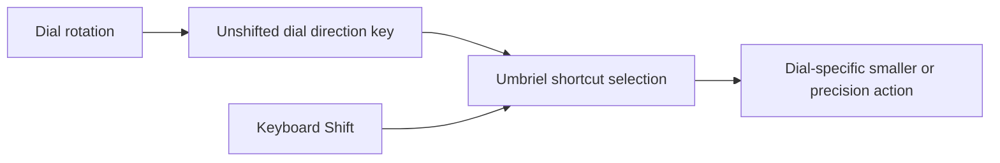
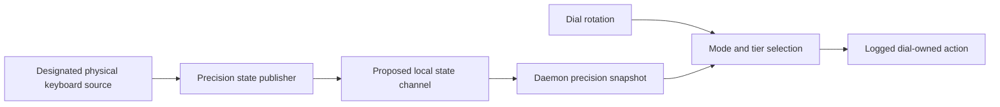

# Revised destination

Existing fine adjustment may already work. The new goal is a **smaller normal dial increment** and an **additional precision tier while keyboard Shift is held**, with observable action selection. The user is interested in stateful sideways communication and possibly keeping dial-specific actions with Surface Dial rather than the global media producer.

This checkpoint keeps that broader direction open; it does not silently substitute a dedicated keyboard button for Shift, require Kinefolk deployment, allocate function keys, or choose step values. Nothing was deployed or implemented in the daemon. The only executable experiment compiled isolated XKB keymaps without device access.

# What the investigations establish

| Area | Evidence-backed finding |
|---|---|
| Current unit | Runs `%h/.cargo/bin/surface-dial-daemon` without arguments or drop-ins. The inspected persisted mode index is `5`, Media+Volume. Binary copies match; source/build lineage is consistent with upstream `43dd973`, not a reproducible-build proof. |
| Current volume vocabulary | Volume and Media+Volume emit their own Left Shift plus Volume. The declared Shift volume command is `0.02`; the plain `0.06` action is not the normal output of these dial modes. |
| Umbriel observability | Its media spawn path logs the requested command, including the volume increment. Inspected volume request logs were fine `0.02` commands. These are action-request observations, not proof of successful child execution or sink mutation. |
| Daemon observability | Direction lines omit mode identity, raw delta, precision tier, and haptic configuration. They precede emission and therefore count attempted actions, not verified completed injections. |
| Burst behavior | Existing journals have a large imbalance between daemon direction lines and Umbriel volume launch requests, especially in fast bursts. This is a measurement lead, not a controlled detent-to-action loss rate or a localized bug. |
| Runtime state channel | The daemon has none today. Its existing shared `new_mode` cell is an internal dispatch seam, not public IPC. |
| Modifier source | Umbriel can use keyboard modifiers for shortcut matching, but its public IPC does not expose held modifiers. Installed Kanata appears to lack TCP support, and its service denies networking. |
| Kinefolk | Static native keyboard configuration and named sparse contexts, not a live modifier publisher. The idea is registered there; deployment does not depend on it. |

See the [revised unit report](/design/surface-dial-layers/unit1.glm53.md) and [routing report](/design/surface-dial-layers/routing0.gpt61s.md) for commands, source revisions, and observation limits.

# Observability already available

These commands watch existing journals; they do not restart services or open input devices:

```sh
journalctl --user -u surface-dial.service -f -o short-iso
journalctl --user -u umbriel.service -f -o short-iso --grep='set-volume'
```

Today the first shows direction; the second distinguishes `0.02` and `0.06` command requests. When new dial actions exist, their explicit amounts or dedicated command names should remain distinguishable here. A compositor-wide bind-executed IPC family is not necessary merely to see the current requested volume action.

The smallest useful daemon change is logging **control mode, raw delta, and intended emission**, plus haptic configuration when applied. An optional daemon-local sequence can help compare windows, but cannot magically correlate through an ordinary key event to Umbriel's launch log. Add emission outcomes or action results only where that outcome is actually known.

Haptic logs need the same stage discipline: the [proxy `set_mode`](https://github.com/daniel5151/surface-dial-linux/blob/43dd973092871d8ef0c452b0797b519f5a9ddfac/src/dial_device/haptics.rs#L17-L22) discards its channel-send result and returns `Ok`; that is not proof of hardware application. The [worker's report-write call](https://github.com/daniel5151/surface-dial-linux/blob/43dd973092871d8ef0c452b0797b519f5a9ddfac/src/dial_device/haptics.rs#L71-L73) is the stronger place to log returned write success, still distinct from observed physical detents. Logging-first need not change either behavior, but should label its observation point honestly.

# Three knobs, one extra dimension

- **Haptic density:** current volume modes request 72 detents per revolution. Altering this changes tactile angle/event density.
- **Increment policy:** the amount applied per selected event/action. This can be lowered without changing haptics.
- **Event accounting:** current volume code uses only the sign of `delta`, producing one attempted chord per callback rather than multiplying by its magnitude. Whether larger magnitudes occur needs measurement.
- **Precision tier:** a momentary overlay driven by keyboard Shift. This can be called a layer; it is independent from the menu-selected control mode and from the compositor's global submap stack.

An appropriate conceptual selector is **control mode × precision tier**. Do not prematurely introduce a generic layer stack or a universal variable framework. Future modes can share the precision signal while retaining their distinct action policies.

The phrase “lower ratio” is unresolved: lowering finer/normal makes the tiers more separated; lowering normal/finer makes them closer. Specify an explicit pair. For example, `0.005 / 0.001` is a 5:1 normal:finer pair, while `0.005 / 0.0025` is 2:1. These are discussion examples, not proposed defaults.

# Two coherent paths

## A. Dial-specific keys, compositor-selected precision

Change dial volume emission to an **unshifted direction pair**, provisionally F23 up and F24 down. Umbriel matches plain versus Shift+direction using its existing cross-keyboard modifier aggregation. The isolated default XKB fixture supports those names; live keymap, collision, and routing verification remain necessary.



**This uses two direction keys, not an extra mode key.** It removes volume's own synthetic Shift as one known collision source. It does not make all input intrinsically physical or remove every possible injector from main Kanata.

The action declarations can live with `surface-dial.src.pb` while Umbriel still executes them. **Declaration ownership is not the same as execution ownership.** This satisfies “Surface Dial rather than media-keys” at the producer boundary without changing ordinary keyboard media commands.

Cost: reserved event vocabulary, daemon capability/emission changes, dial-owned bindings, and exact modifier-mask behavior. Other held modifiers need an explicit policy. Kinefolk must not simultaneously allocate the same candidate codes as keyboard-held mode signals.

## B. Sideways precision state, daemon-selected action

A designated physical-keyboard observer/publisher supplies state to the daemon; the daemon samples it when handling rotation, selects the tier, logs it, and dispatches the selected action. Direct audio actuation requires **no function key and no Umbriel key transformation**.



This is the more interesting growth path for daemon-owned actions, contextual controls, runtime policy updates, and observable state. It is also **new protocol and publisher work**, not an existing remote-variable feature.

The decisive question is who can supply trustworthy held state:

- A physical keyboard event reader must account for Kanata's exclusive grabs. Raw event observation is not automatically available to a second reader.
- A scoped keyboard-only remapper output can be a conventional source, but that topology and its remaining synthetic outputs must be checked.
- Physical held-key bitmap sampling is a candidate to prototype, including permissions, hotplug, and sampling semantics; it is not yet a verified deployed publisher.
- Watching main's merged output cannot recover original device identity. Removing the dial's own Shift eliminates one contaminant, not every possible synthetic modifier.
- Kanata TCP would require both a capable binary and deliberate service transport/security changes. Do not enable it merely to avoid choosing the state source.

For the channel, design a **snapshot with designated source, generation/epoch, and liveness**, not just unauthenticated press/release toggles. A datagram transport does not report publisher disconnect; credentials and leases must match the chosen transport. Unknown/stale state needs an explicit fallback: silently returning to the larger normal increment may be undesirable.

State updates and dial events are separate streams. Log the state generation sampled at dispatch rather than promising instantaneous ordering at physical-event time. Keep policy configuration separate from held state; do not persist “Shift is held” across restarts. Reliability and action execution ordering should be designed, not replaced with a blanket catch-and-print policy.

# Recommended next checkpoint

1. **Logging-first:** add the smallest useful daemon observability slice in the existing layered variant, preserving current output behavior. Choose its source lineage deliberately before any deployment; the notification-timeout fork is a separate predecessor worth preserving.
2. **Measure the chain:** controlled slow/fast rotations, raw delta, intended/completed emission where known, compositor command requests, and observed volume. Do not equate haptic ticks, callbacks, log lines, or successful volume changes.
3. **Choose an action home:** A is the shortest route to Shift-selected dial actions under existing compositor facilities. B merits a focused local state/selection prototype if daemon-owned modalities are the desired destination. Do not automatically rule B out just because A is smaller.
4. **Choose explicit amounts:** baseline and precision increments, finer/normal ratio, and whether haptic density should also change. Preserve ordinary keyboard media behavior unless separately requested.

This is a proposed order of inquiry, not authorization to modify services, keyboard profiles, or live bindings. No implementation slice has been accepted.

# Kinefolk registration and vocabulary coordination

Registered at [`kinefolk-rs/design/host-signal/idea0.glm53.md`](file:///home/rektide/src/kinefolk-rs/design/host-signal/idea0.glm53.md), with a [local index](file:///home/rektide/src/kinefolk-rs/design/host-signal/index.md). It records signal-key purpose metadata and a possible future external-consumer seam. Named Kinefolk contexts are sparse authored configurations, not runtime layer state; macro co-triggers are not a transparent continuous Shift-state publication API.

F13–F20 appear in the bundled `f` context; F21/F22 are earmarked by the declared kinata plan. F23/F24 are candidates, **not accepted allocations**. Dedicated codes create a vocabulary convention, not intrinsic device provenance. Coordinate dial direction events and keyboard mode signals before assigning the same tail to both.

# Cross-review and cross-references

- [Revised unit G](/design/surface-dial-layers/unit1.glm53.md) contributes the strongest live evidence and exposes the journal-count imbalance. Its scope is observational: requested/emitted/completed stages must remain distinct, and binary-to-source attribution is not a reproducible build. [Unit0](/design/surface-dial-layers/unit0.glm53.md) is the preserved predecessor with stronger claims that this review narrowed.
- [Daemon-state G](/design/surface-dial-layers/daemon-state0.glm53.md) maps the existing dispatch seam and compares richer state channels with dedicated-key routing. Its protocol sketch is exploratory; publisher authority, transport credentials, stale state, and source contamination must be settled before adoption.
- [Kinefolk G](/design/surface-dial-layers/kinefolk0.glm53.md) establishes configuration/runtime boundaries and registers the idea. Its candidate keyboard signal is not a substitute for the requested held-Shift interaction, and code allocation remains open.
- [Parent routing](/design/surface-dial-layers/routing0.gpt61s.md) verifies installed Umbriel and Kanata constraints and the XKB fixture. It does not establish an end-to-end physical-input test.
- [Previous input assessment](/design/surface-dial-input/assessment0.gpt61s.md) and [Kanata merger analysis](/design/surface-dial-input/kanata-assessment0.gpt61s.md) explain why a second physical Shift needs a distinct state dimension rather than more merging.
- [Producer authoring](/doc/config/keybinding-producers.md) supplies the existing packaging mechanism for dial-owned action declarations. [User-service patterns](/doc/user-service.glm.md#pattern-6-post-install-user-service-enablement) explain the copied upstream unit pattern whose actual deployed form the unit G inspected.
