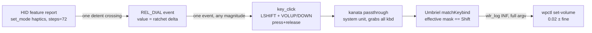

# Unit, lineage, and what the logs can say

Focused slice of the [precision-layers brief](/design/surface-dial-layers/brief0.gpt61s.md): identify the actually-running Surface Dial daemon (unit, build, source, config), inventory its logging and Umbriel's, define increment semantics precisely, and propose the smallest useful observability change. Everything here is read-only observation of an idle system plus source reading; no service was touched, no device opened, no input injected, and no live bug is theorized. The dial was observed disconnected at the end of the session (journal `Dial Disconnected` at 21:47:33, then `haptics worker is waiting...`) — recorded as state, not diagnosed.

## What is actually running

The unit is bare. `~/.config/systemd/user/surface-dial.service` (via `systemctl --user cat`) contains only `ExecStart=%h/.cargo/bin/surface-dial-daemon` with journald output; `DropInPaths=` and `Environment=` are empty (`systemctl --user show`), `Restart=no`. MainPID 1216858 started 2026-10-05 14:42:52 EDT, cwd `/home/rektide`, argv is the bare binary — no flags exist to pass anyway (see lineage below). The unit is the upstream-shipped one, copied by [install-user.sh](/surface-dial.src.pb) from the checkout's `install/surface-dial.service`.

Binary identity, all three install paths agree:

| Path | Identity |
|---|---|
| `/home/rektide/.cargo/bin/surface-dial-daemon` (what the unit runs, `/proc/1216858/exe`) | sha256 `92742cd927f1c0ac0bbcc78258b735784c414530976578ce49f959a6222bf049`, BuildID `3e5873d51b2252c9703739393747cf8840308c45`, mtime 2025-05-03 19:26 EDT, ELF x86-64 not stripped |
| `/usr/local/src/surface-dial-git/target/release/surface-dial-daemon` | same sha256 (build product) |
| `/usr/local/bin/surface-dial-daemon` | symlink to the above (from install-daemon.sh) |

**The running daemon is a build of upstream `daniel5151/surface-dial-linux` @ `43dd973` (2021-05-24), not the local fork.** Evidence: the managed checkout `/usr/local/src/surface-dial-git` sits clean at `43dd973` with only compfuzor-added `bin/`, `env*`, `repo/` files ([surface-dial.src.pb](/surface-dial.src.pb)); the binary mtime (2025-05-03) predates every fork commit (2025-12-11); and `strings` on the binary finds no `notification-timeout`/clap argument strings, which the fork's four commits (`f0d17fa`..`deb8fee`: configurable timeouts + notifications) would embed. The [fork](https://github.com/daniel5151/surface-dial-linux) checkout at `/home/rektide/src/surface-dial-linux` is ahead but undeployed.

`/home/rektide/src/surface-dial-layered` — the repo named for this effort — has `src/` byte-identical to the deployed upstream tree (verified `diff -rq`), a jj history of `Add comprehensive config-control state reference document` then today's `bd init: initialize beads issue tracking`, plus February-dated [`doc/discovery/`](https://github.com/daniel5151/surface-dial-linux) state-analysis docs and `notes/` HID descriptor dumps. It is a clean staging copy of deployed behavior, pre-registered for the layered work; its `AGENTS.md` is a one-line include of rekon's.

Runtime config is one integer: `~/.config/surface-dial-daemon/config.txt` contains `5`, mtime 2026-02-27 — the persisted last mode, which per [main.rs](https://github.com/daniel5151/surface-dial-linux/blob/43dd973092871d8ef0c452b0797b519f5a9ddfac/src/main.rs#L77-L92) indexes the mode list: 0 Scroll, 1 ScrollMT, 2 Zoom, **3 Volume, 4 Media, 5 Media+Volume**, 6 Paddle. So the live mode is Media+Volume. (The layered repo's discovery summary claims a `com.prilik.surface-dial-daemon` config path; the `directories` crate actually yields `~/.config/surface-dial-daemon/` — a small doc correction worth making there.)

## Increment semantics, end to end



Each layer's exact contribution, from the deployed source:

- **Detent granularity**: [ControlModeMeta](https://github.com/daniel5151/surface-dial-linux/blob/43dd973092871d8ef0c452b0797b519f5a9ddfac/src/controller/mod.rs#L9-L16) for Volume and Media+Volume sets `steps: 36 * 2` = 72 subdivisions per revolution (5°/detent). [`set_mode`](https://github.com/daniel5151/surface-dial-linux/blob/43dd973092871d8ef0c452b0797b519f5a9ddfac/src/dial_device/haptics.rs#L103-L125) sends this as a HID feature report (ID 1, steps lo/hi, auto-trigger `0x03` when haptics on) to `045e:091b`; the doc comment allows 0–3600 (down to 0.1°). MetaMode re-sets 36 on entry, and every mode entry or reconnect re-sends the active mode's value.
- **Event rate**: [`from_raw_evt`](https://github.com/daniel5151/surface-dial-linux/blob/43dd973092871d8ef0c452b0797b519f5a9ddfac/src/dial_device/mod.rs#L157-L180) turns each `REL_DIAL` evdev event into `DialEventKind::Dial(value)`. During fast spins the hardware presumably coalesces detents into one event with |value| > 1 — **unknown, because nothing logs the value** (see gaps).
- **Chord emission**: [Volume::on_dial](https://github.com/daniel5151/surface-dial-linux/blob/43dd973092871d8ef0c452b0797b519f5a9ddfac/src/controller/controls/volume.rs#L35-L45) and [MediaWithVolume::on_dial](https://github.com/daniel5151/surface-dial-linux/blob/43dd973092871d8ef0c452b0797b519f5a9ddfac/src/controller/controls/media_with_volume.rs#L93-L107) test only `delta > 0` and emit exactly **one** `key_click(&[KEY_LEFTSHIFT, KEY_VOLUMEUP/DOWN])` per event, regardless of magnitude. `key_click` (in [fake_input.rs](https://github.com/daniel5151/surface-dial-linux/blob/43dd973092871d8ef0c452b0797b519f5a9ddfac/src/fake_input.rs#L149-L182)) is press, SYN, release, SYN — a full discrete chord with `TimeVal::new(0,0)` timestamps — on the uinput node named "Surface Dial Virtual Keyboard/Mouse".
- **Action selection**: Umbriel (running `0.1.0` @ `51e6528`) matches on the seat-wide OR of keyboard modifiers ([handleKey](https://github.com/noctalia-dev/umbriel/blob/51e6528ecf3d787531d9f8e536df24196edea17d/src/input/keyboard.cpp#L247-L264), [keyboardModifiers](https://github.com/noctalia-dev/umbriel/blob/51e6528ecf3d787531d9f8e536df24196edea17d/src/server/server_keybinds.cpp#L267-L275)), so the dial's own synthetic Shift selects the *fine* binding. The generated bindings on disk confirm the step vocabulary from [media-keys.etc.pb](/media-keys.etc.pb): plain `XF86AudioRaiseVolume` → `wpctl … 0.06+` (with `-l 1.0`), `Shift+XF86AudioRaiseVolume` → `0.02+` (same for down, sans `-l`). Since the dial always sends Shift, **a dial tick is always the fine 0.02 action today; the coarse 0.06 action is reachable only from Shift-less emitters**.

So "smaller dial tick increment" decomposes into three independent knobs: the daemon's `steps` (haptic detent angle), the daemon's per-event chord policy (currently 1 chord/event, magnitude ignored), and the producer's step amounts (0.02 fine / 0.06 coarse — a 3:1 ratio). And a keyboard-Shift precision layer has a hard prerequisite visible right here: the daemon reads only its own two dial event nodes ("Surface Dial System Control" / "… Multi Axis", [events.rs](https://github.com/daniel5151/surface-dial-linux/blob/43dd973092871d8ef0c452b0797b519f5a9ddfac/src/dial_device/events.rs#L55-L66)) — it has no notion of external modifier state at all.

## What the logs can and cannot show

Daemon logging is bare `eprintln!`/`println!` to the journal (no tracing, no levels, no `RUST_LOG`). Complete inventory of the deployed build's output lines:

| Journal line | Emitted when | Shows |
|---|---|---|
| `Started` | daemon start | liveness |
| `Dial Connected` / `Dial Disconnected` | udev add/remove of the dial nodes | connect state |
| `haptics worker is waiting...` / `... is ready` | HID worker idle/active | haptics thread state |
| `long press!` | 750ms hold | meta-mode entry |
| `volume up` / `volume down` | **once per Dial event** in modes 3 and 5 | direction, event count |
| `mute`, `play/pause`, `next track`, `next/last song`, `zoom in/out`, `scroll up/down` | other modes' actions | mode-identifying, but only in those modes |
| `received signal …`, error paths | shutdown/failure | lifecycle |

What this cannot show:

- **Active mode identity for volume chords.** Modes 3 (Volume) and 5 (Media+Volume) log the identical strings `volume up`/`volume down`. `config.txt` holds the last persisted mode but only changes on a meta-mode switch, and the mode-switch path itself journals nothing — `MetaMode` updates a D-Bus notification body ([controller/mod.rs](https://github.com/daniel5151/surface-dial-linux/blob/43dd973092871d8ef0c452b0797b519f5a9ddfac/src/controller/mod.rs#L190-L227)) and `common::action_notification` (the only `sending notification:` logger) has **zero callers** in this tree.
- **Delta magnitude.** The value is discarded by every volume-ish `on_dial`; detents-per-event during fast spins is unobservable.
- **`steps`/haptics values.** `set_mode` sends the HID report silently.
- **Injection success.** `on_dial`'s `Result` is `?`-propagated, so a failed write kills the daemon rather than logging — fine for failure, silent for success counts beyond the `volume up` line itself.
- **Physical keyboard Shift.** Nothing in this chain observes external modifiers; per the [prior assessment](/design/surface-dial-input/assessment0.gpt61s.md) Umbriel's *matcher* aggregates them, but no log distinguishes provenance.
- **Kanata passthrough.** The system `kanata` unit logs device discovery at INFO (109 lines today), not per-key events.

Umbriel is the strong half. Every fired binding spawns via a path that logs at INF with the **full argv**: `launch requested for ''wpctl' 'set-volume' '@DEFAULT_AUDIO_SINK@' '0.02+' '-l' '1.0''` ([server.cpp](https://github.com/noctalia-dev/umbriel/blob/51e6528ecf3d787531d9f8e536df24196edea17d/src/server/server.cpp#L998-L1006), `wlr_log(WLR_INFO, "launch requested for '%s' …")`). **Baseline-vs-finer selection is therefore already observable today** — the step amount in that line *is* the discriminator. The only invisible outcome is a cooldown-blocked fire ([executeKeybindAction](https://github.com/noctalia-dev/umbriel/blob/51e6528ecf3d787531d9f8e536df24196edea17d/src/server/server_keybinds.cpp#L104-L119) has a `cooldownMs` facility), but no installed binding sets a cooldown (verified by grep over `~/.config/umbriel/` and `/etc/opt/umbriel/`), so it is moot at present.

## Observed journal counts (not a diagnosis)

Counting existing journals on 2026-10-06, no reproduction attempted:

- Daemon: **1329** `volume …` lines (each = one injected chord).
- Umbriel: **143** `set-volume` launches the same day — all `0.02` (fine). Since Oct 1: 145 fine, **0** coarse. The collapse is burst-dependent: single spaced ticks fire 1:1 (21:45:56: 1 daemon line → 1 launch), while fast spins lose most chords (21:47:02–03: 49 daemon lines → 2 launches; 21:45:44–50 overall: 87 → 11).

This ratio is reported as an observation with localization explicitly unresolved. Ruled out: Umbriel's cooldown (nothing configures it; a blocked fire would still not log). Not ruled out, and not investigated further here: kanata's re-emission of rapid press/release cycles, libinput/wlroots duplicate-press handling (the daemon writes all events with zero timestamps, `TimeVal::new(0,0)` — noted as a fact, not a theory), or timing collapse elsewhere. Whichever it is, **the effective per-tick yield is already variable and sub-1:1**, which any "smaller increment" design must account for: finer steps multiply events that may not become actions.

## Exact non-disruptive observation commands

All read-only; none touch the unit, devices, or configs:

```sh
systemctl --user cat surface-dial.service                       # unit + (no) drop-ins
systemctl --user show surface-dial.service -p MainPID -p ExecStart -p Environment -p DropInPaths
readlink /proc/$(systemctl --user show -p MainPID --value surface-dial.service)/exe
journalctl --user -u surface-dial.service -f -o short-iso       # per-tick volume up/down
journalctl --user -u surface-dial.service --since today | grep -c 'volume'
journalctl --user -u umbriel --since today | grep 'set-volume'  # fired actions, full argv
journalctl --user -u umbriel --since 2026-10-01 | grep -c "'0.02"   # fine-selection count
journalctl --user -u umbriel --since 2026-10-01 | grep 'set-volume' | grep -vc "0.02"  # coarse count
journalctl -u kanata --since today | tail                       # discovery-level only
wpctl get-volume @DEFAULT_AUDIO_SINK@                           # end state, read-only
cat ~/.config/surface-dial-daemon/config.txt                    # persisted mode index
ls -l /dev/input/by-id/                                         # listing only; no device open
sha256sum ~/.cargo/bin/surface-dial-daemon                      # lineage pin
git -C /usr/local/src/surface-dial-git log --oneline -3
```

Deliberately avoided here: `evtest`/`libinput debug-events` (require opening/grabbing event nodes), `udevadm trigger`, any restart/reload, and environment dumps (the unit's `Environment=` was queried narrowly and is empty).

## Smallest useful observability change (proposal, no implementation)

Nothing needs to change on the Umbriel side — its launch lines already answer "which action fired, at what step". The gap is daemon-side, and the smallest change that closes the questions above is three log-line edits in [surface-dial-layered](https://github.com/daniel5151/surface-dial-linux) (the repo that exists for this work; deploy only after agreement, via the existing [surface-dial.src.pb](/surface-dial.src.pb) path):

1. **Mode-tag and delta in the four volume-ish sites** ([volume.rs](https://github.com/daniel5151/surface-dial-linux/blob/43dd973092871d8ef0c452b0797b519f5a9ddfac/src/controller/controls/volume.rs#L38-L44), [media_with_volume.rs](https://github.com/daniel5151/surface-dial-linux/blob/43dd973092871d8ef0c452b0797b519f5a9ddfac/src/controller/controls/media_with_volume.rs#L95-L104)): e.g. `eprintln!("media+volume up delta={}", delta)`. Makes active mode and per-event magnitude visible without any device capture, and lets journal counts separate events from detents.
2. **One line in the haptics worker's `SetMode` arm** ([haptics.rs](https://github.com/daniel5151/surface-dial-linux/blob/43dd973092871d8ef0c452b0797b519f5a9ddfac/src/dial_device/haptics.rs#L79-L87)): log `haptics={} steps={}` so detent-granularity changes are asserted at runtime, not assumed.
3. *(Optional, slightly larger)* one line in `MetaMode::on_btn_release`'s persistence path to journal mode switches with the new index/name.

That is the whole proposal: with (1)–(2) plus the already-sufficient Umbriel lines, every quantity in the increment chain — detents, events, chords, fired actions, step amounts — becomes countable from journals alone. A precision layer's selection (baseline vs finer vs keyboard-Shift-finer) would then be observable end-to-end the same way.

## Unresolved questions

- **Where do ~9/10 chords die?** Between the daemon's `volume up` line and Umbriel's launch line sit kanata (system unit, grabs all keyboards incl. the dial's virtual one) and the libinput/wlroots stack. Localizing needs either kanata at trace (a live config change, not done) or the daemon-side delta logging above plus a later controlled slow-vs-fast spin — the daemon log route needs no device access.
- **|delta| distribution**: how often fast spins coalesce detents into |value|>1 events. Unknown until (1) lands.
- **Terminology to fix with the user**: does "significantly smaller tick increment" mean detent angle (`steps`), chords per detent, the wpctl step (0.02 → ?), or all three — and what the new baseline:finer ratio should be (today 3:1 = 0.06:0.02, and the dial only ever uses the fine one).
- **Keyboard-Shift layer observability**: the daemon cannot see external modifiers at all (it opens only the dial's own nodes); the compositor-side/reserved-key/daemon-reads-modifier options are the sibling investigations' subject — this unit's finding is the constraint, not the choice.
- **The 21:47:33 disconnect**: routine power-off or a drop — journals alone cannot say; no action taken.
- **Fork disposition**: the `--notification-timeout` fork is built but undeployed; unrelated to precision, but it is the only existing daemon CLI/config hook a layered build could subsume.

## Cross-references

- [Precision-layers brief](/design/surface-dial-layers/brief0.gpt61s.md): parent intent this serves — smaller ticks, smaller ratio, keyboard-Shift layer, observability of selection.
- [Input assessment](/design/surface-dial-input/assessment0.gpt61s.md): Umbriel's modifier aggregation and the dial's synthetic Shift, verified against the same revisions cited here.
- [Dial diagnosis](/design/surface-dial/diagnosis0.glm53.md): the 2026-10-05 end-to-end fix and synthetic-chord probe this deployment still reflects.
- [media-keys producer](/media-keys.etc.pb): owns the 0.06/0.02 step amounts — the "ratio" knob.
- [surface-dial.src.pb](/surface-dial.src.pb): owns the managed checkout and install bins used by any future deploy.
- Layered repo `doc/discovery/config-control-state-{summary,reference}.md`: full state map of the daemon; its config-path claim is corrected above.
