# Unit, lineage, and what the logs can say — revision of unit0

This is the epistemic-precision revision of [unit0](/design/surface-dial-layers/unit0.glm53.md); the observations are unchanged, the claims about what they prove are narrowed. What changed:

1. **Lineage**: binary hashes prove artifact identity across install paths and that the running process executes that artifact; mapping the artifact to a source commit is strong inference, not a reproduced-build pin. Phrasing downgraded to "consistent with upstream `43dd973`".
2. **Log semantics**: the daemon's `volume up/down` lines are emitted *before* `key_click` — attempted chords, not proved injections. Umbriel's `launch requested`/`spawned` lines are logged in the parent *after* forking — dispatch requests for spawn-type bindings, not child exit, `wpctl` success, or any non-spawn binding kind. The count mismatch is an observational imbalance, not an established "9/10 chords die" or per-detent loss rate; confounds listed.
3. **Citations**: line anchors re-verified against the deployed commit (local checkout is clean at `43dd973`, so local line numbers are the commit's); local fork/staging docs now linked by `file:///` paths instead of bare upstream URLs.
4. **Proposal scope narrowed**: logging delta+mode makes *attempts* and *dispatch requests* countable; without dispatch-result/status and correlation IDs it proves neither completed writes nor successful actions.

All checks are read-only; no service touched, no device opened, no input injected, no live bug theorized. The dial was observed disconnected at session end (journal `Dial Disconnected` 21:47:33) — state, not diagnosis.

## What is actually running — and how far the proof goes

The unit is bare: `~/.config/systemd/user/surface-dial.service` (via `systemctl --user cat`) holds only `ExecStart=%h/.cargo/bin/surface-dial-daemon` with journald output; `DropInPaths=` and `Environment=` are empty, `Restart=no`. MainPID 1216858 started 2026-10-05 14:42:52 EDT, cwd `/home/rektide`, bare argv. It is the upstream-shipped unit, copied by [install-user.sh](/surface-dial.src.pb).

**Proven by hashes**: `/proc/1216858/exe` resolves to `/home/rektide/.cargo/bin/surface-dial-daemon`, sha256 `92742cd927f1c0ac0bbcc78258b735784c414530976578ce49f959a6222bf049`, BuildID `3e5873d51b2252c9703739393747cf8840308c45`, mtime 2025-05-03 19:26 EDT, ELF x86-64 not stripped. The same digest is at `/usr/local/src/surface-dial-git/target/release/surface-dial-daemon` (build product) and behind the `/usr/local/bin/surface-dial-daemon` symlink. One artifact, three paths, and the running process executes it.

**Inferred, not pinned**: that this artifact was built from upstream [`43dd973`](https://github.com/daniel5151/surface-dial-linux/tree/43dd973092871d8ef0c452b0797b519f5a9ddfac). The evidence — managed checkout clean at that commit with only compfuzor `bin/`+`env*` additions ([surface-dial.src.pb](/surface-dial.src.pb)); binary mtime predating every fork commit (2025-12-11); no `notification-timeout`/clap strings in the binary, which the fork's `f0d17fa`..`deb8fee` commits would embed — is **consistent with upstream 43dd973**, and no rebuild-and-compare was performed (a true pin would additionally need toolchain/`Cargo.lock` reproducibility assumptions). The undeployed fork lives at `/home/rektide/src/surface-dial-linux`; its `--notification-timeout` CLI hook does not exist in the running artifact.

`/home/rektide/src/surface-dial-layered` — the repo staged for this effort — has `src/` byte-identical to the deployed checkout (verified `diff -rq`; same inference class as above applies to *its* relationship to upstream). Its jj history adds the discovery docs then today's beads init; its `AGENTS.md` is a one-line include of rekon's. Local docs: [config-control-state-summary](file:///home/rektide/src/surface-dial-layered/doc/discovery/config-control-state-summary.md), [config-control-state-reference](file:///home/rektide/src/surface-dial-layered/doc/discovery/config-control-state-reference.md), and `notes/` HID descriptor dumps. One correction stands: that summary's `~/.config/com.prilik.surface-dial-daemon` path is wrong — the observed runtime file is `~/.config/surface-dial-daemon/config.txt`, currently `5` (mtime 2026-02-27), indexing the [mode list](https://github.com/daniel5151/surface-dial-linux/blob/43dd973092871d8ef0c452b0797b519f5a9ddfac/src/main.rs#L74-L92) to **Media+Volume** (0 Scroll, 1 ScrollMT, 2 Zoom, 3 Volume, 4 Media, 5 Media+Volume, 6 Paddle).

## Increment semantics, end to end

```mermaid
flowchart LR
    hid[HID feature report\nset_mode haptics, steps=72] -->|one detent crossing| rel[REL_DIAL event\nvalue = ratchet delta]
    rel -->|one event, any magnitude| logT["eprintln volume up/down\nATTEMPT marker"]
    logT --> chord[key_click\nLSHIFT + VOLUP/DOWN\npress+release]
    chord --> kan[kanata passthrough\nsystem unit, grabs all kbd]
    kan --> umb[Umbriel matchKeybind\neffective mask == Shift]
    umb -->|post-fork wlr_log INF, full argv| wpctl["wpctl dispatch requested\n0.02 ± fine"]
```



- **Detent granularity**: [ControlModeMeta](https://github.com/daniel5151/surface-dial-linux/blob/43dd973092871d8ef0c452b0797b519f5a9ddfac/src/controller/mod.rs#L8-L16) for Volume and Media+Volume sets `steps: 36 * 2` = 72 subdivisions/revolution (5°/detent). The worker's [`set_mode`](https://github.com/daniel5151/surface-dial-linux/blob/43dd973092871d8ef0c452b0797b519f5a9ddfac/src/dial_device/haptics.rs#L89-L109) builds an 8-byte feature report and [`send_feature_report`](https://github.com/daniel5151/surface-dial-linux/blob/43dd973092871d8ef0c452b0797b519f5a9ddfac/src/dial_device/haptics.rs#L105)s it to HID `045e:091b`; the doc comment allows 0–3600 (down to 0.1°). MetaMode re-sets 36 on entry; every mode entry or reconnect re-sends the active mode's value.
- **Event rate**: [`from_raw_evt`](https://github.com/daniel5151/surface-dial-linux/blob/43dd973092871d8ef0c452b0797b519f5a9ddfac/src/dial_device/mod.rs#L147-L180) maps each [`REL_DIAL`](https://github.com/daniel5151/surface-dial-linux/blob/43dd973092871d8ef0c452b0797b519f5a9ddfac/src/dial_device/mod.rs#L161) evdev event to `DialEventKind::Dial(value)`. Whether fast spins coalesce detents into |value|>1 events is **unknown — nothing logs the value**.
- **Chord emission**: [Volume::on_dial](https://github.com/daniel5151/surface-dial-linux/blob/43dd973092871d8ef0c452b0797b519f5a9ddfac/src/controller/controls/volume.rs#L36-L46) and [MediaWithVolume::on_dial](https://github.com/daniel5151/surface-dial-linux/blob/43dd973092871d8ef0c452b0797b519f5a9ddfac/src/controller/controls/media_with_volume.rs#L95-L105) test only `delta > 0` and emit **one** `key_click(&[KEY_LEFTSHIFT, KEY_VOLUMEUP/DOWN])` per event regardless of magnitude — the log line [preceding](https://github.com/daniel5151/surface-dial-linux/blob/43dd973092871d8ef0c452b0797b519f5a9ddfac/src/controller/controls/volume.rs#L38-L43) the call. [`key_click`](https://github.com/daniel5151/surface-dial-linux/blob/43dd973092871d8ef0c452b0797b519f5a9ddfac/src/fake_input.rs#L149-L154) is [`key_press`](https://github.com/daniel5151/surface-dial-linux/blob/43dd973092871d8ef0c452b0797b519f5a9ddfac/src/fake_input.rs#L155) then [`key_release`](https://github.com/daniel5151/surface-dial-linux/blob/43dd973092871d8ef0c452b0797b519f5a9ddfac/src/fake_input.rs#L170-L183) — a full discrete chord with `TimeVal::new(0,0)` timestamps on the uinput node "Surface Dial Virtual Keyboard/Mouse".
- **Action selection**: Umbriel (running `0.1.0` @ `51e6528`) matches on the seat-wide OR of modifiers ([`handleKey`](https://github.com/noctalia-dev/umbriel/blob/51e6528ecf3d787531d9f8e536df24196edea17d/src/input/keyboard.cpp#L241-L264), [`keyboardModifiers`](https://github.com/noctalia-dev/umbriel/blob/51e6528ecf3d787531d9f8e536df24196edea17d/src/server/server_keybinds.cpp#L267-L275)), so the dial's own synthetic Shift selects the *fine* binding. Generated bindings on disk match [media-keys.etc.pb](/media-keys.etc.pb): plain `XF86AudioRaiseVolume` → `wpctl … 0.06+` (`-l 1.0`), `Shift+…` → `0.02±`. **A dial tick always aims at the fine 0.02 action; coarse 0.06 is reachable only from Shift-less emitters.**

So "smaller dial tick increment" decomposes into independent knobs: daemon `steps` (detent angle), per-event chord policy (currently 1/event, magnitude ignored), and producer step amounts (0.02/0.06 — the 3:1 ratio). A keyboard-Shift precision layer has a prerequisite visible here: the daemon opens only the dial's own two nodes ([events.rs](https://github.com/daniel5151/surface-dial-linux/blob/43dd973092871d8ef0c452b0797b519f5a9ddfac/src/dial_device/events.rs#L52-L66), "Surface Dial System Control"/"… Multi Axis") — it has no notion of external modifier state.

## What the logs can and cannot show

Daemon logging is bare `eprintln!`/`println!` (no levels, no `RUST_LOG`). Inventory of the deployed build's lines, with what each *actually* proves:

| Journal line | Emitted when | Proves |
|---|---|---|
| `Started` | daemon start | liveness |
| `Dial Connected` / `Dial Disconnected` | udev add/remove | connect state |
| `haptics worker is waiting...` / `... is ready` | HID worker idle/active | haptics thread state |
| `long press!` | 750ms hold | meta-mode entry |
| `volume up` / `volume down` | per Dial event, **before** `key_click` | an attempt to inject one chord |
| `mute`, `play/pause`, `next track`, `next/last song`, `zoom in/out`, `scroll up/down` | other modes | same attempt semantics in those modes |
| `received signal …`, error paths | shutdown/failure | lifecycle |

The attempt/prove distinction has one useful corollary: `on_dial`'s `Result` is `?`-propagated, so a `key_click` write error would terminate the daemon (main's error path exits) — continued liveness is weak evidence that each write call returned `Ok`. It is not evidence the event was delivered or consumed downstream. Cannot show:

- **Active mode identity for volume chords** — modes 3 and 5 log identical strings; `config.txt` only changes on a persisted meta-mode switch, and that path journals nothing ([MetaMode::on_btn_release](https://github.com/daniel5151/surface-dial-linux/blob/43dd973092871d8ef0c452b0797b519f5a9ddfac/src/controller/mod.rs#L188-L208) persists silently; `common::action_notification`, the only `sending notification:` logger, has zero callers in this tree).
- **Delta magnitude**, **`steps` values**, **injection delivery**, **kanata transit**, **physical keyboard Shift** (nothing in the chain observes external modifiers), and — at kanata — per-key passthrough (system `kanata` logs discovery at INFO only, 109 lines today).

Umbriel's contribution is a *dispatch-request* log, and only for spawn-type bindings: after the fork, the parent emits [`launch requested for '%s'`](https://github.com/noctalia-dev/umbriel/blob/51e6528ecf3d787531d9f8e536df24196edea17d/src/server/server.cpp#L999-L1006) (scope path) or [`spawned '%s'`](https://github.com/noctalia-dev/umbriel/blob/51e6528ecf3d787531d9f8e536df24196edea17d/src/server/server.cpp#L1007-L1011) with the full argv at INF. That makes **which spawn action was dispatched, at which step amount, observable today** — the `0.02` vs `0.06` string is the discriminator. It does *not* show: child exit status or `wpctl` success, bindings handled internally (submap pushes, overview, focus-style actions), or fires blocked by the [`cooldownMs`](https://github.com/noctalia-dev/umbriel/blob/51e6528ecf3d787531d9f8e536df24196edea17d/src/server/server_keybinds.cpp#L104-L119) facility — moot today only because no installed binding sets one (verified by grep over `~/.config/umbriel/` and `/etc/opt/umbriel/`).

## Observed journal counts: an imbalance, with confounds

Counting existing journals on 2026-10-06 (no reproduction attempted): **1329** daemon `volume …` attempt-lines vs **143** Umbriel `set-volume` dispatch lines; all dispatched were `0.02` (since Oct 1: 145 fine, 0 coarse). Burst-dependent: spaced ticks pair 1:1 (21:45:56), fast spins show large gaps (21:47:02–03: 49 daemon lines → 2 dispatches; 21:45:44–50: 87 → 11).

This is **an observational imbalance between two differently-shaped log points, not an established chord-death rate**. What the two counts respectively measure differs (pre-write attempts vs post-fork dispatch requests), and open confounds include:

- **Journal rate limiting**: the daemon emits up to ~27 lines/s in bursts; journald per-service rate limiting could suppress either side's lines, in either direction.
- **Window and grep matching**: substring greps (`volume`, `set-volume`) and second-aligned windows are proxies; boundary lines and unrelated matches/skews shift the totals.
- **Correlation**: nothing ties a daemon line to a dispatch line — pairing is by timestamp proximity only, and both timestamps are journald *receipt* times.
- **Source attribution**: without IDs, coincidence (e.g., non-dial volume key use) cannot be excluded from the Umbriel side.

No localization was attempted. Umbriel cooldown is ruled out (unconfigured); kanata re-emission, libinput/wlroots handling of rapid full press/release cycles (the daemon writes zero timestamps — noted as fact, not theory), and other points remain unexamined. The design-relevant statement is the modest one: **the effective per-tick yield is variable and not 1:1**, so finer steps may multiply events that do not become actions — quantify before designing.

## Exact non-disruptive observation commands

All read-only; none touch the unit, devices, or configs:

```sh
systemctl --user cat surface-dial.service                       # unit + (no) drop-ins
systemctl --user show surface-dial.service -p MainPID -p ExecStart -p Environment -p DropInPaths
readlink /proc/$(systemctl --user show -p MainPID --value surface-dial.service)/exe
journalctl --user -u surface-dial.service -f -o short-iso       # per-tick attempt lines
journalctl --user -u surface-dial.service --since today | grep -c 'volume'
journalctl --user -u umbriel --since today | grep 'set-volume'  # dispatch requests, full argv
journalctl --user -u umbriel --since 2026-10-01 | grep -c "'0.02"    # fine-dispatch count
journalctl --user -u umbriel --since 2026-10-01 | grep 'set-volume' | grep -vc "0.02"  # coarse count
journalctl -u kanata --since today | tail                       # discovery-level only
wpctl get-volume @DEFAULT_AUDIO_SINK@                           # end state, read-only
cat ~/.config/surface-dial-daemon/config.txt                    # persisted mode index
ls -l /dev/input/by-id/                                         # listing only; no device open
sha256sum ~/.cargo/bin/surface-dial-daemon                      # artifact pin
git -C /usr/local/src/surface-dial-git log --oneline -3
```

Deliberately avoided: `evtest`/`libinput debug-events` (device open/grab), `udevadm trigger`, restarts/reloads, environment dumps (the unit's `Environment=` was queried narrowly and is empty).

## Smallest useful logging-first slice (proposal, no implementation) — and its limits

Umbriel needs nothing: its dispatch lines already answer "which spawn action, at what step" (with the request-not-completion caveat above). The daemon-side slice, in [surface-dial-layered](file:///home/rektide/src/surface-dial-layered) (deploy only after agreement, via [surface-dial.src.pb](/surface-dial.src.pb)):

1. **Mode-tag and delta at the four volume-ish sites** ([volume.rs](https://github.com/daniel5151/surface-dial-linux/blob/43dd973092871d8ef0c452b0797b519f5a9ddfac/src/controller/controls/volume.rs#L36-L46), [media_with_volume.rs](https://github.com/daniel5151/surface-dial-linux/blob/43dd973092871d8ef0c452b0797b519f5a9ddfac/src/controller/controls/media_with_volume.rs#L95-L105)): e.g. `eprintln!("media+volume up delta={}", delta)` — and, ideally, moved *after* the `key_click` call so the line marks a returned-Ok write rather than an attempt.
2. **One line in the haptics worker's `SetMode` arm** ([haptics.rs](https://github.com/daniel5151/surface-dial-linux/blob/43dd973092871d8ef0c452b0797b519f5a9ddfac/src/dial_device/haptics.rs#L79-L87)) logging `haptics={} steps={}`.
3. *(Optional)* one line journaling mode switches at the persistence site.

**What this makes countable**: attempted (or, with the reorder, returned-Ok) chords with mode and magnitude, detent-granularity changes, and dispatched spawn actions with argv. **What it still does not prove**: uinput delivery to consumers, kanata transit, compositor match attempts (matched-but-internal, unmatched, or blocked), child exit status, or any end-to-end completion. Proving those needs the explicitly-larger follow-on — a correlation ID threaded from daemon event through to a dispatch-result log — which is out of this slice and noted as the named next step, not slipped in.

## Unresolved questions

- **The imbalance**: localize or explain the attempt/dispatch gap (kanata trace is a live config change; the daemon logging above plus a later controlled slow-vs-fast spin is the no-device-access route). Until then, no loss-rate claim.
- **|delta| distribution** (detent coalescing during fast spins) — unknown until (1) lands.
- **Terminology with the user**: detent angle (`steps`), chords per detent, wpctl step (0.02 → ?), and the target baseline:finer ratio (today 3:1, dial only ever uses fine).
- **Artifact pin** (optional): a rebuild-and-compare against `43dd973` would upgrade the lineage inference to proof, with toolchain/lockfile caveats.
- **Keyboard-Shift layer observability**: the daemon cannot see external modifiers (constraint established here; the compositor-side/reserved-key/daemon-reads-modifier choice belongs to the sibling investigations).
- **The 21:47:33 disconnect**: routine or drop — journals cannot say; no action taken.

## Cross-references

- [unit0 predecessor](/design/surface-dial-layers/unit0.glm53.md): same observations, pre-correction claims; preserved in history.
- [Precision-layers brief](/design/surface-dial-layers/brief0.gpt61s.md): parent intent — smaller ticks, smaller ratio, keyboard-Shift layer, selection observability.
- [Input assessment](/design/surface-dial-input/assessment0.gpt61s.md): Umbriel modifier aggregation and the dial's synthetic Shift, same revisions.
- [Dial diagnosis](/design/surface-dial/diagnosis0.glm53.md): the 2026-10-05 fix and synthetic-chord probe this deployment still reflects.
- [media-keys producer](/media-keys.etc.pb): owns the 0.06/0.02 step amounts — the ratio knob.
- [surface-dial.src.pb](/surface-dial.src.pb): owns the checkout and install bins any deploy must flow through.
