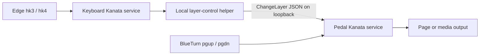
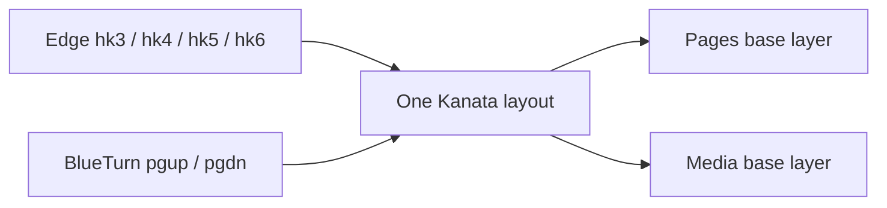

# Kinesis and BlueTurn — Kanata by example

The goal is to change what the **iRig BlueTurn pedals** do using keys on the
**Kinesis Freestyle Edge RGB**, while retaining Game Bank key **5 as Alt** and
key **6 as Windows/Super**. A second set of examples explores alternative
meanings for the Edge's SmartSet-programmed keys.

These are runnable alternatives, **not one combined deployment**. They do not
edit the current root playbooks or automatically stop existing services. Browse
the [Kinesis index](/kinesis/README.md) for entry points.

## The two configuration languages

SmartSet acts **inside the keyboard**, before USB events reach Linux. Kanata acts
**on the host**, after it receives those events.

```text
physical hk5 → SmartSet [hk5]>[f21] → USB F21 → Kanata f21 → lalt → application
```

`hk5` is a **SmartSet position**, not a Kanata key name. Kanata sees the keycode
assigned to that position, not the original position. Assign a **remap**, not a
recorded macro: holding/releasing the physical key must produce corresponding
F21 press/release events for a usable held modifier.

The Edge RGB is not the Freestyle 2. Its media keys do not need the Freestyle 2
[`kfreestyle2d` adapter](/kfreestyle2d.src.pb). The observed keyboard identity is
`Kinesis Freestyle Edge RGB Keyboard`, USB `29ea:0103`; its Consumer Control
node has a separate name and is left with the current main remapper.

Firmware-side SmartSet changes belong to `~/src/kinefolk` or manual Direct
Programming. **These playbooks never write the v-Drive.** Back up the active
profile first; merge these assignments rather than replacing unrelated remaps.
Remove any conflicting recorded macros: firmware macros can take priority over
remaps. Program the active hardware profile, and select that same profile when
testing.

### Common SmartSet contract

For current mediated modifiers and examples A/B:

```text
[hk3]>[f19]
[hk4]>[f20]
[hk5]>[f21]
[hk6]>[f22]
fn [hk3]>[f19]
fn [hk4]>[f20]
fn [hk5]>[f21]
fn [hk6]>[f22]
```

The `fn` lines keep these keys identifiable while the **hardware** Fn layer is
active. That hardware layer is independent of Kanata's layers. F19/F20 are
reserved here for pedal Pages/Media selection; F21/F22 retain Alt/Windows.

Open the v-Drive with **SmartSet+F8**, edit the active `layouts/layoutN.txt`,
save, safely unmount/eject it, then close it with **SmartSet+F8**. **SmartSet+
Profile** is the refresh shortcut. Close the v-Drive before testing remaps.
Repeat assignments only in hardware profiles you intend to use.

## A — separate devices, connected by TCP

Read the [TCP example notes](/kinesis/kanata/tcp-control/README.md).



The keyboard and pedal have independent layouts. A `(layer-switch media)` in
the keyboard process would change **only that process**; it cannot change the
pedal process. Instead, the helper sends a newline-terminated message to the
pedal's TCP server:

```json
{"ChangeLayer":{"new":"media"}}
```

Likewise, a `switch` condition in the pedal layout cannot inspect a modifier
held in the other Kanata process. Separate **layout state** does not mean
separate desktop output destinations: both still emit ordinary OS input. The
IPC message is what deliberately connects their internal layer state.

`ChangeLayer` sets the pedal's **base layer**, just as `layer-switch` does inside
a layout. `pages` is the reset target. In pages mode, left tap pages back and
left hold activates the existing play/pause overlay; in media mode, the pedals
become previous/next track.

The selector sets a named mode rather than toggling blindly: pressing Media
twice still leaves Media selected. This is persistent **within the running
process**, not saved hardware state; restarting/reloading the pedal config
returns to its first base layer, Pages.

Two keyboard trigger variants share the same pedal service:

| Playbook | Trigger path | Binary requirement |
|---|---|---|
| [keyboard.srv.pb](/kinesis/kanata/tcp-control/keyboard.srv.pb) | hk3/hk4 → `(cmd …)` → helper → TCP | `cmd`; explicit `danger-enable-cmd yes` |
| [keyboard-hotkeys.srv.pb](/kinesis/kanata/tcp-control/keyboard-hotkeys.srv.pb) | hk3/hk4 → F19/F20 → desktop shortcut → helper → TCP | Ordinary packaged binary works |
| [pedal.srv.pb](/kinesis/kanata/tcp-control/pedal.srv.pb) | Receives BlueTurn and TCP messages | `tcp_server`, with `--port` |
| [build.src.pb](/kinesis/kanata/tcp-control/build.src.pb) | Builds a separate binary for this example | Rust build prerequisites |

**Choose one keyboard trigger, not both.** The hotkey version requires explicit
desktop shortcut configuration; it is not a complete trigger until those binds
exist. The direct command version also works without a compositor, but grants
the keyboard configuration the ability to start subprocesses.

### Capability and sandbox boundary

On the inspected host, `/usr/bin/kanata` is **1.9.0** and its help does not expose
`--port`. Do not assume the distribution binary includes TCP or `cmd` support.
The build playbook keeps its binary separate from `/usr/bin/kanata`; verify the
result's `--help` and validate the cmd-enabled config before activation.

Source-level explanations were checked against the local upstream archive,
which reports **1.12.1-prerelease-1**, not the installed package. Linked `main`
documentation is mutable. The examples use conservative grammar checked with
the actual selected binary; feature/build requirements remain explicit.

TCP requires both services involved in IPC to share host loopback:
`PrivateNetwork=false`, `AF_INET` allowed, loopback allowed against an otherwise
deny-all IP policy. A private network namespace has its **own** loopback; binding
127.0.0.1 there would not make it reachable from the keyboard process or desktop.
The ordinary hotkey keyboard service needs no networking itself.

This endpoint is **unauthenticated local control**, not a secure public API.
Loopback avoids exposing it to other machines, but local processes can contact
it. `ChangeLayer` does not provide a success acknowledgement; successful sending
is not proof the named layer took effect. Query/log layer state when diagnosing.
No TCP port is opened by the current production playbooks.

## B — both devices feed one layout

Read the [merged example](/kinesis/kanata/merged/README.md) and
[keyboard-pedal.srv.pb](/kinesis/kanata/merged/keyboard-pedal.srv.pb).



Here the selector **is** a pure DSL action:

```lisp
(defalias
  pages (layer-switch pages)
  media (layer-switch media)
)
```

Both devices enter the same state machine, so a keyboard selector directly
changes the layer used for subsequent pedal presses. No socket, subprocess,
desktop shortcut, or feature-enabled build is needed.

**The cost is shared identity.** The keyboard's physical PgUp/PgDn keys and the
pedal's PgUp/PgDn are the same columns. Media mode changes **both** to track
controls. Pages mode gives keyboard PgUp the pedal's tap/hold behavior too.
Timing/history state is shared as well. This is why B is an alternative rather
than an automatic improvement over A.

Two layouts sharing input does not make Alt/Windows a layer selector: hk5/hk6
remain real output modifiers in A/B. hk3/hk4 are the explicit mode selectors.
Changing the mode doesn't require holding an OS modifier down.

An ordinary keyboard emitting another input mode does not automatically solve
this: switching the BlueTurn to up/down would merely collide with keyboard
arrow keys instead. Without device-aware mapping, genuinely unused keycodes or
an upstream translation step are needed to avoid collisions.

## SmartSet alternatives — a focused DSL ladder

See the [SmartSet example notes](/kinesis/kanata/smartset/README.md). Each of these
owns only the Edge keyboard node and is an alternative to current
[`kinata.srv.pb`](/kinata.srv.pb).

| Alternative | Firmware assignments | Kanata behavior | What it teaches |
|---|---|---|---|
| [native.srv.pb](/kinesis/kanata/smartset/native.srv.pb) | hk5 → LALT; hk6 → LWIN | Pass modifiers through; keep caps remap | Firmware/host ownership boundary |
| [one-shot.srv.pb](/kinesis/kanata/smartset/one-shot.srv.pb) | hk5 → F21; hk6 → F22 | Tap for next-key Alt/Windows; hold for normal modifier | `defvar`, aliases, one-shot lifetime |
| [command-layer.srv.pb](/kinesis/kanata/smartset/command-layer.srv.pb) | hk1..8 → F13..F16, F21..F24 | Hold hk7 for editing shortcuts/macro; hk5/hk6 remain Alt/Windows | Momentary layers, transparency, `macro` |

Native passthrough works without Kanata for those modifiers, but the keyboard's
Game Mode can suppress its Windows actions. Mediated mapping has the opposite
tradeoff: the host produces Windows/Super, but without the host remapper those
keys produce F21/F22—not the desired modifiers.

### Read a Kanata expression from the outside inward

```lisp
(defvar timeout 1000)
(defalias alt-next (one-shot $timeout lalt))
(defsrc f21)
(deflayer base @alt-next)
```

- `defsrc` declares the intercepted keycode and its position in positional layers.
- `deflayer` puts an **action** at each position; whitespace is just formatting.
- `@alt-next` names a parsed action, not a user function call.
- `$timeout` substitutes config data at load time, not mutable runtime state.
- `(one-shot 1000 lalt)` is a configured behavior: release it and Alt remains
  armed for the next key until its timeout. Holding it behaves as a held modifier.

The examples set `process-unmapped-keys yes`: ordinary typing still passes
through, but those presses are visible to the state machine even when not
listed in `defsrc`. That matters when a letter must consume a one-shot modifier
or influence a tap/hold decision. `defsrc` isn't a device filter—the `linux-dev`
options choose devices.

“Next key” means a key observed by **this instance**. An Edge-only one-shot
cannot use a press from the independently owned BlueTurn to end its one-shot
state. The merged B layout can observe both; that's another consequence of its
shared state, separate from the PgUp/PgDn collision.

All definitions are not evaluated in file order like ordinary Lisp code:
Kanata processes definition categories in load-time passes. **Alias-to-alias
dependencies still require the referenced alias to be declared earlier.**

### Base layers versus held overlays: the `_` trap

`layer-switch` changes the persistent **base**. `layer-while-held` adds a temporary
layer above that base. Its older synonym `layer-toggle` is **not a latching
toggle**. A one-shot can keep an action armed for a following press.

By default, `_` searches downward through held layers, then the base layer, then
`defsrc`. It does **not** mean “keep whatever the first layer does” when it appears
on a different switched base layer. `delegate-to-first-layer yes` changes that
fallback policy, but these examples don't rely on it.

Consequently, example B repeats caps, selectors, and F21/F22 modifiers in both
`pages` and `media`. Otherwise a `_` in the media base could send raw **F21**
instead of Alt! The command-layer example deliberately uses `_` in its **held
overlay**, where falling through to its base is exactly the desired behavior.

`XX` discards a key; `use-defsrc` explicitly emits the original input key.

### Modifier, chord, sequence

```lisp
lalt                     ;; held modifier, released with the physical key
C-c                      ;; Ctrl+C shortcut
(multi lalt lmet)         ;; simultaneous held actions
(macro h e l l o)         ;; ordered taps: a sequence, not five held letters
(macro C-s 100 C-w)       ;; save, wait 100ms, close — example only
```

Don't use `(macro lalt)` to implement a modifier key: it taps rather than
maintaining the hold needed to chord with other keys. Numbers **inside `macro`**
are delays, not literal digits; elsewhere their meaning comes from that action's
parameter grammar.

## Render and inspect without taking over input

Run from the Compfuzor checkout root so plugin discovery and the scratch profile
resolve consistently:

```sh
ansible-playbook kinesis/kanata/merged/keyboard-pedal.srv.pb --syntax-check
ansible-playbook -i 'localhost,' -c local \
  kinesis/kanata/merged/keyboard-pedal.srv.pb \
  -e @kinesis/kanata/shared/render-only.yaml
```

Compfuzor's existing task/lookup machinery expects root `vars`, `files`, and
`roles` resources beside the playbook. The example directories expose those
through small relative resource symlinks; they reuse the toolkit, not copies of
its templates or a second set of defaults. Do not remove those links when
copying an example directory into another checkout.

The [render-only profile](/kinesis/kanata/shared/render-only.yaml) directs
artifacts into `.test-agent/kinesis-kanata/render/` and disables packages,
checkouts, kernel modules, host/global link installation, bin execution, and service
activation. It keeps system-unit semantics rather than changing them to user
services. It still reads normal host facts and can create internal hierarchy
symlinks within scratch as part of materialization.

Inspect the generated `etc/kanata.kbd`, service unit, and install scripts.
Validate generated config with `kanata --check --cfg PATH`; the direct-cmd
example needs the feature-enabled binary even for parsing. Syntax-check alone
does not validate Kanata grammar or the rendered unit's sandbox.

Normal rendering outside this profile writes the declared host artifact paths.
Example units are **link-only** (`SYSTEMD_ENABLE=false`) and have unique names,
but installing the `kanata` package on a fresh machine can enable the packaged
main service. Review generated installers before running them.

## Deliberate variant switching

The current files/services are left in place. Never run two competing consumers
of the same evdev keyboard node. Ensure you have an unaffected input device or
another session available before experimenting.

| Selected example | Stop while testing | Keep |
|---|---|---|
| A | Current `kanata-kinata`, `kanata-blueturn`; other competing examples | Main `kanata` with its current exclusions |
| B | Current `kanata-kinata`, `kanata-blueturn`; all A services | Main `kanata` with its current exclusions |
| SmartSet alternatives | Current `kanata-kinata`; other Edge examples | Main `kanata`, current `kanata-blueturn` |

The “keep Main” column requires its **live** configuration to exclude the
devices claimed by the alternative. The checked-in [main playbook](/kanata.srv.pb)
already declares those exclusions, but they do not affect a running daemon
until deployed and reloaded/restarted as appropriate. Check its registration
logs and active config first. If the live exclusions aren't in place, either
deliberately apply that prerequisite or temporarily stop main too during the
test (which also removes its remapping of other keyboards). These alternatives
do not silently perform that takeover.

Inspect actual unit names and grabs on the host first; a root playbook being
present doesn't prove its service was deployed. For temporary testing, stop
the conflicting units, start **only** the chosen alternative, and reverse those
operations when finished. For a persistent selection, explicitly review which
services are enabled for boot. No automatic pruning/reconciliation is included.

The shared system services also require the package-provided **static**
`_kanata` user/group and the `input` group. A private source-built executable
doesn't create those accounts. Check before activation:

```sh
getent passwd _kanata
getent group _kanata
getent group input
```

Keep the examples' default virtual output name **`kanata`**. Upstream Linux
auto-detection explicitly skips that name; giving an example a custom output
name can cause the current broad-auto-detect main daemon to grab it and apply
another mapping pass. Unique service names provide log separation without
changing that input-isolation contract.

A switch affects **subsequent presses**. Release the pedals before selecting a
different base: an already-held key has already activated its old action, and a
held overlay can still sit above the new base.

### Acceptance checks with the hardware

1. Verify the active SmartSet profile emits the intended F-key **press and release**.
2. Hold hk5 while pressing Tab: it should behave as Alt+Tab. Check hk6 with a
   desktop Super shortcut. In the one-shot variant, also test tap→next key and
timeout expiration.
3. In A/B, choose Pages with hk3 and test both pedals; choose Media with hk4 and
   test previous/next; switch back. In A check the **pedal service's** layer log.
4. In B, deliberately test the keyboard's PgUp/PgDn to experience the collision.
5. Check reconnect behavior: the exact-name filters should reacquire devices
   after event node numbers change.

The BlueTurn playbook documents a **kernel short-report issue** that can prevent
events arriving at all. These examples do not repair that transport failure.
Separate “input never arrives” from “wrong layer selected”; consult the research
below before interpreting an unresponsive pedal as a DSL failure.

## Cross-references

- [Compfuzor architecture](/doc/arch.md): explains why playbooks declare
  artifacts while apply/install operations remain separate; the scratch profile
  and link-only units exercise that boundary.
- [Systemd generation](/skill/systemd.md#enable-vs-start-systemd_enable--systemd_start):
  documents the enable/start switches and generated install scripts used here.
- [Current BlueTurn investigation](/design/blueturn/blueturn-linux-research.general.md):
  prior input-transport evidence, hardware modes, and kernel report-drop caveat.
- [Short-report kernel follow-up](/design/blueturn/kernel-uhid-shortreport.general.md):
  supporting investigation; not a layer-control mechanism.
- [Kanata layer guide](https://github.com/jtroo/kanata/blob/main/docs/config.adoc#transparent-key):
  the authoritative fallback semantics behind the explicit mappings in B.
- [Kanata minimal sample](https://github.com/jtroo/kanata/blob/main/cfg_samples/minimal.kbd):
  the same tap/hold→momentary-layer shape used by the current pedal config.
- [Kinesis RGB support](https://gaming.kinesis-ergo.com/fs-edge-rgb-support/):
  firmware/profile mechanics and the Direct Programming Guide, distinct from
  Kanata's own DSL.
- [Optional v-Drive mount playbook](/kinesis.etc.pb): declares the keyboard's
  removable configuration-volume mount (default `/mnt/kinesis`); deploying
  that machinery is separate from editing native SmartSet assignments.

## Worth exploring next — not implemented here

- A TCP `ActOnFakeKey`/virtual-key press-release bridge for a **held** remote
  pedal layer. It needs release/disconnect handling, not just a sticky switch.
- Layer indicators in the desktop, using the pedal's TCP notifications rather
  than guessing its state from the most recent keyboard shortcut.
- Matching a recorded input trace to expected output events in Kanata's
  simulator, including “switch while pedal held” and one-shot timeout cases.
- A firmware contract generated/exported by kinefolk so host examples can
  declare their expected F-key assignments without owning native programming.
