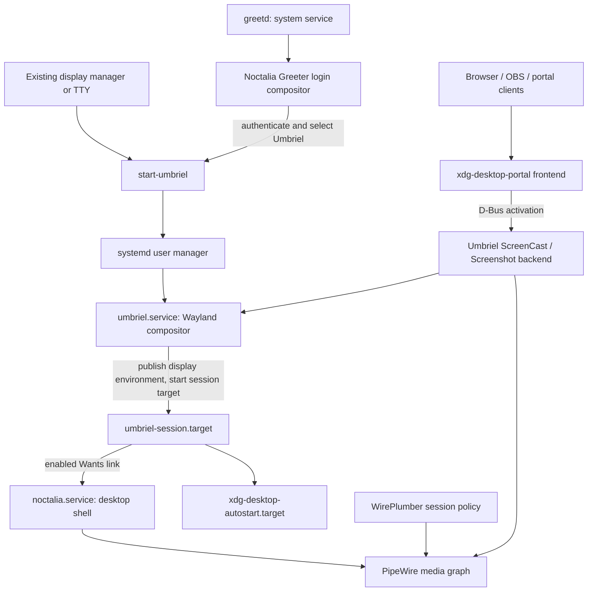

# Noctalia desktop: architecture and operations

This is the end-to-end guide for the **Noctalia v5 + Umbriel** desktop in
Compfuzor. Start here to understand the pieces, install them, choose a login
route, and operate the session. Per-deployment generated READMEs describe local
scripts; this guide explains how those deployments fit together.

**Default operational posture:** build/install the components, link the shell's
user unit, then deliberately enable shell autostart after resolving competing
desktop services. Greeter setup and display-manager cutover remain manual.
Neither installation nor this guide silently switches the running desktop.

## 1. Pieces and ownership

| Piece | Owns | Compfuzor entry |
|---|---|---|
| **Umbriel** | Wayland display server, windows/workspaces, input, compositor IPC, desktop session lifecycle | [`umbriel.src.pb`](/umbriel.src.pb) |
| **Noctalia v5** | Shell UI: bar, dock, launcher, notifications, wallpaper, lock UI, settings, widgets; its own IPC | [`noctalia.src.pb`](/noctalia.src.pb) |
| **Umbriel portal backend** | ScreenCast and Screenshot portal implementations, share picker | [`xdg-desktop-portal-umbriel.src.pb`](/xdg-desktop-portal-umbriel.src.pb) |
| **xdg-desktop-portal frontend** | Stable application-facing D-Bus API; selects and activates backends | Distro package, declared in the portal entry |
| **PipeWire + WirePlumber** | Media graph and session policy; shell audio integration and portal capture transport | Distro packages declared in the entries |
| **greetd + Noctalia Greeter** | Optional system login route, authentication UI, desktop-session selection | [`noctalia-greeter.src.pb`](/noctalia-greeter.src.pb) |
| **Umbriel user config** | Root include chain, local keybind/animation overrides, and the Umbriel keybinding consumer profile | [`umbriel.etc.pb`](/umbriel.etc.pb), [`files/umbriel/config.toml`](/files/umbriel/config.toml) |
| **Secret Service / Polkit / PAM** | Credential storage, privilege authorization, lock/login authentication | Existing host/session services; not interchangeable |

Noctalia is **not** a compositor or display manager. The greeter's bundled
compositor displays the **login screen**; after authentication, Umbriel owns
the user's desktop. Installing the greeter does not install or replace greetd
configuration automatically.

The older `noctalia-shell` + `noctalia-qs` repositories are the v4 Qt/QML stack,
not prerequisites for this native v5 desktop. The deprecated `noctalia-cli`
installer is unnecessary. Plugin/palette/template catalogs supply optional
content, not systemd daemons; avoid assuming legacy-v4 plugins work in v5.



## 2. Install and assemble the desktop

### Build/install the three desktop components

From the Compfuzor repository, use the local connector. Rendering a playbook
prepares repositories, scripts, and configuration and can install dependency
packages; it is not a guarantee that every generated installer was executed.
Explicitly run the generated installation entry points:

```sh
ansible-playbook -i 'localhost,' -c local umbriel.src.pb
ansible-playbook -i 'localhost,' -c local noctalia.src.pb
ansible-playbook -i 'localhost,' -c local xdg-desktop-portal-umbriel.src.pb

/usr/local/src/umbriel-git/bin/install.sh
/usr/local/src/noctalia-git/bin/install.sh
/usr/local/src/xdg-desktop-portal-umbriel-git/bin/install.sh
/usr/local/src/noctalia-git/bin/install-service-noctalia-user.sh
```

Run these installers **as the desktop user**, not `sudo bin/install.sh`.
Package and system-file steps escalate internally; user-manager operations
need the real user's bus, runtime directory, and home. A root invocation can
build successfully yet fail at `systemctl --user` or install into root's home.

The shell unit installer is a separate entry point; do not assume the binary
installer installed the unit. It publishes a link into
`~/.config/systemd/user/noctalia.service`, reloads the manager, and deliberately
does **not** enable or start it (`SYSTEMD_ENABLE: False`).

| Deployment state (default paths) | Installed runtime |
|---|---|
| `/usr/local/src/umbriel-git/{repo,build-release,bin,env,etc}` | `/usr/local/bin/{umbriel,start-umbriel}`, `/usr/local/share/umbriel`, session desktop file and user units |
| `/usr/local/src/noctalia-git/{repo,build-release,bin,env,etc}` | `/usr/local/bin/noctalia`, `/usr/local/share/noctalia/assets`, desktop entry and completions |
| `/usr/local/src/xdg-desktop-portal-umbriel-git/…` | `/usr/local/libexec/{xdg-desktop-portal-umbriel,umbriel-share-picker}`, portal descriptors, D-Bus service and user unit |
| `/usr/local/src/noctalia-greeter-git/…` | `/usr/bin/noctalia-greeter*`, `/usr/share/noctalia-greeter`, Polkit action and tmpfiles entry |

`etc` exposes Compfuzor-managed configuration (normally under `/etc/opt/NAME`).
The Noctalia unit links to that managed file; keep the deployment/configuration
paths available. Source workspaces are backed by the archive lane, while
Meson/Ninja output stays in the deployment-local `build-release` directory to
avoid archive-filesystem timestamp/mode problems.

The greeter intentionally uses `/usr`, unlike the desktop's `/usr/local`:
upstream helpers and Polkit discovery expect distro-style paths. Its assets
and privileged helpers must be installed as well as its executable.

### Configure Umbriel without losing the baseline

```sh
ansible-playbook -i 'localhost,' -c local umbriel.etc.pb
"${XDG_DATA_HOME:-$HOME/.local/share}/compfuzor/etc/umbriel/bin/install.mjs"
"${XDG_DATA_HOME:-$HOME/.local/share}/compfuzor/etc/umbriel/bin/assemble.mjs" --check
/usr/local/src/umbriel-git/bin/validate.sh
```

Umbriel uses the **first configuration found**, not automatic layering of
user and system files. The staged root template explicitly includes
`/usr/local/share/umbriel/config.toml`, carries the keybinding insertion
area inside its `include.files` array, then optional fragments. The user
installer seeds missing files, migrates live files that still byte-match
the previously managed templates, and never overwrites user-edited text.
Maintain the source [`files/umbriel/config.toml`](/files/umbriel/config.toml),
not your seeded `~/.config/umbriel/config.toml` copy. Keep keybind
overrides in included fragments (or producer declarations) so the packaged
default chords survive. Validate changes before depending on them; a new
include must be declared in the root chain.
This etc-typed host now defaults to home-local material; its receiver remains
`~/.config/umbriel`. Explicit `PREFIX_DIR=/etc/opt` can retain shared material.
Existing installed trees are not auto-moved or pruned; see
[audience/placement guidance](/doc/actions/README.md#adopted-playbook-defaults-material-versus-receiver).

### Choose ONE shell startup route

**Recommended: systemd supervision.** Inspect notification/tray ownership
first, and remove the competing startup declaration rather than just killing
its current process:

```sh
busctl --user list | grep -E 'Notifications|StatusNotifierWatcher'
systemctl --user is-enabled noctalia.service
systemctl --user enable noctalia.service
```

Enabling prepares **future Umbriel sessions**. To start now, first confirm you
are in the intended native session, then run:

```sh
systemctl --user is-active umbriel-session.target
systemctl --user show-environment | grep -E 'WAYLAND_DISPLAY|XDG_CURRENT_DESKTOP|UMBRIEL_SOCKET'
systemctl --user start noctalia.service
```

`enable --now` combines those two operations; use it only when the current
session is the one you intend to attach to.

**Alternative: compositor autostart.** Declare this in an included Umbriel
configuration fragment and leave the Noctalia unit disabled:

```toml
[general]
autostart = ["noctalia"]
```

Do not also launch the desktop entry or a second copy through another
autostart mechanism. The shipped desktop entry uses `noctalia --daemon` for
application launching; our systemd unit uses **foreground** `noctalia` so
systemd supervises the actual process.

**Conflict distinction:** another notification daemon (mako, dunst, swaync)
competes for `org.freedesktop.Notifications`. Another tray **watcher** competes
for `org.kde.StatusNotifierWatcher`. A StatusNotifier *item* (an app's icon) or
*host* registration is not, by itself, proof of a conflict: Vicinae need not be
disabled merely because it has a tray icon. Inspect the owner of the exact
watcher name. On Plasma, Noctalia follows different integration paths; this
guide's startup unit targets Umbriel, not every graphical session.

### Retire the legacy bar: waybar site policy

The fleet keeps **waybar installed but off by default for every user**; the
session bar and tray host is the Noctalia shell. [`waybar.etc.pb`](/waybar.etc.pb)
owns the `/etc` state:

- `/etc/systemd/user/waybar.service.d/50-site-default-off.conf` adds
  `ConditionPathExists=%h/.config/waybar/enabled`, which keeps **every** start
  vector (global enablement, per-user enable, manual start) inert until the
  user opts in.
- The Debian-created global enablement symlink
  (`/etc/systemd/user/graphical-session.target.wants/waybar.service`) is
  removed, and `deb-systemd-helper`'s statefile is flipped so waybar package
  upgrades do not re-run global enablement (`was-enabled` defaults to true
  when no statefile exists).

Two mechanism lessons, verified live on workhorse 2026-10-13: a drop-in
setting an **empty `[Install] WantedBy=` clears nothing** — drop-in
`[Install]` lists only add to the vendor unit's, and `[Install]` is not
consulted at runtime anyway — and the enablement symlink is packaging-owned
(`deb-systemd-helper --user enable` from waybar's postinst can recreate it on
upgrade), so deleting it alone is not durable. A `[Unit]` condition in `/etc`
is the durable gate: conditions from all drop-in levels AND together, and a
user-level drop-in cannot cancel an administrator condition. Per-user opt-in,
no root needed:

```sh
mkdir -p ~/.config/waybar && touch ~/.config/waybar/enabled
systemctl --user enable --now waybar.service
```

While waybar runs it owns `org.kde.StatusNotifierWatcher`, so retiring it also
frees the tray-host name Noctalia claims. Beyond D-Bus name conflicts,
Noctalia takes over surfaces other session services may still occupy
behaviorally — OSD feeders (wob), clipboard-history managers (GPaste), idle
dimmers, lock-screen keybinds (swaylock), alternate launchers. Retire those
per surface as you adopt the corresponding Noctalia feature; none of them
block the shell from starting. The same condition-drop-in pattern can gate
other packaging-enabled legacy services if upgrades re-enable them after
retirement.

### Enter a session

- With an existing display manager: select **Umbriel** from its installed
  Wayland-session entry. Noctalia Greeter is optional.
- From a local TTY with no active desktop: run `start-umbriel` as the login user.
- Inside an existing Wayland/X11 desktop: `start-umbriel` runs **nested**.
  Do not treat a nested window as an isolated systemd desktop session.

The user manager and session D-Bus are generally shared by a user's sessions.
The current setup is intended for one native Umbriel desktop per user, not
concurrent independently supervised desktops. A nested compositor can publish
its own environment into the same manager; avoid using shell enable/start
commands as a nested-session smoke test.

## 3. Systemd: what starts what, and why

There are two managers: `sudo systemctl …` operates system services such as
`greetd.service`; `systemctl --user …` operates the user's desktop. User
services are not system services with a `User=` field.

### Native-session lifecycle

1. `start-umbriel` enters the supported login shell environment, clears stale
   display variables, and imports the launch environment into the user manager
   and D-Bus activation environment. If no user manager is available, it falls
   back to direct execution (the Noctalia systemd lane then does not apply).
2. It starts `umbriel.service` and waits for that service to finish.
3. The compositor publishes its **actual** display/session/socket variables,
   updates D-Bus activation, then starts `umbriel-session.target`.
4. That target wants `graphical-session.target` and
   `xdg-desktop-autostart.target`. An enabled Noctalia unit adds a Wants link
   under `umbriel-session.target.wants/`.
5. When the compositor exits, the launcher starts
   `umbriel-shutdown.target`, which conflicts with the graphical-session
   targets, and clears the manager's display/session variables. Target
   relationships propagate shutdown to session-owned services.

This is why services need the **manager's** environment, not merely the
environment visible in a terminal. Avoid hardcoding `WAYLAND_DISPLAY=wayland-1`:
socket names change, and stale values can attach a service to the wrong display.

### Unit relationships in this deployment

| Unit/directive | Operational meaning |
|---|---|
| `umbriel.service`: `Before=umbriel-session.target` | The compositor service is ordered before its session target; actual environment publication comes from compositor code, not this ordering alone. |
| `umbriel-session.target`: `BindsTo=graphical-session.target` | Binds the Umbriel session target's lifetime to the graphical target; it also `Wants=` that target. |
| `noctalia.service`: `WantedBy=umbriel-session.target` | **Install-time** instruction. `enable` creates the Wants link that pulls the shell into future target starts. |
| `After=umbriel-session.target` | Ordering **only**; does not start the target or the shell. |
| `PartOf=umbriel-session.target` | Propagates target stop/restart to the shell; does **not** propagate a target start by itself. |
| `ConditionEnvironment=WAYLAND_DISPLAY` | Checks variable presence in the user manager. Not a socket-health check, proof of Umbriel identity, or dependency that waits for a display. |
| `Type=simple`, foreground `ExecStart=` | The shell process stays supervised; no `--daemon` fork. |
| `Restart=on-failure`, `RestartSec=5` | Recovers a failing shell without restarting the compositor. Explicit stops are not failures; repeated failures can hit start-rate limits. |
| `Slice=session.slice` | Groups desktop processes for resource accounting; not a startup dependency. |
| `EnvironmentFile=-…/noctalia-git/env` | Optional deployment environment file; does not replace Umbriel's display-environment publication. |

`linked`, `enabled`, and `active` are different states: linked means the unit
is discoverable; enabled means an install dependency was created; active means
it is running. Linking does not activate a service. Enabling against an
already-active target does not retroactively start it unless you also start it.

Noctalia's unit has no explicit `Requires=`/`After=` dependency on PipeWire or
WirePlumber. Their runtime availability must be checked independently. Nor
does Noctalia require the portal backend unit: the backend is activated when
applications request its interfaces.

### Portal activation and routing

Applications call `org.freedesktop.portal.Desktop`, not the Umbriel backend
directly. The frontend selects backends from portal descriptors and desktop
preferences. Installed `umbriel-portals.conf` prefers `umbriel;gtk`, so install
a suitable fallback (typically `xdg-desktop-portal-gtk`) if you want interfaces
the Umbriel backend does not implement. **The current portal playbook does
not declare that GTK fallback package.** The GTK4 share picker is not the GTK
portal backend.

The backend's D-Bus service names
`xdg-desktop-portal-umbriel.service`. Its user unit is `Type=dbus`, has the
backend's `BusName=`, `ConditionEnvironment=WAYLAND_DISPLAY`, and
`PartOf=graphical-session.target`. It need not be enabled: bus activation is
the startup route. `After=graphical-session.target` orders it but does not
start the target. An **activatable** bus name proves registration, not successful
screen capture.

`XDG_CURRENT_DESKTOP=umbriel` determines desktop-specific preference lookup;
Umbriel's installed desktop entry advertises `DesktopNames=Umbriel` (the
frontend case-folds the name). Config/data search precedence and frontend
build details matter. User portal overrides can supersede installed defaults:
inspect `~/.config/xdg-desktop-portal/`, `XDG_DATA_DIRS`, and frontend logs
rather than assuming `/usr/local` files won just because they exist.

After adding a backend to a running desktop:

```sh
/usr/local/src/xdg-desktop-portal-umbriel-git/bin/restart.sh
/usr/local/src/xdg-desktop-portal-umbriel-git/bin/status.sh
```

Restarting portals can interrupt active capture requests. Do it between screen
sharing sessions, then test through the application-facing frontend.

## 4. Optional Noctalia Greeter login route

Do this from a TTY or SSH with a working recovery login. **Changing display
managers can terminate the current graphical session.** Installing the
greeter and selecting Umbriel in your current login manager is sufficient to
try the desktop; a greetd cutover is not a prerequisite.

```sh
ansible-playbook -i 'localhost,' -c local noctalia-greeter.src.pb
/usr/local/src/noctalia-greeter-git/bin/install.sh
/usr/local/src/noctalia-greeter-git/bin/greetd-config.sh
```

The last command **prints**, not executes, a proposed configuration procedure.
Its printed `tee` command replaces `/etc/greetd/config.toml`; it is not an
additive merge. Review it rather than piping it into a shell.

1. Back up the existing greetd configuration and record the currently enabled
   display manager. Keep a recovery path to that login manager.
2. Choose/confirm the actual greetd session account (e.g. Debian `_greetd` or
   `greeter` elsewhere). Do not assume its name from this guide. The setup
   helper resolves the account from upstream's configuration/ownership rules;
   it is not a general guarantee that a missing account is created.
3. Merge the desired session block into greetd config, retaining intentional
   terminal settings. Use the session wrapper, **not** the greeter UI binary:

   ```toml
   [default_session]
   command = "/usr/bin/noctalia-greeter-session"
   user = "_greetd" # example only: use the actual account on this host
   ```

4. With the account and config established, deliberately run
   `/usr/local/src/noctalia-greeter-git/bin/setup-greeter.sh`. It escalates to
   run upstream setup: PAM runtime-module patching, state-directory preparation,
   default greeter configuration, and printed configuration guidance. This
   step was deliberately excluded from installation automation.
5. Arrange the old display manager's disable/stop and greetd's enable/start
   as a controlled cutover. Do not start two managers competing for the seat.
   After that decision, `sudo systemctl enable --now greetd` activates greetd.
6. Select **Umbriel** in the greeter; it launches the installed desktop session
   wrapper for the authenticated user. The greeter compositor is separate from
   `umbriel.service` in that user's manager.

Greeter state normally lives under `/var/lib/noctalia-greeter`, owned by the
greetd session account. The installed tmpfiles drop-in hardcodes
`greeter:greeter`; check it against `_greetd` or another configured account and
use a deliberate `/etc/tmpfiles.d/` override where needed. Recreating state at
boot must not silently undo correct ownership.

Appearance sync is optional and distinct from login. The installed Polkit
action defaults to administrator authentication. Where supported by the
installed version, `sudo noctalia-greeter passwordless-sync enable USER`
authorizes a specific user; inspect `passwordless-sync status USER` and retain
the admin-authenticated path unless you intentionally opt in. Never grant a
blanket rule to arbitrary legacy helper invocations.

## 5. Daily operations, updates, and recovery

### Status and logs

```sh
systemctl --user status umbriel.service umbriel-session.target noctalia.service
systemctl --user status pipewire.service wireplumber.service
systemctl --user status xdg-desktop-portal.service xdg-desktop-portal-umbriel.service
systemctl --user cat noctalia.service
journalctl --user -b -u noctalia.service -u umbriel.service
journalctl --user -b -u xdg-desktop-portal.service -u xdg-desktop-portal-umbriel.service
sudo systemctl status greetd
sudo journalctl -b -u greetd
```

A D-Bus/socket-activated service may be inactive until requested; that alone
is not a fault. A masked service is different from a disabled one. For SSH
diagnostics, use the intended user's login environment; do not replace missing
bus variables with root's or a guessed runtime directory.

### Shell control and recovery

```sh
noctalia msg panel-toggle launcher
systemctl --user restart noctalia.service   # shell only, not the desktop
systemctl --user stop noctalia.service      # stop now, keep future autostart
systemctl --user disable --now noctalia.service # stop and opt out of autostart
```

If repeatedly failing, read the journal and correct the cause before
`systemctl --user reset-failed noctalia.service` and a new start. If systemd
supervision is in use, do not launch `bin/run.sh` as a second copy. Stop the
unit first for foreground debugging, then restart the unit when finished.

Restarting **Umbriel** is not equivalent to restarting the shell: it destroys
the Wayland desktop and can terminate applications. End the session through
its normal logout path and log in again when changing compositor/session
integration. Restarting `greetd` can also end the desktop; treat it as a
display-manager operation, not shell maintenance.

### Update and configuration ownership

Re-run the relevant playbook to update/render its deployment workspace, then
run its binary installer. Re-run the separate Noctalia unit installer after
unit changes and inspect `systemctl --user cat noctalia.service`. A
`daemon-reload` makes revised unit files known; it does not restart running
processes. Restart Noctalia or the portals intentionally; schedule compositor
changes for a new login. Meson prefix/datadir are baked into binaries, so do
not relocate only an executable and leave its assets behind.

| Data | Default location / owner |
|---|---|
| Umbriel user config | `~/.config/umbriel/config.toml`, generated include chain plus managed fragments |
| Noctalia user config | `~/.config/noctalia/config.toml` |
| Noctalia state / data / logs | `~/.local/state/noctalia`, `~/.local/share/noctalia`, `~/.cache/noctalia` |
| Portal backend overrides | `~/.config/xdg-desktop-portal-umbriel/config.toml` (optional; baked defaults suffice) |
| Frontend backend selection | Desktop-specific `*-portals.conf`; user config may override distro/source-installed defaults |
| Greeter system config/state | `/etc/greetd/config.toml`, `/etc/pam.d/greetd`, `/var/lib/noctalia-greeter` |

Paths follow XDG overrides where supported. Back up user configuration/state
before experimenting with themes, plugins, or major updates. Source installation
does not imply automatic cleanup of older artifacts or reconciliation of
unrelated desktop services.

### Troubleshooting by boundary

| Symptom | Check first |
|---|---|
| Shell absent after login | Is the unit **enabled**, not just linked? Did Umbriel start its session target? Is the manager's `WAYLAND_DISPLAY` present? |
| Condition skipped / wrong display | `systemctl --user show-environment`; native versus nested session; stale shared-user-manager environment. |
| Duplicate shell / unexpected restart | Compositor autostart, desktop autostart, desktop-entry launches, and systemd startup should not all launch Noctalia. |
| Notifications or tray missing | Exact D-Bus owners for Notifications and StatusNotifierWatcher, not every tray item/host. |
| Audio UI unavailable | Running PipeWire/WirePlumber and shell logs; installing development libraries is not starting daemons. Upstream runtime behavior can vary by version. |
| Browser screen sharing absent | Frontend selection/logs, desktop identity, descriptor discovery, backend activation, PipeWire; then test capture in the browser. |
| File chooser or other portal absent | Umbriel only implements ScreenCast/Screenshot; check the fallback backend package and preference file. |
| Secrets do not persist | A running/unlocked Secret Service provider; `libsecret` alone supplies only the client library. |
| Login greeter fails / state ownership changes | System greetd journal, configured account, PAM runtime setup, state ownership, tmpfiles override. |

## Cross-references and evidence

- [`skill/systemd.md`](/skill/systemd.md): authoritative Compfuzor unit-generation
  and installer controls; explains `SYSTEMD_ENABLE`, user scope, and standalone
  install scripts. [`doc/user-service.glm.md`](/doc/user-service.glm.md) provides
  broader user-service background; this guide specializes it to session lifetimes.
- [`doc/bins.md`](/doc/bins.md) and [`doc/apt.md`](/doc/apt.md): generated action
  composition and package-lane semantics. The shell's systemd installer must be
  invoked explicitly, rather than inferred from successful binary installation.
- [`doc/config/keybindings.md`](/doc/config/keybindings.md): shared keybinding
  generation and Umbriel-native fragments; relevant when connecting launcher
  actions to Noctalia IPC while preserving the compositor's defaults.
- [Umbriel launcher](https://github.com/noctalia-dev/umbriel/blob/main/data/start-umbriel.in),
  [session target](https://github.com/noctalia-dev/umbriel/blob/main/data/umbriel-session.target),
  [shutdown target](https://github.com/noctalia-dev/umbriel/blob/main/data/umbriel-shutdown.target),
  and [server](https://github.com/noctalia-dev/umbriel/blob/main/src/server/server.cpp):
  evidence for environment publication, target startup, and teardown. Checked
  against locally archived source on 2026-10-01; upstream `main` may evolve.
- [Noctalia packaging](https://github.com/noctalia-dev/noctalia/blob/main/PACKAGING.md):
  runtime assets, IPC, desktop entry, authentication/credential dependencies.
- [Portal implementation](https://github.com/noctalia-dev/xdg-desktop-portal-umbriel/blob/main/meson.build)
  and [data files](https://github.com/noctalia-dev/xdg-desktop-portal-umbriel/tree/main/data):
  installed paths, bus activation and backend preference. The host's
  `man portals.conf` describes frontend search precedence.
- [Greeter setup](https://github.com/noctalia-dev/noctalia-greeter/blob/main/scripts/setup_greeter_system.sh)
  and [setup library](https://github.com/noctalia-dev/noctalia-greeter/blob/main/scripts/greetd_setup_lib.sh):
  distinguish changes made by setup from commands merely printed for the operator.
- [`waybar.etc.pb`](/waybar.etc.pb): the legacy-bar default-off site policy
  described above; its header records the enablement/drop-in mechanics and
  the live gate verification.
- [`steamos-umbriel.opt.pb`](/steamos-umbriel.opt.pb) and
  [`steamos-umbriel.srv.pb`](/steamos-umbriel.srv.pb): separate SteamOS compositor
  installation/session-switch routes. Do not apply the `/usr/local` source-host
  path assumptions unchanged to SteamOS; this guide does not add SteamOS shell
  or greeter integration.
