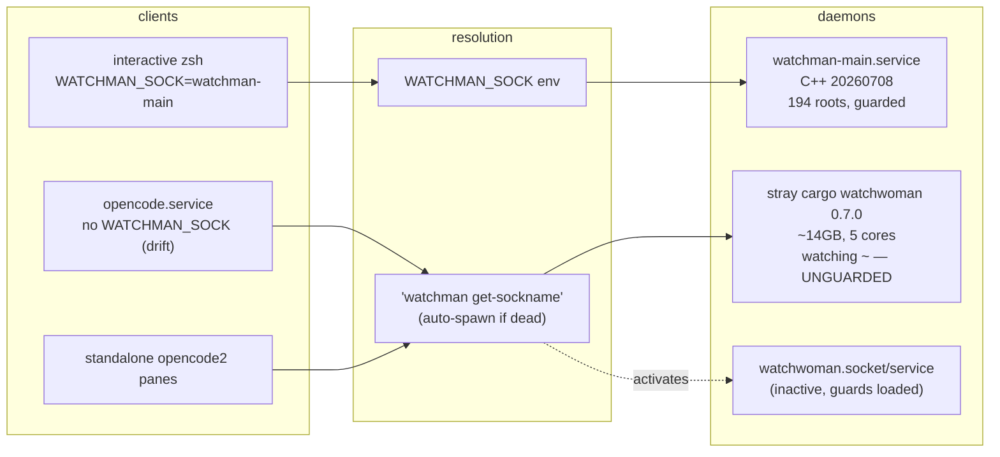

# Watcher operations — scarcity, dueling daemons, and the cutover

> **Model note:** this session could not determine its underlying model identity;
> `unknown` is deliberate, not a guess from the OpenCode harness.

## What is up

We run three generations of file-watcher infrastructure on one box, and they are
actively dueling:

- **watchman-main** — upstream Facebook watchman (C++, getdeps build) as a user
  systemd service ([`watchman.srv.pb`](../watchman.srv.pb) + build in
  [`watchman.src.pb`](../watchman.src.pb)), deployed after the 2026-08-31
  watchwoman fire as the safe incumbent.
- **watchwoman** — the radiosilence fork's `systemd` branch (workspace
  `~/src/watchwoman-systemd`, deployed at `/opt/watchwoman-git` via
  [`watchwoman.src.pb`](../watchwoman.src.pb)): socket-activated, root-policy
  guarded, and freshly loaded with root-blocking + file caps + bounded session
  queues + tick fast-path work. **Not yet flipped back into service.**
- **opencode** — the managed `opencode.service`
  ([`opencode.src.pb`](../opencode.src.pb)) now runs the root-scoped watchman
  backend from the `opencode-watchman` stack. Its transport, when
  `WATCHMAN_SOCK` is unset, bootstraps a **private daemon** by shelling out
  `watchman get-sockname` — and inside that unit's PATH, `watchman` resolves to
  a **stale, unguarded cargo-installed watchwoman** in `~/.cargo/bin`.

The user-facing symptoms: "opencode keeps launching their own watch
[wo]men", daemons competing for sockets, and two live incidents found while
writing this doc (see [Live snapshot](#1-live-snapshot-2026-09-01)). A big
watchwoman build and a large opencode-watchman plugin stack are both about to
deploy. This document is the operational map: what exists, why the resources
are scarce, what guards exist, how to cut over cleanly, and what tooling to
build next. The original snapshot predates the follow-up playbook changes;
the current declared architecture is recorded in [Current correction](#current-correction),
but those declarations have not been applied to the host yet.

## Current correction

The intended architecture is one canonical socket, not one socket per daemon:

`~/.local/state/watchman/<user>-state/sock`

Both `watchman-main.service` and `watchwoman.socket` now declare that same
path. Their units mutually conflict, so starting one stops the other rather
than allowing two daemon namespaces. OpenCode is also declared to use this
path and the managed `/usr/local/bin/watchwoman` client explicitly. The C++
watchman CLI's compile-time default is symlinked to the same canonical state
directory.

The host remains in the manually switched state until the playbooks are
applied: watchwoman owns the canonical socket, watchman-main is stopped, and
the current OpenCode process must be restarted to inherit the updated
declaration. Do not treat the source playbook change as applied until
`/proc/<MainPID>/environ` and the watcher status checks agree.

Naming note: "watchwoman-browse" was mentioned in conversation; no such
directory exists. The main watchwoman workspace is `~/src/watchwoman-systemd`
(jj workspace, `systemd` branch). `~/src/walgit-browse` is unrelated.

## 1. Live snapshot (2026-09-01)

> **Superseded within hours** — the cutover happened the same evening; see
> [Addendum: the flip](#addendum-the-flip-2026-09-01-evening) for the timeline,
> what was fixed on the host, and what remains. This snapshot is kept as the
> record of the failure modes, not of current state.

Read-only inspection, ~17:00 EDT. This section is a *drift report*; it will go
stale, and going stale is exactly what we currently have no tool to notice.

### Two active incidents

**Stray unguarded watchwoman, running now.** pid `4069438`,
`/home/rektide/.cargo/bin/watchman --sockname
/home/rektide/.local/state/watchman/rektide-state/sock --foreground-daemon`:

- Spawned 2026-09-01 03:18:26 EDT — four seconds after `opencode.service`
  restarted (03:18:22). Its `/proc/4069438/environ` contains the
  `opencode.service` memory-pressure path and `OPENCODE_WATCHER_BACKEND=watchman`;
  its parent is now `systemd --user` (the spawning opencode child exited and the
  daemon was orphaned into the user manager).
- That binary is a `cargo install`ed watchwoman 0.7.0 from **2026-08-30 18:01**
  — one day *before* root-blocking, file caps, the ignore floor, and bounded
  session queues landed. It runs **allow-all, no config** (no
  `WATCHWOMAN_CONFIG_FILE` in its environment).
- Its `watch-list` holds **12 roots including `/home/rektide` itself** — the
  exact 32M-file root that killed two daemons on 2026-08-31 — plus
  `~/.agents/skills`, `~/.config/opencode`, `~/.opencode`,
  `~/src/opencode-working`, `~/src/opencode-watchman`, `~/src/opencode-bus-smart`,
  `~/src/opencode-otel`, and two atproto-skills roots.
- At inspection: **~14 GB RSS, 265 GiB VSZ, ~500 % CPU (five cores), 13.5 h
  uptime**, 13 established client connections (several with kilobytes of
  backpressured queue). It is crawling and eventing the home tree *right now*,
  feeding the perpetual "skills rescanned" churn visible in the opencode
  journal.

**watchman-main crash-looped 80 times.** Between 14:00 and 16:41 EDT,
`watchman-main.service` exited with status 1 roughly every 68 s
(`NRestarts=80`; each generation: ~55 s CPU, 2 GB memory peak, then death).
Because the state file is only written on graceful shutdown (last saved 15:04,
22 KB), every generation re-crawled its **194 roots** from scratch — the
20 MB daemon log contains **16,760 `full-crawl` lines**. The generation started
16:41:15 has held (serving `clock` commands normally as of 16:50). The exit-1
cause is not yet diagnosed (see [Open questions](#10-open-questions)).

### Wiring facts (all verified live)

| Fact | State |
| --- | --- |
| `watchman-main.service` | enabled, active; managed C++ watchman on `~/.local/var/lib/watchman-main/sock`; 194 roots; `takeover.sh` ExecStartPre armed |
| `watchwoman.socket` / `watchwoman.service` | enabled but **inactive** (stopped after the fire; flip-back staged, not executed) |
| Stray daemon | owns `~/.local/state/watchman/rektide-state/sock` — **the exact path `watchwoman.socket` will bind** |
| `opencode.service` env | `OPENCODE_WATCHER_BACKEND=watchman`, `OPENCODE_WATCHMAN_COMMAND_TIMEOUT_MS=240000`, **no `WATCHMAN_SOCK`** (verified via `/proc/<MainPID>/environ`) |
| [`opencode.src.pb`](../opencode.src.pb) `ENV` | **does** set `WATCHMAN_SOCK` → watchman-main sock — the deployed env **predates the playbook** (render drift) |
| `watchman` resolution *inside the opencode unit* | PATH has mise shims + `~/.cargo/bin` **before** `/usr/local/bin` → resolves to the stale cargo watchwoman |
| `watchman` resolution in login shells | `/usr/local/bin/watchman` → C++ getdeps build (`watchman.src.pb`) |
| Interactive shells | `~/.zshrc` exports `WATCHMAN_SOCK=~/.local/var/lib/watchman-main/sock` — twice, in two separate manual blocks (~lines 263 and 334, both also export `OPENCODE_WATCHER_BACKEND`) |
| `/usr/local/bin` watchwoman links | `watchwoman`, `watchmanctl`, `watchman-diag`, `watchman-make`, `watchman-wait` → `/usr/local/src/watchwoman-git/repo/target/release/…` (Aug 30); the classic name `watchman` is **not** linked to watchwoman — the C++ binary owns it |
| `watchman-healthcheck.{service,timer}` | legacy self-healer (`~/.local/libexec/watchman-healthcheck`, Aug 13) that `rm`s the state file and restarts the unit on a failed probe; **not in any current playbook**; service static, timer enabled-but-inactive |
| `/opt/opencode-git` | symlink → `~/tmp-opencode/oc-render` (a render scratch dir; that env even bakes `DIR=/home/rektide/tmp-opencode/oc-render`). The live unit actually consumes `/usr/local/src/opencode-git/{env,bin/serve.sh}` and `/etc/opt/opencode-git` units. The alias is stale drift. |
| inotify sysctls | `max_user_watches=3,000,000` (65536 → 1,048,576 → 16M on 2026-08-31 after the 1M pool was exhausted → 3M on 2026-09-03: ~1 KB/watch kernel mem made 16M's worst case ~16 GiB, 3M caps it at ~3 GiB), `instances=8192`, `queued_events=65536` — owned by [`sysctl-fs-inotify.etc.pb`](../sysctl-fs-inotify.etc.pb) |

### Root overlap (why "dueling" is literal)

The stray's `~` root **subsumes all 194 of watchman-main's roots**, and several
are *also* explicitly held by both daemons (`opencode-working`,
`opencode-watchman`, `opencode-bus-smart`, atproto-skills, …). Every write in
those trees costs at least two inotify registrations and fires at least two
event streams (nested-root double-firing was one of the fire's amplifiers).

## 2. The cast

| Actor | Where it lives | Role |
| --- | --- | --- |
| [`watchman.src.pb`](../watchman.src.pb) | compfuzor | builds C++ watchman via getdeps into `/usr/local/src/watchman-git` |
| [`watchman.srv.pb`](../watchman.srv.pb) | compfuzor | `watchman-main.service` (user, global artifacts), root-marker guard, takeover, CLI symlink farm, status/guard-refusal reporters |
| [`watchwoman.src.pb`](../watchwoman.src.pb) | compfuzor | `/opt/watchwoman-git` deploy: socket+service units, root policy JSON, ignore floor, compat LINKS record, `init-watchmanconfig.sh`, status reporter |
| [`sysctl-fs-inotify.etc.pb`](../sysctl-fs-inotify.etc.pb) | compfuzor | inotify pools + `usage.sh` consumption reporter |
| `~/src/watchwoman-systemd` | jj workspace, `systemd` branch | the fork: socket activation, root policy, caps, bounded queues, tick fast path, fan-out sharing; `.design/root-blocking/` post-mortem + staged deploy |
| `~/src/opencode-watchman` | opencode fork workspace, `watchman` bookmark | root-scoped watchman backend plugin stack (25 commits, freshened onto `v2@origin` `43d09b9d`), `.design/watchman/` corpus |
| `~/src/opencode-working` | composed jj workspace | what `opencode.src.pb` builds and deploys (carries the watchman stack — the running service proves it) |
| `/usr/local/bin/watchman` (C++), `~/.cargo/bin/watchman` (cargo watchwoman), `/usr/local/src/watchwoman-git/repo/target/release/watchwoman` | three binaries, one classic name | see [§3](#3-socket-and-name-resolution) |
| `~/.local/libexec/watchman-healthcheck` + units | legacy, unmanaged | pre-`takeover.sh` self-healer; dormant; deliberate-retirement candidate |
| `opencode-manager.{src,srv}.pb` | compfuzor | unrelated (a web UI that supervises opencode processes) — not the restart tooling remembered in conversation |

## 3. Socket and name resolution

Four socket paths, three `watchman` binaries, two resolution protocols. This
matrix is the whole Duel in one table.

| Socket path | Owner today | Who resolves there |
| --- | --- | --- |
| `~/.local/var/lib/watchman-main/sock` | `watchman-main.service` (C++) | shells via `~/.zshrc` `WATCHMAN_SOCK`; the opencode unit *would* use it once the playbook env deploys; the C++ CLI via its compile-time-state symlink (see below) |
| `~/.local/state/watchman/<user>-state/sock` | **stray cargo watchwoman** | watchwoman's default (`XDG_STATE_HOME` layout, `%h/%u` in the socket unit); the opencode transport's `watchman get-sockname` answer; the compat LINKS target |
| `/usr/local/src/watchman-git/watchman/var/run/watchman/<user>-state/sock` | symlink → watchman-main var dir | the **C++ CLI's compile-time default** — it ignores `$WATCHMAN_SOCK`; `install-cli-symlink.sh` maintains this |
| `/usr/local/var/run/watchman/<user>-state/sock` | compat LINKS → watchwoman default path | clients that hardcode upstream watchman's default prefix |

| Binary | Identity | Reached by |
| --- | --- | --- |
| `/usr/local/bin/watchman` → `/usr/local/src/watchman-git/watchman/bin/watchman` | upstream C++ watchman `20260708.*` | login shells (`/usr/local/bin` first non-mise entry) |
| `~/.cargo/bin/watchman` | **watchwoman 0.7.0, cargo install, Aug 30 — pre-guard, allow-all** | anything running with the mise/cargo PATH — including `opencode.service` |
| `/usr/local/src/watchwoman-git/repo/target/release/watchwoman` (+ `watchman` argv[0] alias when linked) | the `systemd` branch build with all guards | `/usr/local/bin/watchwoman` etc.; intended future owner of the classic name |

Resolution rules that bite:

1. The **C++ CLI ignores `$WATCHMAN_SOCK`**; it computes its socket from the
   compile-time `WATCHMAN_STATE_DIR` macro. Env-based routing only works for
   python/node/rust clients and watchwoman's CLI.
2. The **opencode transport honors `$WATCHMAN_SOCK`**, else shells out
   `watchman get-sockname`, and (watchman-family behavior) **auto-spawns a
   daemon if the socket is dead** — in whatever cgroup and with whatever binary
   `PATH` gives it.
3. systemd socket activation inverts (2): while `watchwoman.socket` is active
   the path is *always* bound, `get-sockname` answers instantly, and a
   connecting client *activates the managed service* instead of spawning a
   private daemon. Socket activation is the structural fix for the spawn
   problem; the env pin is the belt-and-braces.



## 4. Why opencode keeps spawning daemons

Mechanics, end to end:

1. `opencode.service` starts; the root-scoped watchman backend is selected
   (`OPENCODE_WATCHER_BACKEND=watchman`).
2. The transport needs a socket. `WATCHMAN_SOCK` is unset in the **deployed**
   env (render drift — the playbook has since added the pin), so it runs
   `watchman get-sockname`.
3. In the unit's PATH, `watchman` is `~/.cargo/bin/watchman` — the stale cargo
   watchwoman.
4. If the resolved socket (`~/.local/state/watchman/rektide-state/sock`) is
   dead, the CLI spawns a daemon **inside the unit's cgroup**; the daemon
   outlives its spawner, is reparented to `systemd --user`, and becomes an
   unmanaged orphan. If the socket is alive (today: the stray), it is reused —
   which is why the stray persists across opencode restarts instead of stacking.
5. Every root the daemon accepts, it crawls. The cargo build predates all
   guards, so it accepted `~`. The oscillation described in the post-mortem
   (subscribe giant root → 20-minute crawl → client gives up → root GC'd →
   retry) is live again, currently at ~14 GB and five cores.

What fixes it, in layers:

- **Deploy the env pin** — re-render `opencode.src.pb` so the unit carries
  `WATCHMAN_SOCK` (playbook already has it) → no `get-sockname`, no spawn.
- **Socket activation** — with `watchwoman.socket` owning the default path, a
  spawn becomes a managed activation instead of an orphan.
- **Kill the escape surface** — the cargo `watchman` must stop being reachable
  (see [Cutover](#7-cutover-watchman--watchwoman)); a stale binary nobody
  manages is exactly how a guarded fleet regains an unguarded daemon.
- The **plugin side** already routes tightly (explicit `watch <project root>`,
  never `watch-project`, route-stage failures fatal, reconnect backoff capped
  at 2 s) and can be pointed at a specific binary via
  `OPENCODE_WATCHMAN_BINARY`.

## 5. Scarcity model

The watcher world competes for four shared pools. None of them are per-daemon;
they are **per-user**, shared by every daemon, every opencode session
(~dozens of `opencode2` processes), and every editor.

| Pool | Budget | Owner | Failure mode |
| --- | --- | --- | --- |
| `fs.inotify.max_user_watches` | 3,000,000 (~1 KB each, kernel mem, **non-swappable**; worst case ~3 GiB on a 62 GiB box — 16M 2026-08-31 → 3M 2026-09-03) | [`sysctl-fs-inotify.etc.pb`](../sysctl-fs-inotify.etc.pb) | `inotify_add_watch` ENOSPC → notify-rs `MaxFilesWatch` (watchwoman journal) or silent recrawl storms (C++); new watchers anywhere fail |
| `fs.inotify.max_user_instances` | 8,192 fds | same | one `inotify_init()` per process; ~60 opencode sessions + daemons — rarely the cap, but non-trivial |
| fds (`LimitNOFILE`) | 524,288 per unit | unit files | EMFILE segv-loops under hundreds of roots (the reason both units carry the limit) |
| RAM / CPU | box-wide | — | per-root `Tree` in RAM: the 2026-08-31 fire peaked **41.1 GB + 16.8 GB swap + 20 h CPU** (gen 1) and **36.1 GB + 31.5 GB swap in 23 min** (gen 2) |

Multipliers that turn a pool into a fire:

- **No watch sharing across daemons.** Two daemons holding the same root
  register it twice and fan events twice. Today the stray's `~` root subsumes
  *all 194* of watchman-main's roots — the home tree is being watched, crawled,
  and evented in parallel by two processes.
- **Cold restart = full re-crawl.** Neither daemon persists its tree (C++
  persists root *list* only on graceful exit — today 22 KB, mostly stale);
  every restart re-crawls every root while dozens of clients reconnect and
  re-subscribe. watchman-main's 80-generation crash loop burned ~55 s CPU and
  2 GB **per generation** doing exactly this.
- **Unbounded consumers poison everyone.** The 1M-watch pool was exhausted
  during the fire era (raised to 16M on 2026-08-31); a poisoned C++ state dir
  is the classic cause of `jj`/fsmonitor hangs (why `takeover.sh` and the
  healthcheck exist at all).
- **Idle-but-live roots still cost.** watchman-main holds 194 roots including
  big archive checkouts; watchwoman reaps stale/dead roots (2-day idle pin in
  the playbook env), the C++ daemon never does.

Implication for design: the scarce thing is not "a daemon" but *a consistent,
guarded, single owner per watch*. Every additional daemon — however small —
multiplies consumption of all four pools and adds a routing ambiguity that
regenerates the spawn problem.

## 6. Three generations of guards

| Generation | Mechanism | Catches | Misses |
| --- | --- | --- | --- |
| watchman-main ([`watchman.srv.pb`](../watchman.srv.pb)) | `enforce_root_files` marker walk-up ([.git .hg .jj .watch]); `takeover.sh` foreign-pidfile reclaim; CLI compile-time-socket symlink farm; guard-refusal log aggregation | bare `~`/`~/src` requests *that resolve past no marker*; auto-spawned daemons that grab the pidfile | anything with a marker (`~/archive/anomalyco/opencode` **is** a repo); no size cap; no memory defense |
| watchwoman `systemd` branch ([`watchwoman.src.pb`](../watchwoman.src.pb) + staged config) | daemon-side `root_policy` (exact/subtree, first-match, fail-closed startup, SIGHUP reload with `canceled` PDUs); `max_files_per_root` 2M physics cap; 100k warn; global ignore floor; bounded session queues; tick fast path; socket activation | **any client, any binary, any retry** — refusal is a cheap error PDU with stable prefix `root blocked by policy:`; slow readers are disconnected, not buffered against | graceful-shutdown hang still open (mitigated `TimeoutStopSec=15s`); only applies to *binaries that carry the code* |
| opencode plugin (`opencode-watchman` stack) | root-scoped interests; explicit `watch <root>` only; route-stage failures fatal (no retry loop); reconnect backoff ≤ 2 s; `WATCHMAN_SOCK`/`OPENCODE_WATCHMAN_BINARY`; channel metrics | its *own* misbehavior: tight roots, no giant-root requests, no retry oscillation | old builds / other clients / other binaries — which is why the daemon-side layer exists |

The live stray is the proof of the "misses" column: a binary from before all
of this, reachable by PATH, running allow-all. **Guards are properties of the
deployed binary, and deployment surface is part of the security boundary.**

## 7. Cutover: watchman → watchwoman

Target topology (the endgame [`watchwoman.src.pb`](../watchwoman.src.pb) already
describes):

- `watchwoman.socket` owns `~/.local/state/watchman/<user>-state/sock`,
  activated at `sockets.target`; the managed, guarded `systemd`-branch daemon
  serves everything.
- opencode: unit env pins `WATCHMAN_SOCK` to that socket (or relies on
  activation-aware `get-sockname`); plugin metrics on.
- Exactly one `watchman` on PATH — the managed watchwoman workspace build
  owning the classic name, as the playbook intends.
- watchman-main either retired (stopped, disabled, masked) or kept as a cold
  fallback with its unit deliberately disabled — decide once (open question).

### Ordered runbook (merges the flip-back checklist, cutover.sh scope, and gentle-restart choreography)

1. **Build and link the new watchwoman** from `~/src/watchwoman-systemd`
   (`bin/build-rust.sh`; jj workspaces do not share `target/` — see the
   flip-back checklist's build-path gotcha). Link per the playbook; the classic
   name moves to watchwoman.
2. **Quarantine the escape surfaces first**: remove/rename the cargo
   `~/.cargo/bin/watchman{,ctl,-diag,-make,-wait,woman}` set (they are one day
   stale *forever*), and decide the fate of `/usr/local/bin/watchman` → C++.
   Nothing may respawn an unguarded daemon while clients migrate.
3. **Re-render and redeploy opencode** so the unit env carries the socket pin
   (playbook edit — deliberately *after* this doc; today the deployed env
   predates the pin). Restart gently: `systemctl --user restart
   opencode.service`, wait for `/api/health`, confirm the transport connected
   to the intended socket.
4. **Terminate the stray** (deliberate, manual, after step 2–3 so nothing
   respawns it): `kill <pid>` / `shutdown-server` against its socket. Expect
   opencode skills/config watchers to reconnect against the new routing.
5. **Confirm the path is free** — nothing may claim
   `~/.local/state/watchman/<user>-state/sock` (`ss -xl`, `lsof`) — then
   `systemctl --user start watchwoman.socket`. First client connection
   activates the service.
6. **Verify policy**: `watchman -j <<< '["debug-policy", "/home/rektide"]'`
   must deny; a project dir must allow; `["watch-project", "/home/rektide"]`
   must return the `root blocked by policy` error; `watch-list` bounded.
7. **Migrate interactive shells**: retire the manual `~/.zshrc` exports in
   favor of the playbook's ZIM env contribution (or one canonical manual
   block) pointing at the watchwoman socket.
8. **Retire watchman-main** (or park it): `systemctl --user disable --now
   watchman-main.service` (+ mask if it must never resurrect). Its 194 roots
   re-establish wherever clients ask next.
9. **Watch the first hour**: `watchman status` (bounded roots, flat memory),
   journal for `MaxFilesWatch` (pool, not rlimit — see the playbook note),
   opencode watchman metrics dumps, `usage.sh` watch consumption.

Restart semantics during and after (from the gentle-restart design): restart
**only `watchwoman.service`**, never the socket, in routine operations; the
socket unit keeps the path bound and queues connects (no `ECONNREFUSED` gap,
socket inode stable across restarts — empirically verified). Policy-only
changes: `SIGHUP`, never a restart. Treat every restart as a cold-cache event;
schedule quietly. Do not run `watchwoman install-unit` (it would overwrite
compfuzor's managed symlinks).

### Hazards

- **Never start the socket while the stray lives** — systemd unlinks and
  rebinds the path; the stray keeps its listener fd and watches as an
  unreachable zombie. Kill first (step 4 strictly after 2–3).
- **Killing the stray before repointing opencode** just means the next
  opencode restart spawns a fresh one. Ordering is the whole game.
- **Both watch playbooks are installed** — their ZIM env contributions duel by
  design (`ZIM_ENV_PHASE` ordering; watchwoman's deliberately wins). Pick one
  production daemon and let the docs say which.
- The **compat LINKS record** and the **C++ CLI symlink farm** both point at
  paths that change hands during cutover; verify both after the flip.
- **Legacy actors**: `watchman-healthcheck.*` would `rm` state and restart
  watchman-main if its timer ever re-activates; `/opt/opencode-git` aliases a
  tmp render. Both are deliberate-retirement items, not auto-prunes.

## 8. Tooling inventory (what exists, where it lives)

| Tool | Location | What it does |
| --- | --- | --- |
| **cutover.sh** (the "slick" one remembered in conversation) | `~/src/opencode-watchman/.test-agent/watchman-cutover/` (+ README) | dry-run-first migration of standalone `opencode2 --standalone` tmux panes off a competing socket: discovers clients by **socket peer inodes** (no bind-race assumptions), maps pids→tmux panes, terminates them, waits for zsh, sends shell resets. Explicitly leaves `opencode.service` and old daemons alone. |
| **Flip-back checklist** (the "root-blocker stuff") | `~/src/watchwoman-systemd/.design/root-blocking/deploy/README.md` | staged `watchwoman.json` payload, env additions, ops commands, and the upstream→watchwoman flip procedure (build-path gotcha included) |
| **Root-blocking post-mortem** | `~/src/watchwoman-systemd/.design/root-blocking/root-blocking.unknown.md` | the 2026-08-31 fire, both daemon deaths, the oscillation, companion-hardening addenda |
| **Gentle-restart design + runbook** | `~/src/watchwoman-systemd/design/gentle-restart/gentle-restart.unknown.md` | socket-activation restart choreography, empirically verified; policy-reload vs restart vs socket-change procedures |
| watchman-main reporters | `/srv/watchman-main/bin/` (from `watchman.srv.pb`) | `status-watchman.sh` (identity/guard/linger/inotify drift), `guard-refusals.sh` (names silent offenders), `takeover.sh`, `install-cli-symlink.sh` |
| watchwoman reporters | `/opt/watchwoman-git/bin/` (from `watchwoman.src.pb`) | `status-watchwoman.sh` (drift, get-sockname/XDG check), `init-watchmanconfig.sh` (seed per-root ignore floor + root marker) |
| inotify usage | `/etc/opt/fs-inotify-git/bin/usage.sh` (from `sysctl-fs-inotify.etc.pb`) | per-user watch/instance consumption, top consumers |
| opencode ops | `/usr/local/src/opencode-git/bin/` (from `opencode.src.pb`) | `status.sh`, `status-cleanup.sh`, global `opencode-status-ok` (shell-vs-managed drift), `cleanup.sh` + timer |
| watchman metrics reading guide | `~/src/opencode-watchman/.design/watchman/metrics0.glm53.md` | decoding the plugin's `watchman_metrics` dumps: symptom→field table, jq recipes |
| plugin maintenance log | `~/src/opencode-watchman/.design/watchman/README.md` | the 25-commit stack, config table (all `OPENCODE_WATCHMAN_*` knobs), verification record |

## 9. Gaps and next tools

The canonical socket, OpenCode routing, restart helper, service-scoped inotify
status, and 3M pool declaration are now in clean playbook commits. Per house
rules, cleanup is **deliberate**: detectors and reporters are welcome; nothing
here should auto-kill or auto-reconcile.

1. **`watcher-status` — one drift reporter for the whole duel** (the manual
   recipe from [§1](#1-live-snapshot-2026-09-01) as a script; registerable in
   `STATUSES`):
   - units table (`watchman-main`, `watchwoman.socket/service`, healthcheck
     timer) with active/enabled/NRestarts;
   - **stray detector**: every `watchman|watchwoman` process not in the two
     managed units' cgroups (`systemctl --user show -p ControlGroup` vs
     `/proc/<pid>/cgroup`) — today it would name pid 4069438;
   - sockets: claimant (unit vs stray), peer counts, queued bytes;
   - per-daemon `watch-list` and the **overlap set** between daemons;
   - env wiring matrix: unit env vs `~/.zshrc` vs playbook `ENV` (drift = the
     §1 finding), plus `watchman` binary resolution in each context's PATH;
   - pool pressure via `usage.sh` + sysctl values.
2. **`restart.sh` for `opencode.src.pb`** is implemented: it checks
   `NeedDaemonReload` → `daemon-reload` if unit changed → `restart` → waits for
   `/api/health` → verifies MainPID and the inherited `WATCHMAN_SOCK`. It never
   touches standalone panes.
3. **`watcher-repoint.sh`**: validate a target daemon (alive, policy answers
   `debug-policy` correctly) → perform the env re-render/restart sequence of
   the cutover §7 steps 3–4 → re-run the drift reporter. This is cutover.sh's
   "system service migration" gap.
4. **cutover.sh v2** (still in its `.test-agent` home): parameterize
   old/new sockets (it hardcodes watchman-main today), add `--report` mode
   without side effects, and coordinate with `restart.sh` instead of punting
   the system service.
5. **Deployment-surface hygiene items** (deliberate, human-approved removals
   only): cargo watchwoman bin set; `watchman-healthcheck.*` units +
   libexec script; `/opt/opencode-git` → tmp-render alias; duplicate
   `~/.zshrc` export blocks; decide the owner of `/usr/local/bin/watchman`.
6. **Render-drift guard**: the deployed env predating the playbook is how the
   spawn regressed invisibly. A status check comparing the live unit env
    against the playbook's declared `ENV` (the §1 method) belongs in
    `status-opencode-ok.sh`'s checks or `watcher-status`.

The existing watcher reporters now provide the canonical-service portion of
item 1 directly: `status-watchman.sh` and `status-watchwoman.sh` enumerate
inotify file descriptors only in their respective managed service cgroups.
The existing `/etc/opt/fs-inotify-git/bin/usage.sh` remains the whole-user
pool view for finding other consumers.

## 10. Open questions

1. Diagnose watchman-main's exit-1 crash loop (14:00–16:41, 80 generations,
   ~68 s each) — daemon log has binary content mixed in; correlate journal
   generations with log tails before the log trims.
2. Keep watchman-main as a deliberately manual fallback, or retire its
   playbook after watchwoman is proven? The units are now mutually exclusive,
   so retaining it no longer creates a second socket namespace.
3. Should the canonical socket be moved from the upstream XDG path later? Any
   such change must update both daemon units, OpenCode, CLI routing, compat
   links, and the status reporters together.
4. Flip `root_policy.default` to `deny` (with allow carve-outs) once the rules
   prove out, per the post-mortem's own open question?
5. Who owns the classic `watchman` name during transition? The source
   declarations now explicitly pin OpenCode to `/usr/local/bin/watchwoman`,
   but the host's existing PATH and `/usr/local/bin/watchman` link still need
   deliberate cleanup during playbook application.
6. Should `watcher-status` and friends live in a compfuzor playbook (which
   type?) or as `opencode-watchman` `.test-agent` graduates?

## Cross-references

- [`root-blocking.unknown.md`](/home/rektide/src/watchwoman-systemd/.design/root-blocking/root-blocking.unknown.md) — the fire, the policy design, landed addenda; prior art for everything in §6.
- [`deploy/README.md`](/home/rektide/src/watchwoman-systemd/.design/root-blocking/deploy/README.md) — staged flip-back payload; §7 step 1–6 sources.
- [`gentle-restart.unknown.md`](/home/rektide/src/watchwoman-systemd/design/gentle-restart/gentle-restart.unknown.md) — restart choreography §7 relies on.
- [`cutover.sh`](/home/rektide/src/opencode-watchman/.test-agent/watchman-cutover/cutover.sh) — the peer-inode client discovery §9 reuses.
- [`.design/watchman/README.md`](/home/rektide/src/opencode-watchman/.design/watchman/README.md) — plugin config table, metrics, verification.
- [`watchman.srv.pb`](../watchman.srv.pb), [`watchwoman.src.pb`](../watchwoman.src.pb), [`opencode.src.pb`](../opencode.src.pb), [`watchman.src.pb`](../watchman.src.pb), [`sysctl-fs-inotify.etc.pb`](../sysctl-fs-inotify.etc.pb) — the playbooks this doc maps.
- [`arch.md`](arch.md) — compfuzor's compile/apply model; why guards belong in applied daemon binaries, not renders.

## How this snapshot was taken

Every claim in §1 is reproducible read-only (no bare `watchman` invocations —
those can spawn daemons; always `--no-spawn --no-local --sockname=…`):

```sh
systemctl --user list-units 'watchman*' 'watchwoman*' 'opencode*'
systemctl --user show <unit> -p MainPID -p NRestarts -p ActiveEnterTimestamp
ps -o pid,ppid,rss,vsz,etime,%cpu,args -p <pid>
tr '\0' '\n' < /proc/<pid>/environ | rg -i 'watch|xdg|home|^PATH='
ss -xl; ss -xp | rg 'watch'          # listeners, peers, queued bytes
lsof -nU | rg '<socket path>'
/usr/local/bin/watchman --no-spawn --no-local --sockname=<sock> watch-list
journalctl --user -u watchman-main.service --since '8 hours ago'
tail ~/.local/var/lib/watchman-main/log
rg -v PASSWORD /usr/local/src/opencode-git/env
```

Update this section when re-running the drift report, and expect the numbers to
have moved.

# Addendum: the flip (2026-09-01 evening)

Written by the same session as the body, later the same day. The body's §1
snapshot was historical by ~21:00. All times EDT.

## Timeline

- **03:18** — `opencode.service` restart spawns the cargo stray inside its
  cgroup (unguarded upstream 0.7.0, allow-all). It quietly accepts `~`.
- **14:00–16:41** — `watchman-main` crash-loops 80 generations (exit 1 every
  ~68 s; each gen re-crawls 194 roots, ~55 s CPU / 2 GB). Cause still
  undiagnosed; the 16:41 generation held.
- **~17:00** — this doc's snapshot taken: stray at ~14 GB RSS / 5 cores /
  13.5 h; total inotify usage **1,996,190 watches** (stray 1.39 M,
  watchman-main 604 k = 99.8 % between the two daemons).
- **19:36–19:46** — manual flip: cargo reinstall (still unguarded),
  watchwoman units started from an Aug-30 build, stray + watchman-main
  killed, opencode restarted — but its env still pinned the dead
  watchman-main socket, so the transport silently fell back to Parcel.
- **20:01–21:10** — playbook re-render wave (committed in-repo): canonical
  naming lands — **`watchman.socket` / `watchman.service` are the canonical
  units**, the C++ fallback is renamed **`watchman-facebook.service`** with
  `Conflicts=` both ways; staged `watchwoman.json` policy deployed; env
  wired (`WATCHWOMAN_CONFIG_FILE`, stale-idle pin); opencode consumes
  `WATCHMAN_CANONICAL_SOCKET_ABS` from common vars; `restart.sh` lands with
  a post-check that the service's `WATCHMAN_SOCK` matches expectations.
- **21:10–23:33** — the unit-managed daemon ran the *unguarded* build for
  2 h 22 m and peaked **27.5 GB RSS + 7.7 GB swap** — fire #3 in progress,
  stopped only by the replacement below. Its stop needed the SIGKILL
  ceiling (`TimeoutStopSec=15s`): the graceful-shutdown hang remains open.
- **23:33** — guarded build installed: relinked the fork workspace's six
  bins into the deploy workspace (`/usr/local/src/watchwoman-git/repo`,
  which symlinks to the archive default workspace — one canonical file),
  gentle service-only restart with the socket left bound.
  **Verified live:** `debug-policy /home/rektide` → `allowed: false, "deny
  exact ~: home root: 32M files, two daemon deaths"`; project dirs allowed;
  clients reconnecting through socket activation.

## Host cleanup performed

- Quarantined the unguarded cargo set to `~/.cargo/bin/quarantine-20260901/`
  (it was also first in the opencode unit's PATH — the respawn vector).
- Pruned orphaned mise shims (`mise reshim`) that claimed `watchman`/`watchwoman`.
- Disabled `watchman-healthcheck.timer` (legacy self-healer that would try to
  resurrect the old watchman-main world).
- Repointed `~/.zshrc` `WATCHMAN_SOCK` to `~/.local/state/watchman/$(id -un)-state/sock`.
- Removed the C++ compile-time cli-route symlink (it had been repointed at
  the watchwoman path; with the classic name on watchwoman the C++ CLI is
  off-PATH and an explicit invocation should spawn nowhere near the live
  socket).

## Numbers after the flip

- inotify total: **1,996,190 → 3,785 watches** (48 instances) once both old
  daemons died; the managed daemon's roots re-grow as clients re-watch,
  bounded by the root policy + 2 M file cap + ignore floor.
- `fs.inotify.max_user_watches` playbook value dialed **16,777,216 → 3,000,000**
  (safe: the old watchman-main steady state was 604 k). The live sysctl still
  reads 16 M until the playbook applies (needs sudo).
- `status-inotify.sh` (fs-inotify) now reports per-user pool totals + top
  consumers in every `status.sh` run; both watcher statuses report
  **canonical-service cgroup-scoped** consumption, per the "canonical service
  only, not other instances" requirement.

## Remaining

1. **Restart `opencode.service`** (the 19:46 process still carries the dead
   watchman-main socket in its environment and is on Parcel fallback — 0
   peers on the canonical socket). `{{DIR}}/bin/restart.sh` is the intended
   path once the re-rendered deploy is in place. `exec zsh` in live shells
   for the same reason.
2. Apply the 3 M sysctl (playbook run with sudo).
3. Deliberate retirement list: `/srv/watchman-main` artifacts,
   `~/.local/var/lib/watchman-main`, the quarantined cargo bins, the
   `/opt/opencode-git` → tmp-render alias, and the `watchman-healthcheck.*`
   units themselves.
4. Diagnose the graceful-shutdown hang (watchwoman open issue) and the
   watchman-main exit-1 crash loop (moot if watchman-facebook stays
   retired, but unexplained).
5. The duel's structural lesson held all evening: **every escalation
   involved an unguarded binary reaching a socket** — cargo install, mise
   shim, PATH ordering, render drift. Canonical naming + Conflicts + the
   env pin + socket activation close all four vectors; keep them closed.


# Addendum: endpoint naming normalized (2026-09-01, later session)

The §3/§7 material above predates the final naming decision. The converged
contract, centralized in `vars/common.yaml` and consumed by
`watchman.srv.pb`, `watchwoman.src.pb`, and `opencode.src.pb`:

| Name | Kind | Owner |
| --- | --- | --- |
| `watchman.socket` | endpoint unit (classic name), `ListenStream=%S/watchman/%u-state/sock` | watchwoman playbook |
| `watchwoman.service` | daemon unit (implementation-named), socket-activated | watchwoman playbook |
| `watchman.service` | unit-name alias → the same unit file; `watchman.socket`'s implicit pairing activates through it, so `systemctl status watchman` works | LINKS record |
| `watchman-facebook.service` | C++ fallback, link-only, `Conflicts=watchman.socket` | watchman playbook |
| `/usr/local/bin/watchman` | watchwoman build (classic client name) | watchwoman playbook |
| `/usr/local/bin/watchman-facebook` | C++ build | watchman playbook |

The old `watchman-main.service` unit name is gone (it was compfuzor's generic
`TYPE-main` deployment name leaking into a unit because `watchman.srv.pb`
never overrode `SYSTEMD_SERVICE`; `watchwoman.src.pb` always overrode its unit
names — that was the whole asymmetry). `-main` legitimately survives only on
the srv deployment dir and the legacy socket alias.

Verified live after migration: alias-based activation works on systemd 261,
`enable` on the socket enables only the socket, one daemon process owns the
canonical XDG socket, all three pathname aliases resolve to one inode, and
starting either endpoint contender stops the other.
